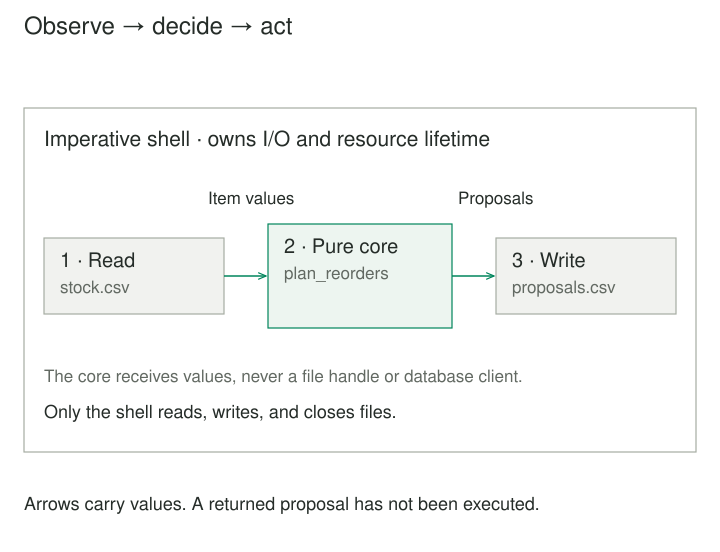
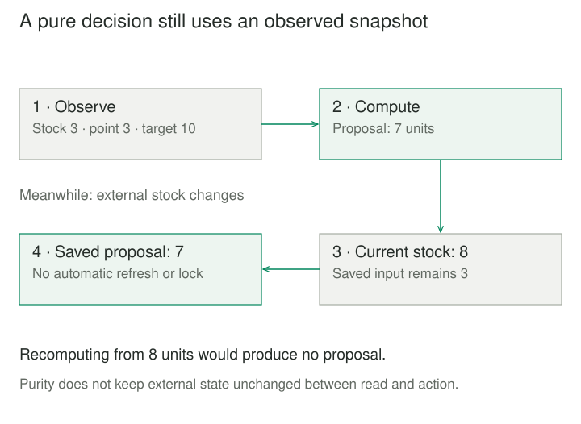

## Purpose and problem

A warehouse script reads inventory rows, checks stock levels, and writes replenishment proposals inside the same loop. Testing whether the reorder threshold is inclusive requires creating files and inspecting output. If a later row is invalid, the script may already have written earlier proposals.

The program must interact with files, but the replenishment rule is a decision about numbers and identifiers. Interleaving those responsibilities makes business cases depend on I/O setup and makes execution order harder to inspect.

## Core idea

**Functional Core, Imperative Shell** separates computation from interaction with the outside world. The core accepts values and returns values without observable side effects. The shell obtains those inputs, calls the core, and performs the required effects using its results.

The mental model is **observe → decide → act**. Gary Bernhardt's public [2012 episode description](https://www.destroyallsoftware.com/screencasts/catalog/functional-core-imperative-shell) describes a functional Twitter-client core surrounded by imperative code handling input, display, storage, and networking. His [Boundaries talk description](https://www.destroyallsoftware.com/talks/boundaries) emphasizes simple values as boundaries between subsystems.

Functional Core / Imperative Shell and Functional Core and Imperative Shell are spelling variants here. The shell is ordinary application code, not necessarily a command-line interpreter. The arrangement can live inside a single application or an individual service.



## How it works

### Give the core facts rather than access

A pure function's result depends on its explicit inputs. It does not read a clock, query a database, mutate caller-owned objects, or send messages. If a rule needs today's date, the shell supplies a date value. Injecting a callable that reads the current clock makes testing easier but does not make that call pure.

Mark Seemann's [functional architecture example](https://blog.ploeh.dk/2016/03/18/functional-architecture-is-ports-and-adapters/) demonstrates the distinction: passing a database-reading function into a capacity rule differs from reading first and passing the resulting number.

Core code can use local builders that do not escape as shared mutable state. Python does not enforce purity; preserving this boundary is an implementation discipline. Immutability does not require avoiding every local assignment.

### Interpret results in the shell

The returned value may be a total, a validated record, a proposed state transition, or descriptions of actions to perform. Returning an action description does not execute it. The shell interprets that result, owns file handles and connections, and handles operational failures.

Seemann's [impure/pure/impure composition](https://blog.ploeh.dk/2020/03/02/impureim-sandwich/) gathers external data, computes, then changes external state. It explains a common execution shape of this architecture, rather than requiring every application to perform one enormous read followed by one enormous write. Multiple rounds may be appropriate when later information depends on an earlier decision.

### Separate repeatability from consistency

The same input values should produce the same result or validation failure. That makes business cases easy to exercise without a database or mock interaction script. Integration checks still need to cover the shell's parsing, resource lifetime, and actual effects.

A stable input value is not necessarily a current or transactionally consistent observation. Two fields read separately may describe different moments. Concurrent updates, write conflicts, retries, and publication guarantees need their own design; purity supplies none of those automatically.



## Worked example

### Compute the complete proposal before opening output

Before separation, each row's decision immediately writes output. Afterward, the shell loads item values, the core validates the batch and returns proposals, and only then does the shell open the destination. A validation error therefore occurs before output is opened.

Save these three files together and run `python3 demo.py` with Python 3.10 or later. Only the standard library is needed. The demo owns a temporary directory and removes it after displaying the generated CSV.

**core.py — values and a pure replenishment rule**

```python
from dataclasses import dataclass


@dataclass(frozen=True)
class Item:
    sku: str
    on_hand: int
    reorder_point: int
    target: int


@dataclass(frozen=True)
class Proposal:
    sku: str
    units: int


def plan_reorders(items: tuple[Item, ...]) -> tuple[Proposal, ...]:
    seen, proposals = set(), []
    for item in items:
        if not isinstance(item.sku, str) or not item.sku.strip():
            raise ValueError("SKU must be nonblank text")
        if item.sku in seen:
            raise ValueError("Duplicate SKU")
        seen.add(item.sku)
        counts = (item.on_hand, item.reorder_point, item.target)
        if any(type(n) is not int or n < 0 for n in counts):
            raise ValueError("Counts must be nonnegative integers")
        if item.target < item.reorder_point:
            raise ValueError("Target must not be below reorder point")
        if item.on_hand <= item.reorder_point and item.target > item.on_hand:
            proposals.append(Proposal(item.sku, item.target - item.on_hand))
    return tuple(proposals)
```

**shell.py — acquire values, compute, then write**

```python
import csv
from pathlib import Path
from core import Item, plan_reorders


def generate_reorders(source, destination):
    if Path(source).resolve() == Path(destination).resolve():
        raise ValueError("Input and output paths must differ")
    with open(source, encoding="utf-8", newline="") as stream:
        items = tuple(
            Item(row["sku"], int(row["on_hand"]),
                 int(row["reorder_point"]), int(row["target"]))
            for row in csv.DictReader(stream)
        )
    proposals = plan_reorders(items)
    with open(destination, "w", encoding="utf-8", newline="") as stream:
        writer = csv.writer(stream)
        writer.writerow(("sku", "units"))
        writer.writerows((p.sku, p.units) for p in proposals)
```

**demo.py — a real file round trip**

```python
from pathlib import Path
from tempfile import TemporaryDirectory
from shell import generate_reorders


with TemporaryDirectory() as directory:
    source = Path(directory) / "stock.csv"
    destination = Path(directory) / "proposals.csv"
    source.write_text(
        "sku,on_hand,reorder_point,target\n"
        "pen,3,3,10\n"
        "pad,4,3,10\n", encoding="utf-8"
    )
    generate_reorders(source, destination)
    print(destination.read_text(encoding="utf-8").strip())
# sku,units
# pen,7
```

All counts are whole units of the identified product. At the inclusive reorder point, `pen` needs seven units to reach ten. `pad` is above its point and produces no proposal. A target equal to current stock produces no zero-unit proposal. Input order is preserved, duplicate identifiers are rejected, and an empty batch produces only the output header.

The core's local list and set never escape. Its result is a tuple of frozen records containing strings and integers; it does not change the input tuple. Python's [dataclass documentation](https://docs.python.org/3/library/dataclasses.html#frozen-instances) explains that frozen fields are not general deep immutability.

The shell expects the four named CSV columns and integer text for counts. It closes input before computing and opens output afterward. Python's [CSV guidance](https://docs.python.org/3/library/csv.html) supports its newline handling; [file context management](https://docs.python.org/3/tutorial/inputoutput.html#reading-and-writing-files) closes handles even on exceptional exits.

Output is a proposal file, not a purchase or stock update. Opening it for writing replaces an existing destination. A write failure may leave partial output; this code promises no atomic file replacement, durable commit, or concurrent inventory protection.

## When to use it

Use this arrangement when many policy branches are tangled with relatively straightforward I/O: eligibility, pricing, validation, scheduling, or reconciliation decisions. For reproducibility, preserve the inputs alongside rule and configuration versions.

For example, reading the current date belongs to the shell, while comparing an explicit date with an expiry date belongs to the core. A tiny file-copy command with almost no policy may need only a clear procedure.

## Tradeoffs and common mistakes

**Hidden effects behind an abstraction.** A repository or injected function can still perform I/O. Naming a module “core” or replacing a dependency with a fake does not establish purity.

**Reading everything for architectural neatness.** Loading an entire data set costs memory and may fetch irrelevant information. Use bounded batches or staged decisions when needed, and make consistency requirements explicit.

**Treating a plan as a completed effect.** A returned proposal has not been persisted, sent, or accepted. If execution partly succeeds, recovery must distinguish completed work from remaining intent. Recomputing a pure value does not make repeating its effects safe.

**Leaving the shell untested.** Serialization, permissions, file closure, failure ordering, and transaction boundaries can fail independently of the rule. A small shell narrows these checks; it does not eliminate them.

## Related patterns

[[ports-and-adapters|Ports and Adapters]] separates application behavior from technology. This pattern emphasizes the additional boundary between pure value-based computation and effects.

[[dependency-injection|Dependency Injection]] supplies collaborators from outside. It can help wire the shell, while an injected I/O collaborator remains effectful.

[[command|Command]] represents an operation as a request. A core can return command descriptions for the shell to interpret; purity depends on keeping their execution outside the core.

[[data-transactional-outbox|Transactional Outbox]] records publication intent with a local state change. It can support reliable effect execution where merely returning a plan is insufficient.

## Sources

Bernhardt's [Functional Core, Imperative Shell episode description](https://www.destroyallsoftware.com/screencasts/catalog/functional-core-imperative-shell) establishes the named arrangement; the public [Boundaries page](https://www.destroyallsoftware.com/talks/boundaries) supplies its value-boundary context. Seemann's [functional architecture](https://blog.ploeh.dk/2016/03/18/functional-architecture-is-ports-and-adapters/) and [impureim sandwich](https://blog.ploeh.dk/2020/03/02/impureim-sandwich/) articles develop the relationship between pure computation and external effects.

The replenishment scenario, Python implementation, and figures are original teaching material. Attribution uses the accessible author descriptions and articles; it does not claim access to the subscription screencast.
