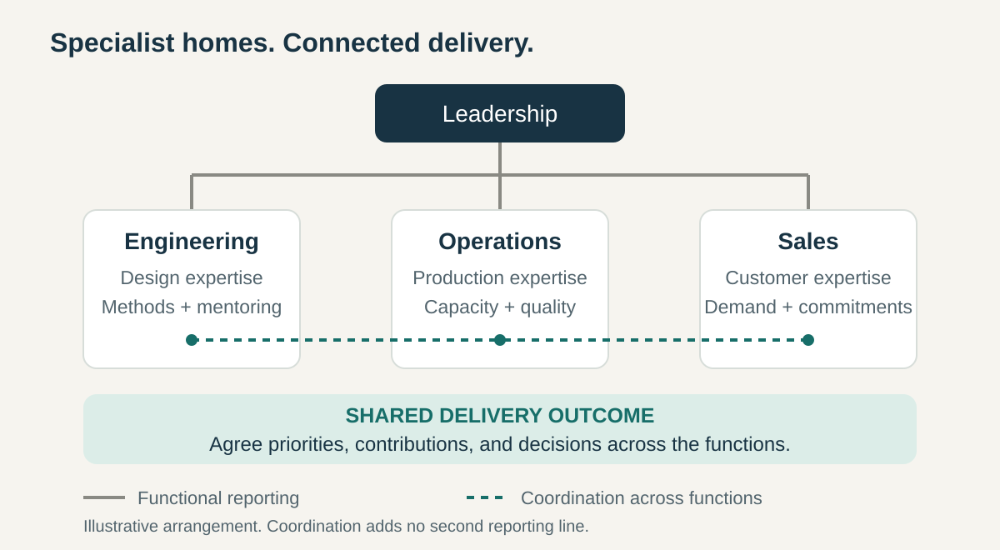

**Core question:** How can we concentrate expertise and use specialist resources efficiently while delivering work that crosses disciplines?

## What it is for

A growing equipment maker needs mechanical design, purchasing, assembly, and sales. Its product lines share many of the same skills. Creating a separate specialist department for every product would stretch scarce expertise and repeat investments in tools and training.

Functional Organization gives each discipline a continuing home. Engineers develop engineering capability; operations manages production; sales develops customer relationships. Their contributions combine to deliver the offering.

The pattern can organize a whole enterprise or operate inside a larger division. It is useful when several activities draw on a common body of expertise and maintaining that capability matters beyond the next project.

## The core idea

**Group people by specialist discipline and give functional leaders responsibility for developing that capability and coordinating its contribution to the organization.**

People belong primarily to a function, such as engineering, operations, or marketing. That function supplies expertise across products, projects, or customers. Its leader usually manages staffing, professional development, methods, and priorities within an agreed scope.

The grouping principle distinguishes this arrangement from a divisional organization, where a product or market unit contains several functions, and a matrix, where formal authority runs along multiple dimensions. Galbraith describes these as different choices about the basis of authority, each preserving some advantages while creating coordination costs elsewhere. [Galbraith, _Matrix Organization Designs_](https://jaygalbraith.com/wp-content/uploads/2024/03/galbraithmatrix1971.pdf)

Having an engineering department alone does not establish that the entire company is functionally organized. The question is which grouping provides the principal home for people, resources, and authority at the level being examined.

## How it works

**Establish the specialist homes.** Group related work where shared knowledge, tools, supervision, and learning justify it. A function may contain further specialties as it grows.

**Make authority and commitments explicit.** Functional managers allocate people and maintain standards. Work spanning functions still needs an owner, agreed contributions, and a way to resolve competing priorities. Professional authority over a design does not automatically confer authority over a launch date or customer promise.

**Coordinate across the boundaries.** A product launch needs engineering readiness, production capacity, and sales preparation to come together. Named counterparts, shared plans, and regular reviews can connect these contributions. Routine coordination can happen directly between colleagues.

**Escalate conflicts selectively.** If two functions cannot resolve a tradeoff within their authority, an agreed leader or forum decides. Sending every interaction through senior management makes leadership a queue.

In the equipment-maker illustration, the engineering head decides how to assign scarce test expertise. The launch owner agrees the required test result and date with engineering and operations. If the commitment conflicts with another product, the relevant leaders settle the priority together.

## Why it works

Specialist work often requires a community that lasts longer than any assignment. Colleagues can review one another’s judgments, maintain common methods, and train newcomers. Managers with relevant expertise are better placed to assess technical work when they also have the skills and time to manage people.

Pooling resources can also make expensive capabilities viable. One laboratory or specialist group may support several offerings whose individual demand would not justify separate facilities or teams.

These benefits depend on demand fitting the shared capacity. Pooling can create a queue when many projects need the same specialists simultaneously. Functional Organization concentrates expertise; its effectiveness also depends on how the resulting dependencies are managed.

## Examples

### Apple: expertise shared across products

In their 2020 account, Apple University’s Joel Podolny and Morten Hansen describe the reorganization that followed Steve Jobs’s return in 1997. Separate business units were combined into functional departments under one company-wide profit-and-loss responsibility.

Their camera example makes the mechanism tangible. A substantial camera-hardware group brought specialists together under a leader with camera expertise, serving several product lines. The arrangement preserved a concentrated technical community instead of distributing it among separate product businesses. Hardware, software, and other specialists still had to make joint product decisions. [Podolny and Hansen, _How Apple Is Organized for Innovation_, 2020](https://www.apple.com/careers/pdf/HBR_How_Apple_Is_Organized_For_Innovation-4.pdf)

The same account emphasizes deep technical understanding and collaborative debate among leaders. Expertise was one part of the operating arrangement; the departments also needed to reconcile their contributions. This is a dated illustration, not evidence that adopting Apple’s chart reproduces its results.

### GitLab: functional reporting with stable counterparts

GitLab’s public handbook, consulted in October 2026, describes a functional management hierarchy in which each employee has one manager. It separates technical leadership through project roles from formal reporting authority. The handbook also acknowledges that subject expertise does not remove the need to train and support managers. [GitLab, _No Matrix Organization_](https://handbook.gitlab.com/handbook/leadership/no-matrix-organization/)

Its organizational-structure guidance describes product groups connected through stable counterparts from functions including product, engineering, and design. These groups coordinate work without creating another reporting hierarchy. [GitLab, _Organizational Structure_](https://handbook.gitlab.com/handbook/company/structure/)

The transferable distinction is between where people report and how they collaborate. Functional homes can coexist with enduring relationships around products. This combines functional authority with coordination across departments; it does not require every assignment to climb and descend the management chain.

## Useful when

- **Expertise is scarce or expensive.** Several offerings need access to the same specialists, equipment, or facilities.
- **Capabilities need continuity.** Standards, mentoring, and professional development must outlast individual assignments.
- **Work has substantial common ground.** Products or customers draw on similar methods and resources.
- **Dependencies are manageable.** Functions can agree priorities and commitments without continually requiring intervention from the top.

## Common mistakes and limits

**Optimizing departments separately.** Engineering can maximize design output while production waits for usable specifications. Local measures need to sit alongside measures of the shared result.

**Assuming the chart supplies coordination.** Reporting lines identify managers. They do not establish who owns a customer outcome, what another department has promised, or when unresolved conflicts will be decided.

**Making expertise a permission bottleneck.** Routing every small choice to the functional head undermines the benefit of having capable specialists. Delegate decisions within clear limits.

**Confusing technical distinction with management ability.** Coaching, fair evaluation, and workload management require development and attention. A strong practitioner may need support before supervising others effectively.

**Ignoring differences between businesses.** When products or regions need sharply different priorities and rapid local decisions, a divisional arrangement may fit better. Where two dimensions genuinely need formal authority, a matrix deserves consideration along with its conflict-resolution costs.

These are tradeoffs to examine, not a sequence in which growing organizations must abandon functions. A useful warning sign is that leaders spend increasing time arbitrating routine handoffs while customers wait for work that is already finished inside individual departments.

## Related patterns

- [[teamwork-optimize-the-whole|Optimize the Whole]] keeps departmental improvements connected to the overall result.
- [[teamwork-coordinate-dependencies-early|Coordinate Dependencies Early]] turns required contributions between functions into explicit working commitments.
- [[teamwork-clarify-decision-rights|Clarify Decision Rights]] establishes which choices belong to specialists, functional leaders, or people responsible for the shared outcome.
