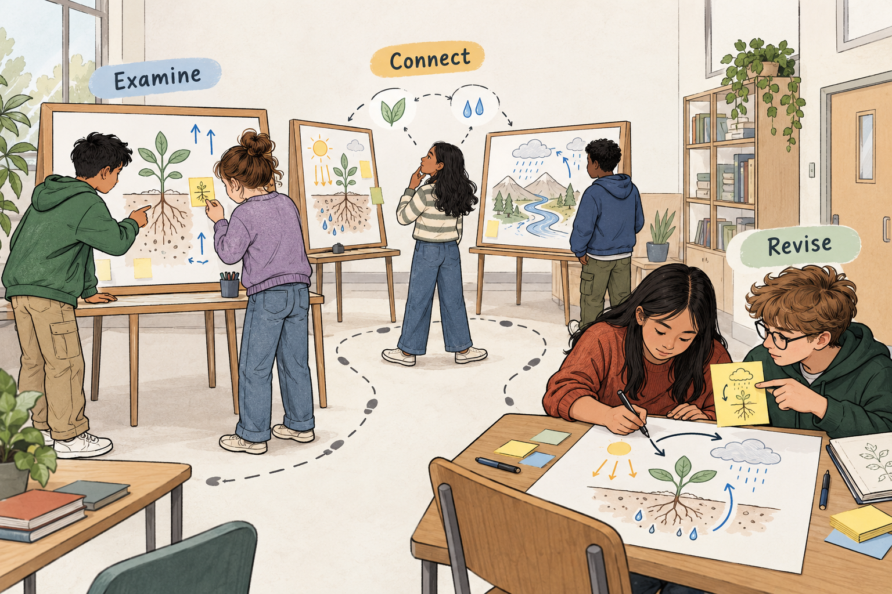

## Let ideas travel beyond the group that made them

Six groups have produced six posters. Each group understands its own work reasonably well. The teacher invites everyone to walk around and look at the others.

Learners circulate, leave comments such as “Good explanation” and “Nice diagram,” and return to their seats. The posters have received attention, but the ideas have barely interacted.

A Gallery Walk can make those encounters more substantial. Learners examine work distributed around a room or shared digital space, discuss what they notice, and leave contributions that others can use. They then connect what they encountered to their own thinking.

The central opportunity is to make each group’s work a resource for learning across the class.

## Give the visit an intellectual purpose

Gallery Walks take several forms. Stations might contain questions that successive groups develop, sources that learners compare, or drafts that invite critique. For improving ideas beyond the original group, work in progress is especially useful: there is still something to change.

The basic structure combines preparation, examination, contribution, and synthesis. Groups make their thinking inspectable. Visitors receive a clear task. Their observations remain available at each station. Learners eventually return to interpret the contributions and decide what follows.

[Carleton’s Science Education Resource Center](https://serc.carleton.edu/introgeo/gallerywalk/step.html) describes a structured rotation in which groups respond to prompts and previous contributions, while the teacher monitors discussion and helps bring the work together.

Movement organizes access to the material. The learning task determines what learners do when they arrive.

## A classroom example: equal area, equal boundary?

Imagine a mathematics class investigating a question:

*“If two rectangular gardens have the same area, must they need the same length of fencing?”*

Groups prepare posters showing an answer, supporting examples, and an explanation. They have already studied area and perimeter.

One group draws a four-by-six rectangle made from 24 unit squares. Its poster argues that another arrangement of the same squares should need the same fencing because “the amount of garden stays the same.”

The teacher organizes a Gallery Walk before the groups finalize their answers. Visitors must examine the reasoning, test it with another example, and leave a specific question or contribution.

At this poster, Lina’s group tries a two-by-twelve rectangle. It also contains 24 unit squares, but its perimeter is 28 units rather than 20.

They leave a sketch with both calculations and a question: “How does your explanation account for these two boundaries?”

At another station, they encounter a diagram that colors only the outside edges. Their own group had been counting edges inconsistently. They note how the representation distinguishes the boundary from edges inside the shape.

When the original group returns, its members initially suspect a calculation mistake in the feedback. They check the example, trace both boundaries, and recognize that equal area does not establish equal perimeter.

They revise their poster to include the counterexample and explain the distinction: area measures the surface covered; perimeter measures the outer boundary.

Lina’s group also revises its work, borrowing the idea of highlighting the boundary while acknowledging where they encountered it.

During the final discussion, the teacher asks which contribution changed each group’s explanation. The class examines both the counterexample and the clearer representation. The posters have become working material for one another.

## Make feedback usable

Specificity matters more than the number of comments collected.

“Explain more” leaves the authors guessing. “Your diagram shows the final arrangement, but I cannot see how you counted its boundary” identifies a gap they can address.

Useful contributions can take different forms: a question about an assumption, a counterexample, a connection to another station, or a suggestion grounded in shared criteria.

Before the walk, briefly examine contrasting examples of feedback. Learners should understand what makes a comment useful and how to connect it to the work.

Authors can also display a question they want visitors to consider. [Project Zero’s Gallery Walk guidance](https://pz.harvard.edu/sites/default/files/Gallery-Walk.pdf) recommends specific feedback and distinguishes walks involving work in progress from those displaying completed work.

Giving feedback can inform the visitor’s thinking too. In the mathematics example, examining someone else’s claim gave Lina’s group a reason to test its own counting method.

## What the evidence supports

A qualitative study by Catarina Santos and Ana Barbosa examined written peer feedback during a geometry Gallery Walk in one fifth-grade class of 19 learners. The researchers found that feedback varied in usefulness; clear comments focused on mathematical content, solution processes, and results were particularly helpful. [Santos and Barbosa, 2023](https://eric.ed.gov/?id=EJ1399520)

This small, interpretative study offers insight into how feedback functioned in that setting. It does not establish that Gallery Walks reliably outperform other teaching methods.

Comparison, explanation, and revision are plausible mechanisms for learning here. Their presence depends on the task. A busy room and crowded comment sheets provide little evidence by themselves.

## Return to the work

Reserve time for authors to process what they received. They should distinguish a misunderstanding caused by their presentation from a substantive objection to their reasoning. Both can matter, but they require different responses.

Receiving a suggestion does not create an obligation to accept it. Groups can explain which feedback they used, which they questioned, and why. The teacher helps resolve factual errors and draws attention to insights that deserve wider consideration.

An individual reflection afterward can reveal learning hidden by the group product: which idea did the learner reconsider, and what evidence prompted the change?

## Adapt the gallery to the learners

The method suits tasks where comparison adds value: alternative solutions, historical interpretations, scientific models, design proposals, or developing arguments.

Visitors need enough knowledge to examine the work. Provide criteria or background where necessary. Keep displays readable and the number of stations manageable; several careful encounters may be more useful than a rushed visit to every poster.

The work can travel instead of the learners. Tabletop exchanges, accessible digital documents, or projected examples can preserve the intellectual structure. Online, assign contributions clearly so some pieces do not receive all the attention while others receive none.

Within groups, brief individual noticing before discussion can help ensure that the designated recorder does not become the only person thinking.

## Avoid collecting comments without using them

Common mistakes include treating praise as sufficient feedback, rewarding polished presentation over reasoning, repeating earlier comments, and ending as soon as rotation finishes.

Peer comments can also contain errors. The teacher remains responsible for monitoring the material and clarifying misunderstandings. Allowing several groups to repeat a claim does not make it sound.

**Peer Review** supplies criteria for examining drafts. **[[jigsaw-learning|Jigsaw Learning]]** distributes complementary knowledge through peer teaching. **[[think-pair-share|Think–Pair–Share]]** can help visitors develop observations before contributing.

A productive Gallery Walk leaves traces in the work afterward: a claim qualified, an explanation clarified, a connection added, or a question made more precise.
