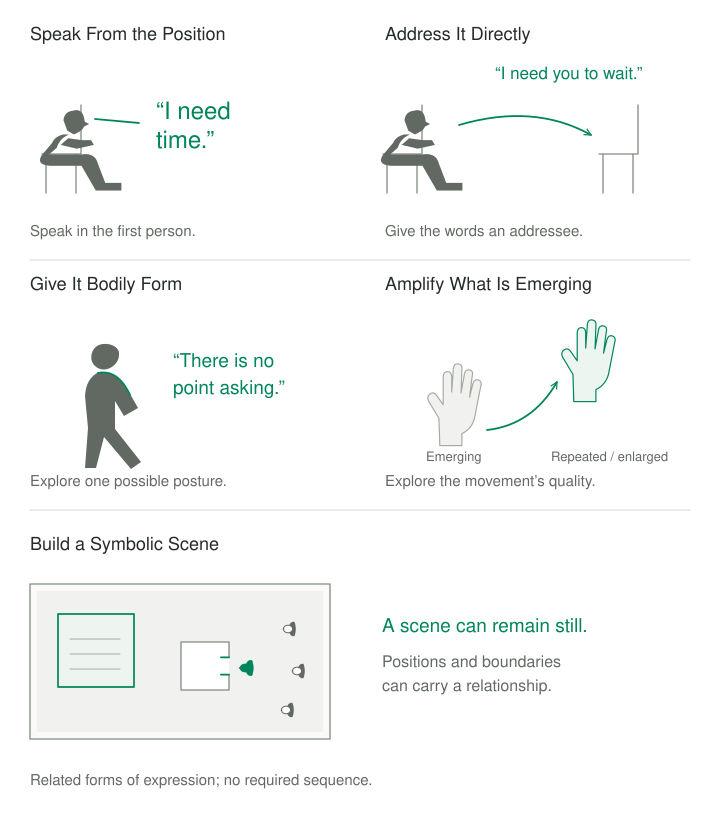

Nora can explain what happens when a colleague changes their shared plans. She becomes accommodating, loses track of her preferences, and feels resentful afterward. She has a name for it: people-pleasing. Yet knowing the name has not helped her recognize the moment when agreement replaces choice.

As she describes a recent exchange, she smiles and briefly lifts a hand. There is something more particular here than the general explanation. A sentence, a gesture, or the combination might help her encounter it.

## The difficulty this pattern addresses

An explanation can leave out what it is like to occupy the position being explained. A person knows that they avoid conflict but has little contact with the expectation that makes agreement urgent. They understand a wish intellectually while struggling to recognize it as their own.

Consider the difference between saying that disagreement is difficult and addressing an imagined partner with the words, “I expect you to become cold toward me if I say what I want.” The second expression specifies a relationship, an anticipated consequence, and something at stake. Speaking it might bring recognition, expose a missing qualification, or feel completely wrong. Each response gives the exploration somewhere more specific to go.

Expression can also remain incomplete. Words describe resignation while the hands seem ready to push something away. That difference invites inquiry: perhaps several responses coexist, or perhaps the movement has an ordinary physical explanation. An observer cannot settle its meaning by looking.

Sometimes an additional account adds little. What may help is a concrete form in which the person can discover more of the experience they are describing.

The difficulty need not be insufficient understanding. Someone may already know what matters but struggle to remain in contact with it when another person is imagined or present. Giving the experience a form can help a discovered meaning become more personally accessible. At other times, the meaning emerges only through expression. Discovery and articulation can develop together.

## The core move

**Give an experience a concrete, voluntary expression and attend to what happens while engaging with that form.**

The form might be a first-person sentence, words addressed to an imagined person, a posture, a facial expression, a small movement, a drawing, or a scene constructed with objects. It can express what is already understood or help discover something not yet clear.

Some forms are enacted: the person speaks from a position or inhabits it bodily. Others are constructed and encountered: a scene in sand can remain still while its arrangement becomes meaningful. Both can make experience more available without requiring a role performance or a complete verbal explanation. Enactment is one important member of this broader family.

The expression answers to the person's experience. They can recognize it, change it, find it artificial, or decline it. What matters is whether the form makes something available for contact and discovery. A quiet sentence may do this; a dramatic performance may not.

Two kinds of fidelity matter. The form needs to remain connected to something the person recognizes, and the therapist needs to remain responsive when that recognition changes. An initially useful sentence can become too absolute. A larger gesture can lose the quality of the original movement. A role that seemed clear can reveal a different concern once inhabited.

Enacting a position also leaves decisions about its accuracy and practical implications open. A person can recognize “I expect rejection” while knowing that rejection is uncertain. They can give anger a voice without deciding to confront someone. Expression makes the position available for encounter; it does not appoint that position to govern behavior.

This distinguishes the pattern from rehearsal of a preferred response. Rehearsal may develop a new ability, while enactment can begin with the existing difficulty itself. Nora might first discover how she makes herself agreeable before considering how she wants to respond differently.

## How the experience unfolds

Giving experience a form introduces a feedback relationship: something is expressed or constructed, engaging with it produces a response, and that response informs what happens next. Engagement might mean speaking, moving, looking, arranging, or quietly remaining with an image. The following subpatterns emphasize different aspects of this relationship and can combine.

### Speak From the Position

A person expresses a perspective in their own voice: “I need to stay agreeable because I expect an objection to become an argument.” Speaking it may reveal that a word fits poorly, a consequence is missing, or another response is also present. The statement can remain provisional—what the person knows so far.

Someone may discover that this wording is too broad: the urgency appears only with people who debate every hesitation. That correction changes a global identity into a particular expectation. First-person wording alone does not establish contact; a person can repeat a therapist's sentence fluently while feeling little connection to it. Hesitation or a less impressive statement may bring the expression closer to experience.

### Address It Directly

The expression acquires an addressee. “I am afraid of disappointing my father” becomes a sentence spoken to an imagined father. The particular relationship may make the stakes clearer. Direct address can also be explored with a feeling: “Fear, I keep trying to silence you because I don't know what will happen if I listen.” This is an expressive possibility, without requiring a literal person inside the feeling.

An imagined addressee can be present without an imagined answer. Speaking may be enough to reveal what is difficult to say. If an answer is imagined, it belongs to the person's representation of the relationship. Addressing a feeling can likewise express the person's current relationship to it without supplying a reply or assuming its purpose in advance.

### Give It Bodily Form

A state is explored through posture, facial expression, movement, or tone. Someone describing resignation might discover how they hold their shoulders or let a sentence trail away. An intentionally assumed expression can feel unfamiliar, exaggerated, accurate, or unhelpful. Its meaning remains open to the person's account.

For instance, a person gives “there is no point asking” a bodily form: shoulders slightly forward, gaze lowered, mouth held still. Inhabiting it reveals that they are also listening intensely for the other person's next demand. What looked like disengagement includes vigilance. Changing to a supposedly confident posture would have missed that discovery.

Facial expression can be explored in the same spirit. Making an appeasing smile more noticeable might reveal its effort or intended effect. Trying a different expression can clarify what is feared when reassurance is absent. The comparison concerns this person's experience; it does not identify the correct face for a feeling or establish that a deliberately assumed expression is more authentic.

### Amplify What Is Emerging

Here the starting point is an expression already appearing: a brief hand movement, a change in voice, or a fleeting look. Repeating or modestly enlarging it may make its direction or quality easier to notice. Amplification changes the expression, so what emerges need not be an exact reproduction of its original meaning.

### Build a Symbolic Scene

Experience takes an external, spatial form through figures, objects, images, and their relationships. What matters might be proximity, an opening, a boundary, something missing, or a quality for which there are not yet words. Sandtray work is one expression of this move; drawings and other object arrangements can offer related possibilities.

A person describing family pressure might arrange figures around one small figure and then notice the absence of any clear way to leave. The scene brings a relationship into view. It does not establish a diagnosis or require an immediate solution. A wall might feel protective to its maker, while an observer assumes it means imprisonment.

The scene can remain still. It need not acquire dialogue, a plot, or a better ending. Depending on the approach, a therapist may invite exploration, follow the person's comments, or witness the creation without immediate interpretation. The concrete form can matter before its meaning is fully articulated.

These forms do not constitute a required sequence. A gesture may suggest words, words may evoke a facial expression, or a symbolic arrangement may remain the most fitting expression. One sentence or one image can be enough.

### How different approaches implement the move

The five subpatterns describe forms of expression. They do not determine the therapeutic task. Two therapists can invite direct address for different purposes. One may be helping a person recognize an emotional expectation; another may be developing an exchange between self-critical and vulnerable positions. A symbolic scene can also be approached through different theoretical orientations. The comparisons below explain those differences. All illustrative encounters are fictional, rather than reports from the cited sources.

#### Coherence Therapy: articulate the emotional position that is operating

In Coherence Therapy, an overt statement gives explicit form to emotional knowledge that has become accessible. It can be addressed to an imagined emotionally relevant person. Ecker and Hulley's clinical accounts place this within discovery and integration: newly recognized material becomes something the client can experience and recognize more consistently. Their examples also distinguish an imaginal encounter from rehearsal for an actual conversation. [Depression case account](https://www.coherencetherapy.org/files/CaseEx-Depression.pdf), [panic case account](https://coherencetherapy.org/files/CaseEx-PanicAttacks.pdf).

The practical focus is the position that actually feels operative, including an uncomfortable expectation the person does not endorse intellectually. A socially desirable statement about what they ought to want can miss that position. The words remain open to correction as their implications become clearer.

For a fictional example, imagine someone who repeatedly postpones showing unfinished creative work to a mentor. “I should be less perfectionistic” summarizes a familiar judgment. Addressing the imagined mentor brings another statement: “I keep my drafts away from you because once you help, I don't think I'm allowed to reject your suggestions.”

The therapist's suggestion that this means they fear criticism fails to fit. The person revises it: they want feedback, but expect accepting it to create an obligation to follow it. The statement now includes the wish as well as the anticipated cost. Its usefulness lies in that recognition, rather than the force with which it is spoken.

An overt statement can also help make an already discovered meaning accessible again. It need not involve changing chairs, producing an imagined reply, or intensifying bodily expression. In this account, the distinguishing aim is accurate contact with the emotional position. Subsequent work with contradictory experience is a further task; speaking the statement does not by itself establish transformation or reconsolidation.

#### Gestalt therapy: explore what becomes apparent through expression

Yontef and Simkin describe Gestalt enactment through direct address, role play, and putting experience into words or action. They describe exaggeration as a particular form and frame enactment as a means of increasing awareness rather than a universal remedy or a requirement for catharsis. [Gestalt introduction](https://gestalt.org/yontef.htm?new_sess=1).

This gives the article's core move a broad experimental expression. The starting point might be a sentence, an imagined person, a recurring interaction, or an emerging movement. The question concerns what becomes noticeable while the person participates in the expression.

Imagine a person describing themselves as helpless while repeatedly rubbing their hands together. With agreement, they explore the movement. Making it larger initially feels theatrical. Returning to its original scale, they recognize a sense of preparation: they are waiting for permission to begin something they already know how to do.

Words emerge from the gesture: “I am ready, but I keep waiting for you to tell me I can start.” Addressing an imagined supervisor makes the expectation more specific. The discovery is neither a universal meaning of rubbing hands nor proof that the supervisor is preventing action. It is a personally recognizable relationship between readiness, permission, and waiting.

The example also shows why an experiment cannot be judged only by increased emotion. The useful development came through reducing the amplification and finding a more accurate expression. The expression could then be explored in relation to the person's actual circumstances.

#### Hakomi: study the immediate effects of a small somatic experiment

Hakomi explicitly includes repeating a gesture and physicalizing a self-state or emotional attitude among its somatic interventions. Its method overview emphasizes mindful attention to present effects and an experimental, nonviolent stance. [Hakomi method description](https://hakomiinstitute.com/about/what-is-hakomi/), [method overview](https://hakomiinstitute.com/overview-of-the-method/).

A useful way to understand the implementation is as a small agreed change surrounded by careful observation. What is proposed, what happens, and how the person describes it remain connected. The therapist's formulation can change with the response.

For example, someone says that they must be easy to have around. They notice themselves smiling while describing fatigue. An agreed exploration of that smile might reveal that it feels less like happiness than reassurance directed toward the listener. The person recognizes a wish to communicate, “You do not need to worry about me.”

They choose to explore letting the smile soften. This immediately feels as though they are making a demand. Rather than treating the expression without a smile as the correct or authentic face, the work follows that anticipated demand. The experiment has made a relationship between expression and obligation more accessible.

Physicalizing could approach a related issue from another starting point: the person describes an attitude of being constantly available and explores how that attitude takes bodily form. Repeating a gesture starts with an observed movement. These routes can reveal different information even when they concern the same general difficulty.

Supporting a defense is another possible intervention, but its purpose needs distinguishing. Taking over a protective effort seeks cooperation with that effort; enacting a self-state gives the state a form for exploration. An expression of protection may lead toward support, yet the two moves are not interchangeable. Neither requires the person to surrender the protective response to demonstrate progress.

#### Emotion-Focused Therapy: enact a particular emotional interaction

Individual Emotion-Focused Therapy uses distinguishable chair tasks. In self-critical two-chair work, the interaction between a critical position and an experiencing position becomes the subject. The Greenberg Institute describes therapist decisions about engagement, specificity, regulation, redirection, and ending unresolved work. [Self-critical two-chair work](https://www.greenbergiseft.ca/two-chair-dialogue-for-self-criticism).

Here it matters who is speaking to whom and how the message is received. Alternating positions can make the impact of an internal demand accessible. A person can explain a critic's argument while barely recognizing the experience of being addressed by it.

For example, a critical position insists that a person must answer every message immediately. From that position, the demand feels responsible and necessary. In the receiving position, the person notices exhaustion and fear, followed by a specific response: “I cannot think while you treat every pause as a failure.”

That response changes what can be explored. The original debate about laziness becomes an interaction involving urgency, pressure, and a need for time. A defiant sentence supplied by the therapist might miss this. The development depends on the person's actual response, including vulnerability or a need that initially seems less impressive than assertiveness.

Self-interruption is a related but different task. It brings an action that stops experience into an enacted relationship with the experience being stopped. The source descriptions include bodily tightening, changing the subject, and joking among possible interruptions, while emphasizing clinical decisions about when and how to work with them. [Self-interruption work](https://www.greenbergiseft.ca/eft-two-chair-self-interruption).

In a fictional encounter, someone turns every expression of hurt into a joke. Once this is recognized as a pattern they want to explore, the interrupting position might say, “Keep it funny so nobody has to respond.” The other position discovers loneliness at the prospect of never being taken seriously. The task concerns that particular interaction; laughter alone would not establish that an interruption is occurring.

#### Psychodrama: give the experience roles, relationships, and a scene

Psychodrama can organize enactment through a concrete scene, identified roles, and other participants representing figures or qualities. Its techniques include doubling, role reversal, and mirroring, with closure and de-roling marking the return from assigned roles. Scott Giacomucci's practice chapter describes this structure and these interventions. [Psychodrama practice chapter](https://link.springer.com/chapter/10.1007/978-981-33-6342-7_13).

The scene gives expression a spatial and relational setting. A person can speak from their own role, try another represented position, or observe a portrayal of their participation. A double offers tentative words that the person can accept or correct. Each change alters which aspect of the encounter is available for attention.

Imagine someone exploring a request for help. In the scene, they make the request and immediately withdraw it. A tentative double offers, “I don't want you to say no.” The person corrects this: “I can bear no. I don't want you to feel trapped into saying yes.” That difference redirects the enactment.

The scene can now explore what it is like to make a request while leaving room for an answer. If role reversal is used, the person might discover assumptions in their representation of the listener. If mirroring is used, they might notice how quickly they withdraw the request. These possibilities serve different purposes; they need not all occur.

The portrayal remains constructed. Another participant's response does not predict what an actual friend would do. Ending also belongs to the work: participants leave assigned roles and distinguish what they learned from the identities or obligations they temporarily represented. The experience may remain emotionally significant after the scene has ended.

#### Sandtray and Sandplay: let a symbolic world take shape

Sandtray approaches use sand, miniature figures, and spatial arrangements as a medium of expression. They can draw on different theoretical orientations, which affects how a tray is introduced and how the therapist responds to it. Kalffian Sandplay is a particular Jungian tradition. These are related uses of materials, with distinct clinical contexts. [International Association for Sandtray Therapy FAQ](https://sandtraytherapy.org/faq/).

The defining addition to this article's family is external symbolic form. A person can select, place, bury, separate, or surround figures, or shape the sand itself. A relationship that is difficult to describe can acquire a visible arrangement. The symbolic world may remain still; the person does not have to perform a character, speak for a figure, or narrate a story.

Credit: © 2021 Akimoto, Tanaka, Ito, Kubota, and Seiyama, Figure 2, “Inter-Brain Synchronization During Sandplay Therapy: Individual Analyses,” *Frontiers in Psychology*. [Original publication](https://www.frontiersin.org/journals/psychology/articles/10.3389/fpsyg.2021.723211/full), [CC BY 4.0](https://creativecommons.org/licenses/by/4.0/). Image unchanged.

In a fictional conversational sandtray encounter, someone describes feeling responsible for everybody. They arrange several figures facing a small house, with one figure standing at its doorway. They also place a walled garden some distance away. Looking at the scene, they notice that the figure at the doorway appears unable to turn toward the garden without leaving the others unattended.

The therapist's initial impression is that the wall represents exclusion. The person corrects this: the garden is a protected place where no one is waiting for an answer. The important difficulty is not being locked out, but feeling unable to leave the doorway. The scene gives room to distinguish being wanted, being needed, and being continually available.

Nothing requires the person to move the figure into the garden to produce a successful ending. They may want to remain with the arrangement, describe its implications, or leave it without further explanation. If changes occur, their significance also belongs to the person's experience rather than to a universal account of what a wall, house, or garden means.

This conversational example should not be generalized to Kalffian Sandplay. The Canadian Association of Sandplay Therapy describes an actively attentive witnessing relationship, with immediate interpretation generally deferred. The maker may comment or tell a story, but verbal explanation is not required to make the symbolic creation meaningful within that approach. [Sandplay Canada overview](https://sandplaycanada.ca/what-is-sandplay-therapy/).

The distinction changes what counts as responsive participation by the therapist. One setting may include invited discussion of relationships within the scene. Another may emphasize protecting the freedom to create and allowing symbolic development without immediate questioning or interpretation. A common material does not imply a common procedure.

Here, giving form includes constructing and encountering an image before its meaning is fully known. That broadens the family beyond enactment while preserving the particular significance of bodily action and direct address elsewhere in the article.

#### Comparing the implementations

The same outward form can serve different inquiries. In the comparisons above, the emphasis shifts among recognizing a particular emotional position, exploring an emerging expression, studying the effects of a small change, encountering an internal interaction, developing a scene through roles and perspectives, and allowing a symbolic world to take shape. These are selected emphases, not exhaustive definitions of the approaches.

A useful comparison therefore asks more than whether a therapist uses words, chairs, movement, or miniature figures. It asks what is being expressed, why this form fits the concern, what response guides the next move, and what would count as enough for the present encounter. The materials cannot answer those questions by themselves.

## A worked example

Nora describes a colleague announcing another change to their project. Before considering its implications, she had smiled and said that it was fine. Later she found herself working an extra evening. The encounter below combines expressive possibilities to illustrate the shared pattern; it is not a demonstration of one school's protocol.

She and the therapist agree to explore what she might say to her image of the colleague. Her first sentence is a reasonable request: “I'd like more consultation about changes.” It sounds like something she already knows she ought to say. Asked how it fits, she says that it leaves out the urgency.

Another version appears: “I say yes quickly because I expect that if I hesitate, you'll start convincing me before I know what I think.” She notices her hand lifting again. The therapist mentions the movement, and Nora wants to explore it. She repeats it slightly, finding a palm turned outward.

“That looks like stop,” the therapist says tentatively. Nora finds that too final. She does not want to reject every change. The gesture feels more like holding a space open. Its words become: “Wait. I haven't decided yet.”

She is still smiling. She recognizes the smile as an attempt to keep the imagined colleague comfortable. She is curious about letting it drop briefly while leaving the hand where it is. Her face feels unusually exposed. The therapist does not treat this expression as more authentic; Nora can return to smiling or end the exploration.

She notices something specific: she can imagine disagreeing, but giving herself time to have an opinion feels discourteous. The difficulty begins before the eventual yes or no. Addressing the imagined colleague again, she says, “I need you to let me think without making my pause into something you have to fix.”

The enactment ends there. Nora is clearer about the point where choice disappears, and still uncertain how her colleague would respond. A conversation about workload and decision-making may be needed. For now, words, gesture, and facial expression have helped distinguish rejecting a proposal from having room to consider it.

## Why this movement may help

A broad description compresses many details. Giving it a concrete form can make a relationship, expected consequence, or action more specific. In the fictional example, the general problem of people-pleasing becomes a particular difficulty with allowing a pause.

An expression also supplies something to check. “Stop” can be compared with “wait”; a polite request can be compared with the sentence that carries the actual concern. Correction becomes productive because the difference can be experienced.

The person may also recognize an existing perspective more fully. A statement that previously sounded like the therapist's interpretation can become wording they recognize, qualify, and remember themselves.

These are experiential rationales. An immediate change in expression or feeling does not establish a lasting change, a particular biological mechanism, or the accuracy of an imagined interaction. What becomes available still needs to be understood in context.

There can also be a change in how a position is received. A person may explain a demanding inner voice sympathetically while remaining distant from the experience of being addressed by it. Enacting the exchange can make its impact more apparent. The demand may concern something important, yet the manner of demanding can still leave the receiving position frightened or unable to think.

Expression can create continuity as well. A personally recognizable phrase or gesture may become a reference point for noticing the response again. Nora might later recognize the pressure to promise ease before she has considered a request. That recognition could support further work, even if changing the response remains difficult.

An external representation can make relationships available in another way. Several concerns can appear in one scene, with their positions and boundaries visible at once. The person may encounter the arrangement with curiosity before finding words for it. Its value need not depend on replacing the image with a complete verbal account; image and language can each retain something the other leaves open.

## Conditions, pitfalls, and limits

The pattern may fit when a description remains remote, an emerging expression attracts the person's curiosity, or an important sentence is difficult to locate. It depends on enough contact and choice to notice what happens and influence the exploration.

A useful contrast is someone whose experience is already clear but whose requests are consistently ignored. More expressive precision may add little. The missing condition could be cooperation, authority, practical support, or protection from consequences. Enactment should not make an external problem into a test of the person's expression.

Another difficulty arises when the person starts performing for the therapist. A louder voice or firmer face can become an expected achievement. The relevant question is what the person discovers, including whether the experiment feels false. No posture or facial expression is a universal sign of anger, confidence, grief, or refusal.

Repetition needs a purpose. It may help someone recognize a sentence's implications, try a correction, or compare two expressions. Repeating the same words because the therapist is waiting for tears or greater conviction can turn exploration into compliance. A useful repetition leaves open the possibility that the wording is wrong or that enough has been approached.

Different forms also bring different pressures. An imagined conversation can be private and easily altered; a group scene adds other people, their interpretations, and the experience of being witnessed. A posture may make something clearer for one person and increase self-consciousness for another. The form should answer to the person and the task rather than to a hierarchy in which more elaborate enactment is presumed better.

A symbolic representation should not automatically become a puzzle for the therapist to solve. Asking every figure to speak, assigning meanings to colors, or rearranging a scene toward a preferred resolution can impose a different task from the one the person is undertaking. A quiet, apparently unfinished image can be a fitting expression for the present encounter.

Physical form must also fit the person's body, access, and preferences. Movement can be imagined, adapted, or omitted. Pain and unwanted distress call for adjustment. The exploration need not continue until a desired emotional response appears.

Imagined people remain representations. Their apparent reactions cannot establish what actual people think, and a vivid scene cannot verify an uncertain memory. Expressing something in therapy also leaves open whether, when, and how to communicate it outside the session.

## Its place in the wider process

[[stay-close-to-lived-experience|Stay Close to Lived Experience]] follows what is available; **Give Experience a Form** brings an expression or representation into contact with that experience. The two can alternate, as observation informs a form and the form invites further observation. The earlier article on [[tracking-the-unfolding-experience|Tracking the Unfolding Experience]] illustrates the descriptive side. [[finding-and-resonating-a-handle|Finding and Resonating a Handle]] explores checking a verbal or visual expression against felt meaning.

[[support-what-protects|Support What Protects]] cooperates with a protective effort. Enactment gives a response an expression, which might make a need for support clearer. [[taking-over-the-defense|Taking Over the Defense]] describes one specific cooperative intervention; that aim should not be assumed whenever a protective position is enacted.

[[make-a-new-experience-possible|Make a New Experience Possible]] concerns access to something different. Enacting an existing position can prepare the ground, but clearer expression alone does not supply a new response from another person. [[let-the-change-register|Let the Change Register]] attends to the impact of whatever becomes different. Its worked example follows Nora as she explores what it means to recognize her right to a pause.

[[hear-the-whole-response|Hear the Whole Response]] becomes relevant when enactment reveals competing wishes. A person can want to speak while wanting to preserve privacy, or want help while fearing its terms. Enactment need not privilege whichever position is most expressive. [[find-the-next-living-expression|Find the Next Living Expression]] concerns a fitting continuation; [[rehearsing-the-new-response|Rehearsing the New Response]] may later explore a possible conversation without requiring the discovery to become an immediate task.

Although this article follows discovery of emotional meaning in the collection's reading order, giving experience a form can itself be a means of discovery. It has no compulsory place in a therapeutic sequence.

## Expressions and sources

*Give Experience a Form* is an editorial synthesis, not a standardized protocol shared by all the source traditions. Enacted positions and constructed symbolic representations are treated as related ways to make experience available, with their differences preserved. The examples are fictional.

[Yontef and Simkin's Gestalt account](https://gestalt.org/yontef.htm?new_sess=1), in its discussion of patient focusing, describes direct address, enactment, and exaggeration. Its treatment of enactment as an awareness experiment provides one foundation for the grouping here.

[Ecker and Hulley's Coherence Therapy case account](https://www.coherencetherapy.org/files/CaseEx-Depression.pdf) illustrates first-person statements addressed to imagined relevant people. The earlier [[overt-statement|Overt Statement]] article explains that specific application. Addressing a feeling is a broader expressive variation here, rather than a claim about CT's formal terminology.

[The Hakomi Institute's method description](https://hakomiinstitute.com/about/what-is-hakomi/) includes repeating a gesture and physicalizing a self-state. These offer further expressions of the core move; [[experiments-in-mindfulness|Experiments in Mindfulness]] describes their experimental context. Giving a state bodily form also differs from Raja Selvam's focus on expanding an emotion's bodily experience, discussed in [[embodying-emotions|Embodying Emotions]].

The Greenberg Institute distinguishes [self-critical two-chair work](https://www.greenbergiseft.ca/two-chair-dialogue-for-self-criticism) from [self-interruption work](https://www.greenbergiseft.ca/eft-two-chair-self-interruption); [[two-chair-dialogue|Two-Chair Dialogue]] provides a related article. These are individual Emotion-Focused Therapy tasks, distinguished from couple enactments in Emotionally Focused Couple Therapy.

Scott Giacomucci's [Essentials of Psychodrama Practice](https://link.springer.com/chapter/10.1007/978-981-33-6342-7_13) supplies the account of role-based enactment. The earlier articles on [[doubling|Doubling]], [[role-reversal|Role Reversal]], and [[de-roling|De-roling]] give more space to individual components. The fictional illustrations in this article show selected applications, rather than suggesting that the approaches have identical theories or interchangeable protocols.

The [International Association for Sandtray Therapy](https://sandtraytherapy.org/faq/) distinguishes sandtray approaches from Kalffian Sandplay. The [Canadian Association of Sandplay Therapy](https://sandplaycanada.ca/what-is-sandplay-therapy/) describes the latter tradition's symbolic creation and witnessing context. The article preserves that distinction rather than assigning one processing style to every use of a tray.
