Your friend agrees to a portrait, then becomes unsure what to do with their hands. “Look
natural” gives them another task to fail at. If they enjoy making coffee, inviting them to
prepare a cup gives their attention and gestures a practical direction. You can photograph
the activity, a pause, or a glance back toward you, according to what they prefer.

Offer an activity when a still pose feels uncomfortable or does not express the person you
want to photograph. The activity should be familiar, safe, and welcome. It is a collaborative
possibility, not a trick for obtaining an expression or an excuse to ignore someone's wish
for a straightforward posed portrait.

[Original sheet and event descriptions](https://commons.wikimedia.org/wiki/File:Ford_A5015_NLGRF_photo_contact_sheet_(1975-06-11)(Gerald_Ford_Library).jpg).
The comparison illustrates visible gesture; it does not establish how either portrait felt to its subject.

## Give attention somewhere to go

Think of an activity as a shared point of attention. A person who knows how to knit,
arrange flowers, or tune an instrument already has ways of holding their body and using
their hands. The activity can bring those gestures into the photograph while connecting the
person with something meaningful to them.

It can also distract from the portrait. A person concentrating on a tiny task may look
down throughout, conceal their face, or become frustrated when asked to repeat it. The useful
activity is one that supports the intended relationship with the camera. Sometimes talking
or holding an ordinary object is enough; sometimes stillness is more comfortable.

[[choose-your-subject|Choose Your Subject]] helps establish whether the portrait concerns the
person's expression, their work, or a relationship between them and an activity. [[work-the-scene|Work the Scene]] provides room to explore several interpretations without assuming the first one
must succeed.

## A cup of tea rather than a performance

Suppose your friend chooses to make tea in their kitchen. Start by asking where they would
normally stand and whether they want you nearby. Choose a view that includes their face
and hands without forcing them to work around the camera. A kettle and cup can give the
hands a purpose while the kitchen supplies context.

The moment of pouring may be less useful than a pause afterward. Steam might obscure a
face, an arm might block an expression, or concentration might be the quality you want.
You can suggest “take your time” or ask whether they would like a picture with the cup
afterward. Avoid demanding repeated smiles during an activity that requires attention to hot
water. The person's comfort takes priority over completing your imagined sequence.

On a phone, ordinary Photo mode may keep the hands and setting more readable than simulated
portrait blur. If you use a camera with shallow depth of field, decide whether both face
and cup need detail. [[choose-your-depth-of-field|Choose Your Depth of Field]] explains that
tradeoff; more blur is not automatically a more personal portrait.

## A familiar skill can reveal identity

A musician may feel more at ease checking a tuning peg than staring into the lens. The
instrument gives a reason for their posture and an object of attention. A close frame
can emphasize fingers and concentration; a wider frame can show the room where they play.
Ask which version feels representative rather than assuming a serious expression is more authentic.

You might ask for a brief pause in a comfortable position if you need the face turned
toward light. That is explicit direction, not an unobserved candid moment. In a personal
or editorial portrait, that collaboration can be entirely appropriate. In reportage, describe
directed activity accurately when the distinction matters.

An unfamiliar task can have the opposite effect. Asking someone who dislikes flowers to
arrange a bouquet may produce awkward hands and a portrait about your idea rather than
theirs. Familiarity and choice are more useful than novelty for its own sake.

## Keep conversation available

Two friends walking slowly together can generate glances and gestures that a static lineup
does not. Choose a safe, accessible route with enough room for everyone, and avoid requiring
them to watch the camera instead of their footing. A seated conversation may be more comfortable
for someone who cannot or does not want to walk.

Tell people what you are photographing and allow breaks. Check whether they want to review
the pictures, which images they are comfortable sharing, and whether an activity or expression
misrepresents them. A laugh is not automatically the most truthful portrait; quiet attention
can matter just as much. Do not interpret a person's reserve as something you must overcome.

## Follow the gesture technically

Hands can move while a face remains relatively still. If unintentional motion blur obscures
the action, choose a shorter exposure or photograph a natural pause. Correct focus on an
eye does not freeze a moving hand. [[freeze-or-show-motion|Freeze or Show Motion]] separates
those causes, and [[focus-on-what-matters|Focus on What Matters]] helps keep the intended person
selected as they turn or lean.

This pattern helps when people feel uncertain in static poses, when hands look disconnected,
or when an environmental portrait needs a meaningful activity. It has no requirement that
everyone perform. If the person prefers stillness, a direct portrait, or no photograph, accept
that preference. The reusable approach is to offer a helpful situation and collaborate on
what emerges, rather than extracting a supposedly natural expression on demand.
