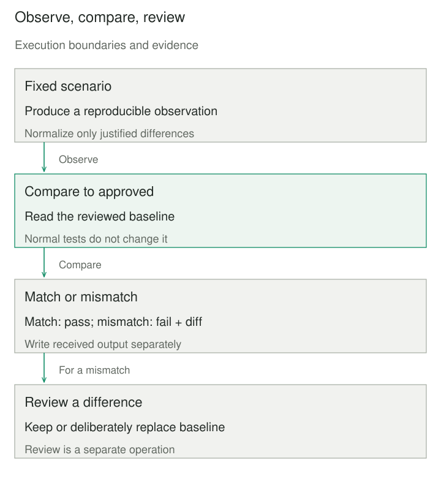

## Purpose and problem

A legacy billing report produces a large structured result. Replacing its formatter requires preserving thousands of details, yet the tests assert only a total and the presence of a heading. Writing a separate assertion for every field is laborious, while simply checking that the report runs says little about its behavior.

Golden Master / Approval Testing captures a meaningful result and compares later runs with a reviewed baseline. The challenge is to make changes visible without teaching the test to accept whatever the current implementation happens to produce. The reviewer’s decision is part of the oracle, not an inconvenient setup step to automate away.

## Core idea

**Preserve a reviewed example of the result, then compare against it.** A scenario produces output, a deterministic representation makes comparison useful, and a stored approved result defines the expected observation. A mismatch produces a diff or received artifact for investigation.

Golden master commonly emphasizes characterizing existing behavior before change. Approval testing emphasizes the review and acceptance workflow. Snapshot testing often uses the same comparison mechanism. These terms overlap, but a captured result is not automatically correct: it may deliberately preserve an existing defect while a refactoring is kept behaviorally separate from a later fix.



## How it works

Choose scenarios with recognizable meaning and bounded output. Run the real behavior you want to characterize, then serialize the relevant result consistently. Text, structured data, images, and other artifacts can all be compared, but each needs an appropriate representation and diagnostic tool.

Control nondeterminism at its source where possible: fixed time inputs, seeded data generation where appropriate, explicit locale, and stable iteration order. When normalization is necessary, make it narrow and visible. Removing an incidental generation timestamp may improve signal; removing customer identifiers or amounts can erase the very regression the test should detect.

Store approved baselines with the scenario and review them as test code. The reviewer must understand the expected behavior, not merely confirm that a diff looks small. A changed total may be consequential even when it occupies one line; a long formatting diff can conceal it. Keep focused semantic assertions for important invariants alongside broader comparisons.

On mismatch, preserve a separate received result and show a useful diff. ApprovalTests supplies libraries and reporters for this workflow. A project can implement a small version with ordinary files and a diff library, but still needs clear naming, cleanup, review, and ownership conventions.

Parallel execution requires unique artifact paths per case and worker where writes can overlap. Baseline updates belong in a deliberate review operation, not the default test run. The approving person and process are repository concerns; an automated “update snapshots” command provides mechanics without establishing that anyone understood the change.

## Worked example

### A reviewed billing summary

The original test checked only that the report existed. The revised test compares stable report content with a known approved example. The demonstration excludes only `generated_at`, an incidental timestamp explicitly outside this summary’s contract. Currency and integer-cent totals remain observable.

This complete Python 3 program uses a temporary directory and the standard library. The approved text is an original, hand-specified teaching baseline. It is not generated from the function’s current output. A real repository would normally keep that approved file under version control instead of seeding it inside a temporary demonstration.

```python
import json
from difflib import unified_diff
from pathlib import Path
from tempfile import TemporaryDirectory


APPROVED = '{\n  "currency": "USD",\n  "total_cents": 300\n}\n'


def normalize(report):
    stable = dict(report)
    stable.pop("generated_at", None)
    return json.dumps(stable, sort_keys=True, indent=2) + "\n"


def verify(report, directory):
    approved = directory / "billing.approved.txt"
    received = directory / "billing.received.txt"
    expected = approved.read_text(encoding="utf-8")
    actual = normalize(report)
    if actual != expected:
        received.write_text(actual, encoding="utf-8")
        diff = "".join(unified_diff(
            expected.splitlines(True), actual.splitlines(True),
            fromfile=approved.name, tofile=received.name))
        raise AssertionError(diff)
    if received.exists():
        received.unlink()


if __name__ == "__main__":
    with TemporaryDirectory() as temporary:
        directory = Path(temporary)
        approved = directory / "billing.approved.txt"
        approved.write_text(APPROVED, encoding="utf-8")
        verify({"currency": "USD", "total_cents": 300,
                "generated_at": "2030-01-01T00:00:00Z"}, directory)
        try:
            verify({"currency": "USD", "total_cents": 301}, directory)
        except AssertionError as error:
            assert '-  "total_cents": 300' in str(error)
            assert '+  "total_cents": 301' in str(error)
        else:
            raise AssertionError("changed total must fail")
        assert approved.read_text(encoding="utf-8") == APPROVED
        assert (directory / "billing.received.txt").exists()
        print("baseline matched; changed total rejected; approval unchanged")
```

The printed line confirms the normal match and the meaningful one-cent regression. The failed comparison leaves a received file for inspection without modifying the approved file. Removing the approved file would cause a read failure, not silently create a new baseline. The temporary directory is cleaned up when the program exits.

The input is a JSON-serializable mapping. Sorting object keys avoids incidental dictionary order, but does not reorder lists. If line-item order is meaningful, retaining it is important; if it is explicitly irrelevant, define a stable ordering as part of the representation. This example compares a summary and does not establish that every line item was calculated correctly.

For rendered documents, the analogous observation might be an image. Review must then distinguish meaningful layout changes from font rendering or environment differences. A pixel tolerance can hide regressions as well as reduce noise, so document what it ignores and keep the rendering environment controlled. The file-based example makes no visual-comparison guarantee.

## When to use it

Use this when an output is rich enough that a reviewed artifact is clearer than many repetitive assertions, or when characterizing legacy behavior before restructuring. Reports, generated documents, serialization, and compiler diagnostics are common candidates.

For a simple numeric rule, a direct expected-value assertion is usually easier to read and diagnose. For a requirement best described by a general invariant, property-oriented testing may give stronger coverage than a handful of snapshots. Baselines are examples, not an exhaustive specification of all inputs.

## Tradeoffs and common mistakes

Baselines cost review effort and can normalize accidental behavior. Huge received files, unstable values, and habitual bulk acceptance make the suite easy to ignore. Split outputs along useful boundaries and name scenarios so reviewers can tell why each artifact exists.

Never use production secrets or unnecessary personal data in stored snapshots. A test artifact may be copied into version control, CI logs, or review tools. Prefer synthetic fixtures and explicit redaction rules that preserve the behavior being tested.

A passing snapshot cannot prove correctness beyond its scenario and observation boundary. A reviewer can approve the wrong result, a normalizer can remove important fields, and a stubbed dependency can differ from production. Treat those as ordinary test-design risks rather than assuming the baseline file is an objective authority.

## Related patterns

[[parameterized-test|Parameterized Test]] supplies several named scenarios to one test structure. Each can have a separate approved artifact without losing diagnostic identity.

[[test-double|Test Double]] can stabilize external inputs, but a snapshot of doubled behavior still needs confidence that the real collaborator matches relevant assumptions.

[[test-data-builder|Test Data Builder]] produces readable scenario inputs. Keep its defaults explicit where they affect an approved output so baseline changes remain understandable.

## Sources

- [ApprovalTests](https://approvaltests.com/): snapshot comparison and explicit approval workflow.
- [ApprovalTests.Python](https://github.com/approvals/ApprovalTests.Python): primary implementation and documentation for Python tooling.
- Python, [difflib](https://docs.python.org/3/library/difflib.html): sequence comparison and unified-diff diagnostics.

The billing summary, normalization policy, and approved baseline are original teaching examples. No approval library dependency is required to run this bounded demonstration.
