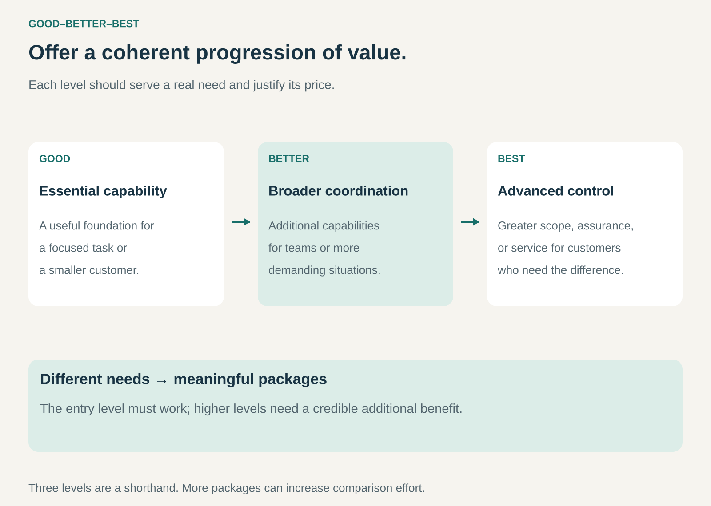

## What it is for

A small business wants a useful product at an affordable price. A larger customer needs collaboration, control, and support. One package forces the provider to disappoint one group or charge the other for capabilities it does not need.

Good–Better–Best organizes an offering into a small number of meaningful levels. Customers choose the combination of capability, service, and price that fits their circumstances.

It is useful when customer needs vary in predictable ways and those differences can be expressed through understandable packages.

## The core idea

**Offer a coherent progression of value, with a credible reason to choose each level.**

The entry package solves a real problem. The middle package adds benefits that matter to a broader or more demanding use case. The highest package serves customers who place enough value on additional scope, assurance, performance, or attention to pay more.

Three levels are a useful shorthand. A business can apply the same logic with a different number, although too many packages make comparison harder. The mechanism is structured choice rather than the number three itself.

## How it works

Start with differences in customer situations. A solo operator, a team, and an organization with complex controls may need different combinations of functions. A hotel guest may value room size, location, and personal service differently from another guest.

Group the differences into packages people can evaluate. Each should have a clear intended use and understandable boundaries. The provider then sets prices that reflect customer value while covering the cost of delivering each promise.

An upgrade should solve a recognizable problem. Additional staff accounts can help a growing team; stronger controls can help a company managing sensitive information. An unexplained collection of extra features creates less clarity.

The packages can coexist with other pricing dimensions. A tier may still charge per seat, per transaction, or for optional add-ons. Customers need to understand both the package and the units that determine their bill.

## Why it works

Customers differ in willingness to pay because their needs and constraints differ. Packages let them select an appropriate level without requiring a separately negotiated product for every buyer.

The structure can also reduce decision effort. Instead of comparing every possible combination of features, customers evaluate a few coherent choices. That benefit disappears if the differences are obscure or the comparison table becomes overwhelming.

For the provider, higher levels can fund capabilities that only some customers need. Standardization can make delivery, support, and sales more repeatable. Those advantages depend on the packages matching actual customer groups; attractive names alone do not create them.

## Famous examples

### Shopify — packages for different operating needs

Shopify presents Basic, Grow, and Advanced plans, alongside a separate Plus offering for more complex businesses. Its public comparison distinguishes intended customer situations and capabilities such as staff accounts and shipping options.

The example illustrates a progression within a wider product range. It is not a claim that Shopify has exactly three offers or that the highest plan suits every merchant. Payment charges and other services also affect the total cost. [Shopify's plan comparison](https://www.shopify.com/pricing)

### Microsoft 365 — productivity packages with different capabilities

Microsoft's business range includes Business Basic, Business Standard, and Business Premium, with variations and additional offers. Differences include access to desktop applications and security or device-management capabilities.

Through this pattern's lens, the progression connects increasing organizational requirements to different packages. Buyers still need to select the appropriate version, billing term, and additional services; the labels do not mean that every capability is unlimited or included. [Microsoft 365 business plans](https://www.microsoft.com/en-us/microsoft-365/business/microsoft-365-plans-and-pricing)

### Mailchimp — levels of marketing capability

Mailchimp's marketing range includes Essentials, Standard, and Premium paid plans, alongside a free option. Its comparison separates levels of marketing functionality and service while also accounting for audience size and sending allowances.

This is a useful example of tiering combined with another charging dimension. A customer selects both an appropriate capability level and a scale of use. The package name alone does not determine the final bill. [Mailchimp marketing plans](https://mailchimp.com/pricing/marketing/)

## The economics

Consider a fictional service with 100 customers. Fifty choose an entry package at $20 per month, 35 choose a middle package at $50, and 15 choose a premium package at $100.

Monthly revenue is $1,000 + $1,750 + $1,500 = $4,250. Suppose monthly delivery costs per customer are $5, $15, and $40 respectively. Total delivery cost is $250 + $525 + $600 = $1,375, leaving $2,875 before shared product development, acquisition, overhead, and tax.

If premium delivery costs rise to $80 per customer, its contribution falls by $600, reducing the total to $2,275. A higher selling price does not guarantee a better contribution margin.

The comparison with a single-package business also requires evidence. Some premium buyers might otherwise have bought the middle package; some entry buyers might otherwise have bought nothing. Package migration and additional customers are different sources of revenue.

## Useful when

- Customers have recurring, understandable differences in requirements.
- The offering can be divided without making the entry level unusable.
- Additional benefits justify both a higher price and their delivery cost.
- Standard packages can reduce negotiation and operating complexity.

## Common mistakes and limits

An entry package that withholds essentials can create frustration rather than a useful choice. A premium package overloaded with expensive personal service can produce weak economics despite a large price.

Avoid treating the middle level as a guaranteed winner. Customer preferences depend on the actual alternatives, prices, and context. A highlighted recommendation does not establish suitability.

Packages also need maintenance. New features can blur boundaries, and changing an established entitlement can damage trust. Buyers should be able to understand renewals, limits, and the consequences of changing levels.

The pattern is less helpful when every project requires fundamentally different work or customers cannot evaluate their needs before purchasing. A scoped consultation or modular offer may fit better.

## Related patterns

[[bundling|Bundling]] combines elements into each package. [[freemium|Freemium]] adds an ongoing free level and a paid conversion mechanism. [[core-plus-add-ons|Core plus Add-Ons]] lets customers extend a common foundation individually. [[per-seat-pricing|Per-Seat Pricing]] can determine the bill within a chosen tier.
