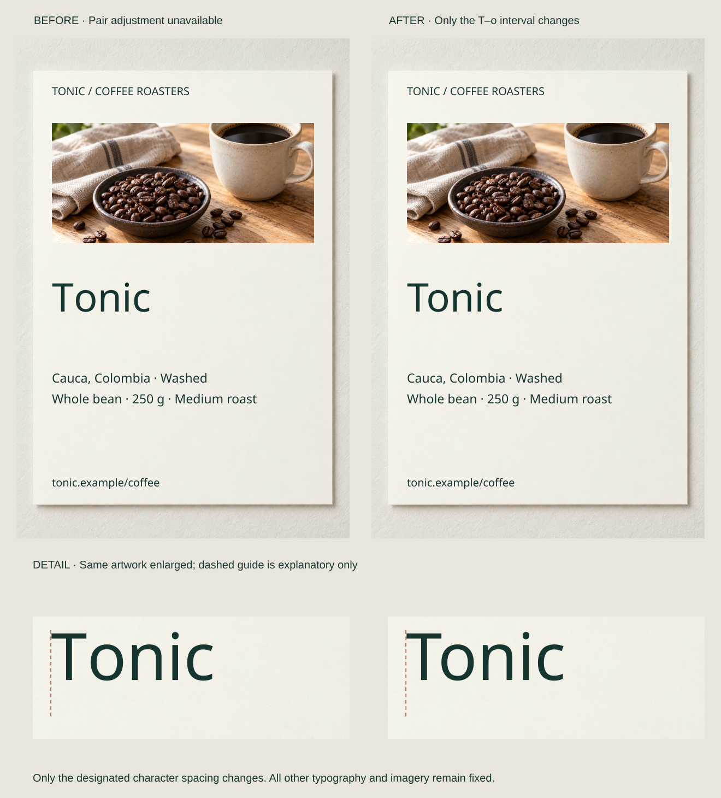

A mixed-case poster headline inherits wide spacing from a small capitals label. Its individual letters become more conspicuous than the phrase. Another word has only one awkward gap. Those problems need different controls.

**Tracking** changes spacing across a run; **kerning** changes a specific pair. Begin with the intended font and its normal kerning, then adjust the range that actually needs attention. Preserve word boundaries and letter shapes.

## What to notice

. Default kerning, starting anchor, baseline and imagery stay fixed.")

[Full-size comparison](../assets/graphic-design/letter-spacing-capitals.svg) · [Stacked narrow-screen view](../assets/graphic-design/letter-spacing-capitals-mobile.svg)

Add +0.08 em tracking only to “STONEWARE,” keeping its size 28, weight, baseline, anchor and normal kerning. The category label gains a more open texture above “Made by hand,” without another face or color. Product facts remain unchanged.

The addition distinguishes this short role; default capitals are not inherently wrong. It also widens the label, so longer categories and translations need capacity checks. A compact inventory label may be better untracked.

An em scales with type size: +0.08 em adds 2.24 units at size 28 but 5.12 at size 64. The same proportional setting creates very different absolute gaps.

## Two variations

### Remove an inappropriate inherited setting

[Full-size comparison](../assets/graphic-design/letter-spacing-headline.svg) · [Stacked narrow-screen view](../assets/graphic-design/letter-spacing-headline-mobile.svg)

Return “Room to make” from +0.08 em to zero additional tracking. Preserve its size 64, anchor, letterforms and normal kerning. The phrase becomes compact by removing an addition, not applying negative spacing or compressing the letters.

Its shorter width leaves more space on the right. A deliberately dispersed campaign or established brand voice might prefer the original; this brief calls for a direct invitation. USWDS supports selective adjustments rather than custom spacing everywhere.

### Fix one pair without changing the rest

[Full-size comparison](../assets/graphic-design/letter-spacing-pair.svg) · [Stacked narrow-screen view](../assets/graphic-design/letter-spacing-pair-mobile.svg)

The Tonic specimen deliberately disables automatic kerning. Restore only its measured T–o adjustment, −4.752 units at size 72: hold T fixed and move “onic” left intact. Every interval within that run remains unchanged.

The o sits beneath the capital’s overhang without tightening satisfactory pairs. In ordinary work, first check metrics kerning; this does not imply defective font spacing. The value is specific to the face and size, not a universal T–o correction.

## Useful when

Adjust tracking for a role’s overall density, kerning for a local interruption. Neighboring stems, rounds and diagonals create different visible spaces, so identical numbers need not look even. Inspect actual words at their intended size, including spaces between words.

Adobe distinguishes metrics, optical and manual kerning. Use typography controls rather than inserting literal spaces, which alters the underlying copy and can disrupt searching, selection or reading.

## Watch out for

Do not apply one label setting to every role or use extreme tightening merely to make a line fit. Reconsider width, wording or face before crowding letters. Horizontal scaling introduces a different distortion.

Some readers need expanded spacing. WCAG’s Text Spacing criterion tests survival of combined user overrides, including tracking of at least 0.12 times font size, without lost content or function. It does not require that value as the authored default. A working layout must accommodate the resulting expansion rather than clip it.

## Related patterns

- [[graphic-design-match-typeface-to-context|Match Typeface to Context]] selects the font’s underlying letterforms and spacing.
- [[graphic-design-control-line-length|Control Line Length]] addresses an unsuitable measure instead of squeezing letters.
- [[graphic-design-apply-optical-alignment|Apply Optical Alignment]] adjusts object placement rather than pair spacing.
- [[graphic-design-control-line-breaks|Control Line Breaks]] chooses endings without altering density.

## Sources and credits

[Adobe: Kerning and tracking](https://helpx.adobe.com/indesign/desktop/format-and-style-text/tabs-indents-and-spacing/about-kerning-and-tracking.html) · [USWDS: Letterspacing](https://designsystem.digital.gov/components/typography/#letterspacing) · [W3C: Text Spacing](https://www.w3.org/WAI/WCAG22/Understanding/text-spacing.html).

Content is fictional. Reused AI-generated photographs accompany licensed Source Sans 3 Regular. Close-ups preserve the artwork at matched enlargement; no print proof, responsive implementation or complete accessibility evaluation is claimed.
