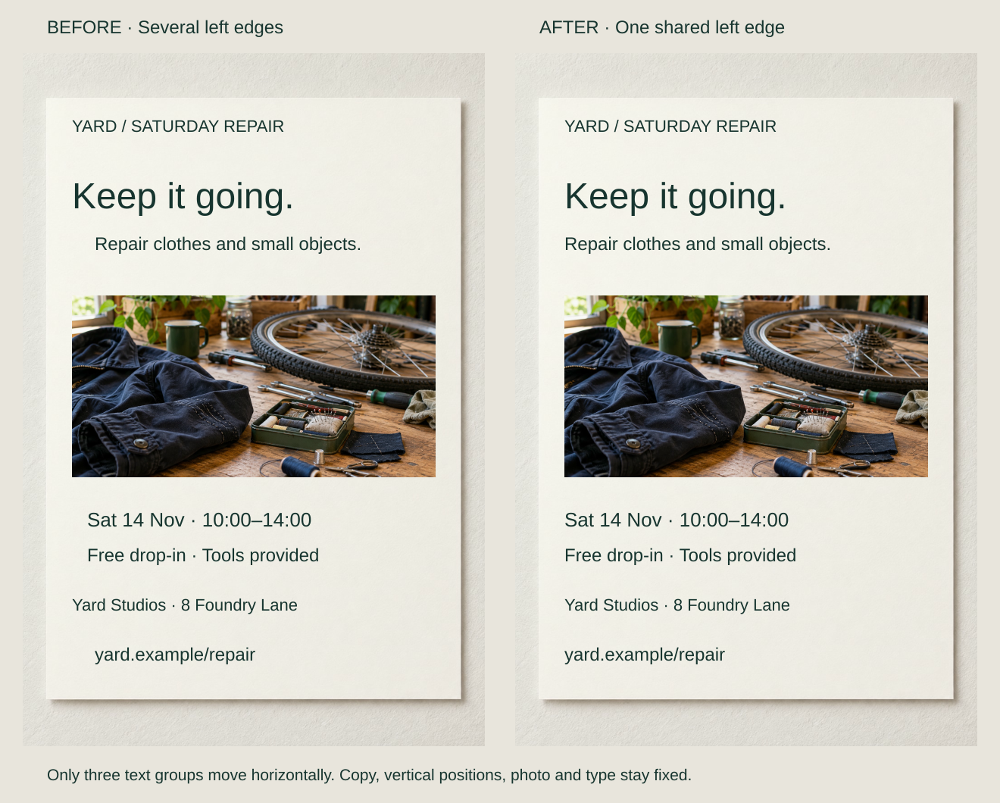
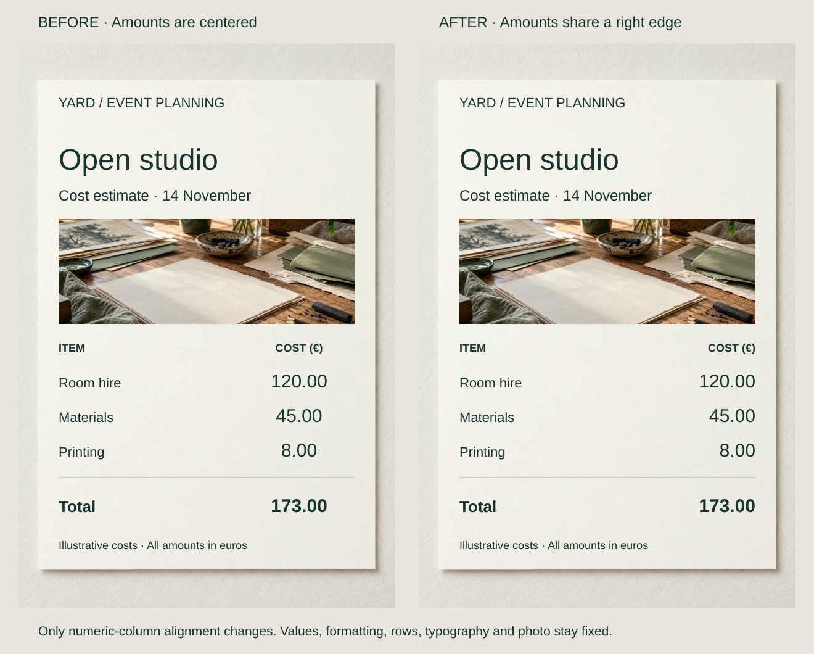
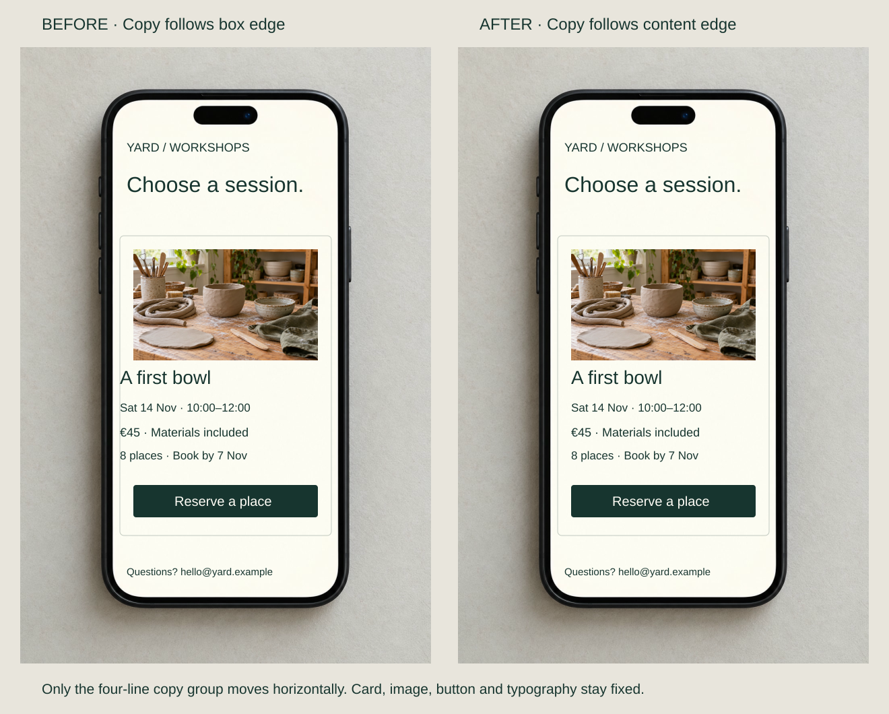

A repair poster’s description starts slightly inside the headline, its date somewhere between them, and its address returns to another inset. Every block is readable, but each asks the reader to relocate its starting edge.

Choose meaningful references and make related elements meet them. The useful edge might be the start of text, the end of an amount, or a content inset inside a card. Alignment is a relationship, not a requirement to put everything on one line.

## What to notice

[Full-size comparison](../assets/graphic-design/alignment-repair-poster.svg) · [Stacked phone view](../assets/graphic-design/alignment-repair-poster-mobile.svg)

Move the description and address 30 units left and the complete date group 20 units left. They now meet the existing headline, photograph and venue edge. Vertical positions and all other treatments stay fixed.

A dependable reference replaces several unmotivated near-alignments. Different type sizes still distinguish roles. The revision feels quieter; consistent subordinate indents, a deliberate stepped composition or a shared centerline could also be coherent.

## Two variations

### Align comparable amounts at their ends

[Full-size comparison](../assets/graphic-design/alignment-cost-sheet.svg) · [Stacked phone view](../assets/graphic-design/alignment-cost-sheet-mobile.svg)

Right-align the cost heading and €120.00, €45.00, €8.00 and €173.00 total to the table’s existing right edge. Preserve their font, two-decimal formatting and row baselines; item labels retain their left edge.

Here, corresponding numeric positions line up for comparison. Right alignment alone cannot align decimals with varying precision or numeral widths. Mixed units need resolution, and identifiers such as phone numbers should follow lookup needs rather than arithmetic conventions. A live table also needs proper headers.

### Use the content edge inside a container

[Full-size comparison](../assets/graphic-design/alignment-workshop-card.svg) · [Stacked phone view](../assets/graphic-design/alignment-workshop-card-mobile.svg)

A workshop card’s copy follows its outer border while the photograph and button are inset. Move the four copy lines 20 units right to share their inner edge. Keep the container and vertical positions fixed.

The inset becomes a repeated content relationship. A heading outside the card can retain another edge: nested components need local references. Moving the copy also reduces room on its right, so check longer titles, translations and narrow layouts before fixing the component’s capacity.

## Useful when

Align related blocks when small offsets imply distinctions that the content does not contain. Internally left-aligned paragraphs can still have misaligned block positions; the repair may require moving whole blocks rather than changing their text alignment.

USWDS recommends a constant starting point for flush-left text; extending that principle across blocks is an editorial application. IBM treats alignment as part of considered layout relationships, while GOV.UK specifically recommends right-aligning comparable numeric columns.

## Watch out for

Choose the relationship before the guide. A sidebar may need its own column; visual neatness cannot make unrelated facts a meaningful group. Consolidate unnecessary near-identical insets without erasing legitimate nesting.

Transparent image margins, punctuation and curved letterforms can make equal bounding boxes look uneven. Small optical corrections may improve a clear reference. Shared edges also cannot supply missing hierarchy, improve tiny type or repair weak contrast. Test the intended reproduction rather than only the editing guides.

## Related patterns

- [[graphic-design-establish-a-grid|Establish a Grid]] provides reusable references across layouts.
- [[graphic-design-use-spacing-to-express-relationships|Use Spacing to Express Relationships]] sets meaningful distances between aligned elements.
- [[graphic-design-chunk-information|Chunk Information]] chooses which facts belong together.
- [[graphic-design-establish-a-clear-reading-order|Establish a Clear Reading Order]] makes starts and continuations apparent.

## Sources and credits

[USWDS: Typography](https://designsystem.digital.gov/components/typography/) · [IBM's layout overview](https://www.ibm.com/design/language/layout/overview/) · [GOV.UK's table guidance](https://design-system.service.gov.uk/components/table/).

The event, estimate and workshop are fictional. Existing AI-generated artwork is reused within pairs. No reading-speed study, working booking service or assistive-technology validation is claimed.
