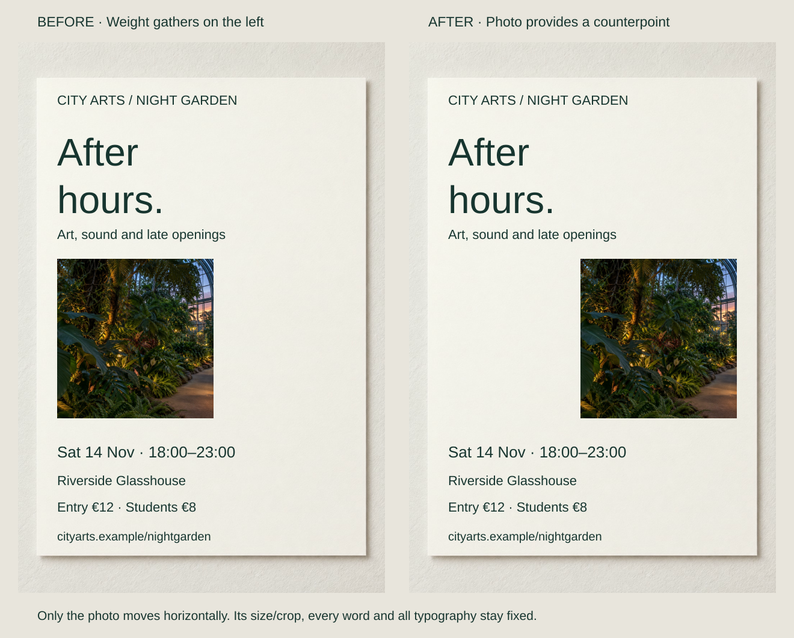
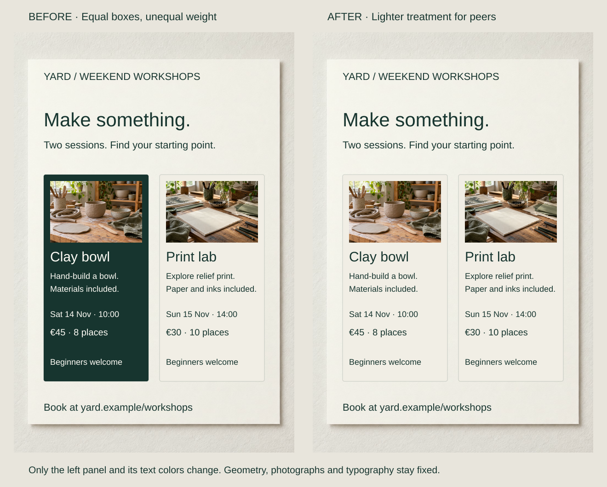

An invitation stacks its large headline, dark photograph and practical details on the left. The other side feels unresolved for a brief seeking a calm composition. An existing element may need moving rather than another badge to fill the gap.

Balance concerns the distribution across the whole field. Size, darkness, contrast, texture, type density and placement all contribute to visual weight. Equal boxes need not feel equal, and a balanced composition can retain a strong lead.

## What to notice

[Full-size comparison](../assets/graphic-design/balance-evening-invitation.svg) · [Stacked phone view](../assets/graphic-design/balance-evening-invitation-mobile.svg)

Move the “After hours” photograph 220 units right, keeping its frame, crop and vertical position fixed. Typography stays left. The photograph becomes a counterpart to the headline and lower details without duplicating them or adding decoration.

The arrangement remains asymmetrical. It distributes substantial regions differently rather than making every part equally prominent. The tradeoff is a less continuous left-hand column; the original could suit an intentionally compressed or directional poster.

Getty distinguishes symmetrical and asymmetrical balance. McGill describes several contributors to weight, while Nielsen Norman Group suggests an imaginary axis for inspection. These are design aids, not a numerical weighing system or proof of a preferred composition.

## Two variations

### Lighten a peer panel instead of enlarging its opponent

[Full-size comparison](../assets/graphic-design/balance-peer-workshops.svg) · [Stacked phone view](../assets/graphic-design/balance-peer-workshops-mobile.svg)

Two workshop cards have equal dimensions, yet the clay card’s dark field dominates the pale print card. Give clay the same pale background and dark text, preserving imagery and geometry.

The change reduces a continuous tonal mass while keeping its information readable. Neither peer now receives an unintended background advantage. A genuinely featured course could justify the original contrast. Different photographs and text densities still require judging the whole page.

### Strengthen a compact counterpart

[Full-size comparison](../assets/graphic-design/balance-material-study.svg) · [Stacked phone view](../assets/graphic-design/balance-material-study-mobile.svg)

Change only “CLAY STUDY 01” from regular to bold, preserving its size, breaks, position and color. The compact identifier gains density against a larger pale object photograph.

The series identity participates more strongly without growing to match the image’s area. It also gains emphasis: suitable when identifying the study is part of the brief, excessive when a photographic essay should leave annotation quiet.

## Useful when

Reconsider weight when a readable design feels unintentionally concentrated or geometric symmetry hides a strong tonal imbalance. Inspect actual images and copy, not their empty frames. Try moving, lightening or strengthening meaningful existing material before adding a counterweight.

An axis can help examine relationships, but also check top and bottom. A dense footer may dominate even when left and right appear comparable. Judge the intended size and medium; weight changes with reproduction and context.

## Watch out for

Balance does not require equal emphasis, mirrored content or occupied space everywhere. Flattening hierarchy may make the message harder to find. An empty area can be intentional, and tension or imbalance may suit an expressive brief.

Do not lighten necessary information into weak contrast. Foreground and background may need changing together, as in the workshop cards. A strong focal point can coexist with balance; the underlying question is whether the distribution serves the purpose.

## Related patterns

- [[graphic-design-establish-visual-hierarchy|Establish Visual Hierarchy]] chooses what leads within the distribution.
- [[graphic-design-establish-a-grid|Establish a Grid]] provides placement references.
- [[graphic-design-use-spacing-to-express-relationships|Use Spacing to Express Relationships]] shapes the open areas around weighted elements.
- [[graphic-design-establish-value-contrast|Establish Value Contrast]] adjusts local light–dark relationships.

## Sources and credits

[Getty's design vocabulary](https://www.getty.edu/education/k-12-learning/describe-listen-draw/vocabulary-for-describing-an-artwork/) · [McGill's balance guidance](https://www.mcgill.ca/web-services/resources/toolkits/digital-design-toolkit/design-principles/balance) · [Nielsen Norman Group: Visual Design Principles](https://www.nngroup.com/articles/principles-visual-design/).

The briefs and revisions are fictional, using reused AI-generated artwork. Checks verify controlled differences, not numerical balance, audience preference, attention paths or task improvement.
