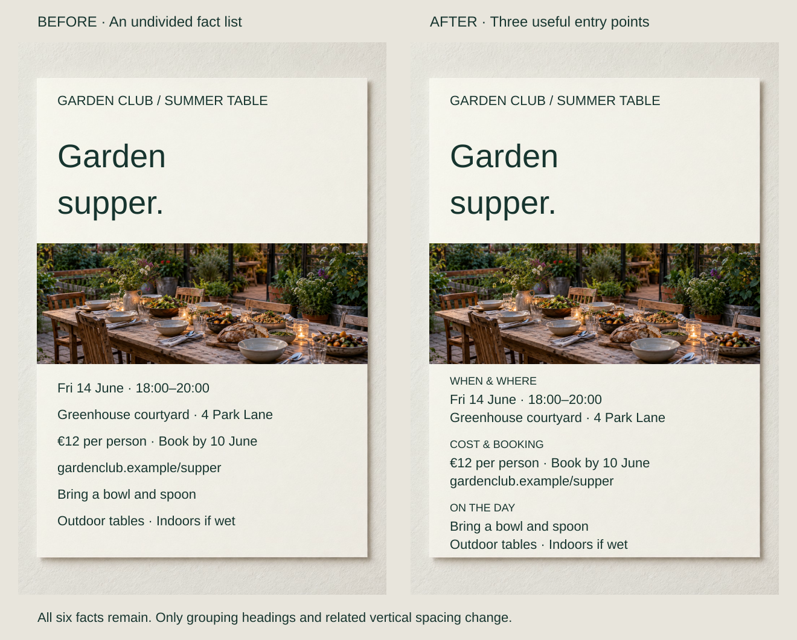
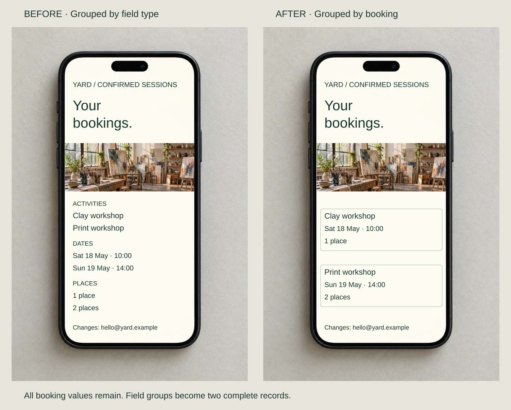
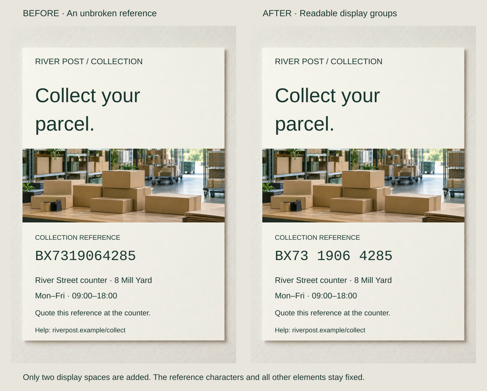

A supper invitation lists the date, venue, price, deadline and preparation details with equal spacing. Nothing is missing, but guests checking how to book must search among facts about arrival and weather.

Choose units that match the reader’s questions. A chunk may be a topic, complete record or reference segment. Headings, spacing and boundaries express that choice; equal-sized boxes do not establish useful categories.

## What to notice

[Stacked narrow-screen view](../assets/graphic-design/chunk-supper-invitation-mobile.svg)

Add “When & where,” “Cost & booking” and “On the day.” Move the unchanged fact lines into those three groups, preserving their order and type treatments. Booking details gain a named entry point; preparation and wet-weather arrangements form another.

The headings reduce the organization readers must infer. W3C describes headings as communicating document structure, although its guidance concerns implemented web content. The extra labels and spacing cost room. A short notice read once might need no intermediate structure; returning guests may benefit more.

## Two variations

### Keep each record’s facts together

[Stacked narrow-screen view](../assets/graphic-design/chunk-booking-records-mobile.svg)

A booking summary groups activities, dates and place counts into separate lists. Reassemble each booking: Clay workshop with Saturday 10:00 and 1 place; Print workshop with Sunday 14:00 and 2 places. Remove the field-type headings and separate complete records with space and light outlines.

One inspection now checks one booking instead of matching entries across three lists. A table could better support comparing the same attribute across many records. In an interface, preserve these relationships in reading order and code; the borders are not working controls.

### Segment a reference without changing it

[Stacked narrow-screen view](../assets/graphic-design/chunk-collection-reference-mobile.svg)

Display “BX7319064285” as “BX73 1906 4285.” Only two spaces change. Groups supply places to pause when quoting the reference and stable segments to check; they do not encode invented dates or categories.

The wider string needs space. Follow existing identifier conventions and check copying and entry behavior: real systems may treat spaces as meaningful. Keep an exact machine-readable representation where required. No reduction in errors is established by this illustration.

## Useful when

Chunk information when readers repeatedly locate related facts, verify records or handle an unfamiliar string. Name the unit before designing its treatment. A heading and contrasting internal/external gaps may express the grouping without another box.

Cowan’s memory review concerns learned associations and specific task conditions. It does not make every visual container a remembered chunk or prescribe three, four or seven items per page. These proposals concern finding and association, not measured memory capacity.

## Watch out for

Overly small groups fragment a larger idea; overly broad “Miscellaneous” groups avoid making a useful decision. Keep qualifications with the claims they limit. When categories overlap, reconsider the labels or provide a cross-reference rather than force an arbitrary home.

A continuous paragraph, short list or table may better fit the task. Chunking cannot supply missing facts or correct false ones. Test meaningful units in the intended medium, including narrow and nonvisual reading.

## Related patterns

- [[graphic-design-use-spacing-to-express-relationships|Use Spacing to Express Relationships]] makes selected groups spatially apparent.
- [[graphic-design-match-form-to-purpose|Match Form to Purpose]] chooses the larger format.
- [[graphic-design-sequence-the-message|Sequence the Message]] orders the units.
- [[graphic-design-make-meaning-explicit|Make Meaning Explicit]] clarifies their labels and scope.

## Sources and credits

[W3C: Headings](https://www.w3.org/WAI/tutorials/page-structure/headings/) · [The magical number 4 in short-term memory](https://doi.org/10.1017/S0140525X01003922).

The content and grouping choices are fictional. AI-generated photographs are reused within pairs; typography is composed separately. These are static examples, not working services or measured memory/usability tests.
