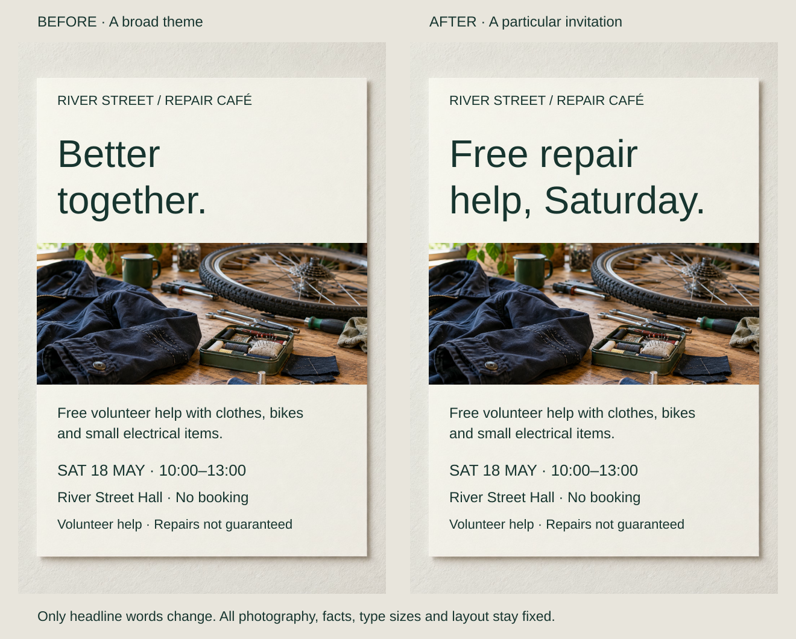
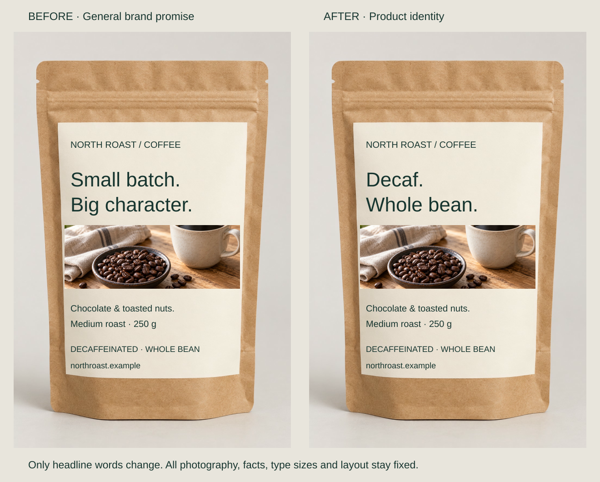
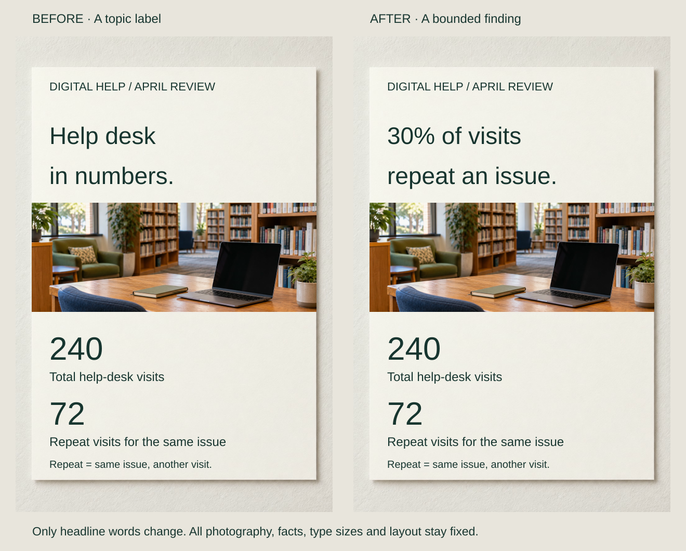

A repair workshop wants to celebrate community, thank volunteers and attract newcomers. Its headline, “Better together,” expresses a value but leaves passersby to discover the actual offer.

Choose what this encounter should establish for its audience. A **core message** is a useful takeaway, not merely a topic or an organizational ambition. “Free volunteer repair help is available this Saturday” gives the designer a criterion for choosing words and images. It need not become the final headline verbatim.

## What to notice

[Stacked narrow-screen view](../assets/graphic-design/core-message-repair-poster-mobile.svg)

Replace “Better together” with “Free repair / help, Saturday.” Only the headline changes; its prominence, photograph and practical details stay fixed. The largest words now introduce this particular event rather than a theme that could advertise a choir or fundraiser.

The mechanism is editorial: the chosen fact occupies the existing entry point. Enlarging the original slogan would not supply that meaning. The revision loses some emotional breadth, which might matter more in a community identity campaign. Keep the volunteer-help qualification; an invitation must not become a repair guarantee.

## Two variations

### Identify the product the shopper needs

[Stacked narrow-screen view](../assets/graphic-design/core-message-coffee-package-mobile.svg)

“Small batch. / Big character.” becomes “Decaf. / Whole bean.” The shopper choosing between regular and decaffeinated coffee gets the distinguishing fact first, with tasting notes and brand character retained. The same headline size and position make this a message decision, not a scale adjustment.

If every product were decaffeinated, a different distinction might lead. Preserve “decaffeinated, not caffeine-free”; the clearer label cannot establish complete packaging compliance.

### State a finding within its evidence

[Stacked narrow-screen view](../assets/graphic-design/core-message-library-report-mobile.svg)

“Help desk / in numbers” becomes “30% of visits / repeat an issue.” The unchanged counts—72 of 240 visits—support that relationship. A manager beginning a staffing discussion gets a bounded finding rather than a topic label.

Here, the denominator is visits, not people. Repeat appointments may be useful or planned; repetition does not establish service failure. These counts alone cannot explain causes or determine staffing. A neutral topic heading could suit an archive intended for lookup.

## Useful when

Define the message when a brief contains competing intentions or an attractive design says little about its subject. Distinguish the main message from the action it may support: understanding an offer and booking it are different jobs. CDC guidance makes that distinction; GOV.UK recommends beginning with evidenced user needs.

## Watch out for

Shortness alone is no test of focus. A precise sentence can guide design better than a memorable slogan. Do not delete eligibility, uncertainty or cost to strengthen a claim. Conflicting stakeholder objectives may require separate pieces, while maps, catalogues and exploratory exhibitions may need an organizing purpose rather than one proposition. Team agreement does not establish what viewers understand.

## Related patterns

- [[graphic-design-design-for-the-audience|Design for the Audience]] establishes whose situation the message serves.
- [[graphic-design-sequence-the-message|Sequence the Message]] orders its supporting ideas.
- [[graphic-design-establish-visual-hierarchy|Establish Visual Hierarchy]] expresses the chosen priorities visually.

## Sources and credits

[main-message guidance](https://www.cdc.gov/ccindex/tool/page-1.html) · [Identify user needs](https://guidance.publishing.service.gov.uk/writing-to-gov-uk-standards/plan-manage-content/identify-user-needs/).

The briefs, wording and data are fictional editorial examples. AI-generated photographs are reused within each pair; typography is composed separately. No audience study or measured improvement is claimed.
