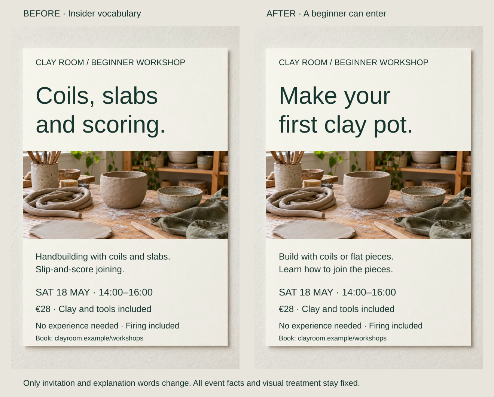

A beginner pottery poster leads with “Coils, slabs and scoring.” The words are accurate, but someone considering their first session must translate them before imagining what they will make.

Adapt the design to relevant knowledge, tasks and viewing conditions. “A newcomer deciding whether to attend” suggests concrete changes. A demographic label such as “young creatives” tells the designer much less.

## What to notice

[Stacked narrow-screen view](../assets/graphic-design/audience-pottery-poster-mobile.svg)

Change the headline to “Make your / first clay pot” and explain the techniques as building with coils or flat pieces and learning to join them. Only four text nodes change; the photograph, €28 price, materials, firing and experience requirement remain.

The revision supplies a recognizable activity before specialist terminology. Readers no longer need the class’s knowledge to understand its invitation. Experienced makers comparing techniques might prefer the original wording; the tutor can still introduce technical terms alongside demonstrations.

Audience adaptation concerns the work a reader must do: decode a term, locate a destination or assemble an offer. Evidence about that work should guide changes. GOV.UK recommends researching users and tasks; W3C describes varied abilities and situational barriers. The printed applications here are editorial proposals.

## Two variations

### Design for an entrance decision

[Stacked narrow-screen view](../assets/graphic-design/audience-museum-sign-mobile.svg)

A museum paragraph explains tickets, the upstairs collection and lift access. At a busy entrance, visitors need destinations they can find during a glance. Separate tickets/information from the collection route, enlarge destination and supporting text, and create a gap between the two groups. Every practical fact survives.

Wording, scale and spacing change together because the encounter warrants them. The spacious arrangement is less suitable for a compact leaflet. Actual sightlines, lighting, reading distance and visitor feedback remain necessary; larger lettering alone does not establish accessible wayfinding.

### Lead with the visitor’s choice

[Stacked narrow-screen view](../assets/graphic-design/audience-day-pass-phone-mobile.svg)

A day-pass page leads with desk, floor and room counts. Replace the primary lines with “Day pass €18,” weekday hours and “Desk and Wi-Fi included”; move capacity facts into the secondary block. Five text nodes change while their visual treatments stay fixed.

The page answers a freelancer’s day-and-budget question first. “Meeting rooms booked separately” remains visible, so the capacity count does not imply inclusion. A team selecting premises might reasonably want capacity first, and total desks do not establish today’s availability.

## Useful when

Use this pattern when insiders understand a piece but intended viewers struggle, or when material designed for seated reading moves to a sign, label or phone. Enquiries, observation, interviews and draft trials can reveal the relevant knowledge and constraints. Stakeholder suggestions begin as assumptions, not audience findings.

## Watch out for

Do not infer a preferred style or ability from age or appearance. Expertise varies by task. Beginners may need explanations beside technical terms, while specialists may need their precision. Preserve necessary conditions rather than simplifying them away.

Conflicting audiences may need separate entry points or artifacts. Adaptation cannot repair incorrect prices or unavailable services; check proposed designs with people performing realistic tasks.

## Related patterns

- [[graphic-design-define-the-core-message|Define the Core Message]] chooses this piece’s takeaway.
- [[graphic-design-match-form-to-purpose|Match Form to Purpose]] chooses a format for the resulting task.
- [[graphic-design-make-meaning-explicit|Make Meaning Explicit]] clarifies assumptions the audience cannot supply.
- [[graphic-design-establish-visual-hierarchy|Establish Visual Hierarchy]] makes the relevant priorities visible.

## Sources and credits

[Start by learning user needs](https://www.gov.uk/service-manual/user-research/start-by-learning-user-needs) · [Diverse abilities and barriers](https://www.w3.org/WAI/people-use-web/abilities-barriers/).

These are fictional briefs and revisions using AI-generated photographs and separately composed typography. Each pair retains its image data. No user study or performance improvement is claimed.
