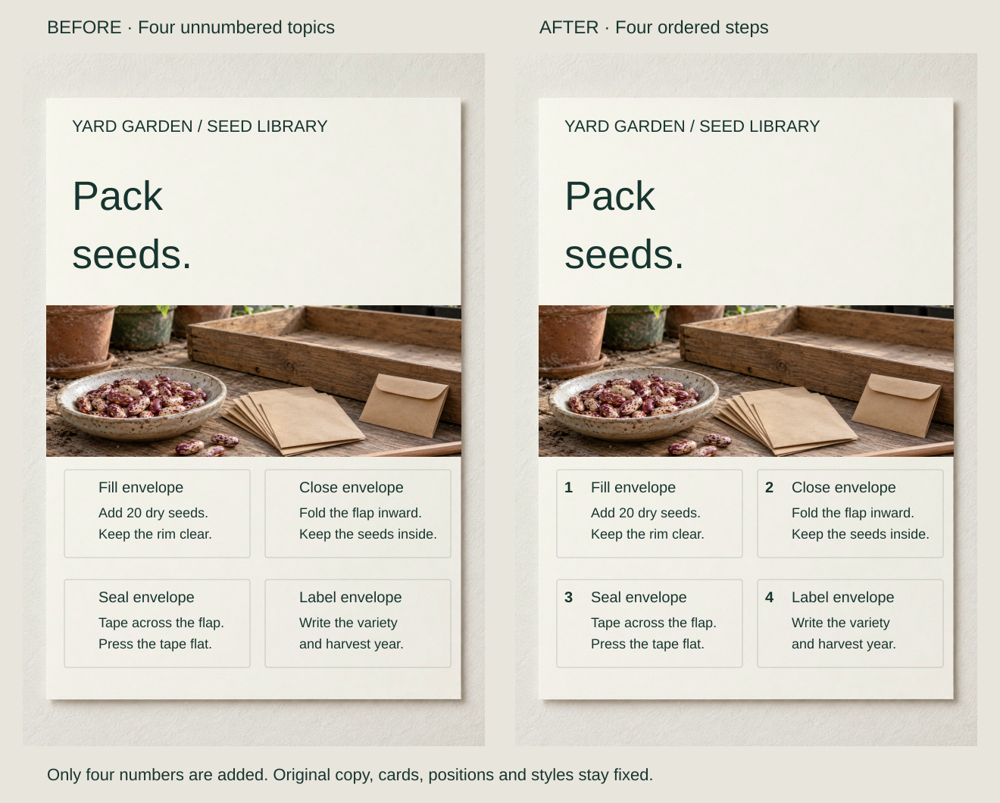
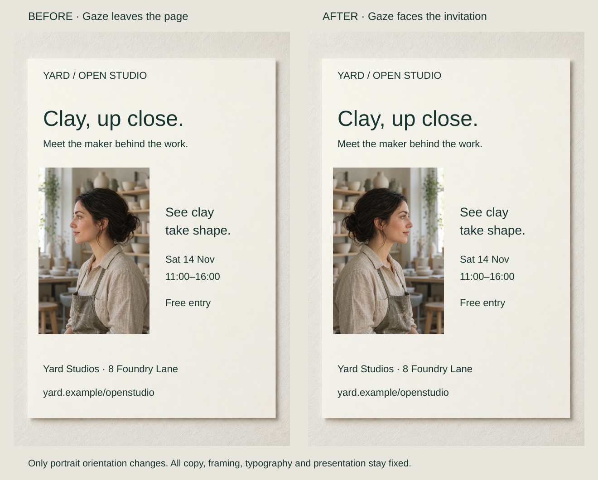

A newsletter’s story begins on the left but ends beneath a sidebar on the right. The words have a sensible sequence; the layout leaves several plausible places to continue.

Give readers a recognizable start and next step while separating parallel material from the main thread. Reading order makes an intended progression visible. It does not decide which ideas belong first or which deserve the greatest prominence.

## What to notice

[Stacked narrow-screen view](../assets/graphic-design/reading-seed-procedure-mobile.svg)

A seed-library sheet already places four actions in the intended row-by-row order. Add numbers 1–4 in the margins, preserving words, card positions and styling. The cards now identify a procedure rather than merely suggesting four reference topics.

The ordinal cues supply evidence about succession and a place to return after interruption. They add marks and imply a real dependency: independent maintenance tips might be better without numbers. Google’s procedure guidance supports numbering ordered tasks, not every collection of information.

## Two variations

### Keep a continuation with its story

[Stacked narrow-screen view](../assets/graphic-design/reading-editorial-thread-mobile.svg)

Move only the closing paragraph sideways beneath the opening, leaving its vertical position and the “Bring along” sidebar fixed. The story shares one column; the labeled list remains an optional detour.

A common edge supplies continuity at the transition. The page is less evenly filled, but filling every area is secondary to preserving the relationship. A collage of independent snippets could use the earlier distribution; a longer story might need genuine column flow or explicit continuation cues.

### Preserve the route on a narrow screen

[Stacked narrow-screen view](../assets/graphic-design/reading-visit-preparation-mobile.svg)

The underlying workshop-preparation list is 1–2–3, but the narrow layout displays 1–3–2. Exchange the visible positions of the last two intact steps. Desktop and phone now agree with the source list.

The companion prototype was checked at 960px and 396px. That verifies layout order, not keyboard behavior, screen-reader use or usability. W3C’s Meaningful Sequence guidance concerns programmatically determinable order where meaning depends on it; matching source and visual order is one implementation technique.

### Guide the Eye

[Full-size comparison](../assets/graphic-design/guide-maker-gaze.svg) · [Stacked narrow-screen view](../assets/graphic-design/guide-maker-gaze-mobile.svg)

Gaze, gestures and arrows can suggest a direction. Aim them toward useful content and give an action arrow an actual destination. These cues invite a route rather than establish everyone’s eye movements. For exact reference to a photographed feature, see [[graphic-design-integrate-text-and-image|Integrate Text and Image]].

## Useful when

Use the pattern where continuations are ambiguous, a procedure resembles independent topics, or responsive rearrangement contradicts the intended sequence. Inspect the joins between units, not only the first glance. These English examples use different routes—across rows, down a column and down a phone list—rather than one universal page-scanning pattern.

## Watch out for

Arrows cannot resolve a fundamentally confused layout. Fix relationships before adding connectors. Visual order, document structure and keyboard order need related but separate checks.

Timetables and exploratory displays can support multiple valid routes. Clear order should help people choose and return, not force every encounter into a funnel. Resolve incorrect instructions or an incoherent message before emphasizing its path.

## Related patterns

- [[graphic-design-sequence-the-message|Sequence the Message]] chooses the meaningful progression.
- [[graphic-design-establish-visual-hierarchy|Establish Visual Hierarchy]] assigns relative rank rather than succession.
- [[graphic-design-chunk-information|Chunk Information]] defines the units between which readers move.

## Further comparisons

- Give an arrow an actual destination: [full-size comparison](../assets/graphic-design/guide-booking-arrow.svg) · [stacked view](../assets/graphic-design/guide-booking-arrow-mobile.svg).

Open a comparison for its stated changes and limitations; choose the stacked view for a narrow screen.

## Sources and credits

[Google's Procedures guide](https://developers.google.com/style/procedures) · [W3C's Meaningful Sequence explanation](https://www.w3.org/WAI/WCAG22/Understanding/meaningful-sequence.html) · [W3C's C27 technique](https://www.w3.org/WAI/WCAG22/Techniques/css/C27).

The workflows and layouts are fictional. Each pair reuses AI-generated photography. Saved artwork and the responsive prototype were checked; no reader study, physical trial or assistive-technology validation is claimed.
