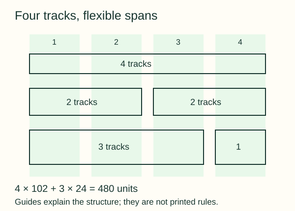
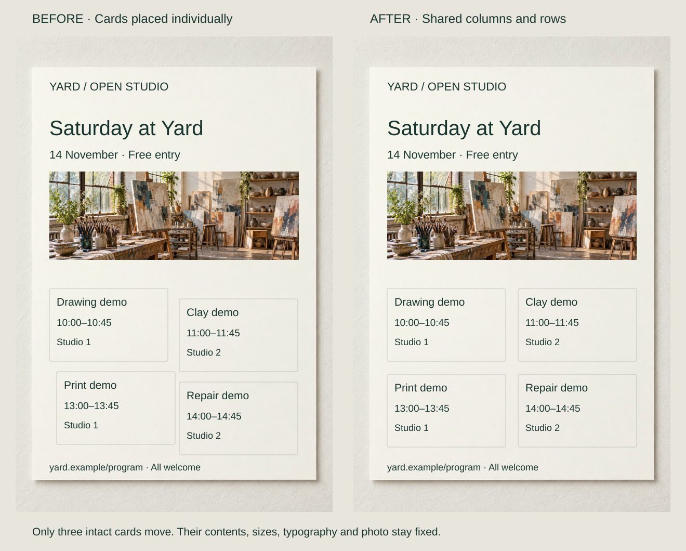

Four session cards are internally consistent but occupy slightly different positions. Visitors must keep finding the next starting point, and a fifth session has no agreed place to go.

Define reusable placement relationships. **Margins** bound the content area; **tracks** divide it; **gutters** separate tracks; **spans** combine them. A one-column arrangement can be a grid. Choose its divisions from the material rather than a habitual column count.

[Full-size construction diagram](../assets/graphic-design/grid-anatomy.svg)

## What to notice

[Full-size comparison](../assets/graphic-design/grid-studio-program.svg) · [Stacked phone view](../assets/graphic-design/grid-studio-program-mobile.svg)

Keep the first open-studio card fixed and move the other three onto shared column and row starts. In the 480-unit live area, four 102-unit tracks and three 24-unit gutters allow each 228-unit card to span two tracks. Neither cards nor photograph resize.

Recurring regions make comparable sessions easier to locate and give the designer a structure to extend. These are practical rationales, not measured outcomes. Equal modules suit peer sessions; a featured activity with more content may need another span.

## Two variations

### Let content span the divisions

[Full-size comparison](../assets/graphic-design/grid-editorial-spans.svg) · [Stacked phone view](../assets/graphic-design/grid-editorial-spans-mobile.svg)

A journal paragraph forced into one 102-unit track fragments into thirteen lines while neighboring tracks sit unused. Widen it to a three-track, 354-unit span and rewrap the unchanged words, preserving font, size and leading. The sidebar retains one track.

Four lines replace thirteen fragments. The grid accommodates different roles rather than making every division a compulsory box. A still-wider measure could cause another reading problem; a brief label might fit one track perfectly.

### Change the count when width changes

[Full-size comparison](../assets/graphic-design/grid-responsive-workshops.svg) · [Stacked phone view](../assets/graphic-design/grid-responsive-workshops-mobile.svg)

On a narrow course listing, replace two columns with one. Keep course order and type sizes; widen images and buttons, and let inclusion text rewrap. Photographs retain the same centered crop and 2:1 proportion.

The cards gain usable width at the cost of height, scrolling and immediate side-by-side comparison. The companion study verifies the policy at 960px and 396px: both wide versions have two columns; only the revised narrow version has one, without horizontal overflow. This is not a complete accessibility audit.

## Useful when

Use a grid for repeated modules, related pages or formats where placement decisions should survive additions and revisions. IBM and USWDS describe adaptable grid systems, not a universal recipe. Test actual paragraphs, images and longer titles before fixing tracks and spans.

### Use Proportional Relationships

Let selected dimensions depend on content-informed references. A prose column may need twice a facts column’s width, but no ratio guarantees success. [[graphic-design-establish-a-type-scale|Type scales]] and [[graphic-design-adjust-line-spacing|leading]] apply proportion to different decisions.

### Break the Grid Deliberately

[Diagram: grid rules, allowed spans and deliberate exceptions](../assets/graphic-design/break-grid-anatomy.svg).

Name the rule being broken and the content reason. A photo-and-caption module might extend beyond an edge while booking details retain dependable placement. An allowed span is not necessarily a break; restore unrelated drift without removing a purposeful exception.

### Create Modular Layout Systems

Specify repeatable content roles, insets and allowed spans, then test another item and a narrower format. A useful module adapts through defined changes rather than unrelated redesigns.

## Watch out for

Do not fill empty tracks merely because they exist, or preserve a column count by clipping text or shrinking it. Reconsider spans, columns or format. W3C’s Reflow guidance concerns preserving information and functionality as content adapts. Exploratory compositions can legitimately favor freer placement.

## Related patterns

- [[graphic-design-align-to-common-edges|Align to Common Edges]] follows useful local reference lines.
- [[graphic-design-use-spacing-to-express-relationships|Use Spacing to Express Relationships]] chooses meaningful intervals.
- [[graphic-design-control-line-length|Control Line Length]] tests a paragraph’s usable span.
- [[graphic-design-build-reusable-templates|Build Reusable Templates]] adds content obligations and variation rules.

## Further comparisons

- Allocate width according to the content: [full-size comparison](../assets/graphic-design/proportion-workshop-guide.svg) · [stacked view](../assets/graphic-design/proportion-workshop-guide-mobile.svg).
- Let a headline depart from the content edge: [full-size comparison](../assets/graphic-design/break-grid-open-studio.svg) · [stacked view](../assets/graphic-design/break-grid-open-studio-mobile.svg).
- Bridge a gutter without detaching the caption: [full-size comparison](../assets/graphic-design/break-grid-material-study.svg) · [stacked view](../assets/graphic-design/break-grid-material-study-mobile.svg).
- Keep the photo exception and restore the booking inset: [full-size comparison](../assets/graphic-design/break-grid-workshop-booking.svg) · [stacked view](../assets/graphic-design/break-grid-workshop-booking-mobile.svg).

Open a comparison for its stated changes and limitations; choose the stacked view for a narrow screen.

## Sources and credits

[IBM's 2x Grid guidance](https://www.ibm.com/design/language/2x-grid/) · [USWDS's layout grid documentation](https://designsystem.digital.gov/utilities/layout-grid/) · [W3C's Reflow explanation](https://www.w3.org/WAI/WCAG22/Understanding/reflow.html).

Programs, offers and layouts are fictional, using reused AI-generated photography and native graphics. The layout study was checked; reader outcomes, assistive technology and a complete production workflow were not validated.
