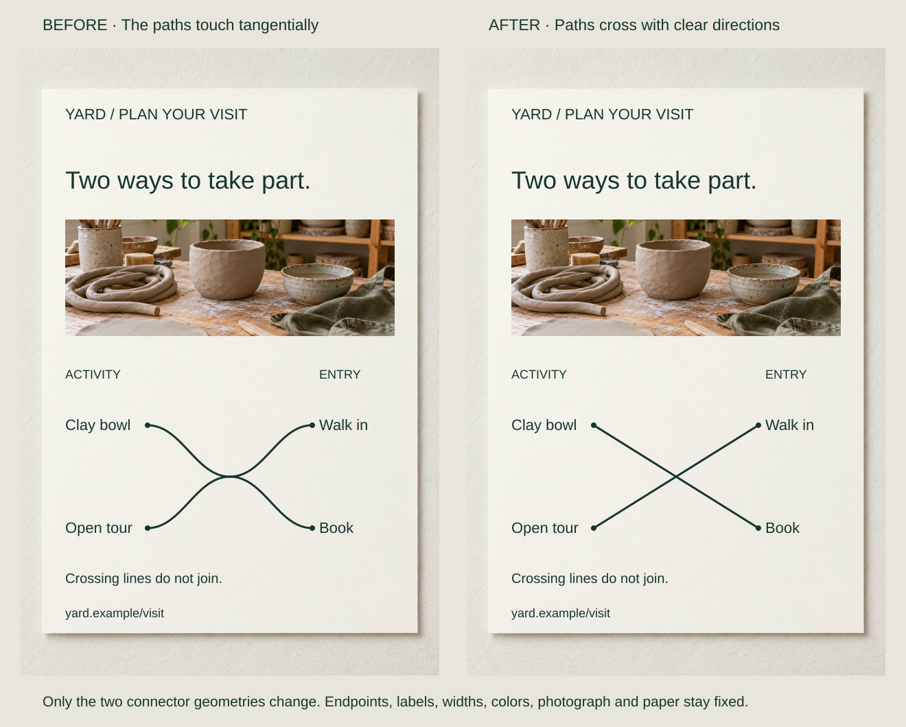

A visitor diagram connects workshops to booking arrangements. Two curves touch with the same direction at their crossing, so either incoming path seems able to continue into either branch. Correct endpoints cannot resolve an ambiguous middle.

Make position, angle and curvature support the path or contour that actually continues. Separate marks may suggest one line behind an obstruction; unrelated parts should not be joined merely to make a smoother composition.

## What to notice

[Full-size comparison](../assets/graphic-design/continuity-open-studio.svg) · [Stacked narrow-screen view](../assets/graphic-design/continuity-open-studio-mobile.svg)

An open-studio poster’s diagonal motif passes behind a title panel. Its right stroke has the correct angle but sits too low. Move only that stroke upward by 50 units. Both pieces now occupy one extended diagonal, with the opaque panel explaining the interruption.

The repair supplies coherent evidence for a continuing contour. Field, Hayes and Hess studied alignment in path detection; Kellman and Shipley examine interpolation across gaps. Neither establishes a fixed sequence of eye movements through this poster.

If the strokes were independent accents, their offset could be appropriate. If the motif adds little, removing it may serve the brief better than perfecting it.

## Two variations

### Make the intended path win at a crossing

[Full-size comparison](../assets/graphic-design/continuity-visit-connections.svg) · [Stacked narrow-screen view](../assets/graphic-design/continuity-visit-connections-mobile.svg)

Replace two touching curves with straight diagonals between the existing endpoints. Keep terminals, line color and width fixed. “Clay bowl” still connects to “Book,” and “Open tour” to “Walk in.”

Continuing along the correct path is now straight; switching branches requires a turn. Small or crowded crossings can still need bridges, distinct patterns, direct labels or a layout without crossings. This diagram describes arrangements, not physical routes; a floor plan must preserve actual geography.

### Keep an honest interruption in a chart

[Full-size comparison](../assets/graphic-design/continuity-booking-gap.svg) · [Stacked narrow-screen view](../assets/graphic-design/continuity-booking-gap-mobile.svg)

A studio report records 12, 18, an unrecorded week, 24 and 20 booked places. Remove only the solid bridge across the missing interval. Keep observations, within-run segments and the “W3 was not recorded” note.

The two recorded runs remain continuous internally without suggesting an observed sweep through the gap. A single trend shape is sacrificed. Interpolation can be valid when explicitly presented as an estimate or model, distinct from observation. IBM documents interpolation, gaps and zero as different null-value treatments; choosing one changes meaning.

## Useful when

Inspect continuity when motifs pass behind panels, connectors cross, or chart segments meet gaps. Check both direction and position at each interruption. Matching stroke color alone cannot make displaced segments one plausible contour.

A larger gap may require another cue even with coherent geometry. The intended continuation must first be true and useful; visual fluency is not sufficient justification.

## Watch out for

Connecting decorative rules to data lines can invent membership or junctions. Smoothing a sharp turn may erase a real corner, transition or event. Preserve those distinctions rather than turn everything into flowing curves.

A coherent path supports grouping, not guaranteed attention. Readers can enter elsewhere or follow their own questions. Use arrows or labels when direction or relationship needs explicit meaning rather than assume continuation communicates it all.

## Related patterns

- [[graphic-design-establish-a-clear-reading-order|Establish a Clear Reading Order]] coordinates content traversal, not just contours.
- [[graphic-design-use-implied-forms|Use Implied Forms]] suggests a whole from partial evidence.
- [[graphic-design-signal-relationships-through-similarity|Signal Relationships Through Similarity]] connects elements through shared features.
- [[graphic-design-reinforce-meaning-beyond-color|Reinforce Meaning Beyond Color]] adds another cue when paths need distinction.

## Sources and credits

[Field, Hayes, and Hess, 1993](https://pubmed.ncbi.nlm.nih.gov/8447091/) · [Kellman and Shipley, 1991](https://www.sciencedirect.com/science/article/pii/001002859190009D) · [IBM: Customizing null values for lines](https://www.ibm.com/docs/en/cognos-analytics/12.0.x?topic=visualizations-customizing-null-values-lines).

The events, data and URLs are fictional. Reused AI-generated photographs accompany separately composed typography and linework. Artwork checks verify controlled differences, not reader benefits.
