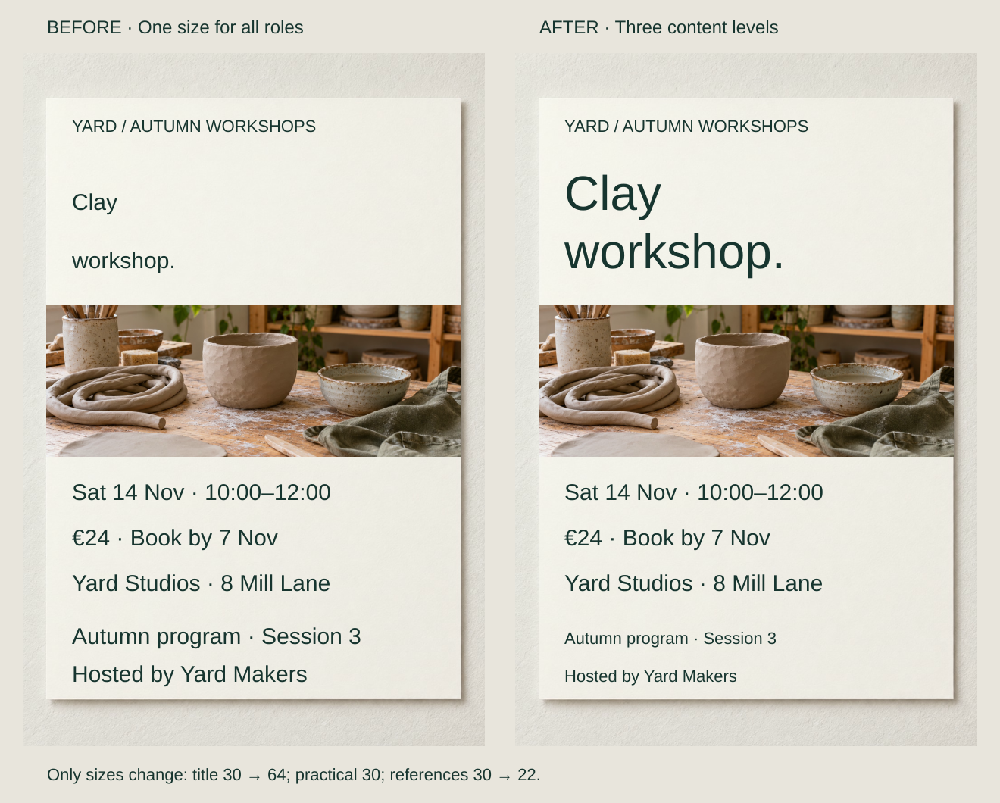
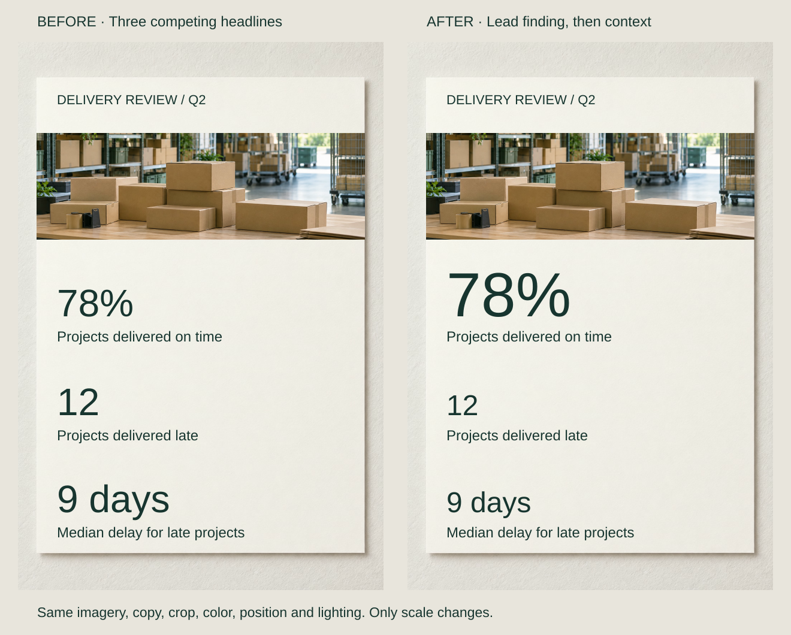

A workshop notice gives the course name, price, date and host the same treatment. Each line is readable, but the visitor must inspect the whole list to establish its priorities.

Choose what introduces the piece, what supports a decision and what serves as reference. Then distinguish those roles through a small number of dependable treatments. A focal point is the leading part of that hierarchy; size is one way to express it.

## What to notice

[Stacked narrow-screen view](../assets/graphic-design/levels-clay-course-mobile.svg)

Make “Clay workshop” the lead, attendance details the practical level, and programme/host lines the reference level. Enlarge the two title lines from 30 to 64, retain practical lines at 30 and reduce references to 22. Baselines, weights and imagery stay fixed.

Different roles no longer make equal visual claims. The price and deadline remain substantial because they affect attendance. A regular visitor checking dates might need a different lead; the illustrated values are artwork units, not prescribed print sizes.

## Two variations

### Give a finding priority without hiding exceptions

[Full-size comparison](../assets/graphic-design/scale-report-metrics-photographic.svg) · [Stacked narrow-screen view](../assets/graphic-design/scale-report-metrics-photographic-mobile.svg)

Three report metrics initially share headline status. Increase the 78% on-time result from 64 to 104 units and reduce “12” late projects and “9 days” median delay to 48. Their labels and positions stay fixed.

This introduces an overview before its qualifying context. A failure investigation could reasonably lead with delays instead. Do not enlarge the flattering figure merely to soften the exceptions. These callouts signal editorial priority, not proportional numerical magnitude, and still need definitions and a benchmark elsewhere.

### Reduce competing action emphasis

[Stacked narrow-screen view](../assets/graphic-design/focal-booking-action-mobile.svg)

Leave “Download ticket” filled. Remove the fills from “Add to calendar” and “Get directions,” changing their labels to dark ink while preserving outlines and target dimensions. The primary action gains distinction by reducing competition.

GOV.UK’s button guidance supports distinguishing main and secondary actions; this custom outlined treatment is an editorial application. Directions could be the priority for someone outside the venue. Quieter controls must still look available and work with keyboard and focus behavior in a real interface.

## Useful when

Establish hierarchy when necessary information is present but competing equally, or minor context dominates the main decision. Coordinate rank across the composition: assigning every important fact its own focal treatment creates another search problem.

### Use Scale to Establish Importance

Judge relative size. Enlarging everything preserves competition; enlarge the lead or reduce a competitor while keeping required details readable. Repeated roles need a reusable size vocabulary: see [[graphic-design-establish-a-type-scale|Establish a Type Scale]]. Check the actual viewing size rather than preserve a ratio at the expense of legibility.

## Watch out for

Importance follows the audience’s task, not organizational preference. Eligibility may deserve more prominence than a slogan. A catalogue or comparison table may need entries to remain peers; inventing a winner would distort its purpose.

Hierarchy expresses rank, while [[graphic-design-establish-a-clear-reading-order|Establish a Clear Reading Order]] handles the route onward. Equal-ranked procedural steps can still require a strict sequence. Stronger styling cannot repair a misleading content priority or guarantee a first fixation.

## Related patterns

- [[graphic-design-define-the-core-message|Define the Core Message]] selects the takeaway before emphasis.
- [[graphic-design-signal-relationships-through-similarity|Signal Relationships Through Similarity]] keeps recurring roles recognizable.
- [[graphic-design-balance-visual-weight|Balance Visual Weight]] considers distribution across the whole field.

## Further comparisons

- Give the event a clear introduction: [full-size comparison](../assets/graphic-design/scale-event-poster-photographic.svg) · [stacked view](../assets/graphic-design/scale-event-poster-photographic-mobile.svg).
- Reduce decoration that competes with the message: [full-size comparison](../assets/graphic-design/scale-workshop-promotion-photographic.svg) · [stacked view](../assets/graphic-design/scale-workshop-promotion-photographic-mobile.svg).
- Let the event identity lead the poster: [full-size comparison](../assets/graphic-design/focal-open-studios.svg) · [stacked view](../assets/graphic-design/focal-open-studios-mobile.svg).
- Isolate a pricing group without enlarging it: [full-size comparison](../assets/graphic-design/focal-pottery-price.svg) · [stacked view](../assets/graphic-design/focal-pottery-price-mobile.svg).
- Keep the same roles at the same level across records: [full-size comparison](../assets/graphic-design/levels-booking-roles.svg) · [stacked view](../assets/graphic-design/levels-booking-roles-mobile.svg).
- Promote a condition that determines whether an offer is useful: [full-size comparison](../assets/graphic-design/levels-day-pass-terms.svg) · [stacked view](../assets/graphic-design/levels-day-pass-terms-mobile.svg).

Open a comparison for its stated changes and limitations; choose the stacked view for a narrow screen.

## Sources and credits

[McGill: Visual hierarchy](https://www.mcgill.ca/web-services/resources/toolkits/digital-design-toolkit/design-principles/visual-hierarchy) · [Research on attentional guidance](https://doi.org/10.1038/s41562-017-0058) · [GOV.UK: Buttons](https://design-system.service.gov.uk/components/button/) · [W3C: Use of Color](https://www.w3.org/WAI/WCAG22/Understanding/use-of-color.html) · [W3C: Headings](https://www.w3.org/WAI/tutorials/page-structure/headings/) · [W3C: Contrast (Minimum)](https://www.w3.org/WAI/WCAG22/Understanding/contrast-minimum.html) · [Nielsen Norman Group: Visual Design Principles](https://www.nngroup.com/articles/principles-visual-design/).

These fictional design studies reuse AI-generated photography and native layouts. Intended readings are editorial judgments, not measured audience outcomes; full-size and narrow views retain the controlled comparisons.
