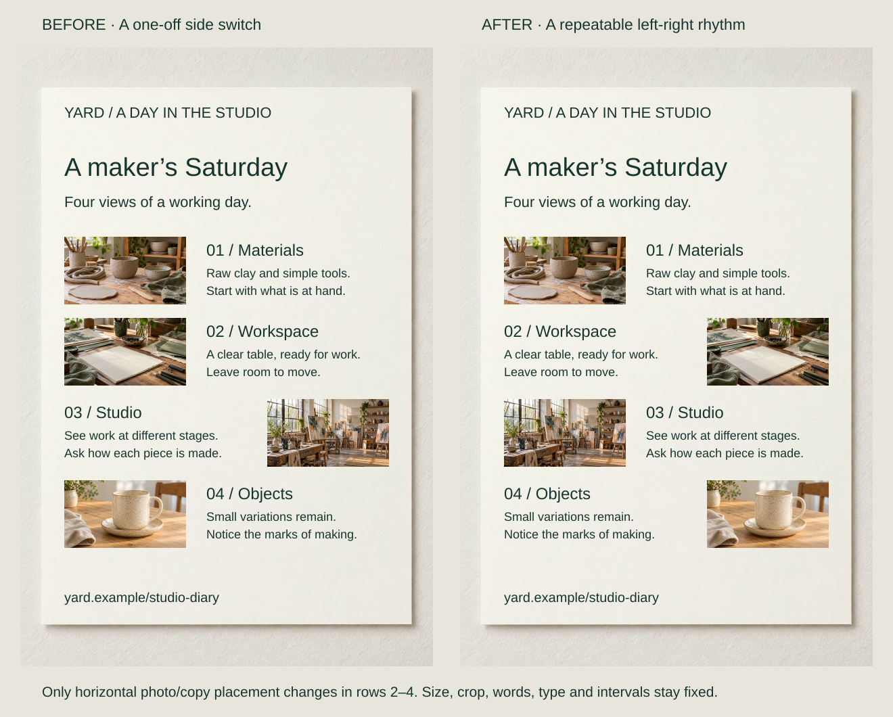
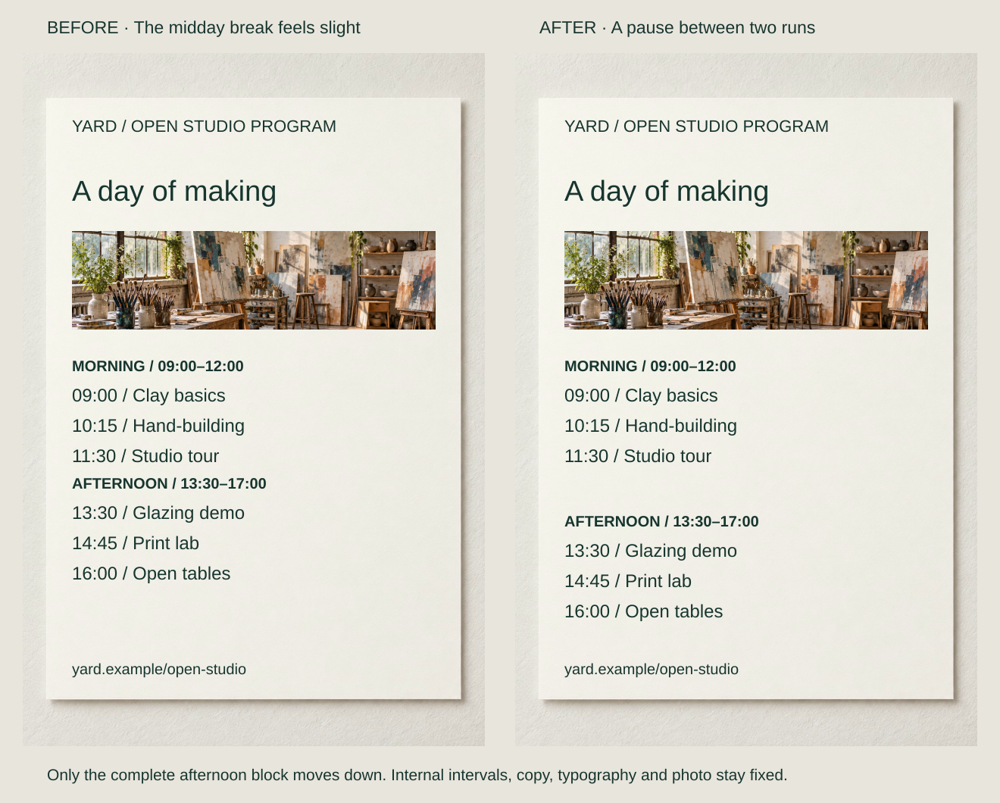
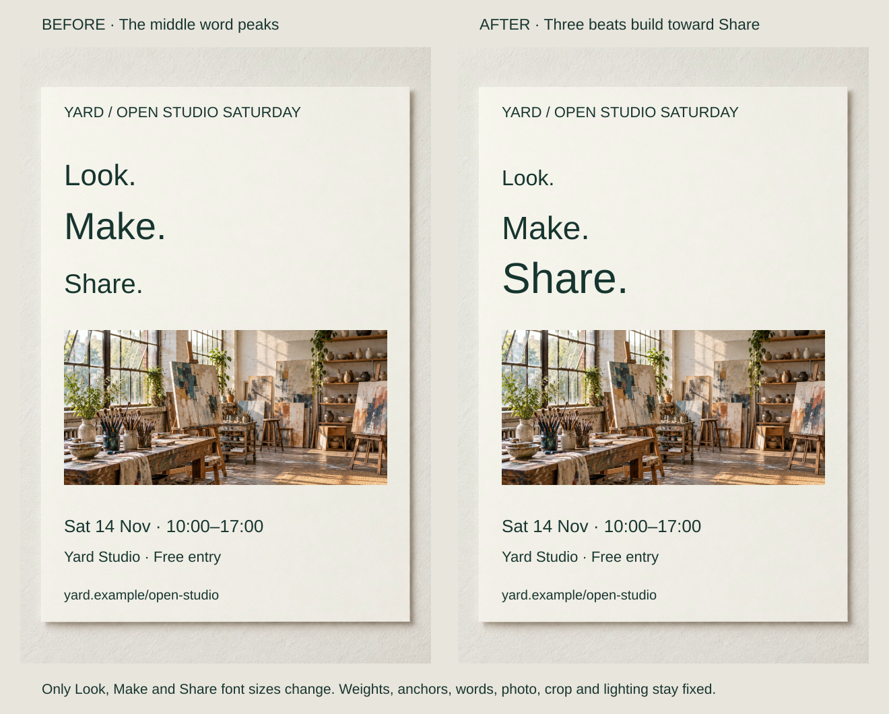

A maker’s diary places photos left, left, right, then left. The isolated switch suggests a distinction that its content does not supply. Deliberate alternation—or a steady repeated orientation—would give the variation a reason.

Choose what recurs, how it varies and where it pauses. Rhythm may repeat a row, alternate positions or progress through sizes. Getty and McGill use rhythm to describe repetition and flow; musical terms here describe visual relationships, not measured reading time.

## What to notice

[Full-size comparison](../assets/graphic-design/rhythm-studio-diary.svg) · [Stacked narrow-screen view](../assets/graphic-design/rhythm-studio-diary-mobile.svg)

Change the diary’s image sequence to left–right–left–right. Move only the photographs and intact copy blocks horizontally in rows two, three and four. Keep captions paired with their images, with all vertical positions, crops and treatments fixed.

A recurring alternation replaces one unexplained exception. The pattern gives changes a reference, but adds horizontal travel. A directory may work better with one stable orientation. If the third row really introduced a chapter, an explicitly labeled exception could be appropriate. Narrow layouts may need image/caption stacking rather than preserved alternation.

## Two variations

### Mark a real pause without disturbing the beat

[Full-size comparison](../assets/graphic-design/rhythm-open-studio-program.svg) · [Stacked narrow-screen view](../assets/graphic-design/rhythm-open-studio-program-mobile.svg)

An open-studio programme already repeats session baselines every 40 units. Move the complete afternoon block down 50 units, increasing the boundary after the morning run from 35 to 85. Internal spacing and every session stay fixed.

The longer interval reinforces the labeled change from morning to afternoon. It uses more vertical space and leaves less room for additions. A compact pocket reference might retain the original density. This timetable is not time-proportional: its gaps do not encode minutes.

### Make a progression agree with the message

[Full-size comparison](../assets/graphic-design/rhythm-look-make-share.svg) · [Stacked narrow-screen view](../assets/graphic-design/rhythm-look-make-share-mobile.svg)

“Look. Make. Share.” begins with sizes 44, 56 and 40, making MAKE the peak. For a brief culminating in showing and exchanging work, change only the sizes to 32, 48 and 64. Baselines, anchors, weights and imagery stay fixed.

Equal 16-unit increases create a recognizable buildup toward SHARE. That also changes hierarchy, so it would misrepresent a workshop where sharing was incidental. The smaller opening word still needs to work at the intended distance. The increments are an example, not a formula for momentum.

## Useful when

Use rhythm to coordinate a series of sections or images, distinguish a meaningful break or give variation an intelligible structure. A stable repeat lets an exception carry information rather than look like another arbitrary decision. Carbon’s spacing guidance similarly relates recurring intervals to grouping and separation.

A calm directory, varied editorial feature and emphatic short poster can need different rhythms. Start with that task rather than adding decoration to prevent sameness.

## Watch out for

Alternating everything creates unnecessary searching. Growing every item can invent rising importance; unvarying repetition can hide a genuine warning. Let the content justify changes in treatment.

A pause needs a continuation. Too much space can detach related information or make the sequence seem finished. Check the whole run after longer copy, larger text and narrower layouts change its geometry. Rhythm offers a structure for browsing, not control over where viewers look or how long they stay.

## Related patterns

- [[graphic-design-use-spacing-to-express-relationships|Use Spacing to Express Relationships]] sets the intervals through which repeats and pauses appear.
- [[graphic-design-signal-relationships-through-similarity|Signal Relationships Through Similarity]] keeps shared roles identifiable.
- [[graphic-design-establish-visual-hierarchy|Establish Visual Hierarchy]] assigns rank when a progression changes emphasis.
- [[graphic-design-establish-a-clear-reading-order|Establish a Clear Reading Order]] makes the route through units apparent.

## Sources and credits

[Getty: Vocabulary for Describing an Artwork](https://www.getty.edu/education/k-12-learning/describe-listen-draw/vocabulary-for-describing-an-artwork/) · [McGill: Rhythm](https://www.mcgill.ca/web-services/resources/toolkits/digital-design-toolkit/design-principles/rhythm) · [Carbon: Spacing](https://www.carbondesignsystem.com/building-blocks/foundations/spacing/overview).

These fictional designs reuse AI-generated photographs with separately composed typography and layout. Checks cover the saved comparisons; no audience study, measured attention benefit or physical print result is claimed.
