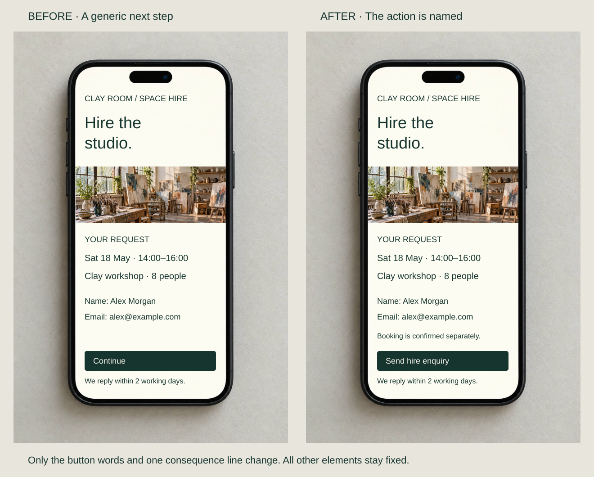
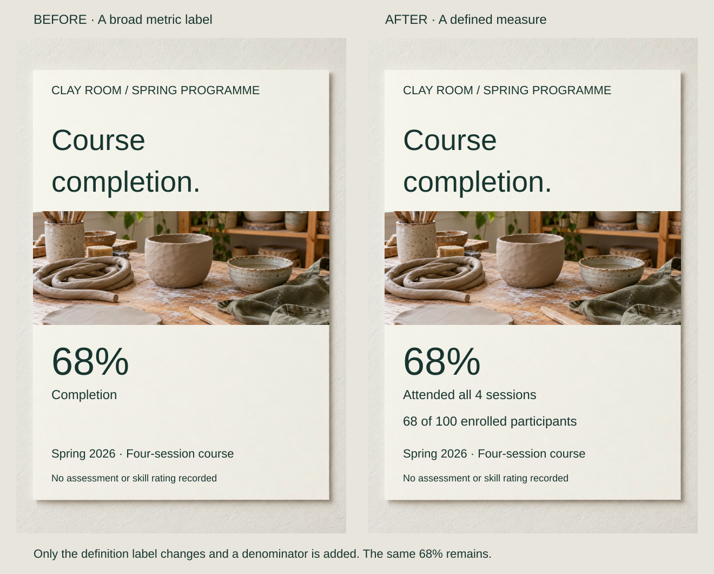
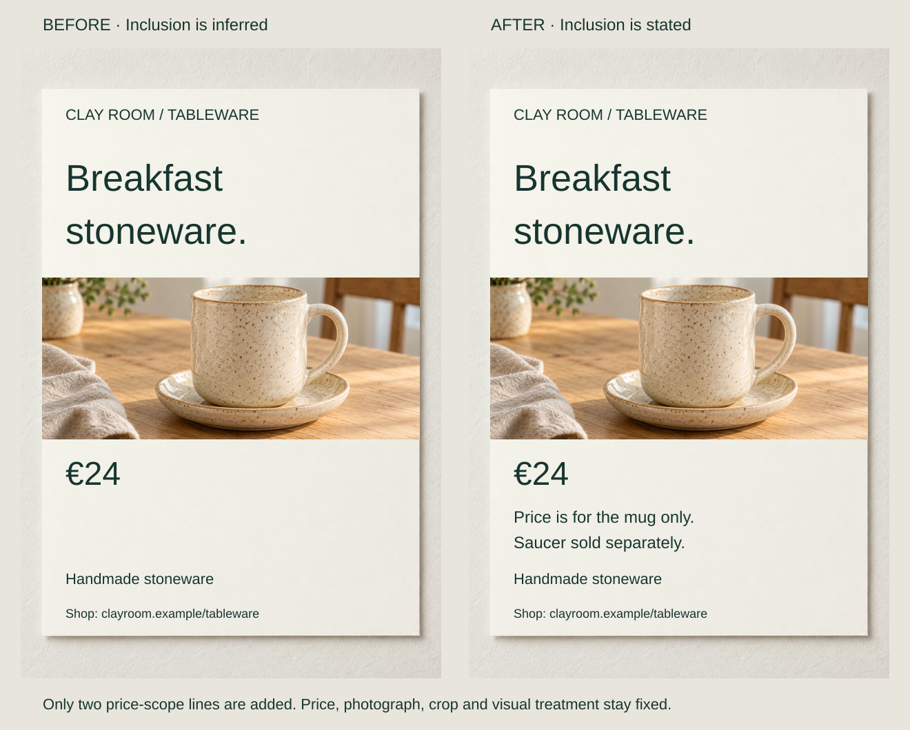

A studio-hire form asks a visitor to “Continue.” Does that send an enquiry, reserve the room or open another step? The action is visible; its consequence is not.

Resolve the particular inference that matters. Name the action, define the measure or state what a price includes. Add enough information to establish the intended meaning at the point where it is needed.

## What to notice

[Stacked narrow-screen view](../assets/graphic-design/explicit-hire-enquiry-mobile.svg)

Change the button to “Send hire enquiry” and add “Booking is confirmed separately.” Retain the two-working-day reply promise and the button’s visual treatment. The reader can distinguish sending details from securing a reservation.

The change supplies a consequence that generic progression wording leaves implicit. GOV.UK’s button guidance supports labels that describe behavior. This wording must match the actual service, including a confirmation state after submission; clear copy cannot establish successful delivery. “Continue” can be appropriate between ordinary, clearly framed steps.

## Two variations

### Define the counted event and population

[Stacked narrow-screen view](../assets/graphic-design/explicit-completion-report-mobile.svg)

A course report labels 68% simply “Completion.” Replace that label with “Attended all 4 sessions” and add “68 of 100 enrolled participants.” The percentage, cohort and no-assessment qualification stay fixed.

Precision in the number no longer disguises ambiguity in its definition. ONS chart-text guidance supports explicit measures and coverage; the numeric callout applies that attention editorially. The finding concerns attendance, not skill, satisfaction or causes. A familiar internal metric may need less repetition if its glossary remains available.

### Say what the photographed offer includes

[Stacked narrow-screen view](../assets/graphic-design/explicit-tableware-card-mobile.svg)

A €24 tableware card shows a mug with a saucer, although the price buys only the mug. Add “Price is for the mug only” and “Saucer sold separately” beneath the amount. The photograph and price stay fixed.

The clarification separates a purchasable item from its styled setting. It adds transactional language to a quiet composition, appropriate for a buying decision. A collection mood image without a price might not need it. If viewers still infer a set, use more suitable product imagery rather than accumulating explanations.

## Useful when

Use explicit wording where a reader could reasonably infer the wrong scope, relationship or next step. Place it beside the action, value or object it explains. The mechanism is not simply “more detail”: it supplies the missing link between visible information and its intended interpretation.

## Watch out for

A wall of qualifications can obscure the important one. Clarify what matters at this point, using familiar conventions where context supports them. An explanation far away or in unreadably small type may remain effectively disconnected.

Do not replace uncertainty with assertive language. Variable prices, provisional estimates and unconfirmed availability need that status expressed. Poetic covers or speculative exhibitions can deliberately invite interpretation; transactions and reported measures usually need firmer boundaries. First establish the underlying truth—wording cannot repair an undefined dataset, inaccurate offer or broken interaction.

## Related patterns

- [[graphic-design-define-the-core-message|Define the Core Message]] chooses the whole piece’s takeaway.
- [[graphic-design-design-for-the-audience|Design for the Audience]] identifies reasonable assumptions.
- [[graphic-design-remove-the-nonessential|Remove the Nonessential]] retains clarifications that earn their place.
- [[graphic-design-reinforce-meaning-beyond-color|Reinforce Meaning Beyond Color]] addresses meanings carried only by hue.

## Sources and credits

[GOV.UK: Buttons](https://design-system.service.gov.uk/components/button/) · [Chart text guidance](https://service-manual.ons.gov.uk/data-visualisation/guidance/chart-text).

Offers, attendance data and revisions are fictional. AI-generated photographs are reused within pairs; typography is composed separately. The mockups are static, with no user study or measured comprehension gain.
