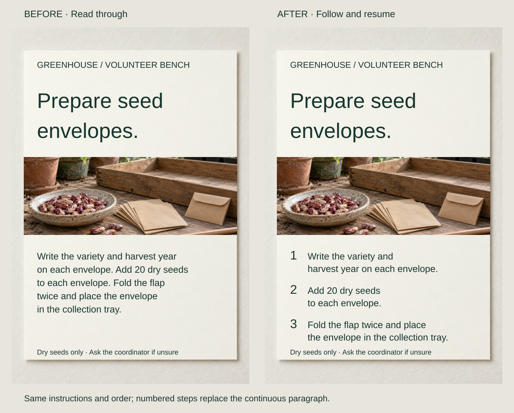
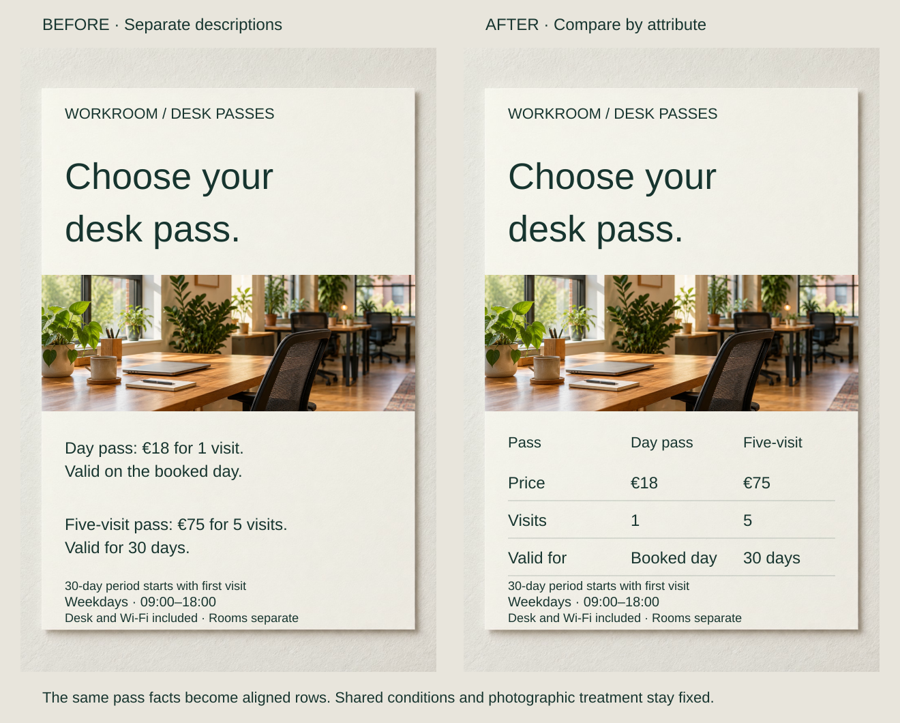
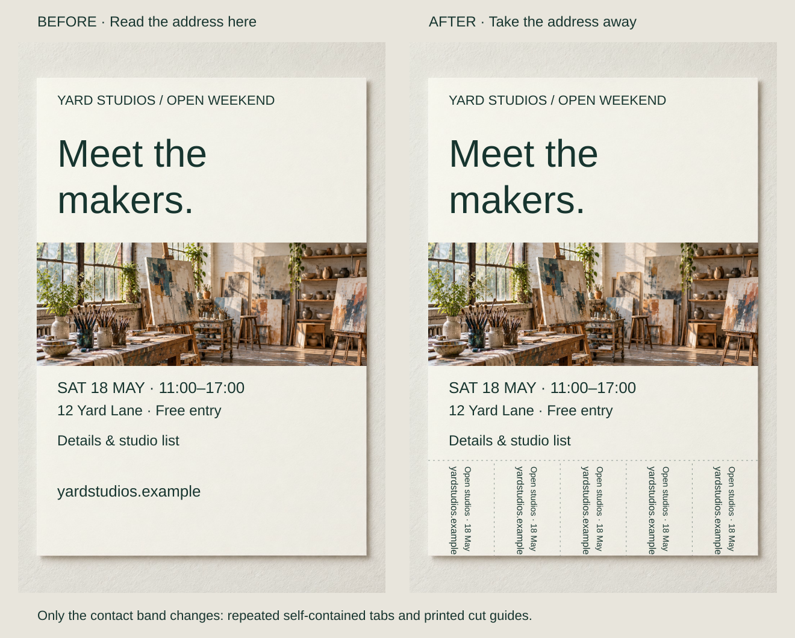

A volunteer packing seed envelopes looks back at a paragraph to find the next action. The instructions are accurate, but the sheet explains the process more comfortably than it supports performing it.

Choose a form for the operation: following, comparing, finding, carrying or exploring. A procedure, table and take-away tab let people use the same material differently. An attractive treatment cannot resolve a mismatch in structure.

## What to notice

[Stacked narrow-screen view](../assets/graphic-design/form-seed-procedure-mobile.svg)

Separate the seed-packing paragraph into three numbered steps: label the variety and harvest year, add 20 dry seeds, then close and place the envelope. Keep the instruction words, order and type size; add numbers, breaks and spacing.

Each action gets a stable location, so volunteers can return to step 2 rather than recover their place in a sentence. Coordinators can refer to the same number. The sheet grows, and numbering still cannot demonstrate an unfamiliar fold or record completed work. The quantity belongs to this fictional brief.

The original paragraph could work in a newsletter describing the activity. GOV.UK similarly distinguishes ordered journeys from reading and choosing among alternatives; applying that distinction to print is an editorial extension.

## Two variations

### Put comparable facts in corresponding places

[Stacked narrow-screen view](../assets/graphic-design/form-pass-comparison-mobile.svg)

Separate descriptions of a €18 day pass and €75 five-visit pass become a table with Price, Visits and Valid for rows. Shared hours, the 30-day starting condition and separate meeting-room charge remain below. No option gets promotional emphasis.

The table makes correspondences available to scan rather than remember. Its chosen attributes must be relevant: a lower per-visit price is not automatically better for one visit. Independent descriptions may suit fundamentally different offers; a wide table needs a deliberate phone layout.

### Let useful information leave the poster

[Stacked narrow-screen view](../assets/graphic-design/form-open-studios-tabs-mobile.svg)

An open-studios poster’s address band becomes five take-away tabs. Each repeats the address, event name and date so it remains meaningful after separation. The main invitation stays fixed.

The change makes a portable reminder possible instead of asking viewers to transcribe or photograph the address. Tabs require preparation, can run out and need a physical handling trial. The organizer must cut the vertical guides before display; the image shows artwork, not a tested fabrication. Photographs or a separate stack of cards could serve the same purpose.

## Useful when

Choose form before polishing when readers must repeatedly find a step, compare equivalent attributes or keep information for later. State the job concretely: “compare two passes” guides a format decision better than “communicate our offer.” GOV.UK’s table guidance supports rows and columns for comparison.

## Watch out for

Do not adopt a fashionable carousel, dashboard or fold without a task it supports. Numbering alternatives can imply a sequence that does not exist. One artifact need not do everything: a poster may introduce an event while a linked page supports booking, provided the connection and necessary terms remain usable.

Atmosphere, surprise and ambiguity are legitimate purposes too. A table might efficiently expose differences while flattening an editorial narrative. Test the artifact through its actual operation; form cannot repair false facts or a disputed objective.

## Related patterns

- [[graphic-design-design-for-the-audience|Design for the Audience]] defines the people and conditions the form serves.
- [[graphic-design-define-the-core-message|Define the Core Message]] chooses what it should establish.
- [[graphic-design-sequence-the-message|Sequence the Message]] orders material within the chosen form.
- [[graphic-design-build-reusable-templates|Build Reusable Templates]] makes a proven form repeatable.

## Sources and credits

[Table guidance](https://design-system.service.gov.uk/components/table/) · [Step by step navigation guidance](https://design-system.service.gov.uk/patterns/step-by-step-navigation/).

These fictional examples use AI-generated photographs with separately composed typography and layout. Image data is unchanged within pairs; usability and physical handling have not been tested.
