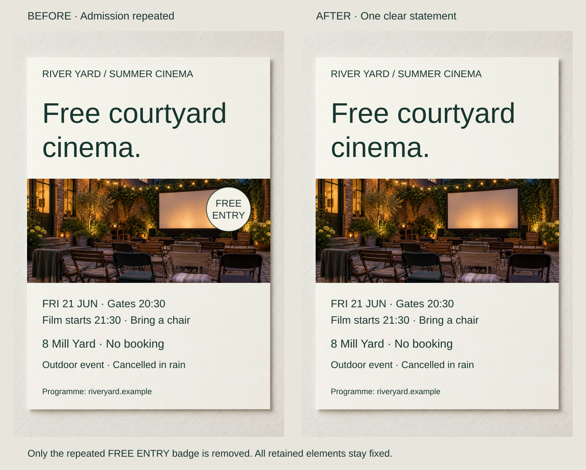
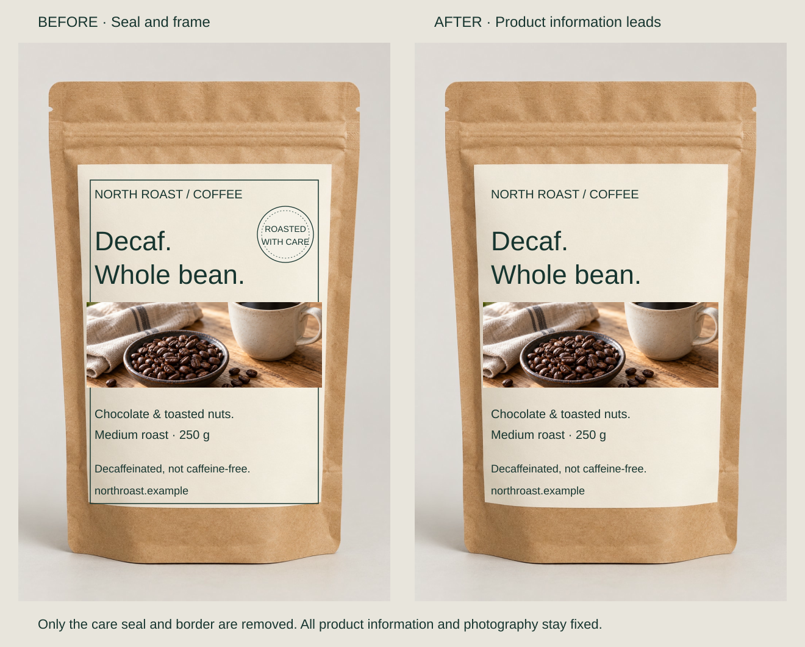
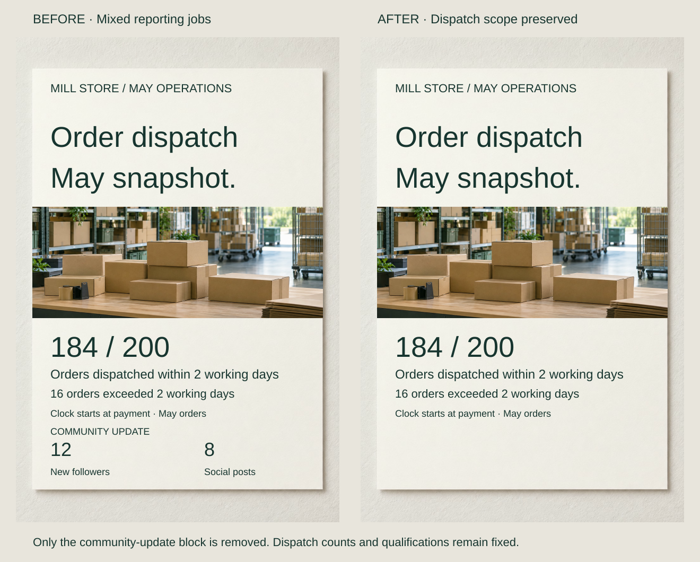

A cinema poster says “Free courtyard cinema” and repeats the admission claim in a prominent badge. The second signal covers the photograph without adding a fact. Removing it may help more than adding another treatment.

Judge inclusion against the audience and purpose. An element can earn its place through explanation, identity, atmosphere or a necessary qualification. “Nonessential” does not mean whatever prevents a sparse aesthetic.

## What to notice

[Stacked narrow-screen view](../assets/graphic-design/remove-cinema-poster-mobile.svg)

Delete the FREE ENTRY circle and lettering. Nothing else moves: gates, screening time, chair request, venue and rain cancellation remain. The headline still establishes free admission, while the photograph regains its covered area.

Subtraction removes one competing focal signal without removing the offer. But repetition can have a job: a badge may identify admission in social crops that omit the headline, or address a price readers repeatedly overlook. Test its contribution before deleting it.

Nielsen Norman Group’s minimalist-design guidance concerns relevance to tasks, not a universal visual style. Its interface rationale is applied editorially to these print examples.

## Two variations

### Remove an extra treatment, not the identity

[Stacked narrow-screen view](../assets/graphic-design/remove-coffee-package-mobile.svg)

Remove a coffee label’s “ROASTED WITH CARE” seal and fine frame. The name, typefaces, dark green ink, paper, photograph and tasting note retain substantial character. The existing label edge already contains the composition; the seal supplies no specific product distinction in this brief.

The package loses some traditional grocery character. A recognized seal or useful range identifier might deserve to remain. Keep “Decaffeinated, not caffeine-free”; necessary accuracy is not an ornamental burden. This comparison does not establish complete packaging requirements.

### Keep the report within its question

[Stacked narrow-screen view](../assets/graphic-design/remove-dispatch-report-mobile.svg)

A dispatch review includes followers and social-post counts copied from a monthly template. Delete that separate community block while retaining the timing definition, 184 timely dispatches out of 200 orders and all 16 exceptions.

The reader no longer has to determine how unrelated communications metrics explain dispatch. A general bulletin could reasonably include both topics. Deleting unfavorable delays instead would make the review more flattering and less honest. Dispatch also differs from arrival; subtraction cannot supply causes.

## Useful when

Remove duplicates, inherited template blocks or decorative devices whose contribution is weak relative to their cost. Inspect what remains after deletion. If the information is necessary but too dominant, reduce its emphasis rather than remove it. New open space is visible evidence of subtraction, not proof of better comprehension.

## Watch out for

Labels, conditions and explanations often look expendable to someone who already knows the subject. Check whether the design remains meaningful without them. Dense reference material may need grouping or another format instead of less content.

Decoration is not automatically waste. Bateman and colleagues’ study of selected charts found that embellishment need not reduce interpretation accuracy and could support later recall. That bounded finding challenges blanket minimalism; it does not validate every ornament. Preserve mood and recognition when those are part of the brief.

## Related patterns

- [[graphic-design-define-the-core-message|Define the Core Message]] provides a criterion for inclusion.
- [[graphic-design-design-for-the-audience|Design for the Audience]] identifies which explanations are necessary.
- [[graphic-design-establish-visual-hierarchy|Establish Visual Hierarchy]] reduces prominence when useful material should remain.
- [[graphic-design-use-spacing-to-express-relationships|Use Spacing to Express Relationships]] allocates the resulting open areas.

## Sources and credits

[Aesthetic and Minimalist Design](https://www.nngroup.com/articles/aesthetic-minimalist-design/) · [Useful Junk?](https://vis.csail.mit.edu/classes/6.859/readings/pdfs/Bateman-UsefulJunk.pdf).

The briefs, judgments and data are fictional. AI-generated photographs are reused within pairs; typography and deletion groups are composed separately. No reader study or measured improvement is claimed.
