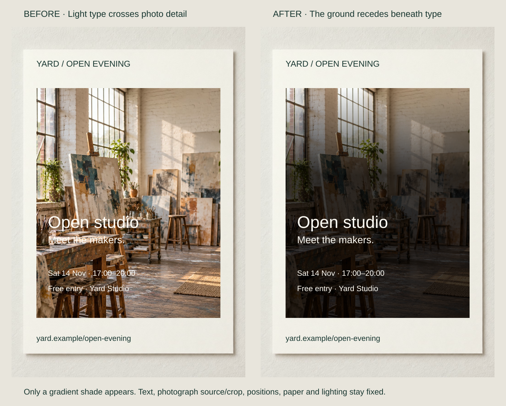

Pale visiting details cross a workshop photograph’s bright floorboards and furniture edges. Increasing type size leaves the conflict in place: the words still meet a changing, competitive ground.

Make the intended object or layer distinguishable from its surroundings. Figure–ground organization concerns which region owns a boundary and appears shaped by it; the supporting field can seem to continue behind. This is more specific than making everything louder.

## What to notice

[Full-size comparison](../assets/graphic-design/figure-ground-open-evening.svg) · [Stacked narrow-screen view](../assets/graphic-design/figure-ground-open-evening-mobile.svg)

Add a dark gradient between the studio photograph and all four text lines, preserving source, crop, position and typography. The ground immediately behind the words becomes more dependable while the upper photograph stays open.

Local tonal competition decreases, at the cost of detail beneath the text. The average darkness of a photograph cannot establish contrast behind every letter. W3C’s text-contrast guidance addresses that local relationship, but a ratio is not a complete account of figure–ground perception. If the obscured details matter, move text to a separate surface instead.

## Two variations

### Reveal a product contour through its ground

[Full-size comparison](../assets/graphic-design/figure-ground-loop-pitcher.svg) · [Stacked narrow-screen view](../assets/graphic-design/figure-ground-loop-pitcher-mobile.svg)

Change the charcoal pitcher’s rectangular backdrop from dark to pale warm gray. Reuse the identical cutout, handle opening and shadow at the same size and position.

The dark contour gains separation, including around the handle’s opening. No invented outline changes the product edge. The revision loses low-key atmosphere, which could be appropriate in a campaign image with other informative views. This catalogue image still cannot establish dimensions or replace additional views.

### Separate a dialog from its context

[Full-size comparison](../assets/graphic-design/figure-ground-date-dialog.svg) · [Stacked narrow-screen view](../assets/graphic-design/figure-ground-date-dialog-mobile.svg)

Add only a semitransparent dimmer over the underlying booking page, beneath the opaque confirmation dialog. Dialog text, controls and position remain fixed while competing background content recedes.

The foreground task becomes a distinct layer, but background information is harder to consult. An inline or nonmodal panel may suit tasks requiring that context. W3C’s modal-dialog guidance also requires appropriate focus management and an inert background; these visual mockups do not implement that behavior.

## Useful when

Inspect figure–ground when text, contours or interface layers are hard to separate despite adequate size. Diagnose the boundary and nearby field before choosing tone, transparency or an opaque surface. Perceptual research also implicates recognition and orientation; raw contrast does not settle every assignment.

### Control the Background

[Full-size comparison](../assets/graphic-design/background-studio-invitation.svg) · [Stacked narrow-screen view](../assets/graphic-design/background-studio-invitation-mobile.svg)

A local backing can protect text, or reduced pattern opacity can let a product lead without changing its surface. Keep necessary context available rather than dimming or blurring everything. A border alone does not neutralize busy detail inside it.

For a silhouette, preserve its shape and openings while adjusting the ground. Deciding whether contour alone carries enough information belongs to [[graphic-design-simplify-through-abstraction|Simplify Through Abstraction]].

## Watch out for

Shadows on every edge can add noise without fixing the actual boundary. Check every necessary word’s surroundings, including alternate crops and narrow layouts. An overlay that hides required context solves one problem by creating another.

Ambiguity can be purposeful in reversible marks, camouflage or low-key imagery. Judge it against the brief: an image rewarding slow exploration has different obligations from required visiting details or primary controls.

## Related patterns

- [[graphic-design-establish-value-contrast|Establish Value Contrast]] tests specific tonal separation.
- [[graphic-design-use-spacing-to-express-relationships|Use Spacing to Express Relationships]] can isolate a figure without dimming its surroundings.
- [[graphic-design-group-elements-within-shared-boundaries|Group Elements Within Shared Boundaries]] uses regions to express membership.
- [[graphic-design-crop-for-impact|Crop for Impact]] can choose less competitive surroundings.

## Further comparisons

- Give text a quiet field inside a photograph: [full-size comparison](../assets/graphic-design/frame-open-studio.svg) · [stacked view](../assets/graphic-design/frame-open-studio-mobile.svg).
- Let the product carry the detail: [full-size comparison](../assets/graphic-design/background-pitcher-texture.svg) · [stacked view](../assets/graphic-design/background-pitcher-texture-mobile.svg).
- Stop the photograph showing through the facts: [full-size comparison](../assets/graphic-design/background-booking-surface.svg) · [stacked view](../assets/graphic-design/background-booking-surface-mobile.svg).
- Protect the shape against its ground: [full-size comparison](../assets/graphic-design/silhouette-shears-ground.svg) · [stacked view](../assets/graphic-design/silhouette-shears-ground-mobile.svg).

Open a comparison for its stated changes and limitations; choose the stacked view for a narrow screen.

## Sources and credits

[Peterson and Salvagio: Figure-ground perception](https://doi.org/10.4249/scholarpedia.4320) · [Peterson and Gibson, 1994](https://journals.sagepub.com/doi/10.1111/j.1467-9280.1994.tb00622.x) · [W3C: Contrast (Minimum)](https://www.w3.org/WAI/WCAG22/Understanding/contrast-minimum.html) · [W3C: Dialog (Modal) Pattern](https://www.w3.org/WAI/ARIA/apg/patterns/dialog-modal/).

The content is fictional. Photographs are AI-generated; the same transparent pitcher file is reused against both grounds, retaining its partial transparency. Typography/layout are native. Artwork checks do not establish reader benefits.
