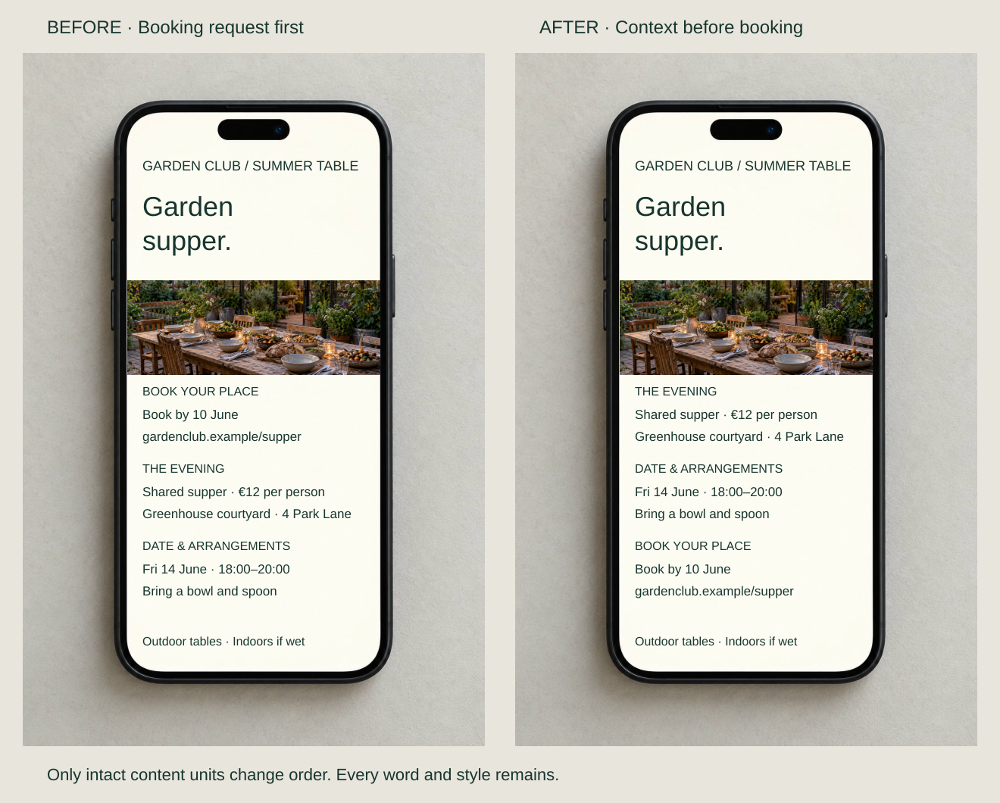
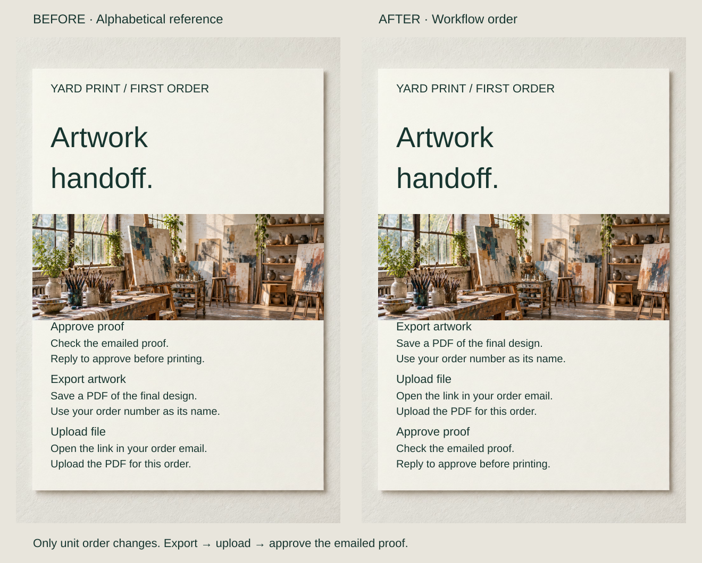
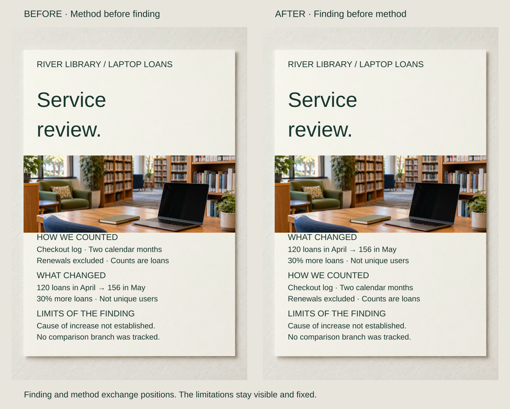

A supper invitation asks people to book before explaining the price, location and date. The facts are present, but the request arrives before its basis.

Order content around what the reader needs next. Context may precede a decision, preparation may precede an action, or a finding may introduce supporting detail. Choose that logic before making its visual route emphatic.

## What to notice

[Stacked narrow-screen view](../assets/graphic-design/sequence-informed-invitation-mobile.svg)

Move “The evening” first, “Date & arrangements” next and the unchanged booking block last. The €12 supper, venue, date and preparation details establish the offer before the request. The wet-weather footer stays fixed.

No information or emphasis changes. Reordering makes relevant context available before it is needed, reducing the unresolved questions the reader must carry forward. Returning guests who already understand the event might prefer booking first; a real invitation can offer them a direct route.

## Two variations

### Put dependencies before their use

[Stacked narrow-screen view](../assets/graphic-design/sequence-artwork-handoff-mobile.svg)

A print-studio handoff lists “Approve proof,” “Export artwork” and “Upload file” alphabetically. Move the intact sections into the actual workflow: export the PDF, upload it through the order-email link, then approve the studio’s emailed proof.

The same copy now supports first-time execution rather than topic lookup. Alphabetical order could suit a help center for returning customers. The progression must follow the real service, and needs updating when that service changes.

### Lead a review with a bounded finding

[Stacked narrow-screen view](../assets/graphic-design/sequence-service-review-mobile.svg)

Exchange “What changed” and “How we counted.” The opening now states that laptop loans rose from 120 to 156, or 30%; method and limitations follow. “Not unique users” stays beside the finding, while exclusions, lack of a comparison branch and unresolved cause remain available.

The result gives the counting method a subject. A method audit might reasonably begin with counting rules instead. Frontloading must never separate a claim from a qualification needed to interpret it.

## Useful when

Reorder when readers encounter actions before prerequisites or explanations after the decision they support. Google’s procedure guidance supports task order and preparation; ONS recommends frontloading important online information. Neither supplies one universal sequence for every artifact.

People skip, return and arrive through links, so retain descriptive headings and reasonably self-contained sections even when a main route is useful.

## Watch out for

Do not make familiar actions wait behind unnecessary background. Conversely, delaying fees or eligibility until after commitment makes a sequence misleading. Essential conditions belong before the choice they constrain.

Timetables, comparison tools and exploratory exhibitions can need several valid entry points. On digital pages, visual rearrangement must preserve a meaningful programmatically determinable order; W3C recognizes that independent material can have multiple valid sequences. Static layout alone does not establish that implementation.

## Related patterns

- [[graphic-design-chunk-information|Chunk Information]] chooses the units to order.
- [[graphic-design-establish-a-clear-reading-order|Establish a Clear Reading Order]] makes the progression visible.
- [[graphic-design-match-form-to-purpose|Match Form to Purpose]] checks whether a sequence is the appropriate form.
- [[graphic-design-define-the-core-message|Define the Core Message]] establishes what the sequence develops.

## Sources and credits

[Google's Procedures guide](https://developers.google.com/style/procedures) · [ONS Structuring content guide](https://service-manual.ons.gov.uk/content/writing-for-users/structuring-content) · [W3C's explanation of Meaningful Sequence](https://www.w3.org/WAI/WCAG22/Understanding/meaningful-sequence.html).

The briefs, values and revisions are fictional. Existing AI-generated photographs are reused within pairs with separately composed typography. No real event, service, library result or measured improvement is claimed.
