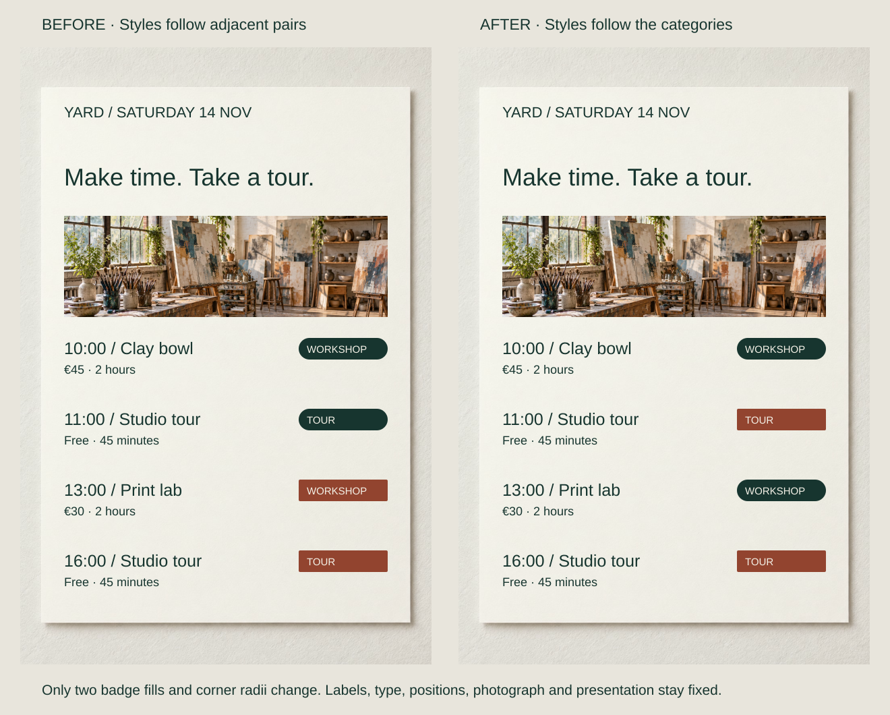
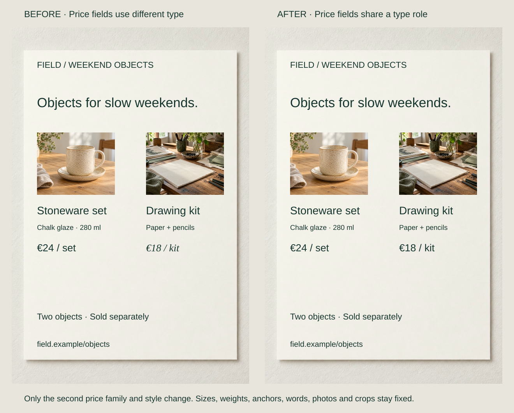

A programme styles one workshop and one tour as green pills, then gives the remaining entries terracotta rectangles. The labels are accurate, but appearance suggests a different organization.

Choose what a shared feature promises. Repeated color, shape or type can connect a category, role or behavior across separated elements. Similarity should follow that relationship rather than accidental neighbors.

## What to notice

[Full-size comparison](../assets/graphic-design/similarity-studio-program.svg) · [Stacked narrow-screen view](../assets/graphic-design/similarity-studio-program-mobile.svg)

Change the 11:00 tour to a terracotta rectangle and the 13:00 workshop to a green pill. Leave the first workshop and final tour fixed. Words, schedule, prices, positions and imagery remain unchanged.

Workshops now connect across intervening entries while the timetable retains chronological order. Color and shape reinforce explicit category words; neither inherently means “workshop.” With only four entries, coding may be unnecessary, and additional categories would need a more careful system.

Similarity provides a grouping cue, not a permanently dominant rule. Quinlan and Wilton’s controlled study found interactions between feature similarity and proximity. The programme applies that principle editorially, without measured selection or comprehension outcomes.

## Two variations

### Give equivalent prices one visual role

[Full-size comparison](../assets/graphic-design/similarity-product-prices.svg) · [Stacked narrow-screen view](../assets/graphic-design/similarity-product-prices-mobile.svg)

Change only “€18 / kit” from Georgia italic to upright Arial, matching “€24 / set.” Size, weight, color, baseline and anchor stay fixed. Local proximity still identifies each product; shared typography identifies price information across them.

An editorial shopping feature might deliberately give products different voices. For comparison, common price styling avoids an unexplained distinction. It must not imply that different commercial terms—monthly and one-time charges, for example—are equivalent.

### Remove a misleading member of the action group

[Full-size comparison](../assets/graphic-design/similarity-booking-controls.svg) · [Stacked narrow-screen view](../assets/graphic-design/similarity-booking-controls-mobile.svg)

Availability text uses the same filled rounded surface as “Book a place” and “Ask about access.” Hide only its background and change its text to dark ink. The two actual actions remain unchanged.

The surface now consistently suggests a control. Availability loses some emphasis; use a distinct status treatment if it needs more prominence. Its original appearance could be appropriate if it genuinely opened seat selection. These mockups do not implement focus, keyboard support or live updates.

## Useful when

Use similarity to connect distributed categories or recurring fields, and distinguish actions from static information. Choose a feature that survives the intended size and viewing conditions. Related elements can share one useful attribute without becoming identical in every respect.

### Assign Consistent Color Roles

Define a hue’s job within a stated scope, then repeat its assignment. A palette supplies swatches; roles decide where they belong. Preserve wording or another independent cue when color carries necessary information.

Keep typeface roles stable too. A serif/sans swap between equivalent entries invents a distinction. [[graphic-design-match-typeface-to-context|Match Typeface to Context]] chooses the partners; similarity governs their dependable assignments.

## Watch out for

One accent cannot simultaneously identify categories, warnings, prices and controls without creating ambiguous relationships. Conversely, shared membership need not erase priority or state: a destructive action may require an additional warning.

The original programme styling could identify morning and afternoon groups if that were its explained purpose. Judge the mapping against the intended question. Subtle hue or corner differences may disappear in reproduction; retain useful words rather than asking readers to memorize a fragile key.

## Related patterns

- [[graphic-design-use-spacing-to-express-relationships|Use Spacing to Express Relationships]] groups through relative distance.
- [[graphic-design-group-elements-within-shared-boundaries|Group Elements Within Shared Boundaries]] groups through common region.
- [[graphic-design-reinforce-meaning-beyond-color|Reinforce Meaning Beyond Color]] keeps hue-based mappings independently readable.
- [[graphic-design-establish-visual-hierarchy|Establish Visual Hierarchy]] allows related items to retain different priorities.

## Further comparisons

- Let the same pair keep its jobs: [full-size comparison](../assets/graphic-design/pairing-consistent-assignments.svg) · [stacked view](../assets/graphic-design/pairing-consistent-assignments-mobile.svg).
- Make equivalent booking actions look equivalent: [full-size comparison](../assets/graphic-design/color-roles-primary-actions.svg) · [stacked view](../assets/graphic-design/color-roles-primary-actions-mobile.svg).
- Keep a category’s color across a report: [full-size comparison](../assets/graphic-design/color-roles-studio-report.svg) · [stacked view](../assets/graphic-design/color-roles-studio-report-mobile.svg).
- Give different problems the same attention role: [full-size comparison](../assets/graphic-design/color-roles-order-status.svg) · [stacked view](../assets/graphic-design/color-roles-order-status-mobile.svg).

Open a comparison for its stated changes and limitations; choose the stacked view for a narrow screen.

## Sources and credits

[Quinlan and Wilton: Proximity and similarity](https://pure.york.ac.uk/portal/en/publications/grouping-by-proximity-or-similarity-competition-between-the-gesta/) · [Similarity Principle in Visual Design](https://www.nngroup.com/articles/gestalt-similarity/) · [W3C: Use of Color](https://www.w3.org/WAI/WCAG22/Understanding/use-of-color.html) · [Carbon: Button usage](https://carbondesignsystem.com/components/button/usage/).

The content is fictional. Reused AI-generated photographs and native typography/layout preserve image data and crops within pairs. Checks verify the artwork; the cited experiment did not test these applications.
