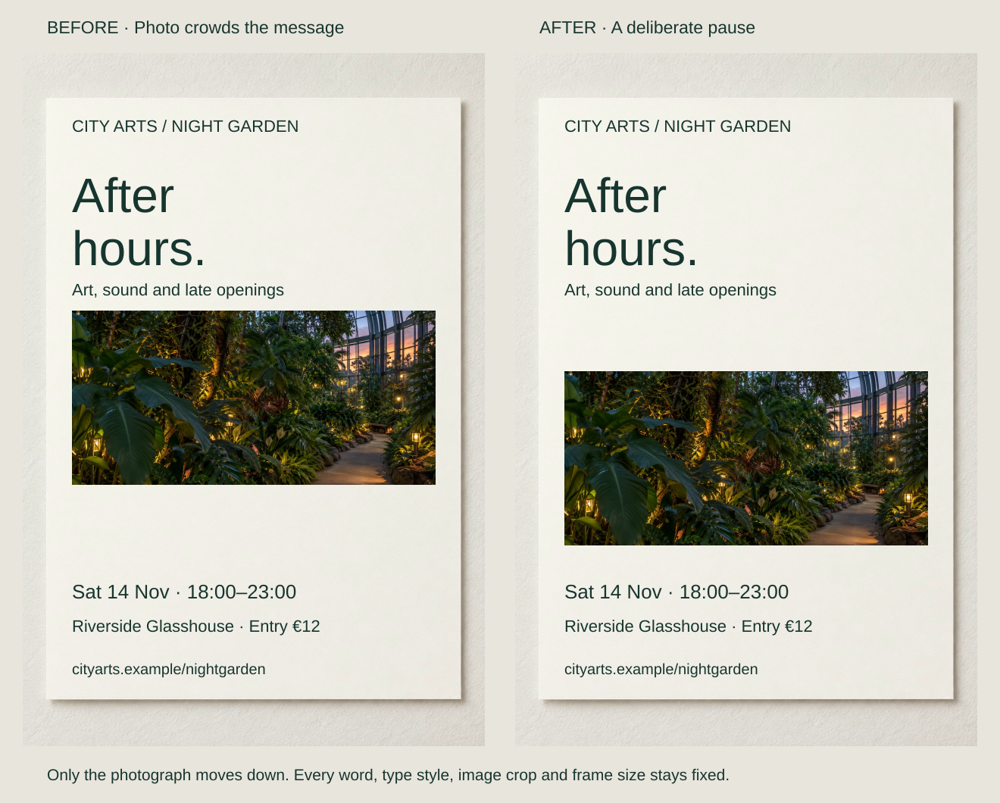
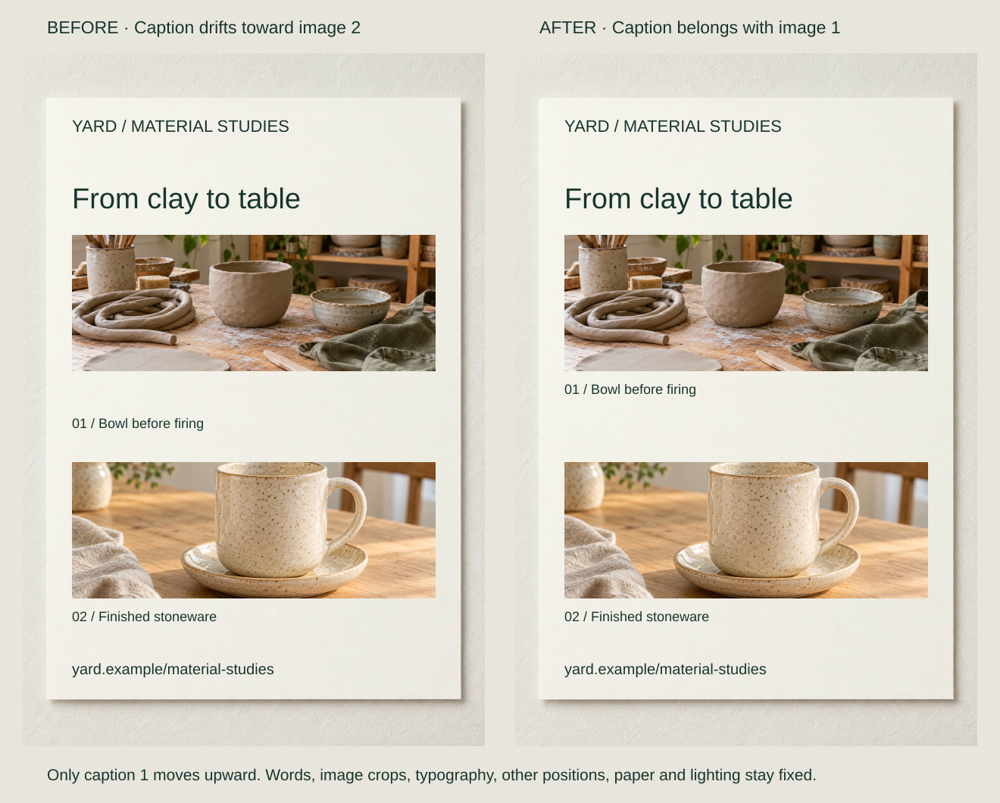

An invitation crowds its photograph against the introduction while leaving room below. Elsewhere, equal gaps make a price seem equally related to two titles. Both layouts contain space; its distribution expresses the wrong relationships.

Give intervals distinct jobs. Related material should sit closer than competing neighbors, and repeated relationships should receive dependable gaps. Consistency means equivalent relationships, not equal distances everywhere. Open space need not be white.

## What to notice

[Full-size comparison](../assets/graphic-design/space-evening-invitation.svg) · [Stacked narrow-screen view](../assets/graphic-design/space-evening-invitation-mobile.svg)

Move only the event photograph down 80 units, preserving its frame and every text position. A useful pause appears beneath the introduction by spending space previously held below the image.

This is redistribution, not a general increase in emptiness. The verbal opening becomes more distinct while the picture remains nearby. Moving it farther could crowd the date or detach it from the invitation; an integrated campaign might deliberately prefer a tighter relationship.

## Two variations

### Keep a caption in its image’s neighborhood

[Full-size comparison](../assets/graphic-design/proximity-material-captions.svg) · [Stacked narrow-screen view](../assets/graphic-design/proximity-material-captions-mobile.svg)

“01 / Bowl before firing” sits closer to the next photograph than its own. Move only that caption upward by 45 units. It now adopts the image-to-caption baseline offset used by the lower pair, with a larger gap before the competing image.

Spacing supports the relationship already stated by its number and wording. The same page space is redistributed, and a longer caption would need a new clearance check. These generated photographs illustrate stages; they do not document one physical object.

### Repeat the relationship after different heading heights

[Full-size comparison](../assets/graphic-design/spacing-studio-notes.svg) · [Stacked narrow-screen view](../assets/graphic-design/spacing-studio-notes-mobile.svg)

One paragraph begins 20 baseline units after a one-line heading; another starts 64 after a two-line heading. Set both first body baselines 32 units after their final heading baseline. Move the paragraphs, keeping headings, breaks and body leading fixed.

Consistency preserves the two-line heading’s extra height instead of forcing both paragraphs onto matching page coordinates. These are baseline measurements; production systems may instead use line-box edges. Recheck the visible result when font metrics or sizes change.

## Useful when

Adjust spacing when labels drift toward competitors, equivalent sections appear to follow different rules, or the page has room in the wrong place. Name each relationship—within-group gap, between-group pause, inner inset—before choosing a small repeatable vocabulary.

Relative proximity offers evidence of belonging without adding marks. It cannot choose the right semantic grouping: a spacious but incorrectly grouped offer still miscommunicates. Check relationships at narrow widths and with longer text instead of preserving numbers mechanically.

## Watch out for

More space can fragment prose, detach labels and increase scrolling. Dense reference material may benefit from compact regularity. Do not make all distances equal or use one “breathing room” rule for margins, leading and letters.

Shared conditions should not become part of one local offer simply because they fit there. Their scope may call for another placement or boundary. Preserve required details before deciding whether the overall page needs more room.

## Related patterns

- [[graphic-design-chunk-information|Chunk Information]] chooses the units that spacing expresses.
- [[graphic-design-group-elements-within-shared-boundaries|Group Elements Within Shared Boundaries]] handles inside/outside membership.
- [[graphic-design-adjust-line-spacing|Adjust Line Spacing]] sets intervals within multiline text.
- [[graphic-design-establish-a-grid|Establish a Grid]] provides recurring placement references.
- [[graphic-design-align-to-common-edges|Align to Common Edges]] coordinates their edges.

## Further comparisons

- Stop headings from floating between sections: [full-size comparison](../assets/graphic-design/space-workshop-details.svg) · [stacked view](../assets/graphic-design/space-workshop-details-mobile.svg).
- Make a card's inner space intentional: [full-size comparison](../assets/graphic-design/space-product-card.svg) · [stacked view](../assets/graphic-design/space-product-card-mobile.svg).
- Regular intervals between peer entries: [full-size comparison](../assets/graphic-design/spacing-open-studio-program.svg) · [stacked view](../assets/graphic-design/spacing-open-studio-program-mobile.svg).
- Matching cards need a shared inset: [full-size comparison](../assets/graphic-design/spacing-workshop-cards.svg) · [stacked view](../assets/graphic-design/spacing-workshop-cards-mobile.svg).
- Pair each session with its details: [full-size comparison](../assets/graphic-design/proximity-studio-schedule.svg) · [stacked view](../assets/graphic-design/proximity-studio-schedule-mobile.svg).
- Bring prices back to their products: [full-size comparison](../assets/graphic-design/proximity-product-prices.svg) · [stacked view](../assets/graphic-design/proximity-product-prices-mobile.svg).

Open a comparison for its stated changes and limitations; choose the stacked view for a narrow screen.

## Sources and credits

[USWDS: Typography](https://designsystem.digital.gov/components/typography/) · [McGill: Negative space](https://www.mcgill.ca/web-services/resources/toolkits/digital-design-toolkit/design-principles/negative-space) · [Nielsen Norman Group: Proximity](https://www.nngroup.com/articles/gestalt-proximity/) · [USWDS: Spacing units](https://designsystem.digital.gov/design-tokens/spacing-units/) · [Carbon: Spacing](https://www.carbondesignsystem.com/building-blocks/foundations/spacing/overview) · [Research on proximity grouping in dot lattices](https://www.psychologicalscience.org/journals/psychological-science/j.1467-9280.1995.tb00597.x/) · [Quinlan and Wilton: Proximity and similarity](https://pure.york.ac.uk/portal/en/publications/grouping-by-proximity-or-similarity-competition-between-the-gesta/) · [McGill: Proximity and region](https://www.mcgill.ca/web-services/resources/toolkits/digital-design-toolkit/design-principles/proximity-and-region).

These fictional design studies reuse AI-generated photography and native layouts. Intended readings are editorial judgments, not measured audience outcomes; full-size and narrow views retain the controlled comparisons.
