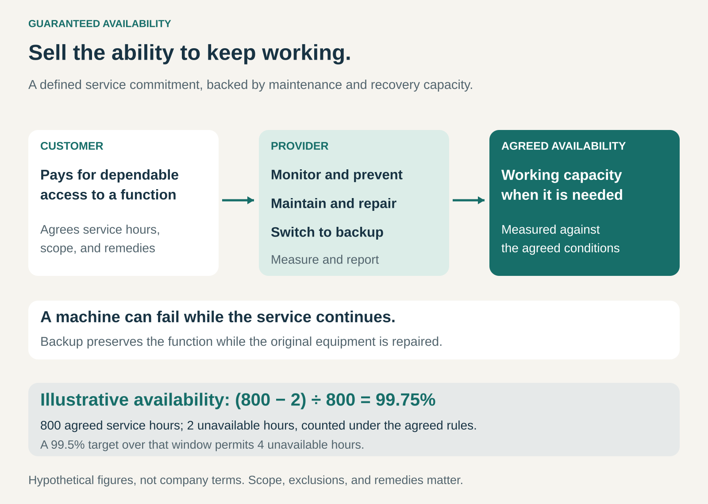

## What it is for

A machine stops working. Its repair costs $500, but the interruption leaves a production line idle, delays deliveries, and wastes an entire shift.

For the customer, the larger problem is losing the ability to work.

Guaranteed Availability addresses situations where dependable access to a product, service, or operating capacity matters more than the equipment itself. The provider commits to a defined level of availability and organizes maintenance, repairs, replacement capacity, and support around delivering it.

The promise is: **you can count on this function being available under the conditions we have agreed.**

## The core idea

Make readiness part of what the customer buys.

A conventional equipment sale transfers a working asset to the customer. A warranty may cover certain defects or repair costs. Guaranteed Availability adds responsibility for keeping an agreed function accessible over time.

That function might be compressed air at the required pressure, usable construction tools, or computing infrastructure.

The original equipment does not necessarily have to remain operational throughout. A replacement machine or backup system can preserve service while a failed component is repaired.

This makes an important distinction:

**Reliability concerns how consistently something works. Availability also depends on how quickly its function can be restored or replaced.**

The commercial commitment can be paid through a recurring fee, a usage charge, a premium service package, or a combination. Neither customer ownership nor a particular pricing method defines the pattern.

## How it works

The provider first defines what must remain available. “The compressor is running” may be insufficient if the customer needs clean, dry air at a particular pressure and volume.

It then builds the operating system behind the promise: monitoring, preventive maintenance, spare parts, technicians, logistics, and backup capacity.

A useful agreement makes several things clear:

- **Scope:** the equipment, function, capacity, and locations covered.
- **Service window:** when availability is required and measured.
- **Measurement:** what counts as unavailable, including partial failures.
- **Recovery:** response, repair, replacement, or restoration commitments.
- **Responsibilities and remedies:** customer obligations, exclusions, and what happens when the commitment is missed.

Response time deserves particular attention. A technician answering within an hour does not mean the service will be restored within an hour.

Likewise, “guaranteed” does not automatically mean uninterrupted operation or reimbursement of every loss. Its practical meaning depends on the commitment and remedy.

## Why it works

Customers often lack the resources to maintain dependable capacity efficiently on their own. A specialist provider may have better diagnostic knowledge, more spare parts, a wider service network, and enough customers to support shared backup resources.

The provider can turn those capabilities into something customers value: fewer interruptions and less responsibility for managing them.

The arrangement can also change incentives. When the provider bears repair costs or consequences for missed service levels, preventing failures becomes commercially valuable. Better engineering and faster recovery can improve both the customer’s experience and the provider’s economics.

That alignment depends on the terms. A small service credit may create much less incentive than an obligation to supply replacement capacity.

## Famous examples

### Kaeser: guaranteeing the compressed-air supply

Kaeser’s SIGMA AIR UTILITY combines system design, installation, operation, monitoring, and maintenance. Customers pay a basic price covering an agreed quantity of compressed air, with additional quantities charged at a contractual rate. Its programme literature explicitly includes guaranteed uptime, air quality, quantity, and stable pressure. [Kaeser compressed-air utility service](https://us.kaeser.com/services/compressed-air-as-utility-service/), [SIGMA AIR UTILITY brochure](https://pr.kaeser.com/en/download.ashx?id=tcm%3A164-109579)

The object of the offer is a usable supply of air. Kaeser’s brochure describes backup components and monitoring intended to maintain that supply during maintenance and repairs.

The transferable lesson is to define availability around what the customer needs to accomplish. A functioning compressor alone does not establish that production has the air it requires.

### Hilti: keeping access to working tools

Hilti’s Tool Fleet Management includes repairs and access to loan tools that help customers continue working while equipment is being serviced. Its US repair guidance describes loaner requests and notes that exclusions apply. [Hilti US repair support](https://www.hilti.com/content/resources/faqs/local/support-repair)

Some local offers also make explicit restoration commitments. Hilti India, for example, advertises guaranteed repair turnaround in selected areas, with the repair free if the promised turnaround is missed. [Hilti India repair service](https://www.hilti.in/content/resources/tool-support/local/tool-repair)

These are bounded commitments, rather than a universal promise of uninterrupted tool access. They illustrate two practical components of the pattern: shorten the interruption and provide an alternative while the original asset is unavailable.

The lesson is that service geography, eligible equipment, and replacement conditions are part of the product.

### Amazon Web Services: availability defined through a service-level agreement

Amazon EC2’s region-level service-level agreement sets a 99.99% monthly uptime commitment for qualifying deployments across multiple Availability Zones. A separate commitment applies to individual instances. Eligible failures can lead to service credits, subject to definitions, exclusions, and claim requirements. [Amazon Compute service-level agreement](https://aws.amazon.com/compute/sla/)

The configuration matters: the headline percentage does not apply indiscriminately to every setup. Nor does infrastructure availability establish that a customer’s entire application is working.

AWS demonstrates how availability can become an explicit commercial attribute with a measurement method and financial remedy. It also shows the boundary: a credit against infrastructure charges can be much smaller than the customer’s business losses.

## The economics

Customers compare the price of the commitment with the cost and burden of managing interruptions themselves.

That burden can include idle staff, lost output, emergency rentals, expedited shipping, and maintaining their own spare equipment.

For the provider, revenue must cover more than ordinary maintenance:

**Service revenue must fund prevention, repairs, logistics, backup capacity, administration, and the financial consequences of missed commitments.**

Spare capacity has a cost even when it sits unused. Its purpose is to make recovery possible.

Pooling resources across customers can improve efficiency, but only within limits. A common defect, regional disruption, or overloaded repair network can affect many customers simultaneously.

The provider therefore needs to understand both typical service costs and expensive periods when several obligations come due together.

## Useful when

- Downtime creates substantial operational or financial consequences.
- Customers value dependable capacity and predictable support.
- The provider can meaningfully influence failures and recovery.
- Availability can be measured in terms relevant to the customer.
- Maintenance expertise, spare resources, or service coverage create an advantage.
- Customers will pay enough to fund the capability behind the promise.

## Common mistakes and limits

**Selling a percentage without defining the experience.** Availability averaged over a long period can conceal an interruption at the worst possible time. Maximum outage duration or time to restore service may matter alongside the percentage.

**Confusing maintenance coverage with availability.** Paying for repairs does not necessarily keep operations running. Replacement equipment, redundancy, or a restoration deadline may be necessary.

**Promising more than the provider controls.** Electricity, customer misuse, external networks, and upstream suppliers can affect service. Responsibilities need to match the actual operating dependencies.

**Making the remedy the whole product.** Compensation after an outage does not restore lost production. The operating capability behind the guarantee remains central.

**Underfunding backup and recovery.** A low service price can look attractive until a major failure reveals that replacement assets or technicians are unavailable.

**Assuming availability guarantees quality or safety.** Equipment can be accessible yet perform poorly. Capacity, output quality, and safe operation need their own clear requirements.

## Related patterns

[[product-as-a-service|Product as a Service]] bundles an asset with continuing service responsibilities. Guaranteed Availability specifies the readiness or continuity the provider commits to deliver; the two often appear together.

[[outcome-based-pricing|Outcome-Based Pricing]] links payment to an agreed result. Availability can be that result, although an availability commitment can also accompany fixed or usage-based charges.

[[retainer|Retainer]] pays for continuing access to expertise or capacity. Guaranteed Availability adds a defined service commitment beyond simply having support on call.

[[solution-provider|Solution Provider]] takes responsibility for a broader customer problem. Guaranteed Availability can make one part of that responsibility concrete and measurable.
