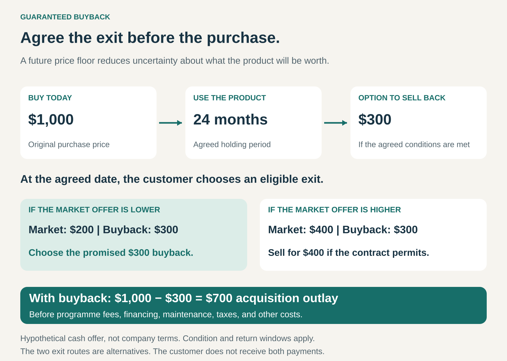

## What it is for

A customer wants the product but hesitates over what happens later. Will the car depreciate sharply? Will the laptop become difficult to sell? Will upgrading mean accepting an unpredictable trade-in offer?

Guaranteed Buyback reduces that uncertainty by establishing an exit value before the customer commits.

The seller, finance provider, or programme partner promises to take back an eligible product at a specified future value, subject to agreed conditions.

The proposition is: **buy it knowing what you can recover when you are ready to move on.**

## The core idea

Combine a purchase with an option to sell the product back.

The guarantee might specify a fixed amount, a percentage of the original purchase price, or a schedule that changes with the product’s age. Its defining feature is an advance commitment that protects the customer against some uncertainty about future resale value.

That distinguishes it from an ordinary trade-in service. A company offering to assess a used product later has not necessarily guaranteed its future value.

The benefit can take different forms:

- **Cash buyback:** the customer receives money for returning the eligible product.
- **Guaranteed upgrade credit:** the value applies toward another purchase.
- **Finance-linked return:** returning the product satisfies an agreed remaining payment obligation, subject to the finance terms.

These arrangements provide different kinds of protection. Store credit requires further spending. A finance return may settle a balance without putting cash in the customer’s hands.

## How it works

Consider a hypothetical product costing **$1,000**, with a guaranteed cash buyback of **$300 after 24 months**.

If the available market offer is then $200, the customer can exercise the eligible buyback and receive $300. If an outside buyer offers $400, the customer may prefer that route, provided the agreement permits it.

The guarantee provides a fallback. It does not mean the customer must return the product, or that the guaranteed amount is the highest price available.

The agreement must make the practical terms clear: eligible products, return dates, condition requirements, usage limits, necessary accessories, deductions, and whether another purchase is required.

The provider also needs a process for inspecting, collecting, refurbishing, and reselling returned products.

For the customer who exercises the illustrative buyback, purchase price minus the payment is **$700**. That is an acquisition outlay before programme fees, financing, maintenance, taxes, and other costs—not a complete cost-of-ownership calculation.

## Why it works

The purchase decision becomes easier when the customer can see a credible route out.

This can matter particularly for expensive products, unfamiliar technologies, and products customers expect to replace regularly. The customer gains a clearer basis for comparing the cost of buying and using different options.

The provider may benefit through stronger purchase confidence, repeat business, and a supply of used products for refurbishment or resale.

A guarantee can also signal confidence in the product’s durability and future demand. However, willingness to make the promise does not establish that the product will retain its value. The commercial value of the guarantee depends on its terms and the provider’s ability to honour it.

## Famous examples

### Tesla: an early resale-value guarantee for the Model S

Tesla introduced a resale-value guarantee with its financing offer in 2013. Eligible customers could later sell their Model S back to Tesla at a value established through the programme. [Tesla’s 2013 announcement](https://ir.tesla.com/press-release/tesla-improves-financing-product-best-resale-value-guarantee-and)

A published 2016 agreement specified an exercise window between months 36 and 39. Its guaranteed value combined 50% of the original base-vehicle price with 43% of eligible options, subject to financing, maintenance, mileage, and condition requirements. [Tesla’s historical guarantee agreement](https://www.tesla.com/sites/default/files/pdfs/rvg/RVG_Agreement_R20160318_en_US.pdf)

This historical programme shows how a buyback promise can address uncertainty around an unfamiliar product category.

It also demonstrates why the conditions matter: the guarantee covered a defined vehicle, owner, period, and usage profile.

### Samsung: a scheduled exit value for smartphones

Samsung’s Galaxy Forever programme in India combines eligible smartphone purchases with assured buyback and device protection through its service partner Servify.

The published offer assigns buyback percentages to different return periods. Customers can choose among eligible return, upgrade, and retention routes. Programme fees and financing obligations remain part of the economics; returning the device does not automatically erase every outstanding payment. [Samsung Galaxy Forever](https://www.samsung.com/in/galaxy-forever/), [programme terms](https://images.samsung.com/is/content/samsung/assets/in/tnc/galaxy-forever-tnc.pdf)

The mechanism gives customers a known valuation schedule rather than leaving the entire exit price to a future market assessment.

The lesson is to consider the purchase, protection plan, buyback, and financing together. An attractive recovery percentage alone does not establish the total cost.

### HP: guaranteed value tied to another purchase

HP’s 2019 Upgrade Program in India offered a minimum buyback-value schedule for eligible laptops between months 12 and 36, subject to condition requirements.

The programme provided the higher of the assessed current value and the assured value. Redemption took the form of a discount on a new purchase at participating stores, with that purchase required at the same time. [HP Upgrade Program’s historical terms](https://www.hpupgradeprogram.com/Redemption/PUPCustomerTC04Apr2019.pdf)

This illustrates the difference between a guaranteed upgrade allowance and a cash exit.

The customer received protection against a low valuation, while HP connected that protection to a subsequent transaction. The benefit therefore depended partly on whether the customer wanted to buy again through the programme.

## The economics

The provider is accepting exposure to future resale values.

A useful starting point for each returned item is:

**Net recovery = resale proceeds − buyback payment − collection, inspection, refurbishment, and selling costs.**

Suppose the provider pays the promised $300, spends $40 preparing and selling the product, and resells it for $250. That return produces a **$90 shortfall**, before considering the original sale’s contribution, programme fees, or other income.

The whole arrangement can still be commercially viable. It must earn enough across sales, fees, repeat purchases, and resale activity to cover its obligations.

Returns are unlikely to be random. Customers have a stronger reason to exercise the guarantee when the market offers less. When outside offers are higher, they may sell elsewhere. Forecasting costs from the average used-product value alone can therefore underestimate exposure.

Market shocks can also affect many products at once. The provider needs both conservative valuation assumptions and sufficient cash to meet a wave of eligible returns.

## Useful when

- Uncertain resale value is a meaningful barrier to purchase.
- Customers expect to replace or upgrade the product.
- Returned products retain recoverable value.
- Condition and usage can be assessed consistently.
- The provider has effective collection and resale capabilities.
- Fees, margins, and financing can support the guarantee.
- Customers understand whether the benefit is cash, credit, or settlement of a balance.

## Common mistakes and limits

**Presenting a future estimate as a guarantee.** A valuation calculated only at return time provides convenience, but may offer little protection against depreciation.

**Advertising recovery while obscuring total cost.** Programme fees, financing charges, and a required new purchase can materially change the value to the customer.

**Making eligibility difficult to preserve.** Narrow return windows or demanding condition rules can weaken a promise customers expected to use after ordinary ownership.

**Treating guaranteed value as guaranteed equity.** A product can qualify for a buyback payment while the customer still owes more to a lender.

**Ignoring resale costs and timing.** Returned products require working capital, storage, inspection, and buyers. Their value can fall while they wait.

**Assuming take-back automatically creates environmental benefit.** Reuse and refurbishment can extend product life, but outcomes depend on what happens to returned products and whether the programme accelerates replacement.

## Related patterns

[[outright-sale|Outright Sale]] transfers a product for a purchase price. Guaranteed Buyback adds a future exit option to that transaction.

[[leasing|Leasing]] can provide a defined return route within a different ownership and payment structure. A buyback attached to a purchase does not automatically make it a lease.

[[product-as-a-service|Product as a Service]] organizes continuing access and support around a product. Guaranteed Buyback can support planned replacement without requiring a continuing service model.

[[razor-and-blade|Razor and Blade / Bait and Hook]] connects an initial purchase to later revenue. Upgrade-linked buyback can similarly encourage repeat purchases, although the customer benefit comes from the promised exit value.
