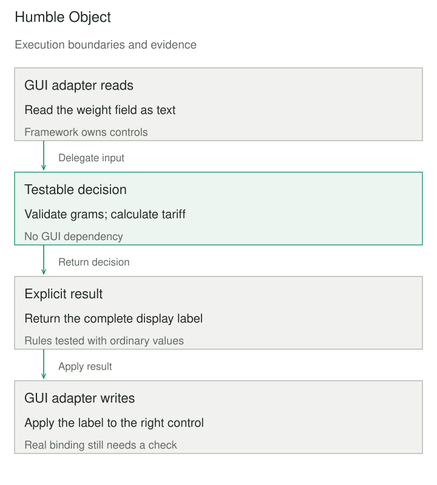

## Purpose and problem

A shipping screen reads a weight field, chooses a tariff, formats a price, and updates a GUI label inside one click callback. Checking a rounding boundary requires starting the toolkit, constructing controls, and driving an event loop. Tests are slow and awkward, so the most consequential rules receive the least coverage.

The difficulty is that framework interaction and application decisions share the same execution boundary. The team needs both confidence in the rules and a working screen, without making every rule test depend on the screen’s infrastructure. Humble Object reduces the behavior that must be exercised through that difficult interface.

## Core idea

**Make the boundary small; move the interesting decisions somewhere testable.** Extract validation, calculation, and presentation decisions into an ordinary collaborator. The remaining adapter reads framework values, delegates, and writes the returned result.

Fowler credits Michael Feathers with the name and points to Gerard Meszaros’s treatment. The idea applies beyond GUIs: a message listener, timer callback, device driver wrapper, or framework-managed endpoint can be the difficult boundary. It is a testability technique, not a requirement to make all application code pure or to replace every external dependency.



## How it works

First identify what makes the original component difficult to test. It may require a process, UI thread, framework lifecycle, physical device, or unavailable dependency. Extract behavior along that boundary rather than mechanically moving methods into a second class with the same global dependencies.

Give the extracted collaborator explicit inputs and observable outputs. If the behavior needs time, randomness, or a service, supply a suitable value or interface. The adapter retains framework-specific conversion and lifecycle obligations; the collaborator owns the decisions that can be expressed independently.

Keep one place responsible for mapping results back to the framework. For a view, that includes which field receives an error and whether stale asynchronous results should be ignored. For a queue listener, it includes acknowledgment and retry behavior. An extracted function cannot make an incorrect acknowledgment policy safe merely because its arithmetic is tested.

The separation allows most cases to run cheaply and deterministically. It also makes remaining integration checks clearer: does the real callback read the correct control, invoke the collaborator with the right value, and apply the returned result? A thin adapter is a smaller verification target, not an exemption from verification.

Ownership still matters. The GUI normally owns controls and dispatches updates on its UI thread. The collaborator should not retain references to short-lived widgets or mutate shared screen state behind the adapter. If work runs elsewhere, define cancellation and delivery of results explicitly; the synchronous example below supplies no concurrency policy.

## Worked example

### Shipping-label decisions without a GUI

Originally the callback contained parsing, weight limits, tariff arithmetic, and control writes. Here `shipping_label` owns those decisions. `on_quote` is the humble boundary, supplied with the framework’s read and write operations.

The invented tariff is 500 US cents for the first 1,000 grams, plus 200 cents for each additional started kilogram. Inputs must be one to six ASCII digits representing a positive weight no greater than 20,000 grams. The complete Python 3 program uses only the standard library.

```python
def shipping_label(raw):
    if not 1 <= len(raw) <= 6 or any(c not in "0123456789" for c in raw):
        return "Enter a whole weight in grams"
    grams = int(raw)
    if not 1 <= grams <= 20000:
        return "Weight must be 1–20000 grams"
    cents = 500 + 200 * ((grams - 1) // 1000)
    return f"Shipping: {cents} US cents"


def on_quote(read_text, write_label):
    write_label(shipping_label(read_text()))


if __name__ == "__main__":
    assert shipping_label("1000") == "Shipping: 500 US cents"
    assert shipping_label("1001") == "Shipping: 700 US cents"
    assert shipping_label("0") == "Weight must be 1–20000 grams"
    assert shipping_label("1.5") == "Enter a whole weight in grams"
    displayed = []
    on_quote(lambda: "1001", displayed.append)
    assert displayed == ["Shipping: 700 US cents"]
    print(displayed[0])
```

It prints `Shipping: 700 US cents`. The two neighboring weights reveal the rounding boundary, while zero and decimal input exercise separate rejection paths. The adapter check verifies one read-to-write mapping using supplied callables; it does not execute a toolkit or establish that a real button is connected correctly.

Strings are the input precondition. The example deliberately rejects whitespace, signs, non-ASCII numerals, and excessive input length rather than leaving GUI and core parsing policies inconsistent. In a real application, use the actual toolkit for a small set of binding and lifecycle checks, including error display and repeated clicks.

A scheduled-job wrapper illustrates a different boundary. The framework can own when a callback fires while an extracted planner accepts an explicit timestamp and returns intended work. Planner tests can cover calendar boundaries without waiting for the clock. Separate checks must still verify timezone configuration, overlap prevention, and the framework’s scheduling behavior.

## When to use it

Use this when meaningful decisions are trapped in infrastructure that makes tests slow, fragile, or impractical. Repeatedly constructing framework objects just to test a rule is a useful signal, as is a callback that mixes business policy with event plumbing.

A small function already accepting ordinary values may need no additional layer. If the framework supplies convenient isolated testing hooks and little application behavior is embedded, extraction may add more navigation than value. Let the actual testing obstacle determine the boundary.

## Tradeoffs and common mistakes

Extraction adds an interface and a mapping that can themselves be wrong. Moving a large conditional into another object without removing framework coupling merely relocates the obstacle. Leaving parsing or consequential error handling in the adapter can also preserve the most important untested behavior.

Avoid a false coverage claim. Core tests do not prove thread affinity, serialization, subscription registration, network behavior, or correct cleanup. Conversely, one end-to-end happy path rarely covers the full rule space. Use each level of verification for the behavior it can observe.

Keep the adapter small through later changes. A convenient callback tends to accumulate new decisions unless ownership remains explicit. Review changes for new policy in the boundary and for collaborator outputs that expose enough information to apply errors and success consistently.

## Related patterns

[[test-double|Test Double]] supplies controlled collaborators to a test. Humble Object changes where application behavior lives so fewer tests require the difficult collaborator at all.

[[functional-core-imperative-shell|Functional Core, Imperative Shell]] separates decisions from effects more broadly. A humble adapter can implement one such shell, while Humble Object also allows stateful, testable collaborators.

[[presentation-model|Presentation Model]] provides a UI-specific home for presentation state and behavior. It is one way to make GUI controls humble.

## Sources

- Martin Fowler, [Humble Object](https://www.martinfowler.com/bliki/HumbleObject.html): mechanism, Feathers attribution, and reference to Meszaros’s catalog.
- Martin Fowler, [Passive View](https://martinfowler.com/eaaDev/PassiveScreen.html): extracting screen behavior while keeping controls as a thin boundary; the page identifies itself as draft material.
- Martin Fowler, [Presentation Model](https://martinfowler.com/eaaDev/PresentationModel.html): presentation behavior independent of GUI controls.

The shipping tariff, callback, and scheduled-planner discussion are original teaching examples. The program makes no claim about a particular GUI toolkit.
