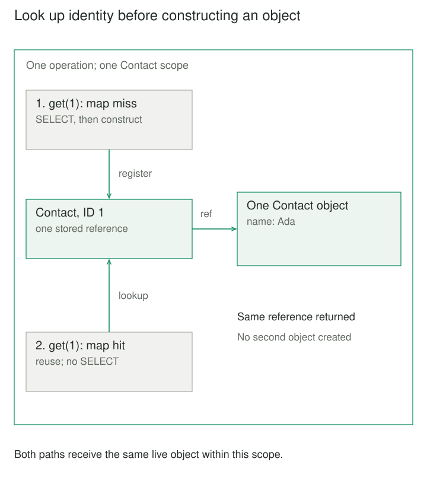

## Purpose and problem

A checkout operation loads a contact for billing, then loads the same contact through its shipping workflow. Each lookup constructs a separate object. Billing corrects the name; shipping still sees the old spelling. Both objects claim to represent contact 1, but their local states disagree.

Repeated database reads cost time, yet avoiding reads is only part of the problem. Collaborating code needs an agreed object to work with during this operation. Comparing IDs after every lookup leaves that responsibility scattered across callers.

## Core idea

An **Identity Map** associates a persistent identity with its already-loaded object. A loader checks this map before constructing another instance. Within the chosen scope, repeated references to that identity resolve to the same object.

The mental model is **one identity, one working object, one scope**. [Fowler's catalog](https://martinfowler.com/eaaCatalog/identityMap.html) establishes the pattern in the context of a business transaction. Identity Map Pattern is an alias here; this is neither a mathematical identity function nor an identity-provider account directory.

Sharing the object makes local changes visible through every reference to it. It does not make those changes persistent, make the object current with other writers, or provide database isolation.



## How it works

### Identify the complete identity

The key must distinguish everything the map might hold. It commonly includes the mapped entity type and complete primary key. If keys repeat across tenants, databases, or shards, include that namespace or keep separate maps. SQLAlchemy's [identity-token example](https://docs.sqlalchemy.org/en/20/orm/queryguide/api.html#identity-token) demonstrates distinct objects with the same type and primary key in different schemas.

The example below binds one map to one connection and one mapped type, Contact. Those namespaces are implicit; the positive integer ID is its remaining key. Public identity has no setter. Changing a mapped object's identity behind the map would invalidate its bookkeeping.

### Reuse during materialization

On a miss, read the row, validate it, construct the object, and register it before handing it to callers. On a hit, return the existing reference. Every materialization path must honor this rule; a second mapper that constructs independently defeats it.

A map of objects is not a cache of arbitrary query results. A filtered query may still need SQL to discover matching IDs, then reuse objects for those IDs. SQLAlchemy's [session FAQ](https://docs.sqlalchemy.org/en/20/orm/session_basics.html#is-the-session-a-cache) makes this distinction. The bounded implementation offers only primary-key lookup.

Missing rows return `None` and are not remembered here. Storage and validation errors propagate without registering an object. More elaborate graph loaders must also handle cycles and partially constructed objects; this example has no relationships.

### End the scope deliberately

This implementation holds strong references until context exit, then clears the map and forbids reuse. Other implementations choose different retention policies: SQLAlchemy documents [weak references for ordinary persistent objects](https://docs.sqlalchemy.org/en/20/orm/session_state_management.html#session-referencing-behavior).

The scope owns its registry, not the caller's connection, transaction, or surviving object references. It performs no save, commit, or rollback. An escaped object can still exist after exit, but future scopes need not reuse it.

Keep a scope local to one sequential operation. A concurrent check-then-load can construct duplicates unless coordinated. SQLAlchemy likewise documents [one Session per thread or task](https://docs.sqlalchemy.org/en/20/orm/session_basics.html#is-the-session-thread-safe-is-asyncsession-safe-to-share-in-concurrent-tasks); this small map implements no synchronization.


## Worked example

### Two paths share a correction

Previously, billing and shipping constructed independent contacts. Now both receive a shared scope. Save these two files together and run `python3 demo.py` with Python 3.10+ and standard-library SQLite.

IDs are positive integers, excluding booleans. Names contain 1–80 printable characters and cannot be entirely whitespace. The database starts with contact 1 named Ada. Renaming changes memory only. A direct SQL update then illustrates why a map hit does not promise freshness.

**contacts.py — validated objects and scoped lookup**

```python
def valid_id(value):
    if type(value) is not int or value <= 0:
        raise ValueError("Positive integer ID required")


class Contact:
    def __init__(self, contact_id, name):
        valid_id(contact_id)
        self._id = contact_id
        self.rename(name)

    @property
    def contact_id(self):
        return self._id

    @property
    def name(self):
        return self._name

    def rename(self, name):
        if type(name) is not str or not name.strip() or not name.isprintable() or len(name) > 80:
            raise ValueError("Use 1–80 printable name characters")
        self._name = name


class ContactScope:
    def __init__(self, db):
        self._db, self._loaded = db, {}
        self._entered = self._closed = False

    def __enter__(self):
        if self._entered or self._closed:
            raise RuntimeError("Single-use scope")
        self._entered = True
        return self

    def __exit__(self, *error):
        self._loaded.clear()
        self._closed = True

    def get(self, contact_id):
        if not self._entered or self._closed:
            raise RuntimeError("Active scope required")
        valid_id(contact_id)
        if contact_id not in self._loaded:
            row = self._db.execute(
                "SELECT id, name FROM contacts WHERE id = ?", (contact_id,)
            ).fetchone()
            if row is None:
                return None
            self._loaded[contact_id] = Contact(*row)
        return self._loaded[contact_id]
```

**demo.py — reuse, local mutation, and a later scope**

```python
import sqlite3
from contextlib import closing
from contacts import ContactScope


with closing(sqlite3.connect(":memory:", isolation_level=None)) as db:
    db.execute("CREATE TABLE contacts (id INTEGER PRIMARY KEY, name TEXT NOT NULL)")
    db.execute("INSERT INTO contacts VALUES (1, 'Ada')")
    with ContactScope(db) as scope:
        billing = scope.get(1)
        shipping = scope.get(1)
        billing.rename("Ada Lovelace")
        print("same object:", billing is shipping)
        print("other path:", shipping.name)
        print("stored:", db.execute("SELECT name FROM contacts WHERE id = 1").fetchone()[0])
        db.execute("UPDATE contacts SET name = 'Augusta' WHERE id = 1")
        print("same scope:", scope.get(1).name)
        print("missing:", scope.get(99))
    with ContactScope(db) as fresh:
        print("new scope:", fresh.get(1).name)
        print("different object:", fresh.get(1) is not billing)
# same object: True
# other path: Ada Lovelace
# stored: Ada
# same scope: Ada Lovelace
# missing: None
# new scope: Augusta
# different object: True
```

Python's [SQLite documentation](https://docs.python.org/3/library/sqlite3.html#transaction-control-via-the-isolation-level-attribute) explains the explicit configuration. The demo leaves each statement outside a multi-statement transaction; the scope introduces none. A new scope therefore observes the completed SQL update here. That observation is an example condition, not a universal freshness guarantee.

## When to use it

Use Identity Map when several paths load the same entities during one operation, shared mutable objects matter, or repeated primary-key reads are wasteful.

For a small read-only projection, independent immutable values may be sufficient. An ORM may already implement identity management; avoid competing registries with different owners.

## Tradeoffs and common mistakes

**Assuming freshness.** A hit can preserve local edits while the stored row changes or disappears. Refreshing is an explicit policy and may overwrite edits. SQLAlchemy's [Session.get documentation](https://docs.sqlalchemy.org/en/20/orm/session_api.html#sqlalchemy.orm.Session.get) describes its separate expiration and reload behavior; this example implements neither.

**Making the map global.** Long-lived strong references retain memory and stale state. Sharing across users can also bypass access checks if a hit skips authorization. A tenant-aware key prevents collisions; it does not authorize access.

**Confusing identity with safety.** Shared mutation affects every holder. Identity Map supplies neither change tracking nor protection against another process overwriting the same row. Locks, expected versions, and transaction boundaries remain separate decisions.

## Related patterns

[[entity|Entity]] defines continuity through domain identity; Identity Map chooses one local object representing a persistent identity.

[[data-mapper|Data Mapper]] reconstructs domain objects from rows. Consulting an Identity Map prevents repeated reconstruction from creating competing instances.

[[unit-of-work|Unit of Work]] tracks pending persistence changes and coordinates completion. It often shares a lifecycle with an Identity Map, but the responsibilities differ.

[[repository|Repository]] offers domain-oriented retrieval. Several repositories or loaders must share the same map when their results should share object identity.

## Sources

Fowler's [Identity Map](https://martinfowler.com/eaaCatalog/identityMap.html), in *Patterns of Enterprise Application Architecture*, establishes the pattern. Official SQLAlchemy documentation linked above supports the query-cache, identity-namespace, retention, concurrency, and refresh distinctions. Python documentation supports the SQLite configuration.

The contact scenario, scope implementation, examples, and illustrations are original teaching material.
