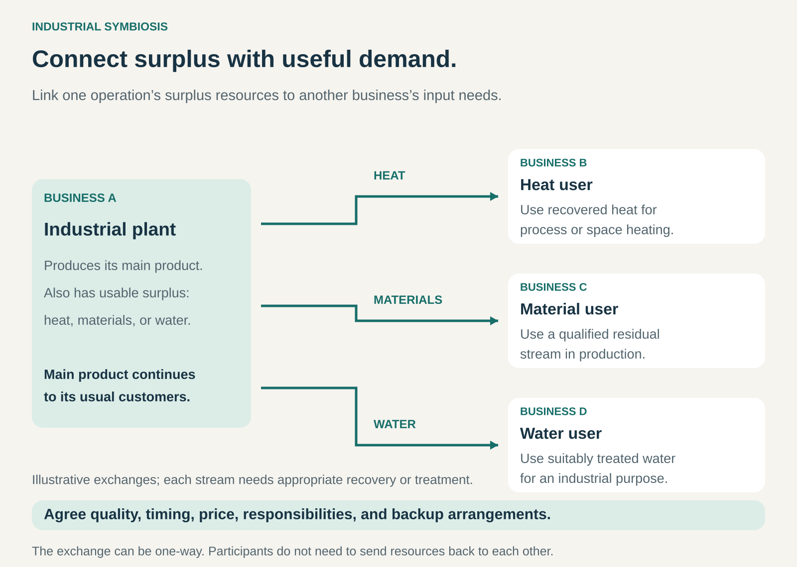

## What it is for

One factory releases heat while another pays to generate it. A production process produces a residual material that a neighboring business could use. An industrial site needs water, while a nearby treatment plant has a recoverable supply.

Each organization may be operating efficiently within its own boundaries. The opportunity appears when those boundaries are considered together.

Industrial Symbiosis connects separate organizations so that surplus energy, water, materials, or other resources from one operation become useful inputs elsewhere.

It is useful when cooperation can reduce combined costs and resource consumption while creating a dependable commercial relationship.

## The core idea

**Find a productive use for resources across organizational boundaries.**

A resource has different value in different processes. Heat that is too cool for one industrial operation may still be suitable for heating buildings. A residual material with little value to its producer may contain exactly what another manufacturer needs.

Industrial Symbiosis connects those differences.

The exchange can involve:

- **Energy:** recovered heat, steam, or usable process gases.
- **Water:** treated wastewater, cooling water, or other suitable water streams.
- **Materials:** production residues, recovered chemicals, minerals, or organic by-products.

Participants can include manufacturers, utilities, farms, processors, and municipalities.

They do not need to exchange resources directly with each other in both directions. A single useful connection can begin a wider network. Nor must the resource have been completely worthless before the arrangement.

The distinctive feature is cooperation that improves resource use across operations. Selling an ordinary product to another manufacturer does not, by itself, establish industrial symbiosis.

## How it works

**Identify a useful match.** Participants compare resource availability with actual input requirements. Composition, temperature, pressure, quantity, location, and timing determine whether an apparent opportunity is technically useful.

**Prepare the resource.** An exchange may require separation, filtration, drying, treatment, heat recovery, storage, or blending. The receiving business needs a usable input with known characteristics.

**Connect the operations.** Trucks, pipelines, heat exchangers, storage facilities, or shared treatment infrastructure move the resource between participants.

**Agree the commercial terms.** Contracts establish specifications, prices, minimum quantities, measurement, responsibilities, and what happens when a delivery falls outside the agreed conditions.

**Provide for interruptions.** Maintenance shutdowns, seasonal demand, production changes, and equipment failures can interrupt the exchange. Backup supplies and alternative outlets protect the underlying businesses.

**Maintain the relationship.** Participants monitor quality and performance and adapt as their operations change. A local coordinator or specialist operator can help discover opportunities and manage shared infrastructure.

Geographical proximity often helps, especially for heat, water, and bulky materials. Higher-value resources can justify longer journeys. The practical boundary is the cost and performance of the complete connection.

## Why it works

The first mechanism is substitution. A recovered resource can replace some purchased material, water, or energy.

The second is avoided handling. The supplying business may reduce the cost of treatment, disposal, cooling, or other management of its surplus.

The third is shared infrastructure. A treatment plant, collection system, or distribution network can serve several participants, making connections possible that would be uneconomical individually.

Value can appear in different forms. A supplier may earn resource revenue. A receiving business may reduce input costs. An intermediary may charge for treatment, distribution, or coordination.

The arrangement succeeds when the combined benefit exceeds the additional costs—and when the commercial terms give each necessary participant a reason to continue.

## Famous examples

### Kalundborg — a network of connected resource flows

Kalundborg in Denmark is a longstanding reference example of industrial symbiosis. Its network connects public and private organizations through exchanges of energy, water, and materials.

One concrete connection involves Kalundborg Bioenergi. It receives organic residual products from Novo Nordisk and Novonesis, alongside manure and other organic inputs, and converts them into energy and fertilizer products.

The production residue moves into another organization’s process, where useful energy is recovered and nutrients remain available for agricultural use.

Kalundborg illustrates how several individually practical exchanges can develop into a regional system. It also shows why the network needs to evolve: participating companies and their production processes change over time. [Kalundborg’s resource network](https://www.symbiosis.dk/okosystem-bag-kalundborg-symbiose/), [Kalundborg Bioenergi](https://kalundborgbioenergi.dk/)

### Kwinana — reclaimed water serving industrial users

Western Australia’s Kwinana Water Reclamation Plant treats wastewater to produce water suitable for industrial and cooling uses.

The system connects wastewater infrastructure with businesses that need dependable process water. Water Corporation identifies Tronox’s Kwinana Pigment Plant as one user of reclaimed water within its broader program to diversify water sources.

The match depends on treatment and suitability. Industrial users need water that meets their particular process requirements; an available wastewater stream cannot simply be substituted without preparation.

This example broadens the pattern beyond factory-to-factory exchanges. A public utility can connect urban resource recovery with industrial demand, reducing pressure on other water supplies. [Water Corporation: Kwinana reclamation system](https://www.watercorporation.com.au/about-us/media-releases/2026/june-2026/kwinana-water-reclamation-plant), [Tronox water-use case](https://www.watercorporation.com.au/Help-and-advice/Waterwise/Business/Tronox)

### Dunkirk — steelworks heat supplying a city

Dunkirk’s district-heating network uses recovered industrial heat from the ArcelorMittal steelworks.

Dalkia’s documented project describes capturing industrial heat, transferring it into water, and distributing that heat to homes and buildings such as the university, swimming pool, and town hall.

The steelworks and the buildings have different purposes, but their resource needs connect through recovery equipment and a heating network.

The network also uses other energy sources. Industrial heat recovery supplies part of a wider heating system rather than making the whole system independent of fuel.

This example highlights the intermediary’s role: infrastructure and network operation turn an available heat source into a usable service for many recipients. [Dalkia: the Dunkirk project](https://www.dalkia.fr/references/retour-experience/les-hauts-fourneaux-d-arcelormittal-chauffent-dunkerque/), [France Chaleur Urbaine: network energy mix](https://france-chaleur-urbaine.beta.gouv.fr/reseaux/5914C)

## The economics

Consider a hypothetical exchange between a manufacturer producing a residual material and another business able to use it.

Technical validation establishes that the material can replace an input the receiving business currently purchases.

| Annual change                                              |     Supplier | Receiving business |
| ---------------------------------------------------------- | -----------: | -----------------: |
| Avoided existing disposal or input costs                   |    +€300,000 |          +€900,000 |
| Payment for the recovered resource                         |    +€400,000 |          −€400,000 |
| Additional preparation costs                               |    −€200,000 |                  — |
| Transport costs                                            |    −€100,000 |                  — |
| Qualification and backup arrangements                      |            — |          −€100,000 |
| Annualized cost of dedicated equipment                     |            — |          −€200,000 |
| **Annual improvement before tax and unallocated overhead** | **€400,000** |       **€200,000** |

These figures are illustrative.

The combined improvement is **€600,000**. The €400,000 resource payment transfers value between participants; it does not create another €400,000 of system-wide benefit.

That distinction matters when assessing a project. Adding supplier revenue to buyer savings without subtracting the buyer’s payment would double-count part of the value.

The result also depends on actual volumes, processing requirements, and the alternative costs being avoided. A technically successful exchange may still fail commercially if utilization is too low or dedicated infrastructure costs too much.

## Useful when

- **Resource streams recur predictably.** Quantity and quality are sufficiently stable to support another operation.
- **A nearby user has a compatible need.** The resource can meet a real requirement after affordable preparation.
- **Existing disposal or input costs are significant.** There is enough potential value to fund the connection.
- **Infrastructure can be shared or economically installed.** Transport, pipelines, storage, and treatment remain proportionate.
- **Participants can make dependable agreements.** Responsibilities, information, and investment commitments are clear.
- **There is room to adapt.** The relationship can accommodate shutdowns, changing processes, and future improvements.

## Common mistakes and limits

**Matching names instead of specifications.** Two streams described as “water” or “biomass” can have very different characteristics. Technical suitability determines value.

**Assuming surplus is free.** Collection, treatment, transport, storage, and quality assurance can consume the apparent saving.

**Ignoring mismatched schedules.** A continuous heat source and seasonal heat demand require a different arrangement from two processes operating together.

**Overlooking dependency.** A receiving business can become exposed to a supplier’s shutdown, relocation, or change of process. Dedicated investments need realistic alternatives.

**Preserving waste to preserve the exchange.** Agreements should accommodate waste prevention and cleaner production. The network should remain useful as participants improve.

**Assuming every exchange benefits the environment.** Additional processing and transport must be weighed against the resources and impacts actually avoided. Contaminants must not simply be transferred into another product or location.

## Related patterns

- [[by-product-valorization|By-product Valorization:]] Develops useful offerings from secondary production streams; industrial symbiosis emphasizes the connection between organizations.
- [[waste-to-value|Waste-to-Value / Trash-to-Cash:]] The broader recovery pattern, which may operate within one business or across a market.
- [[orchestrator|Orchestrator:]] Coordinates participants, resource information, and infrastructure that make exchanges workable.
- [[shared-savings|Shared Savings:]] Can divide the financial benefit when one participant funds improvements that reduce another’s costs.
