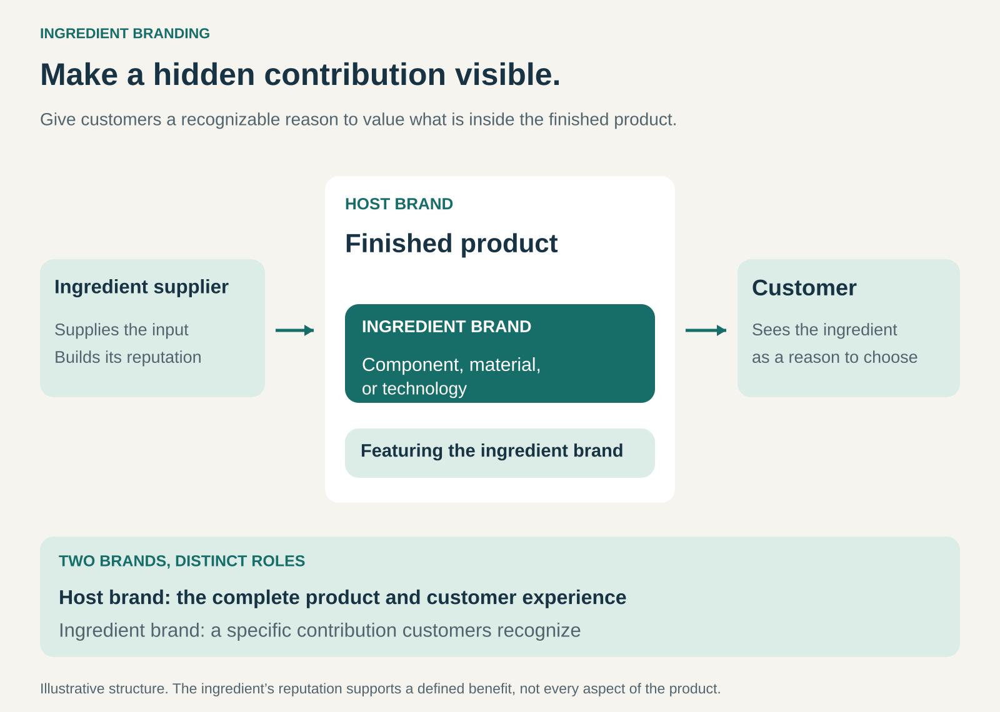

## What it is for

Make a valuable component recognizable to the people choosing the finished product.

Customers usually encounter the brand on the outside: the computer manufacturer, clothing label, or television maker. Important contributions inside the product can remain invisible, even when they influence performance.

Ingredient Branding gives those contributions a name customers can recognize and seek out.

It is useful when a component, material, or technology provides a meaningful benefit that customers would value if they understood it. The supplier gains visibility beyond its direct business customers, while the finished-product brand gains another reason for customers to choose its offering.

## The core idea

**Build recognition for an input and display its brand alongside the brand of the finished product.**

The ingredient might be a processor, fabric technology, audio system, or another identifiable contribution. The host company incorporates it and communicates its presence through labels, packaging, product descriptions, or advertising.

Business Model Navigator describes the pattern as adding the ingredient supplier’s branding to the finished product, allowing associations with the ingredient to support the product’s appeal. [Business Model Navigator: Ingredient Branding](https://ri.businessmodelnavigator.com/pattern?id=22)

The two brands have distinct roles. The host brand represents the overall offering. The ingredient brand represents a particular contribution within it.

This is a specific form of co-branding: the relationship is grounded in something the finished product actually uses.

## How it works

**1. Establish a contribution customers can value.**

The ingredient needs a benefit that matters in the purchase decision.

Technical sophistication alone is insufficient. Customers need to connect it with something understandable: weather protection, computing capability, compatibility, or a particular entertainment experience.

The benefit should also be substantial enough to justify the attention given to it.

**2. Build recognition beyond the direct buyer.**

The supplier communicates with the people who choose or specify the finished product.

Those people might be consumers, retailers, architects, or procurement teams. They learn to recognize the ingredient’s name and associate it with a defined capability.

This can create demand that travels back through the value chain: buyers start asking manufacturers for products containing the ingredient.

**3. Make the ingredient visible within the host offering.**

The manufacturer identifies the ingredient through an agreed presentation.

That might be a badge on a device, a hangtag on clothing, a specification on a product page, or joint advertising.

The communication needs to explain the contribution without confusing customers about who provides the complete product.

**4. Protect the meaning of the brand.**

The supplier and manufacturer establish requirements for implementation, claims, and brand use.

Testing, manufacturing guidance, approved configurations, and ongoing support may help ensure the ingredient performs as intended.

Integration matters. A strong component can be undermined by poor construction, incompatible equipment, or unsuitable use.

## Why it works

**It makes an unfamiliar technical contribution easier to recognize.** Customers gain a name and a benefit they can use when comparing products.

**It can reduce uncertainty.** An established ingredient brand provides a recognizable reference point, particularly when performance is difficult to assess before purchase.

**It gives the host brand another selling argument.** The manufacturer can connect its product to a capability customers already understand.

**It can strengthen the supplier’s position.** Customer preference for the ingredient can influence manufacturers’ purchasing decisions.

**Recognition can travel across products.** Customers may encounter the same ingredient brand in offerings from several manufacturers.

These advantages depend on a credible association between the name and the benefit. Recognition alone does not establish that every product carrying the ingredient will perform equally well.

## Famous examples

### Intel Inside — making the processor visible to computer buyers

Intel’s Intel Inside co-marketing campaign launched in 1991, bringing the component supplier’s identity into the marketing of finished computers. Intel returned to that heritage with its “That’s the power of Intel Inside” brand platform in 2025. [Intel’s account of the campaign](https://newsroom.intel.com/corporate/postcard-from-vision-a-refreshed-intel-brand-takes-center-stage)

The computer retained its manufacturer’s brand, while Intel’s name identified an important component within it.

The example illustrates the supplier’s ambition to become relevant to the end buyer, rather than communicating only with the companies purchasing its processors. It does not mean the processor alone determines the computer’s overall performance.

### GORE-TEX — a recognizable technology within another brand’s clothing

GORE-TEX describes itself as an ingredient brand whose collaborators manufacture and sell finished products using its technologies. Customers encounter the outdoor or lifestyle brand alongside the GORE-TEX identification. Gore also describes manufacturing and testing requirements supporting its products. [GORE-TEX frequently asked questions](https://www.gore-tex.com/support/frequently-asked-questions)

The ingredient’s reputation connects a technical contribution with a benefit customers can understand.

The promise is specific: Gore’s “GUARANTEED TO KEEP YOU DRY” guarantee applies to the designated product range carrying the relevant black diamond hangtag, rather than every product associated with the wider brand. [GORE-TEX guarantee scope](https://www.gore-tex.com/support/guarantee-and-returns)

### Dolby — branded technology within entertainment products

Dolby licenses technologies including Dolby Atmos and Dolby Vision to device manufacturers. Its branded technology licenses include relevant technology rights, know-how, and use of the Dolby brand. Licensing income depends substantially on technology adoption and shipments of licensed devices. [Dolby’s description of branded technology licensing](https://www.sec.gov/Archives/edgar/data/1308547/000130854725000007/dlb-20250926.htm)

Customers can therefore recognize both the television or audio-device manufacturer and a particular Dolby capability.

The delivered experience also depends on the wider setup, including compatible content and equipment. The ingredient identifies a contribution within that system. [Dolby home-entertainment setup guide](https://www.dolby.com/siteassets/about/support/guide/dolby-atmos-speaker-setup/dolby-vision-and-dolby-atmos-home-entertainment-setup-guide.pdf)

## The economics

The ingredient supplier may earn through component sales, material sales, technology licensing, or a combination. A separate brand-license fee is not required in every arrangement.

For the host company, the question is whether the ingredient creates enough additional value to justify its total cost.

Consider a hypothetical product:

| Per-unit economics                                   | Standard input | Branded ingredient |
| ---------------------------------------------------- | -------------: | -----------------: |
| Net selling price received by the manufacturer       |           $200 |               $220 |
| Product cost, including the input                    |          −$140 |              −$153 |
| Gross profit before other selling costs and overhead |        **$60** |            **$67** |

The illustration assumes the manufacturer can realize the higher price. It does not isolate how much of that increase comes from technical performance versus brand recognition.

If customers will not pay more, improved sales volume or another measurable benefit would need to justify the additional cost.

The supplier also funds brand building, partner support, and any testing or implementation programs. Greater visibility does not automatically produce greater profit.

## Useful when

- **The ingredient contributes a meaningful benefit.** Customers have a reason to care about its presence.
- **Performance is difficult to judge before purchase.** Recognition can help customers navigate an unfamiliar technical choice.
- **The contribution can be identified reliably.** Manufacturers can explain what is included and what it does.
- **Several host brands can use the ingredient.** Recognition can build across a wider market.
- **Both sides gain commercially.** The supplier receives demand or differentiation, and the host gains a worthwhile selling argument.

## Common mistakes and limits

**Promoting a name without explaining the benefit.** A logo adds little when customers do not understand its relevance.

**Allowing the badge to imply too much.** The ingredient may support one capability without establishing the quality of the entire product.

**Neglecting implementation.** Poor integration can disappoint customers and damage both brands.

**Letting the ingredient overshadow the host.** The manufacturer still needs reasons for customers to choose its particular product.

**Assuming presence creates uniqueness.** If many competitors use the same ingredient, it may become an expected feature rather than a differentiator.

**Underestimating supplier dependency.** Building a product’s appeal around one ingredient can make later substitution difficult.

**Allowing inconsistent brand use.** Unclear claims, unsuitable applications, or unauthorized labeling can weaken what the name represents.

The pattern is less effective when customers cannot perceive or understand the contribution, or when its commercial benefit cannot cover the costs of recognition and implementation.

## Related patterns

- [[licensing|Licensing:]] can provide permission to use the ingredient’s technology and brand under defined terms.
- [[layer-player|Layer Player:]] specializes in one contribution across many value chains. Ingredient branding can make that specialist’s role visible to end customers.
- [[certification-and-assurance|Certification & Assurance:]] provides evidence against defined criteria. Ingredient branding can incorporate testing, while also identifying the specific input used.
- [[open-business-model|Open Business Model:]] combines capabilities across organizational boundaries. Ingredient branding makes one partner’s contribution part of the customer-facing proposition.
