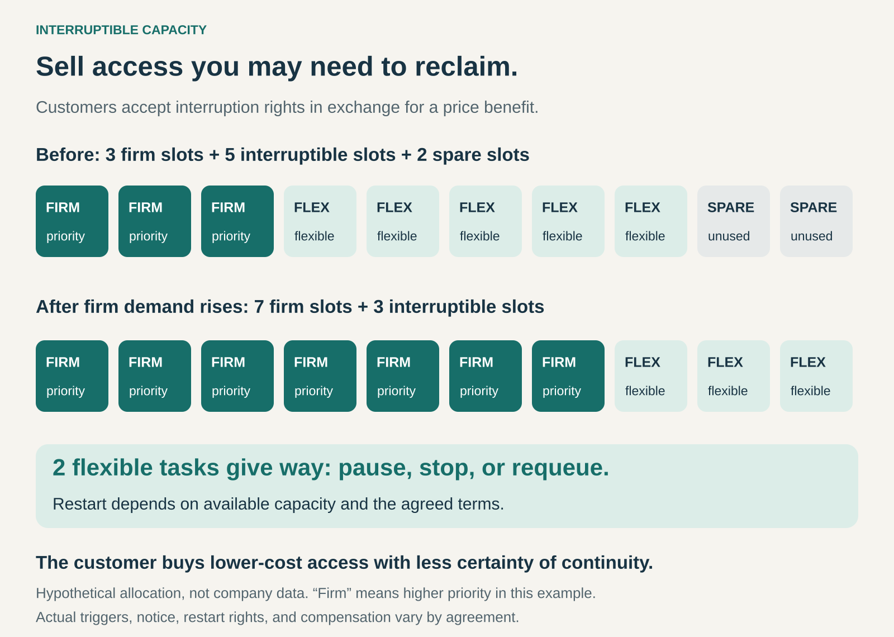

## What it is for

A provider has resources that would otherwise sit unused: computing power, transport space, or supply capacity outside peak demand.

Some customers could use those resources productively, provided they pay less and can tolerate interruptions.

Interruptible Capacity connects the two. The provider sells access while retaining an agreed right to reclaim, reduce, or postpone it. The customer receives a lower price or compensation for accepting that flexibility.

The proposition is: **use the capacity on favourable terms, but be prepared to give way when the agreed conditions arise.**

## The core idea

Make continuity a feature customers can choose to pay more—or less—for.

Some work needs dependable, timely access. Other work can wait, restart, move elsewhere, or proceed in stages. Interruptible Capacity creates an offering for that second category.

The underlying resource may be the same as in a higher-priority service. What changes is the customer’s entitlement to keep using it.

This is an explicit commercial permission to interrupt service. It should be understood before purchase, including any limits on when and how interruption can occur.

The financial benefit can take different forms:

- A discounted usage rate.
- A lower standing or service charge.
- A credit or payment when capacity is withdrawn.
- A combination of discounted access and event-based compensation.

## How it works

Imagine a provider with ten interchangeable capacity slots.

Initially, three serve higher-priority demand, five serve interruptible work, and two remain unused.

Higher-priority demand then rises to seven slots. The provider uses the two spare slots and reclaims two from interruptible customers. Three interruptible tasks continue; two must pause, stop, or return to a queue.

The arrangement needs clear rules governing:

- **Triggers:** when the provider can reclaim capacity.
- **Notice:** how the customer learns that access will change.
- **Consequences:** whether work stops, pauses, moves, or is rescheduled.
- **Restoration:** whether and how the customer can resume.
- **Payment:** charges for interrupted work and any compensation.
- **Limits:** applicable restrictions on interruption frequency or duration.

Customers also need an operating model that fits those rules. Restartable processing, flexible shipping dates, alternative supply, or saved progress can make interruption manageable.

A discount alone cannot make unsuitable work tolerant of disruption.

## Why it works

An unused hour of capacity usually cannot be saved and sold later. Once that hour passes, its revenue opportunity has gone.

Interruptible Capacity allows the provider to earn revenue from resources it is unwilling to promise continuously. The right to reclaim access preserves flexibility for other obligations.

Customers with adaptable workloads can receive useful service at a lower effective cost. They contribute flexibility that the provider can use to manage the whole system.

The model can also serve customers whose work would be uneconomic at standard rates. A discretionary analysis or non-urgent shipment may become worthwhile when it can use lower-priority capacity.

The operating challenge is to match the right work to the right service class. Commercial flexibility produces value only when interruption costs remain manageable.

## Famous examples

### Amazon Web Services: computing resources that can be reclaimed

Amazon EC2 Spot Instances provide access to spare computing capacity at discounted prices. AWS can reclaim that capacity, with interruption behaviour that can stop, terminate, or hibernate an instance depending on its configuration.

AWS identifies capacity requirements, pricing limits, and certain request constraints as possible interruption causes. [AWS Spot interruption documentation](https://docs.aws.amazon.com/AWSEC2/latest/UserGuide/spot-interruptions.html)

The useful customer is one whose workload can cope with losing individual resources: for example, processing that can retry tasks or resume from saved progress.

The transferable lesson is that lower-cost infrastructure and uninterrupted work are separate concerns. The customer’s own design determines how effectively it can turn temporary resources into completed results.

### National Grid: discounted gas service with curtailment obligations

National Grid describes arrangements in which businesses receive discounted rates in exchange for agreeing to switch to an alternative fuel when required.

Its gas-demand guidance explains that these customers are curtailed before other business customers when supply must be protected for needs such as home heating and critical facilities. [National Grid gas-demand guidance](https://www.nationalgridus.com/Managing-Gas-Demand)

The interruption concerns the supply of one input. A customer with suitable alternative arrangements may continue operating through another source.

This shows why customer capability is part of the model. The discounted service is valuable when the customer can accommodate the curtailment obligation, including the cost of maintaining and using its alternative.

### Maersk: compensation for flexible shipment timing

Maersk’s Rollable option lets customers identify non-time-sensitive cargo that may move to a later sailing.

Maersk explains that it selects Rollable cargo first when it needs to roll shipments and provides compensation under the applicable terms. Its booking terms permit rolling at different stages of the journey and define the compensation arrangement. [Maersk Rollable explanation](https://www.maersk.com/fr-fr/support/faqs/2025/03/09/select-rollable-to-get-compensation), [Maersk Spot terms](https://terms.maersk.com/terms-spot-booking)

This is a scheduling variation of the pattern. The customer accepts a weaker timing commitment rather than having an active process stopped.

It also demonstrates that the benefit need not be an automatic upfront discount. Compensation can be tied to the provider actually exercising its flexibility.

## The economics

The customer should compare **cost per completed result**, including disruption, rather than the advertised resource rate alone.

Suppose a hypothetical job needs ten productive hours. At $10 per hour, a more dependable option costs $100.

Interruptible resources cost $4 per hour. But interruptions cause repeated work, bringing billed usage to 15 hours. That costs $60. If additional recovery and coordination cost $20, the total becomes $80.

The resource rate is 60% lower; the completed job costs 20% less, before considering the value of delay.

Other workloads could save much more—or become more expensive.

For the provider, additional revenue must cover variable operating costs, interruption administration, compensation, and any effect on higher-priority service. Existing equipment is not costless simply because it has spare capacity.

Demand also matters over time. A service that is attractive during quiet periods may become scarce precisely when many customers want it. Historical availability does not establish future continuity.

## Useful when

- The provider has capacity it cannot confidently promise continuously.
- Customers can pause, restart, defer, or move the work.
- Progress can be preserved or repeated at reasonable cost.
- Deadlines leave room for interruption and recovery.
- Alternative resources or supply arrangements are available.
- The financial benefit exceeds expected disruption costs.
- Both parties can communicate and administer interruptions reliably.

## Common mistakes and limits

**Placing inflexible work on a flexible service.** A task may be technically restartable yet commercially unsuitable if delay has serious consequences.

**Assuming a notice period solves recovery.** Notification helps only when the customer can detect it and respond within the available time.

**Treating past continuity as a promise.** Long uninterrupted periods can encourage dependence on access the provider remains entitled to withdraw.

**Ignoring simultaneous interruptions.** Several resources can disappear together. Spreading work across identical resources in the same constrained pool may provide less protection than expected.

**Forgetting the cost of alternatives.** Backup supply, storage, restart mechanisms, and operational support can consume the apparent saving.

**Assuming restart is immediate.** Reclaimed capacity may remain unavailable. A customer may need to wait, change resource types, or pay for another service.

**Making interruption terms vague.** The price benefit should correspond to a clearly understood reduction in service certainty, including what compensation does and does not cover.

## Related patterns

[[reserved-capacity|Reserved Capacity]] protects a defined access entitlement. Interruptible Capacity gives the provider specified rights to withdraw or defer access. Different service classes can coexist within the same resource pool.

[[guaranteed-availability|Guaranteed Availability]] commits to keeping an agreed function usable. Interruptible Capacity deliberately permits specified disruptions, with the customer accepting or managing their consequences.

[[commitment-for-discount|Commitment or Discount]] exchanges a customer obligation for a price benefit. Interruptible Capacity exchanges tolerance of provider-initiated disruption for favourable terms.

[[dynamic-pricing|Dynamic Pricing]] changes prices as conditions change. Interruptible Capacity changes access rights; its price can be fixed, variable, or combined with event-based compensation.
