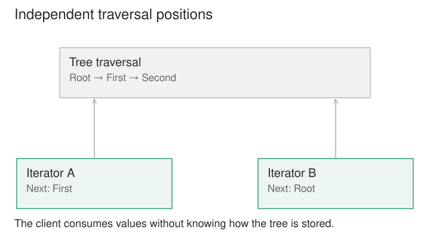

## Purpose and problem

A reporting function expects a list. Then its input becomes a tree, a streamed file, or a paginated service result. If the function understands each representation, traversal details spread into reporting logic. The common need is simpler: obtain the next element until there are no more.

## Core idea

Iterator separates traversal from the underlying collection. A client uses a common protocol to advance through elements while the iterator maintains the position and understands the storage representation. Different iterators can present different structures through the same style of access.



## How it works

A collection can create an iterator with its own traversal state. Two iterators over the same collection can then progress independently. The collection does not need one shared current-position field that every reader changes.

The protocol might use has_next and next, or a next operation with a defined end signal. Some languages provide native iteration protocols and syntax. The conceptual benefit remains the same: the client depends on traversal behavior rather than internal storage layout.

An external iterator leaves advancement under the client's control. An internal iterator or callback-based traversal lets the collection drive visits. These choices affect cancellation, composition, and control flow, but both can hide representation details.

## Worked example

### A report over several input sources

Suppose a summary computes counts from transaction records. Initially it loops over an in-memory array. Later, records come from a database cursor or a large file. With an iterator-based boundary, the summary consumes records one at a time and does not need to know where they are stored.

The database iterator fetches rows according to its cursor policy. The file iterator reads and decodes records as traversal advances. The array iterator tracks an index. The summary maintains only its aggregate state.

This can reduce peak memory if the source and processing are genuinely incremental. It does not guarantee low memory if the iterator loads the entire dataset internally or if the summary retains every record. Laziness is an implementation and usage property, not a promise created merely by an iterator interface.

Errors also remain possible during traversal. A file can be malformed halfway through; a database connection can fail after some rows. Clients need a policy for partial computation and failure rather than assuming all errors occur before iteration starts.

### A small implementation

A tree exposes depth-first iteration through Python's iterator protocol. Each call to iter creates a fresh generator with its own traversal state. The reporting client consumes values without implementing a tree walk.

```python
from dataclasses import dataclass


@dataclass(frozen=True)
class Node:
    name: str
    children: tuple = ()

    def __iter__(self):
        yield self.name
        for child in self.children:
            yield from child


tree = Node("Root", (Node("First"), Node("Second")))
left = iter(tree)
right = iter(tree)
print(next(left), next(left))
print(next(right))
print(list(tree))
# Root First
# Root
# ['Root', 'First', 'Second']
```

Advancing left does not move right. The immutable example avoids a mutation policy; a mutable tree would need to define whether edits during iteration are forbidden, reflected live, or read from a snapshot. For very deep trees, an explicit stack can replace recursive generator calls.

### Walking a document tree

A document contains nested sections and paragraphs. A depth-first iterator presents content in reading order. A breadth-first iterator can support an inspection tool that processes items by nesting level. Both traverse the same Composite structure without requiring clients to inspect child storage directly.

Before this separation, each feature implements its own recursive walk. Afterward, traversal policies can be tested and reused. The search feature can stop on its first match; a word counter can continue through every relevant text node.

The order is part of the iterator's contract. A caller that expects reading order should not receive an arbitrary traversal just because all nodes are eventually visited. Filtering out hidden sections or including them is another meaningful choice that should be expressed deliberately.

For very deep trees, an iterator can maintain an explicit stack rather than relying on recursive calls. That changes implementation details without forcing clients to change their consumption logic.

## When to use it

- Clients need sequential access to different storage structures.
- Traversal state should be separate from the collection itself.

Consider a simpler design when a client needs random access that the traversal interface does not provide, or when traversal hides resource ownership or unstable mutation semantics.

## Tradeoffs and common mistakes

What happens if the collection changes while an iterator is active? Designs may use a snapshot, prohibit structural mutation, detect modification and fail, or provide a documented weakly consistent view. There is no universal answer hidden in the pattern.

A snapshot offers stable traversal but can cost memory and construction time. Fail-fast behavior can reveal misuse but should not be mistaken for synchronization. A live view may suit some applications if callers understand which changes can appear or be missed.

Resource-backed iterators need cleanup. If a client stops after the first record, a database cursor or file handle should not remain open indefinitely. Explicit closing, scoped use, or language-supported resource management may be necessary. Reaching the end is not the only way traversal terminates.

An iterator can also be single-pass. Once consumed, it may not be restartable. The interface should distinguish a reusable collection that can create fresh iterators from an iterator whose current state advances irreversibly. Confusing these leads to surprising empty second traversals.

## Related patterns

[[composite|Composite]] supplies a recursive part–whole structure; Iterator provides a way to visit its elements. [[visitor|Visitor]] organizes operations based on element types. An iterator can control traversal while a visitor processes each encountered node, depending on the design.

[[strategy|Strategy]] can represent a traversal policy, such as breadth-first versus depth-first. Iterator adds the protocol and traversal state through which the selected policy is consumed.

## Sources

Iterator is one of the 23 patterns in Gamma, Helm, Johnson, and Vlissides, [*Design Patterns: Elements of Reusable Object-Oriented Software*](https://www.informit.com/store/design-patterns-elements-of-reusable-object-oriented-9780201633610). The examples, code, and illustrations here are original educational explanations.
