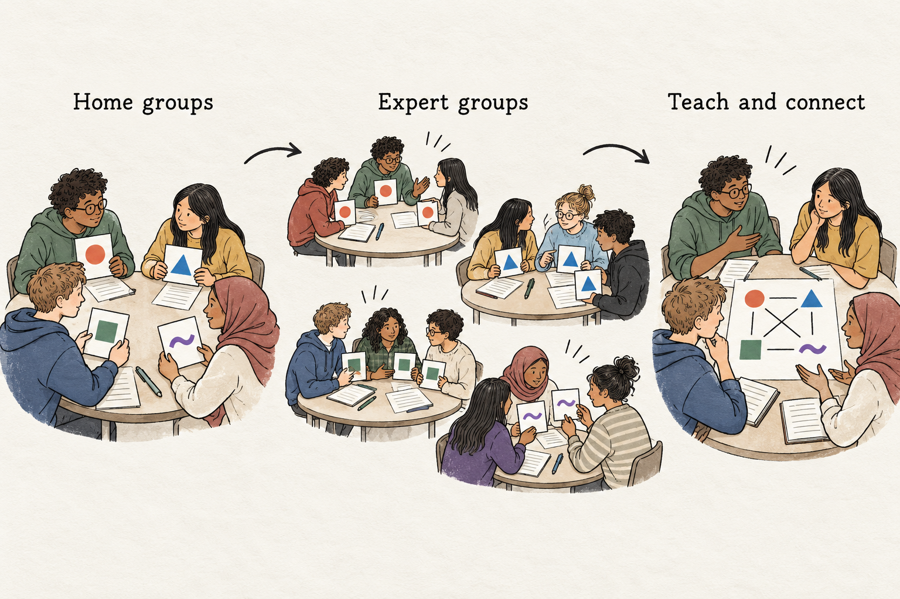

## Teach a piece, understand the whole

Four learners finish a group presentation. Each has prepared one section. They combine their slides, take turns speaking, and receive a shared grade.

Later, the teacher asks how the sections connect. The learner who researched the background cannot explain the evidence. The learner who prepared the conclusion knows little about the competing explanations. Everyone contributed, but their understanding remains divided.

Jigsaw Learning addresses this familiar problem by making teaching one another part of the task. Each learner prepares one piece of a topic, develops it with others studying the same material, and returns to help their original group understand it. The group then uses those contributions to build an account of the whole.

## Two groups, two responsibilities

A jigsaw begins with a **home group**. Each member receives a different part of a shared topic or problem. Everyone should understand the overall question before separating to investigate their piece.

Learners then meet in **expert groups** with classmates assigned the same material. These groups compare interpretations, resolve difficulties, and prepare explanations. “Expert” describes a temporary responsibility, not a claim that learners have mastered the subject.

Finally, learners return to their home groups and teach their respective pieces. Their partners ask questions and connect the contributions. A shared synthesis task, followed by an individual check, helps reveal whether understanding extends beyond each person’s specialty.

This movement between home groups and expert groups is central to the [original Jigsaw Classroom approach](https://www.jigsaw.org/overview/). The expert meeting provides preparation and rehearsal before learners become responsible for explaining material to others.

## Make the contributions necessary

Jigsaw changes the relationship between individual preparation and group work. Each person has something the others need, while also needing what the others bring.

That arrangement creates several plausible opportunities for learning. Preparing an explanation requires selecting important information. Teaching makes gaps and ambiguities available for questioning. Listening has a purpose because the final task requires material beyond one’s own assignment.

These opportunities depend on the design. If the final product is simply four independent summaries, learners can complete it without examining the connections.

Research also warrants restraint. A 2023 systematic review examined 69 studies of Jigsaw Learning. Its achievement meta-analysis found a positive average effect, but results varied substantially across studies, and findings for other outcomes were inconsistent. The review supports treating Jigsaw as a method whose effects depend on context and implementation, rather than promising automatic improvements in achievement or relationships. [Cochon Drouet and colleagues, 2023](https://pmc.ncbi.nlm.nih.gov/articles/PMC10436097/)

## A classroom example: which street should receive funding?

Imagine a geography class examining a fictional town’s proposal to improve public spaces during hot weather. The town can fund improvements on only one of three streets.

The teacher gives everyone a common map and the same question:

*“Which street should receive funding first, and what evidence supports your recommendation?”*

Each four-person home group assigns one member to investigate each of four evidence sets: recorded temperatures and shade, who uses each street, access to alternative public spaces, and the costs of proposed improvements.

The materials are short and prepared for the learners’ reading level. Each contains information that matters to the eventual decision.

Amira joins the expert group studying temperatures and shade. She initially plans to recommend the street with the highest recorded temperature. Another learner notices that measurements were taken at different times. Their discussion helps them distinguish what the records show from what they cannot establish.

The teacher visits, checks their interpretation, and asks them to prepare an explanation of that limitation.

Back in her home group, Amira explains the temperature evidence. Leo contributes information about who uses each street. His material suggests that the hottest location is lightly used during the day, while another street serves people waiting for buses.

The group now faces a question that neither contribution could answer alone. Should the priority be the highest measured temperature, the greatest exposure among users, or the lack of nearby alternatives? Cost information introduces another constraint.

Their final recommendation must connect at least three evidence sets and explain a tradeoff. Afterward, each learner writes an individual justification.

The teacher can now see whether Amira understands the access evidence and whether Leo can use the temperature records carefully. The activity has moved beyond exchanging reports toward developing shared understanding.

## Prepare learners to teach

The expert stage deserves substantial attention. Reading the same passage together does not necessarily prepare learners to explain it.

Useful preparation includes identifying the central idea, choosing an example, anticipating a likely question, and checking an interpretation against the source. A quick explanation to another expert can reveal where the account becomes confusing.

The teacher remains active throughout. Expert groups may need clarification, especially when their material contains unfamiliar concepts or ambiguous evidence. Correcting a misunderstanding before it travels to several home groups is valuable.

A common note-taking structure can also help listeners connect contributions. In the town example, every learner records the main finding, its limitation, and its implication for the decision.

## Design pieces that can be reassembled

Jigsaw suits topics with distinguishable parts that contribute to a larger understanding. These might be perspectives on an event, components of a system, or evidence relevant to a decision.

The pieces should be manageable separately, with reasonably balanced demands. If one requires extensive technical knowledge and another needs only a short description, equal responsibility becomes difficult.

Avoid splitting a tightly dependent procedure arbitrarily. A learner cannot meaningfully investigate a later step if understanding it requires several earlier steps they have not encountered. Teach shared prerequisites first.

Plan the final question before dividing the material. Asking learners to explain relationships, compare interpretations, or justify a decision gives them a reason to reconnect their pieces.

## Watch for fragile links

A rushed explanation can become the only account another learner hears. A confident speaker may discourage questions. An absent member can leave a group without essential information.

Build in ways to recover: checked summaries, access to the original materials, teacher clarification, or a prepared replacement contribution. Responsibility for teaching should come with support, not the threat of letting everyone down.

For a first attempt, use fewer pieces and a narrow topic. Online, clearly labeled documents and explicit group assignments help learners move between expert and home groups. Pairing two learners on a demanding contribution can provide additional support.

## Connect the method to its neighbors

**[[think-pair-share|Think–Pair–Share]]** gives learners a common question and time to develop responses. **[[snowball-groups|Snowball Groups]]** progressively combine ideas in larger groups. Jigsaw introduces a different structure: learners prepare complementary contributions before returning to a shared task.

**Teach-back** can strengthen the home-group exchange. After an explanation, a listener restates the idea and its relevance, giving the presenter an opportunity to clarify.

The revealing moment comes when someone uses a partner’s contribution accurately: “Your evidence changes our recommendation, because…” That is the connection the lesson has been designed to make possible.
