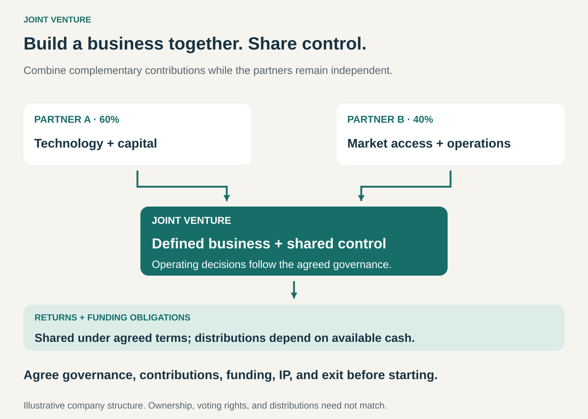

## What it is for

Build a business or pursue a substantial opportunity with a partner when each side brings capabilities the other needs.

One company may have technology and product expertise. Another may have manufacturing capacity, local operations, or access to customers. Developing everything independently could be expensive, slow, or impractical.

A Joint Venture gives the partners a defined business to develop together, with agreed contributions, governance, and participation in its economics.

It is useful when cooperation requires a deeper commitment than an ordinary supplier agreement, while the parent businesses continue independently.

## The core idea

**Create a jointly controlled undertaking around a defined opportunity, combining resources and sharing its economic results under agreed terms.**

Joint ventures are often organized through a jointly owned company. Business usage also includes contractual arrangements; formal classifications depend on the parties’ rights and obligations.

Shared control needs explicit arrangements. Under IFRS’s joint-control principle, decisions about activities that significantly affect returns require agreement among the parties sharing control. Ownership percentages alone do not establish that control. [IFRS: Joint Arrangements](https://www.ifrs.org/issued-standards/list-of-standards/ifrs-11-joint-arrangements/)

A venture does not have to be owned equally. Partners can hold different stakes while agreeing to share control over the decisions that drive the business.

The arrangement also needs to distinguish ownership, voting rights, funding commitments, and distributions. Those do not necessarily follow identical percentages.

## How it works

**1. Define the business the partners will pursue together.**

The venture needs a clear purpose and boundary: a particular market, product family, infrastructure project, or operating business.

That boundary identifies which opportunities belong to the venture and which remain with the parents. It also helps prevent disputes when the business expands into adjacent areas.

**2. Specify each partner’s contribution.**

Contributions can include cash, equipment, technology, intellectual property, employees, facilities, or commercial relationships.

The venture needs to know which resources it owns, which it licenses, and which it receives through continuing agreements with a parent.

An initial promise of access is insufficient if the operation depends on that access for years.

**3. Establish workable governance.**

The partners agree how the venture will be managed, which decisions management can make, and which require joint approval.

Budgets, major investments, product direction, and leadership appointments may need different approval processes from routine operating decisions.

A deadlock process matters because shared control can otherwise become shared inability to act.

**4. Plan funding, returns, and change.**

The agreement needs to address how growth and losses will be funded, when cash can be distributed, and how the relationship can change.

Partners also need arrangements for buying one another out, selling the venture, or winding it down.

These decisions become easier to discuss before either side is under financial or strategic pressure.

## Why it works

**Complementary capabilities can be committed to one business.** The venture brings resources together around a shared operating purpose.

**Investment can be shared.** Each partner contributes to an undertaking that might be difficult to fund or justify alone.

**Incentives can extend beyond a transaction.** Participation in the venture’s economics gives partners an interest in its continuing performance.

**The venture can develop a dedicated organization.** Its management and operating processes can concentrate on the shared opportunity.

**The parents retain their wider independence.** They collaborate within a defined scope while continuing their other businesses.

These benefits come with coordination costs. Partners must sustain both a functioning business and a functioning relationship.

## Famous examples

### CFM International — combining aircraft-engine capabilities

CFM International is a 50/50 joint company between GE Aerospace and Safran Aircraft Engines. It produces the LEAP engine family and supports LEAP and CFM56 fleets. The partnership began in 1974 and has been extended through 2050. [CFM International](https://www.cfmaeroengines.com/about), [Safran’s description of the partnership](https://www.safran-group.com/companies/cfm-international)

The partners contribute engineering and production capabilities to a shared engine business.

This illustrates a venture built around a substantial technical and commercial undertaking, with continuing cooperation across development, production, and support.

### Tata Starbucks — operating a shared business in India

Tata Starbucks operates Starbucks cafés in India through a joint venture between Starbucks and Tata Consumer Products. Tata Consumer’s financial statements for the year ended March 2026 identify its holding as 50%. [Tata Consumer’s 2025–26 financial statements](https://www.tataconsumer.com/iar-2025-26/docs/consolidated.pdf)

The venture was established in 2012 as a jointly owned café business. A separate agreement covered coffee sourcing and roasting, illustrating how a joint venture can sit alongside other commercial relationships between participating companies. [Original Tata Starbucks announcement](https://www.tataconsumer.com/news/tata-global-beverages-and-starbucks-form-joint-venture-open-starbucks-cafes-across-india)

The shared ownership arrangement and the supply agreements perform different roles.

### Sony Honda Mobility — a venture affected by changing parent strategy

Sony and Honda established their venture to combine Honda’s automotive capabilities with Sony’s expertise in areas including sensing, networks, and entertainment. The agreement specified equal ownership. [Sony and Honda’s founding agreement](https://www.sony.com/en/SonyInfo/IR/news/20220616_E.pdf)

In March 2026, they announced the cancellation of development and launch of the first two AFEELA models after Honda’s strategy reassessment changed underlying assumptions. In April, the companies announced plans to scale down the venture’s operations. [April 2026 business-direction announcement](https://www.sony.com/en/SonyInfo/IR/news/20260421_E.pdf)

The case shows a central dependency: a venture’s business case can change when a parent changes the technologies, assets, or strategic support it expects to contribute.

## The economics

A joint venture earns money through its underlying business—selling products, providing services, or operating assets. The venture structure determines how the partners participate.

Consider a hypothetical venture with proportional contributions and distribution rights:

| Item                                                             | Partner A: 60% | Partner B: 40% |
| ---------------------------------------------------------------- | -------------: | -------------: |
| Initial cash investment                                          |     $6 million |     $4 million |
| Distribution if $1 million is available and approved for payment |       $600,000 |       $400,000 |

These figures assume the agreement allocates both items in proportion to ownership.

The initial investment is capital committed to the venture. A distribution depends on available cash and the applicable arrangements; reported profit does not automatically become cash paid to the parents.

The venture may retain funds for growth, debt payments, or working capital. It may also require additional funding.

Payments to parents for supplies, licenses, facilities, or services affect the venture’s economics separately from shareholder distributions. Those relationships need clear terms because a partner can have several commercial roles at once.

## Useful when

- **The partners bring complementary strengths.** Combining them materially improves the opportunity.
- **Both sides need continuing commitment.** The business depends on sustained contributions rather than a single transaction.
- **A dedicated operating structure helps.** The opportunity benefits from its own management, resources, and priorities.
- **The scope can be defined.** Partners can distinguish the shared business from their independent activities.
- **Shared control is workable.** The partners can make important decisions together and resolve disagreements.

## Common mistakes and limits

**Choosing a partner only for its reputation.** The venture needs specific resources, capabilities, and commitment.

**Assuming equal ownership creates alignment.** Partners can hold identical stakes while disagreeing about investment, timing, or acceptable returns.

**Making management answer to incompatible instructions.** Parent-company priorities need a clear route through the venture’s governance.

**Leaving future contributions uncertain.** Technology access, supply commitments, staffing, and funding can become critical dependencies.

**Ignoring conflicts in parent transactions.** A parent supplying the venture may prioritize its own margin differently from the venture’s profitability.

**Treating shared investment as complete risk transfer.** Guarantees, funding commitments, and operational dependencies can create exposure beyond the initial contribution.

**Postponing exit discussions.** Disagreement becomes harder to resolve when there is no agreed route for separation.

The pattern is harder to sustain when partners have incompatible time horizons, cannot share important decisions, or expect the venture to solve a weak underlying business case.

## Related patterns

- [[open-business-model|Open Business Model:]] makes external collaboration central to value creation and capture. A joint venture provides a formal structure for some collaborations.
- [[licensing|Licensing:]] can give the venture access to a parent’s technology or brand without transferring ownership of that asset.
- [[orchestrator|Orchestrator:]] coordinates independent contributors. A joint venture adds shared governance and economic participation in a defined undertaking.
- [[vertical-integration|Vertical Integration / Integrator:]] brings activities under ownership and operation. A joint venture can provide shared participation in an adjacent stage of the value chain.
