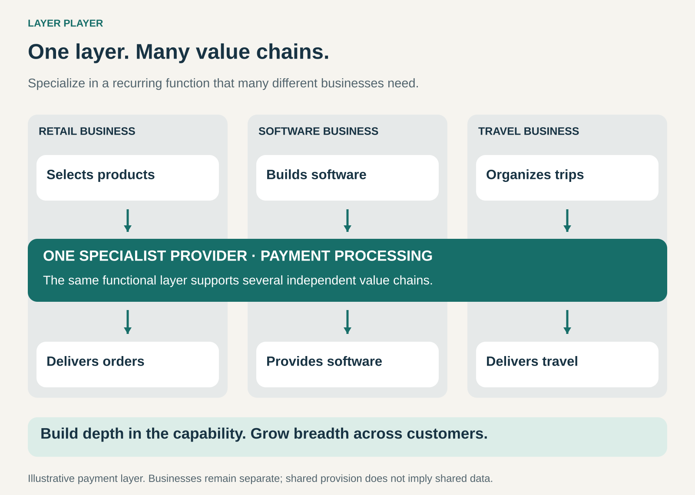

## What it is for

Build a business around one valuable function that many other businesses need, rather than delivering their entire product or service.

A retailer, a software company, and a travel operator sell very different things. All three need to accept payments. A specialist can provide that layer across their otherwise separate businesses.

Layer Player is useful when a capability becomes better, more economical, or easier to maintain through concentrated expertise and repeated use. Your customers keep responsibility for their broader offering; you become a specialist provider of one essential part.

The opportunity is to grow across many value chains while remaining focused on a particular contribution.

## The core idea

**Specialize deeply in one value-adding layer and provide it to many independent businesses.**

That layer might be semiconductor manufacturing, payment processing, warehousing, identity verification, or another recurring function. Business Model Navigator describes the pattern as providing a specialized value-adding step across different value chains, often spanning several markets or industries. [Business Model Navigator: Layer Player](https://businessmodelnavigator.com/pattern?id=24)

The layer can contain several closely connected activities. A logistics specialist may combine storage, picking, packing, and dispatch. The defining feature is a focused role within customers’ broader businesses.

Growth comes from applying that capability more widely: more customers, more applications, more locations, or greater volume.

A layer player can serve competing businesses. It can also operate within one industry, provided its specialist capability supports multiple independent value chains.

## How it works

**1. Identify a recurring function with a clear boundary.**

Customers need to understand what they can delegate and what they retain.

For payment processing, that boundary concerns accepting and processing transactions. For contract manufacturing, it concerns producing a specified product. For fulfilment, it concerns receiving stock, storing it, and preparing orders for delivery.

Clear responsibilities make the layer easier to buy, integrate, and evaluate.

**2. Build specialist capabilities that customers would struggle to reproduce individually.**

The advantage might come from equipment, engineering expertise, operational processes, infrastructure, or experience handling difficult exceptions.

The specialist needs to offer a compelling reason to use an external provider: better quality, lower total cost, faster deployment, access to scarce capabilities, or some combination.

**3. Make the capability reusable across customers.**

Common systems, interfaces, equipment, and operating methods allow the provider to reuse substantial parts of its work.

Customers may still need different configurations. The challenge is to accommodate those differences without rebuilding the entire operation for each account.

A reusable core with controlled variation often provides a stronger foundation than either complete uniformity or unlimited customization.

**4. Fit reliably into each customer’s wider operation.**

A specialist layer must connect well to the activities around it.

Orders need to arrive in an agreed format. Specifications need to be understood. Outputs need to reach the next stage on time. Problems need clear escalation routes.

The customer is buying a contribution that must work inside a larger system.

## Why it works

**Investment can serve a broader customer base.** Equipment, software, training, and process development may support demand from many businesses.

**Repeated work builds expertise.** A specialist encounters variations and failure modes that an individual customer might see only occasionally. That experience can improve methods, provided the organization learns from it.

**Customers can concentrate their own resources.** They gain access to a capability without developing the entire operation themselves.

**Demand can be spread across several customers.** Different markets and applications may help balance fluctuations, although customers can still be exposed to the same economic cycle.

**A focused provider can improve one function continuously.** A capability that receives limited attention inside a general business can become the specialist’s central investment priority.

These benefits depend on enough commonality between customers. If every engagement requires a completely different operating model, the advantages of reuse weaken.

## Famous examples

### TSMC — semiconductor manufacturing across many product businesses

TSMC’s foundry model centers on manufacturing customers’ semiconductor products. Its chips serve applications including high-performance computing, smartphones, automotive systems, and consumer electronics. In its 2025 annual report, TSMC reported manufacturing products for 534 customers. [TSMC 2025 annual report](https://investor.tsmc.com/static/annualReports/2025/english/index.html)

The layer is the manufacturing capability that supports many different chip designs and downstream products.

TSMC also emphasizes its commitment to avoiding competition with customers through semiconductor products marketed under its own name. That positioning illustrates why trust can matter when a specialist serves competing businesses.

It also demonstrates that a layer player can be highly capital intensive. Specialization does not imply a business with few physical assets.

### Stripe Payments — a payment layer across different industries

Stripe provides payment capabilities that businesses can integrate into their own offerings. Its Checkout product supports purchases of physical and digital goods and connects with other Stripe services for uses such as subscriptions and marketplace payments. Stripe’s customer base spans sectors including retail, software, travel, and media. [Stripe Checkout](https://stripe.com/payments/checkout), [Stripe customer examples](https://stripe.com/en-ca/customers/all)

The businesses retain their different products and customer propositions while using specialist payment infrastructure.

Stripe’s broader portfolio extends beyond payment processing. The Layer Player pattern is especially visible in its payments offering; it need not describe every activity of the company.

### DHL Supply Chain — logistics expertise across customer businesses

DHL Supply Chain provides warehousing, transport, and related services across industry sectors. Its operating model combines modular standards with solutions adapted to customer requirements. Its services include fulfilment, returns, and logistics supporting manufacturing. [DHL Supply Chain overview](https://group.dhl.com/en/about-us/corporate-divisions/supply-chain.html)

This illustrates how a specialist can build considerable depth within a functional layer. Customers retain their wider product businesses while DHL performs substantial logistics work.

The same division also offers supply-chain orchestration services. A company can therefore combine Layer Player with other patterns as its offering develops.

## The economics

A layer player can charge per unit, transaction, project, license, subscription, or reserved capacity. The pattern describes its position in the value chain rather than a particular pricing method.

Consider a hypothetical specialist processing standardized jobs for several business customers:

| Annual activity                          |  100,000 jobs | 200,000 jobs |
| ---------------------------------------- | ------------: | -----------: |
| Revenue at $5 per job                    |      $500,000 |   $1,000,000 |
| Variable costs at $3 per job             |     −$300,000 |    −$600,000 |
| Fixed operating costs                    |     −$300,000 |    −$300,000 |
| Operating result before interest and tax | **−$100,000** | **$100,000** |

The illustration assumes existing capacity can handle both volumes and fixed costs include depreciation. Initial investment and working-capital requirements would need separate consideration.

Serving more customers helps when their work uses the existing capability efficiently. Extra customization, support, equipment, or facilities can change the calculation.

The customer’s comparison also includes integration effort, supplier management, and service reliability alongside the specialist’s fee.

## Useful when

- **Many businesses need a similar function.** Their end products differ, but the underlying requirement has substantial common ground.
- **Specialization produces a meaningful advantage.** Expertise, equipment, infrastructure, or operating discipline improves the result.
- **Customers can delegate the function clearly.** Responsibilities, inputs, outputs, and quality requirements can be defined.
- **The core capability can be reused.** New customers require manageable adaptation.
- **There is enough accessible demand.** The specialist can reach sufficient volume without depending entirely on one customer.

## Common mistakes and limits

**Confusing narrow scope with weak differentiation.** Concentrating on one function helps only if the business performs it competitively. An easily replaceable service can face persistent price pressure.

**Accepting unlimited customization.** Bespoke commitments can fragment systems and processes until little is reusable across customers.

**Underestimating customer concentration.** A business may serve an entire industry in principle while receiving most of its revenue from a few powerful buyers.

**Assuming broader demand guarantees stable utilization.** Customers may share seasonal peaks, react to the same downturn, or require incompatible equipment.

**Expanding into customers’ territory carelessly.** Selling a competing finished product may make customers less willing to share information or rely on the specialist.

**Neglecting confidentiality.** Serving competing businesses requires clear boundaries around their designs, data, and commercial information.

**Becoming excellent at a shrinking layer.** Automation, technical standards, or changes in product architecture can reduce demand for the specialist’s contribution.

The pattern is harder to sustain when the function cannot be separated cleanly from the surrounding work, or when customization overwhelms the benefits of specialization.

## Related patterns

- [[orchestrator|Orchestrator:]] coordinates several specialist contributions into a coherent offering. Layer players can supply important parts of that network.
- [[vertical-integration|Vertical Integration / Integrator:]] brings successive stages inside a business. Layer Player concentrates on a selected stage across several customer businesses.
- [[monetize-existing-capabilities|Monetize Existing Capabilities / Make More of It:]] can create a layer-player business when an internal capability is offered to external customers.
- [[solution-provider|Solution Provider:]] can coexist with specialization when the provider offers a complete solution within its chosen functional domain.
