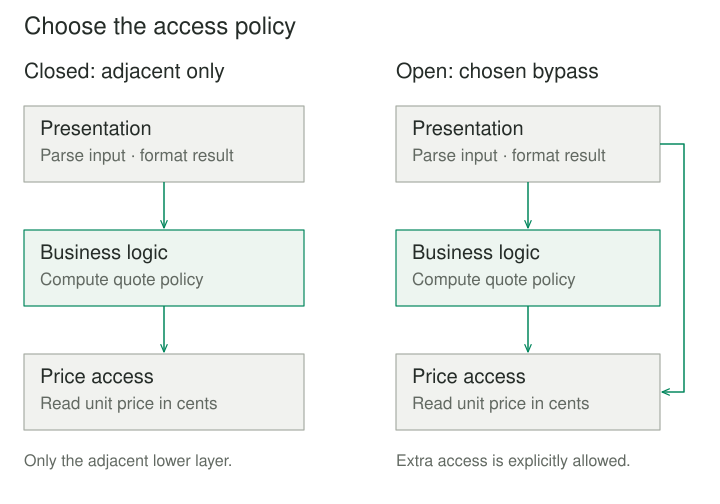
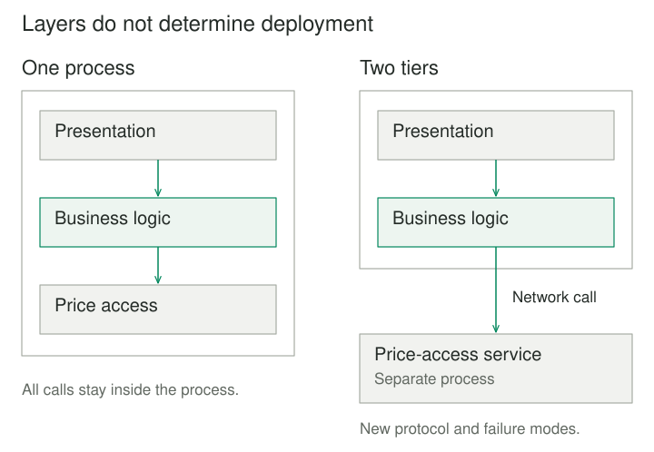

## Purpose and problem

A shop shows delivery quotes on its website and produces them in a batch tool. Both entry points read prices, apply a handling fee, and format an amount. A fee change reaches the website but misses the batch tool. Soon presentation code knows database field names, and storage code produces messages intended for the browser.

The application needs distinct responsibilities that still cooperate. Changing how an amount is displayed should not require changing how it is stored. Changing a pricing rule should have one clear home. **Layers** supplies an ordering for these responsibilities and rules for the dependencies between them.

## Core idea

Group components by their level of responsibility. Each layer provides a useful service to higher layers while hiding the details needed to implement it. Presentation can request a quote; business logic can obtain a unit price; data access can retrieve that price from its chosen representation.

The essential decision is the **allowed dependency relationship**. Creating folders called presentation, business, and data is insufficient if their contents can freely import one another. The boundaries become useful when contracts and dependency rules constrain what each component must understand.



## How it works

### Choose the responsibilities and the access policy

A small application might use presentation, business logic, and data access. A communications stack uses different abstractions. Layers does not prescribe three boxes or require a database. POSA documents it as an architectural pattern for responsibilities at different abstraction levels. [POSA Volume 1](https://www.oreilly.com/library/view/pattern-oriented-software-architecture/9781118725269/9781118725269_c02.xhtml).

In **closed**, or strict, layering, a component uses only the immediately lower layer. In **open**, or relaxed, layering, selected layers may use services farther below. Choose and enforce that policy. A permitted catalog read should not accidentally let presentation bypass the pricing rules when producing a quote. [Open and closed layers](https://learn.microsoft.com/en-us/azure/architecture/guide/architecture-styles/n-tier).

Results can return upward through a call without creating a reverse source dependency. If pricing returns an integer, it does not thereby import presentation. Callbacks and events need more care: specify who owns their interfaces and which modules depend on them. Import checks can detect forbidden references; they cannot prove that responsibilities were assigned well.

### Logical layers and deployment tiers

Layers group software responsibilities. Tiers describe physical deployment boundaries. All three example layers can run in one process. Moving data access behind a network service is a further design decision requiring a protocol, failure handling, and operational ownership. [Logical layers and physical tiers](https://learn.microsoft.com/en-us/azure/architecture/guide/architecture-styles/n-tier).



## Worked example

### Put the quote rule in one place

The shop charges a handling fee of 100 euro cents for orders below ten items, and waives it for ten or more. A notebook costs 250 cents. Before separation, both entry points implement this policy. After separation, both ask the business layer for a total; only presentation turns that integer into display text.

Save the following four files together and run `python3 main.py`. This is an in-process example using Python's standard library and an in-memory price table.

**prices.py — data access**

```python
class PriceBook:
    def __init__(self):
        self._unit_prices = {"notebook": 250}

    def unit_price_cents(self, product):
        return self._unit_prices[product]
```

**pricing.py — business logic**

```python
from prices import PriceBook


class QuoteService:
    def __init__(self, prices: PriceBook):
        self._prices = prices

    def total_cents(self, product, quantity):
        if type(quantity) is not int or quantity <= 0:
            raise ValueError("Quantity must be a positive integer")
        subtotal = self._prices.unit_price_cents(product) * quantity
        handling = 100 if quantity < 10 else 0
        return subtotal + handling
```

**presentation.py — input conversion and display**

```python
from pricing import QuoteService


def quote_text(service: QuoteService, product, quantity_text):
    quantity = int(quantity_text)
    cents = service.total_cents(product, quantity)
    return f"{cents // 100}.{cents % 100:02d} EUR"
```

**main.py — startup wiring**

```python
from prices import PriceBook
from pricing import QuoteService
from presentation import quote_text


service = QuoteService(PriceBook())
print(quote_text(service, "notebook", "2"))
print(quote_text(service, "notebook", "10"))
# 6.00 EUR
# 25.00 EUR
```

The first quote is 500 cents plus the 100-cent fee. The second is 2,500 cents with no fee. Integer cents avoid floating-point formatting decisions. Positive whole quantities and the single currency are explicit assumptions.

`main.py` is the composition point: it knows the concrete components to assemble. The three operational modules follow the downward import rule. The business layer deliberately depends on the lower price-access abstraction here; dependency inversion is a separate choice, not a requirement of this example.

Quantity zero or a negative quantity raises `ValueError` before a price lookup. Non-numeric input fails during presentation conversion. An unknown product raises `KeyError` from the price table; a production boundary should give missing products a documented application meaning and translate infrastructure failures appropriately. Layers does not perform that translation automatically.

The batch tool can call `total_cents` directly because it needs a numeric result. Changing the fee updates one business operation. Replacing the price table requires preserving its lookup contract. An SQL-backed implementation would also need decisions about connection lifetime, read consistency, and database errors.

### A different set of abstractions

A document viewer can separate document operations, page layout, and drawing primitives. Layout asks the drawing layer to place text without knowing device commands. Replacing a drawing backend can leave document operations intact if the contract preserves the required measurements and behavior. A backend with different font metrics may still change pagination: a stable method signature alone cannot guarantee equivalent output.

## When to use it

Layers helps when responsibilities form a useful abstraction order, several entry points need the same rules, or implementation details repeatedly leak into callers. It provides boundaries for focused tests and coordinated changes.

A small program with one straightforward operation may need only a few functions. A layer earns its place by owning decisions or providing a useful abstraction. Separate source boundaries can remain valuable even when everything deploys together.

## Tradeoffs and common mistakes

**Passing through without adding meaning.** A chain of near-identical forwarding methods adds navigation work. Review whether each boundary isolates a real responsibility. A carefully documented open layer can reduce needless forwarding. Mark Richards discusses this tension in his [layered architecture treatment](https://www.oreilly.com/content/software-architecture-patterns/).

**Leaking lower-layer details.** Returning database rows everywhere spreads storage assumptions. Returning a lower-level exception unchanged may similarly force presentation to understand infrastructure. Define the data and failure contracts that callers actually need.

**Assuming layers isolate every change.** A new business capability may affect several layers. Horizontal separation can make that work coordinated and repetitive. Keep cohesive modules within layers, and assess whether the chosen boundaries match the system's main changes.

**Confusing a dependency rule with a guarantee.** Layers alone supplies neither atomic transactions nor concurrency control. Multiple reads may observe different versions. A separate process adds latency and partial failures. Those properties require their own design.

## Related patterns

[[facade|Facade]] can provide a focused entry point to a layer. Layers establishes the wider dependency arrangement; a facade addresses the interface presented to particular callers.

[[adapter|Adapter]] can translate an external API at a layer boundary. The adapter resolves a specific mismatch while the layer owns a broader responsibility.

[[bridge|Bridge]] separates independently varying abstractions and implementations. It can support a drawing layer, but its two dimensions of variation are different from ordering an application's responsibilities.

## Sources

Buschmann, Meunier, Rohnert, Sommerlad, and Stal document Layers in *Pattern-Oriented Software Architecture, Volume 1: A System of Patterns*. The [book preview](https://www.oreilly.com/library/view/pattern-oriented-software-architecture/9781118725269/9781118725269_c02.xhtml) establishes its architectural pattern context. [Microsoft's architecture guide](https://learn.microsoft.com/en-us/azure/architecture/guide/architecture-styles/n-tier) explains dependency policies and the layers–tiers distinction. [Mark Richards](https://www.oreilly.com/content/software-architecture-patterns/) discusses isolation, open layers, and unnecessary forwarding.

The shop, viewer, Python code, and illustrations are original teaching examples. Their boundaries illustrate design decisions; no performance improvement has been measured.
