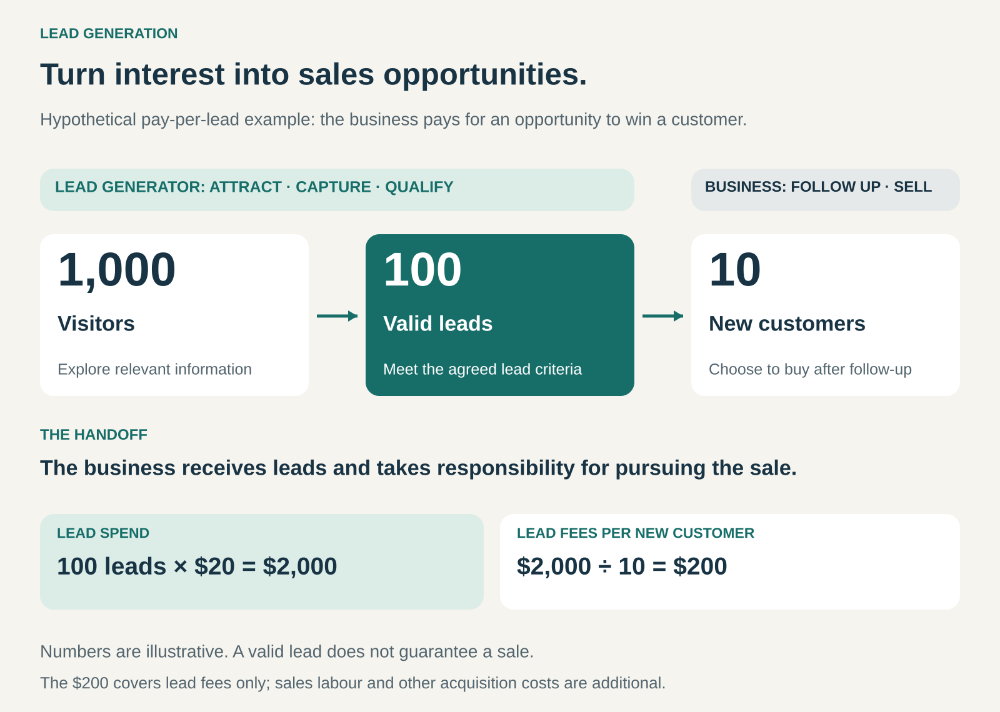

## What it is for

A roofing company has skilled workers but an unpredictable flow of enquiries. A software vendor knows which organizations could benefit from its product but struggles to reach interested buyers. A lender wants to meet people actively comparing financing options.

These businesses can deliver their offering. Their immediate problem is finding the next plausible customer.

Lead Generation creates a business around attracting potential buyers, capturing relevant information, and connecting them with providers that want their business.

## The core idea

**Create a sales opportunity that another business is willing to pay to pursue.**

A lead is an identifiable person or organization with enough relevant information to support appropriate follow-up. It might take the form of a quotation request, an inbound call, a submitted contact form, or a booked conversation.

The strength of that opportunity varies considerably. Someone requesting an urgent repair expresses a different level of intent from someone downloading a general research report.

The lead generator attracts attention, captures the enquiry, and may check whether it meets agreed criteria. The receiving business then evaluates the opportunity, discusses its offering, and attempts to win the customer.

Companies also generate leads for their own products. As a business-model pattern, Lead Generation commercializes that capability for other businesses.

Revenue can come from individual leads, qualified calls, appointments, campaign fees, or subscriptions. Advertising platforms can support lead generation while charging for clicks or impressions. The commercial arrangement needs to specify what the customer is buying.

## How it works

The pattern usually combines five activities.

**Attract a relevant audience.** The business reaches people through search, advertising, useful content, comparison tools, directories, events, or specialist communities. Relevance matters: a large audience outside the provider’s service area may produce little value.

**Offer a reason to respond.** A visitor might request estimates, compare options, arrange a demonstration, or ask for advice. The response should follow naturally from what the person is trying to accomplish.

**Capture useful information.** Contact details establish how to respond. Context establishes why: the project, location, requirements, timetable, or organization involved.

**Check the agreed criteria.** Qualification can range from checking that a phone number works to confirming service eligibility, timing, and purchasing responsibility. A technically valid submission may still be a weak commercial prospect.

**Deliver the opportunity.** The lead reaches the appropriate business, ideally with its context intact. The person making the enquiry should understand who may receive their information and what contact to expect.

The handoff is central. A lead generator can produce a legitimate opportunity without controlling whether the receiving business responds promptly, offers a competitive proposal, or closes the sale.

## Why it works

Lead generation separates customer acquisition into work that different organizations can perform well.

A specialist may understand search traffic, comparison journeys, or a particular professional audience better than an individual supplier. It can spread investment in content, technology, and acquisition across many participating businesses.

Providers gain access to opportunities without building every acquisition channel themselves. People seeking help may gain a convenient way to express a need and discover relevant suppliers.

Useful information improves the handoff. “Someone wants a kitchen renovation in this postcode within three months” gives a contractor a clearer starting point than an anonymous website visit.

The value comes from the likelihood of a worthwhile next conversation. Contact volume alone does not establish that value.

## Famous examples

### Thumbtack: turning service enquiries into opportunities for professionals

Thumbtack connects customers with professionals for projects such as repairs, cleaning, and home improvements. Its professional offering charges for leads and lets professionals control lead pricing and budgets.

Thumbtack defines a lead as arising when a homeowner contacts a professional about a service. The associated information can include the project, location, scheduling preferences, and conversation history. [Thumbtack for professionals](https://www.thumbtack.com/pro), [Thumbtack’s description of leads](https://developers.thumbtack.com/docs/pro-integrations/negotiations)

The commercial opportunity is the enquiry. The professional still needs to respond, assess the work, and win the customer. Thumbtack’s own materials state that earnings are not guaranteed.

### LendingTree: delivering consumer requests to financial providers

LendingTree’s 2025 annual report describes a model in which participating providers pay to receive consumer requests. Its home-loan products primarily earn upfront matching fees; a single request can be delivered to multiple participating providers.

Other products combine different payment events, including delivered requests, clicks, calls, completed loans, or credit-card approvals. [LendingTree 2025 annual report](https://www.sec.gov/Archives/edgar/data/1434621/000162828026016084/tree-20251231.htm)

This illustrates both Lead Generation and a hybrid revenue model. Some payments arise when an opportunity is delivered, while others depend on a later outcome.

The initial enquiry is a request to be matched with providers. It does not guarantee a loan offer or approval; providers make their own decisions. [LendingTree terms](https://www.lendingtree.com/legal/terms-of-use/)

### LinkedIn Lead Gen Forms: capturing responses within advertising

LinkedIn lets advertisers attach forms to advertisements. These can prefill contact and professional information from a member’s profile, and submitted leads can be downloaded or synchronized with customer-management systems.

An advertiser might use a form for a webinar registration, a report download, or an expression of interest in its offering. These responses require different follow-up and should not automatically be treated as equally ready to buy.

LinkedIn states that the forms carry no additional charge beyond the associated advertising. Its help documentation describes click- or impression-based purchasing rather than cost-per-lead purchasing. [LinkedIn Lead Gen Forms](https://www.linkedin.com/help/linkedin/answer/a423447/linkedin-lead-gen-forms-overview)

The example shows Lead Generation operating within an advertising-supported model.

## The economics

The lead generator and the receiving business have different calculations.

For the generator, revenue must cover attracting visitors, capturing and checking enquiries, delivering them, handling disputes, and operating the service. Paying for traffic can make lead volume expensive to grow.

For the receiving business, the important question is how lead spending translates into profitable customers.

In the diagram’s hypothetical example:

- The business buys 100 valid leads at $20 each, spending $2,000.
- Ten leads become customers.
- Lead fees therefore amount to $200 per acquired customer.

That $200 excludes sales labour and other acquisition costs.

If each customer contributes $350 after delivering the product or service, the ten customers produce $3,500 before acquisition costs and overhead. Subtracting the $2,000 in lead fees leaves $1,500 for follow-up costs, overhead, and profit.

If only five leads convert, the lead fees rise to $400 per customer. At the same $350 contribution, those customers would not cover the lead bill.

A cheaper lead can therefore be more expensive in practice if its conversion rate is substantially worse.

## Useful when

- **Providers need a steadier flow of enquiries.** Their delivery capability exceeds their ability to attract suitable prospects.
- **Purchases involve discussion or quotation.** A conversation normally precedes the transaction.
- **Customer value supports acquisition spending.** Expected contribution can cover unsuccessful enquiries as well as successful ones.
- **A specialist can reach a relevant audience efficiently.** It has useful content, distribution, tools, or category knowledge.
- **Qualification criteria are reasonably clear.** Both parties can distinguish an acceptable lead from an irrelevant submission.

## Common mistakes and limits

**Equating contact details with buying intent.** A valid email address does not establish a need, budget, or willingness to speak.

**Optimizing form submissions in isolation.** Removing every qualifying question can increase volume while making the resulting leads less useful.

**Leaving the paid event ambiguous.** A raw enquiry, verified contact, qualified opportunity, and attended appointment are different deliverables. Duplicate and invalid-lead rules also affect value.

**Ignoring shared distribution.** An exclusive enquiry and one delivered to several competitors create different opportunities. Buyers need to understand what they receive.

**Separating lead quality from follow-up quality.** Poor conversion can reflect weak leads, slow responses, unsuitable offers, or several factors together. Feedback from completed sales helps identify the cause.

**Making information-sharing expectations unclear.** Unexpected calls or repeated contact can damage trust. Clear explanations about recipients and follow-up are part of the service.

**Counting every resulting sale as incremental.** Some people may already know the provider or have become customers through another channel. Attribution affects whether the spending creates additional value.

## Related patterns

[[advertising-supported|Advertising Supported]] monetizes access to an audience. Lead Generation adds a response or contact handoff, and the two can share the same commercial model.

[[brokerage|Brokerage / Matchmaking]] identifies suitable counterparties and may support negotiation and agreement. Lead Generation commonly hands the opportunity to the provider earlier.

[[marketplace|Marketplace]] organizes discovery and exchange between buyers and sellers. It can incorporate paid leads even when the eventual sale happens elsewhere.

[[third-party-funded-access|Third-Party-Funded Access / Hidden Revenue]] applies when people use a discovery or comparison service without paying directly, while providers fund access to relevant enquiries.
