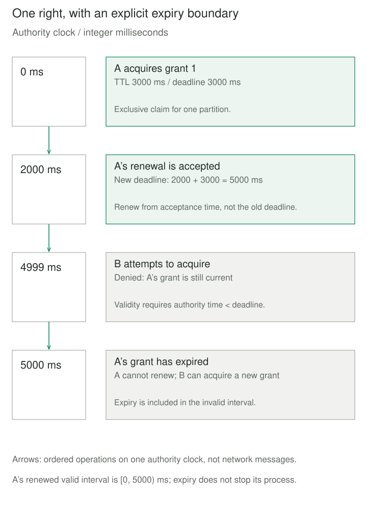
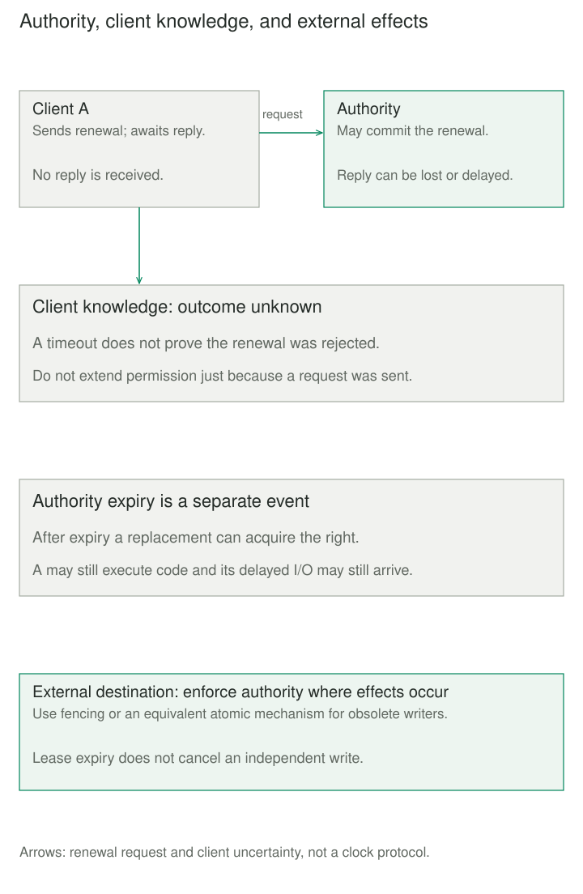

## Purpose and problem

A report-building worker claims a customer partition. If it crashes, another worker must eventually take over. A permanent ownership record blocks that recovery unless someone clears it manually. Deleting the record whenever a heartbeat is late creates a different problem: the original worker may merely be paused and can resume after its replacement starts.

The system needs a right that expires without the holder's cooperation. It must also distinguish losing that right from stopping the process, and distinguish the coordinator's decision from a client's possibly outdated knowledge.

## Core idea

**Make permission temporary; require explicit renewal to retain it.** A Lease grants a particular right over a defined resource for a limited duration. Its holder renews before expiry or lets the right lapse. After expiry, the authority can reassign it without obtaining a release from an unreachable holder.

A lease is a time-bounded agreement, rather than proof that a worker is alive or that its work completed. A heartbeat can carry renewal requests, but an observed heartbeat is not itself an atomic ownership grant. A cache TTL merely ages a local copy unless a coordinating protocol makes corresponding promises.



## How it works

### Define the right and its authority

A grant identifies its resource, holder, acquisition identity, and expiry rule. The authority serializes acquisition, renewal, and release. An exclusive resource needs an atomic conditional acquisition: two contenders cannot both replace the same expired grant. Production coordination commonly delegates this responsibility to a consistent, fault-tolerant service.

Renewal extends the existing acquisition only if its preconditions still hold. Release must match that acquisition, rather than simply deleting a record by worker name. Otherwise a delayed release can erase a newer grant, even when the same worker name is reused.

API semantics differ. etcd grants a server-selected TTL, refreshes leases through keep-alives, and deletes attached keys on expiry or revocation. Its lease alone does not make an attached key an exclusive claim; the acquisition protocol still needs conditional creation. Azure Blob leases enforce write/delete access at the blob service, require the active lease ID for writes, and allow certain expired leases to renew if the blob has neither changed nor been leased again. The example below deliberately disallows renewal at or after expiry.

### Separate time, knowledge, and effects

Choose whose clock defines expiry. A client cannot safely interpret a server timestamp using an unrelated local clock. Systems that let clients act on local lease timers need conservative timing rules covering relevant clock rates, communication delay, and pauses. Chubby describes such a client approximation and a period of uncertainty during which its library blocks application operations.

A renewal timeout has an unknown outcome: the server may have extended the lease while its reply was lost. Do not extend local permission merely because a request was sent. Stop initiating protected work when permission is no longer established, then follow the service's recovery protocol. Coordinator failover must preserve outstanding promises or conservatively wait them out; forgetting grants on restart can create conflicting authority.

Expiry does not cancel CPU execution or delayed I/O. For an independent destination, lease checks followed by unconditional writes leave a race. Resource-side fencing or an equivalent atomic authorization mechanism must enforce obsolete authority there. A lease ID identifies an acquisition; it need not be an ordered fencing token.



## Worked example

### An exclusive partition claim

Save `lease.py` and `demo.py` together and run `python3 demo.py` with Python 3.11+. This sequential, in-memory model has one partition and a manually advanced authority clock. Inputs use integer milliseconds; TTLs range from 1 to 60000. Each method models one atomic authority operation. Grant identities are trusted references, not security credentials.

```python
from dataclasses import dataclass


class Busy(Exception):
    pass


class LostLease(Exception):
    pass


@dataclass(frozen=True)
class Grant:
    owner: str
    lease_id: int


class LeaseSlot:
    def __init__(self):
        self._now_ms = 0
        self._deadline_ms = 0
        self._serial = 0
        self._grant = None

    def advance(self, delta_ms):
        if type(delta_ms) is not int or delta_ms < 0:
            raise ValueError("Time must advance by nonnegative integer ms")
        self._now_ms += delta_ms

    def _ttl(self, ttl_ms):
        if type(ttl_ms) is not int or not 1 <= ttl_ms <= 60000:
            raise ValueError("TTL must be 1..60000 integer ms")

    def _require(self, grant):
        if self._grant is None or grant != self._grant:
            raise LostLease("Acquisition does not match")
        if self._now_ms >= self._deadline_ms:
            raise LostLease("Grant expired")

    def acquire(self, owner, ttl_ms):
        self._ttl(ttl_ms)
        if not isinstance(owner, str) or not owner.strip():
            raise ValueError("Owner must be a nonempty name")
        if self._grant is not None and self._now_ms < self._deadline_ms:
            raise Busy("An unexpired grant already exists")
        self._serial += 1
        self._grant = Grant(owner, self._serial)
        self._deadline_ms = self._now_ms + ttl_ms
        return self._grant

    def renew(self, grant, ttl_ms):
        self._ttl(ttl_ms)
        self._require(grant)
        self._deadline_ms = self._now_ms + ttl_ms
        return self._deadline_ms

    def release(self, grant):
        self._require(grant)
        self._grant = None
```

```python
from lease import Busy, LeaseSlot, LostLease

slot = LeaseSlot()
a = slot.acquire("A", 3000)
slot.advance(2000)
print("renewed until ms:", slot.renew(a, 3000))
slot.advance(2999)
try:
    slot.acquire("B", 3000)
except Busy:
    print("B at 4999 ms: busy")
slot.advance(1)
try:
    slot.renew(a, 3000)
except LostLease:
    print("A at 5000 ms: expired")
b = slot.acquire("B", 3000)
print("replacement:", b.owner, b.lease_id)
try:
    slot.release(a)
except LostLease:
    print("old release: rejected")
slot.release(b)
print("next acquisition:", slot.acquire("C", 3000).lease_id)
```

Output is `renewed until ms: 5000`, `B at 4999 ms: busy`, `A at 5000 ms: expired`, `replacement: B 2`, `old release: rejected`, and `next acquisition: 3`. Renewal moves expiry from 3000 to 5000, not 6000. A cannot renew at the boundary or release B's grant. B's explicit release permits immediate acquisition by C.

This models ownership records only: no network, client timer, durable storage, automatic cancellation, authentication, or external writes. Increasing IDs distinguish acquisitions here; no destination consumes them as fences.

## When to use it

Use leases when workers can disappear while holding renewable claims, registrations should lapse without cleanup cooperation, or a coordinator role needs eventual reassignment. Choose a duration that balances acceptable takeover delay against renewal cost and expected pauses.

For a service registry, a leased registration bounds how long an absent instance remains advertised; it does not guarantee the instance can serve the next request. For a single database operation, a transaction or conditional update may be sufficient. Repeat-safe duplicate computation can also remove the need for exclusive ownership.

## Tradeoffs and common mistakes

Short durations increase renewal traffic and ownership churn; long durations delay takeover. Expiry detection and reassignment also take time, so a TTL is not a complete recovery-time guarantee. Persistent contenders need backoff and a fairness policy if starvation matters.

A successful renewal does not validate business data or extend an independent destination's permissions. A failed renewal is not proof of a crash. Keep identity checks and state changes atomic, scope grants to the intended resource, and authorize who may acquire, renew, or revoke them.

Do not restart an empty authority over still-active promises, share one grant indiscriminately across unrelated resources, or interpret lease IDs as credentials. Leases neither provide exactly-once execution nor roll back effects already performed.

## Related patterns

[[leader-election|Leader Election]] chooses a coordinator. A lease can bound that role's tenure; it does not define every election rule.

[[data-leases-with-fencing-tokens|Leases with Fencing Tokens]] adds ordered authority enforced by the protected destination, addressing obsolete owners and delayed writes after handover.

[[pessimistic-offline-lock|Pessimistic Offline Lock]] reserves business data across a longer interaction. A lease can bound the reservation's lifecycle, while transaction and authorization rules remain separate.

[[idempotent-receiver|Idempotent Receiver]] prevents duplicate business effects from repeated deliveries. A valid lease does not identify which operations already succeeded.

## Sources

- [Unmesh Joshi: Lease](https://martinfowler.com/articles/patterns-of-distributed-systems/lease.html) — established pattern name, limited tenure, renewal, and consistent coordination authority.
- [etcd: Lease API](https://etcd.io/docs/v3.6/learning/api/#lease-api) — granted TTL, keep-alives, revocation, and attached-key deletion.
- [Microsoft: Blob leases](https://learn.microsoft.com/en-us/azure/storage/blobs/storage-blob-lease) — destination-enforced permissions and implementation-specific renewal semantics.
- [Mike Burrows: The Chubby lock service](https://storage.googleapis.com/gweb-research2023-media/pubtools/4444.pdf), sections 2.8–2.9 — conservative client timers, uncertain session state, and failover recovery.
- [Martin Kleppmann: How to do distributed locking](https://martin.kleppmann.com/2016/02/08/how-to-do-distributed-locking.html) — process pauses, delayed requests, and destination-side fencing.

The partition scenario, Python model, and diagrams are original teaching examples, not implementations of those services.
