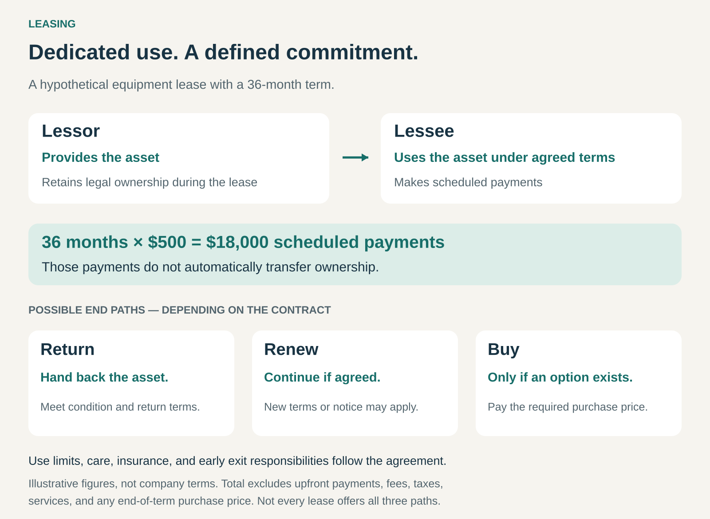

## What it is for

Give customers sustained use of an asset through an agreed payment schedule, while separating its use from immediate ownership. Leasing helps customers obtain equipment, vehicles, or other productive assets without paying the full purchase price upfront.

A business needs equipment for several years. Buying it would consume substantial capital. Renting it repeatedly may fit the requirement poorly. The business wants dependable use, predictable payments, and a clear arrangement for what happens afterward.

A lease connects those needs through a defined commitment.

The customer receives usage rights for an agreed term. The contract determines payments, responsibilities, restrictions, and any options to return, renew, or purchase.

## The core idea

Combine the provision of an asset with a continuing financial commitment.

The party providing the lease is the **lessor**. The customer using the asset is the **lessee**. The lessor may be the manufacturer, an independent asset owner, or a financing business that purchases equipment from a supplier.

The arrangement commonly involves:

- An identified asset or agreed equipment.
- A defined term and payment schedule.
- Responsibilities for care, insurance, and permitted use.
- Conditions governing early termination and the end of the term.

Leasing and renting overlap. This article focuses on leasing as a committed arrangement for sustained use and asset funding, while **Rent instead of Buy** focuses on the operational cycle of temporary rentals. The terminology does not create a universal legal boundary.

## How the commitment works

In this hypothetical example, the customer commits to 36 monthly payments of $500: $18,000 in scheduled payments.

That figure alone does not establish the total cost or eventual ownership. Upfront payments, services, fees, and an optional purchase price may sit outside it.

The end of the term can lead to different outcomes:

**Return the asset.** Meet the agreed condition, usage, notice, and return requirements.

**Renew the arrangement.** Continue using it where the contract permits or the parties agree.

**Purchase the asset.** Exercise an available option and pay the required amount.

Not every lease offers all three paths. Completing the scheduled payments does not automatically mean the customer owns the equipment.

## Why it works

Leasing separates the need to operate an asset from the need to fund its full purchase immediately.

A customer can preserve cash for other activities while obtaining sustained use. A manufacturer can make expensive equipment easier to acquire. A specialist lessor can combine purchasing, financing, customer assessment, and asset management.

The arrangement can also support planned replacement. A business expecting to refresh technology periodically may value a defined return process rather than managing resale itself.

However, predictable payments come with a commitment. Monthly billing does not necessarily provide monthly cancellation.

The economics also depend on how future asset value is allocated. Some arrangements leave significant resale exposure with the lessor. Others recover most of the asset’s cost through the payment structure and support a path toward customer ownership.

## Famous examples

### BMW Financial Services: vehicle use with defined end options

BMW’s US leasing programs let customers select terms and mileage allowances. Its lease-end guidance describes returning the vehicle, purchasing it, or moving into another BMW. Mileage, condition, and applicable charges affect the return process. [BMW’s lease programs](https://www.bmwusa.com/financial-services/lease-program.html), [BMW’s lease-end guidance](https://www.bmwusa.com/return-vehicle.html).

The customer obtains sustained use of a vehicle without buying it outright at the beginning.

The agreement also defines boundaries around that use. Additional mileage or excess wear can create charges, and early termination may carry a cost.

The commercial offer therefore combines the vehicle, a payment schedule, and a planned decision at the end of the term.

### AerCap: aircraft for airline operations

AerCap acquires flight equipment and leases it to airline customers. Its annual report describes managing acquisition costs, funding, lease rates, downtime between leases, and eventual sales.

For most of its flight equipment, AerCap uses operating leases under which the airline handles maintenance and servicing, while AerCap retains the benefits and risks of the equipment’s residual value. [AerCap’s 2025 annual report](https://www.aercap.com/investors/shareholder-services/sec-filings/content/0001628280-26-007513/aer-20251231.htm).

The airline obtains aircraft capacity through a lease commitment. AerCap manages the asset across financing, deployment, and later placement or sale.

This example makes responsibility allocation visible: retaining ownership does not mean the lessor performs every operational task. The airline’s maintenance obligations remain central to protecting the asset.

### Dell Financial Services: different paths for technology

Dell’s US financing offer distinguishes its fair-market-value Technology Rotation lease from its ownership-oriented finance lease.

The fair-market-value arrangement offers options to return equipment, renew, or purchase at its then fair market value. The ownership-oriented arrangement includes an option to purchase for $1 at the end of the initial term or return the equipment. [Dell’s payment and leasing options](https://www.dell.com/en-us/shop/dell-financial-services/lp/pay-as-you-go).

These structures support different intentions. One accommodates return and replacement; the other provides a low final purchase amount after the committed payments.

The example shows why the monthly payment cannot describe the whole bargain. The end option and total payment structure determine what the customer is acquiring.

## The economics

For the customer, the comparison concerns the whole arrangement over a realistic period.

Relevant costs include initial payments, scheduled payments, required services, insurance, usage charges, return costs, and any purchase option. The alternative of buying includes financing, maintenance, and eventual resale proceeds.

A smaller initial outlay can be valuable without making the total arrangement cheaper.

For the lessor, payments must support funding costs, customer credit risk, administration, and the asset’s expected economic outcome. Where the lessor relies on resale or another lease, future demand and condition matter greatly.

A high assumed residual value can help produce an attractive payment schedule while leaving more exposure at the end. That risk has to sit somewhere; the contract determines how it is shared.

Leasing can make costs more predictable, but it cannot eliminate depreciation, financing costs, or the possibility that the customer’s needs change.

## Useful when

This pattern is especially useful when:

- **Use is sustained and reasonably predictable:** the customer can commit to an appropriate term.
- **The asset requires substantial funding:** spreading payments preserves cash for other needs.
- **Replacement can be planned:** the expected term fits the equipment’s useful role.
- **Responsibilities can be specified:** maintenance, insurance, condition, and permitted use are clear.
- **The lessor understands the asset:** it can assess funding, customer risk, and future value.

It becomes less attractive when requirements are highly uncertain, early exit is likely, or the customer needs extensive freedom to modify or dispose of the asset.

## Common mistakes and limits

**Choosing on the monthly payment alone.** Upfront amounts, term length, purchase options, and return charges can materially change the result.

**Confusing payment frequency with flexibility.** A monthly invoice can belong to a multiyear obligation.

**Assuming maintenance is included.** Some leases bundle services; others leave substantial operating responsibilities with the customer.

**Treating a purchase option as automatic ownership.** Notice, eligibility, payment, and other contractual requirements may apply.

**Ignoring the end process.** Return logistics, condition requirements, renewal rules, and notification deadlines affect the practical value of the arrangement.

**Assuming leasing removes balance-sheet obligations.** Under IFRS 16, lessees generally recognize assets and liabilities for leases longer than 12 months, subject to specified exceptions such as low-value assets. Legal ownership and accounting recognition are different questions. [IFRS Foundation’s explanation of IFRS 16](https://www.ifrs.org/issued-standards/list-of-standards/ifrs-16-leases/).

## Related patterns

- [[access-over-ownership|Access over Ownership:]] the broader pattern of receiving usage rights without immediate ownership.
- [[rent-instead-of-buy|Rent instead of Buy:]] overlaps with leasing, with greater emphasis here on sustained commitment and asset funding.
- [[subscription|Subscription:]] organizes recurring payments or service access; a lease adds an asset-specific commitment and contractual responsibilities.
- [[outright-sale|Outright Sale:]] transfers ownership through a purchase. A lease may include a later purchase option, but its payment schedule alone does not establish that transfer.
