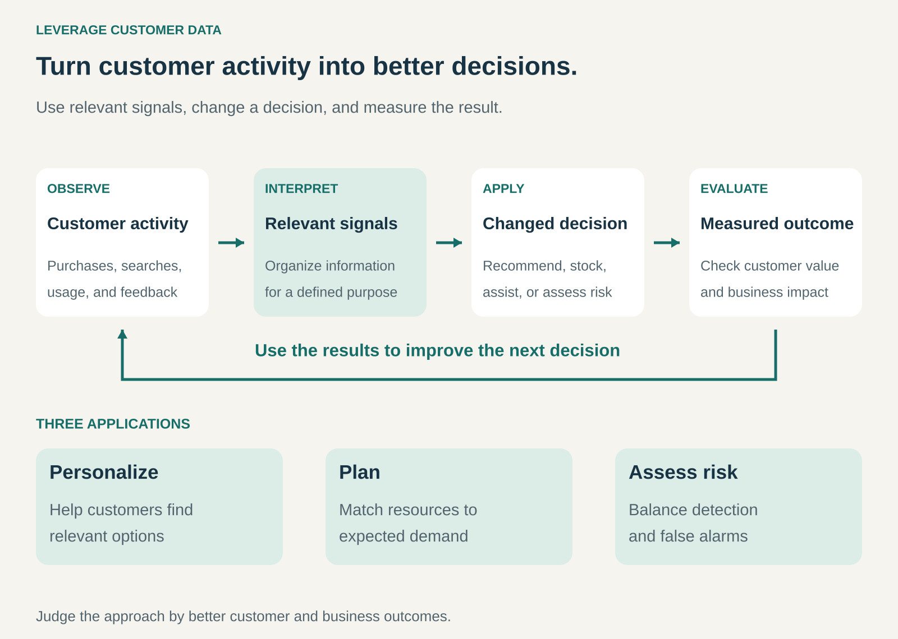

## What it is for

Improving products, services, and operating decisions by learning from customers’ purchases, preferences, usage, and feedback.

A retailer sees which products customers buy together. A subscription service learns which options people find useful. A payment provider observes patterns associated with unsuccessful or fraudulent transactions.

These interactions produce information that can improve later decisions.

The commercial value may appear as more relevant recommendations, better availability, faster support, fewer losses, or a stronger customer experience.

## The core idea

**Turn information from customer relationships into decisions that create additional value.**

The useful sequence is:

**Customer activity → relevant signals → changed decision → measured outcome.**

Collecting information is only the beginning. The business needs a clear explanation of which decision will change and why the change should help.

Customer data can include explicitly stated preferences, transaction records, product usage, searches, returns, and support interactions. Different sources answer different questions.

A purchase shows what someone bought under particular circumstances. It does not reveal everything they wanted, considered, or could not find.

Value can be captured through improvements to the existing business or through additional data-derived services. The pattern does not require selling customer records.

## How it works

The pattern connects four activities.

**Start with a decision.** The business identifies a practical question: which items to recommend, how much inventory to hold, which service problem to address, or which transactions need review.

That purpose determines what information is relevant.

**Organize the signals.** Records need consistent definitions and enough context to be interpreted. A returned item, for example, means different things depending on whether it was defective, unsuitable, or delivered late.

Sometimes a simple summary is sufficient. More complex prediction is useful only when it improves the decision enough to justify the work.

**Apply what has been learned.** Information changes a recommendation, forecast, service process, product feature, or risk assessment.

The benefit remains hypothetical until the changed decision affects results.

**Evaluate the outcome.** The business checks whether customers and the operation are better served. Controlled comparisons can help distinguish an improvement caused by the change from differences that would have occurred anyway.

The resulting observations inform the next decision.

## Why it works

Repeated interactions can reveal patterns that individual employees or isolated transactions cannot show.

A customer’s recent choices may help identify relevant options. Patterns across many customers can reveal recurring problems, complementary products, seasonal demand, or unusual transactions.

The business can then allocate attention and resources more effectively.

This can create a reinforcing relationship: a useful service attracts activity, activity provides relevant observations, and those observations support further improvements.

That relationship is conditional. More activity produces an advantage only when the information is relevant, interpreted well, and applied effectively.

The business also needs customers’ trust. Unexpected or poorly explained uses of information can weaken the relationship that makes the pattern possible.

## Famous examples

### Netflix: helping customers find relevant titles

Netflix explains that its recommendations consider viewing history, ratings, similarities between members’ preferences, and information about the titles themselves. It also uses contextual signals such as preferred language and viewing duration. [Netflix’s explanation of its recommendation system](https://help.netflix.com/en/node/100639/)

The information changes which titles are presented and how they are ordered.

The customer benefit is easier discovery within a large catalogue. The business opportunity is a service that remains useful enough for customers to continue choosing it.

Netflix’s description establishes how the system uses signals. It does not, by itself, establish how much revenue any particular recommendation generates.

### Amazon: using customer activity to inform inventory planning

Amazon’s account of its forecasting development describes using information including demand, sales, product categories, and page views to predict future demand. It also explains how patterns across products can help when an individual product has limited history. [Amazon’s history of demand forecasting](https://www.amazon.science/latest-news/the-history-of-amazons-forecasting-algorithm)

The changed decision concerns inventory: what to have available and in what quantities.

This demonstrates a use beyond personalizing an individual customer’s screen. Information from customer activity becomes an input to operating decisions.

The forecast remains an estimate. Product launches, changing conditions, and incomplete observations can make future demand difficult to predict.

### Stripe Radar: learning from payment activity to assess risk

Stripe describes Radar as using machine learning and signals from incoming payments, together with information across its network, to assess transaction risk. [Stripe’s explanation of Radar](https://support.stripe.com/topics/radar)

The information supports decisions about payments that may need additional attention.

This illustrates how patterns across many interactions can support a service that an individual business would struggle to build from its own limited transaction history.

The relevant outcome includes both detecting problematic transactions and avoiding unnecessary rejection of legitimate customers. A risk assessment is an input to a decision, rather than certainty about an individual transaction.

## The economics

Consider a hypothetical randomized comparison of two product-recommendation approaches.

| Result        | Existing approach | New approach |
| ------------- | ----------------: | -----------: |
| Visits        |            50,000 |       50,000 |
| Orders        |             1,500 |        1,700 |
| Purchase rate |              3.0% |         3.4% |

The observed difference is **200 orders**.

Assume those additional orders produce **$25 contribution each**, after product costs, discounts, fulfillment, and expected returns.

Additional contribution is:

**200 × $25 = $5,000.**

If the additional operating cost of the new approach is **$2,000** during the comparison period, the remaining benefit is:

**$5,000 − $2,000 = $3,000.**

That amount is before recovering one-time development costs.

These are illustrative results. A real evaluation needs enough evidence that the difference is reliable, along with attention to longer-term effects and changes elsewhere in the customer experience.

Counting every order influenced by a recommendation would overstate the gain. Some purchases would have happened without it.

## Useful when

- Customer interactions contain information relevant to recurring decisions.
- The business can connect observations to a specific product or operating improvement.
- Customers face many options and benefit from more relevant guidance.
- Demand, service needs, or transaction patterns are difficult to assess manually.
- Outcomes can be measured well enough to evaluate the change.
- Information can be used within appropriate purposes, permissions, and safeguards.

It is less useful when observations are sparse, misleading, unrelated to an actionable decision, or too expensive to maintain relative to the likely benefit.

## Common mistakes and limits

**Collecting without a purpose.** A large store of information does not establish what the business should do differently.

**Treating behavior as a complete expression of preference.** Customers choose from what they see, can afford, and can access. Those conditions shape the observations.

**Confusing correlation with an improvement caused by the change.** High-spending customers may use a feature more often without the feature causing their higher spending.

**Optimizing an incomplete measure.** More clicks, viewing time, or blocked transactions may coexist with worse customer outcomes.

**Ignoring feedback effects.** Recommendations influence what people encounter, which influences the next round of data. The system can reinforce its own assumptions.

**Assuming past patterns remain stable.** Preferences, products, and operating conditions change. Models and decision rules need reassessment.

**Overlooking purpose and permission.** Having access to information does not establish that every secondary use is appropriate. For personal data, the EU’s principles include purpose limitation, data minimization, transparency, and accuracy. [European Commission: personal-data processing principles](https://commission.europa.eu/law/law-topic/data-protection/information-business-and-organisations/principles-gdpr_en)

**Assuming more data automatically creates an advantage.** Relevance, quality, interpretation, and execution determine whether observations become useful decisions.

## Related patterns

- [[cross-selling|Cross-Selling:]] Can use purchase relationships to identify relevant complementary offers.
- [[customer-loyalty-program|Customer Loyalty Program:]] Can provide a continuing relationship through which preferences and purchasing patterns become clearer.
- [[data-as-a-service|Data as a Service:]] Can turn appropriately prepared information into a separate commercial offering.
- [[curation|Curation:]] Uses judgment and context to make choices more useful; customer signals can inform that work.
