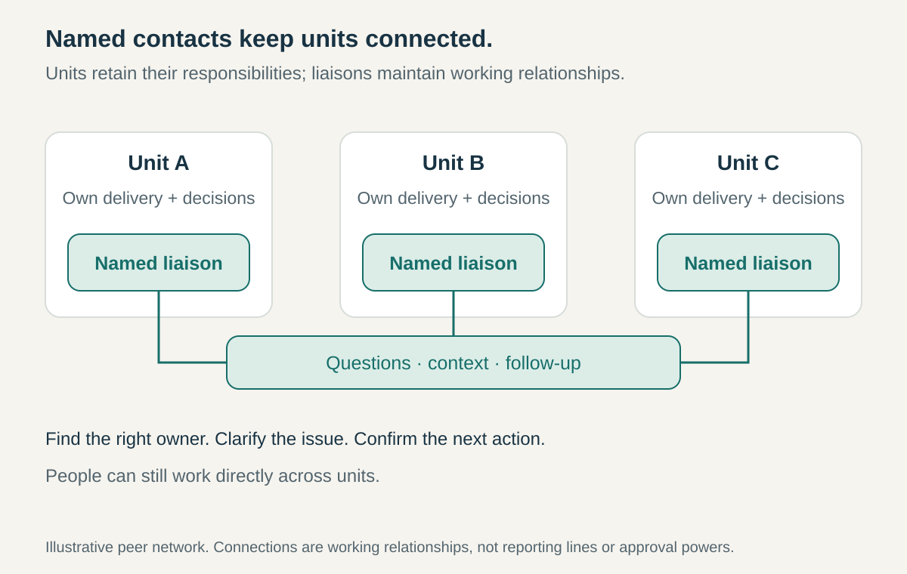

**Core question:** How can separate units keep useful working connections without relying on personal favors or escalating every question?

## What it is for

Imagine a hypothetical museum coordinating exhibitions across several venues. Each venue has its own operations, communications, and visitor services staff. A change to an exhibition’s opening date reaches some people through a personal contact and others after they have printed the publicity. Everyone can use the shared messaging system, but nobody knows who can give a dependable answer elsewhere.

Liaison Networks makes those connections an explicit responsibility. Each relevant unit has a recognized contact who understands its work and maintains relationships across the boundary. The pattern can connect departments, locations, professions, member organizations, or a central specialist function with distributed teams.

It addresses a recurring coordination need while leaving delivery responsibilities with the units that already hold them.

## The core idea

**Establish a network of named contacts who connect their units to relevant counterparts, carry context both ways, and help questions reach someone who can act.**

A liaison maintains a working interface. They know whom to involve, translate unfamiliar terms, bring emerging concerns into the right conversation, and follow up when a request disappears between units.

The network may connect peers directly or link local contacts through a coordinating function. It need not make everyone attend the same meeting. What makes it a network is a maintained set of relationships, a shared purpose, and a recognizable way to use those relationships.

The arrangement differs from an informal collection of helpful colleagues because the responsibilities survive changes of personnel. It also differs from creating another management layer: a liaison’s authority depends on their stated mandate, not on being the contact person.

## How it works

**Choose the boundaries that need attention.** Identify recurring interactions where finding the right person or understanding another unit causes delay. The museum might need a venue liaison network for exhibition changes. A network covering every topic would quickly become vague and overloaded.

**Name credible local contacts.** Select people who understand their unit’s work, can reach its specialists, and have enough standing to obtain answers. Publish the scope of the role, contact details, cover arrangements, and how replacements are appointed. A liaison need not be the unit’s most senior person or its expert on every question.

**Define the mandate.** Distinguish providing information, convening a discussion, negotiating a commitment, and approving it. A venue liaison might identify publicity affected by a date change and assemble the relevant owners. They may still need those owners to authorize revised spending or staffing. Make any additional decision powers explicit.

**Maintain useful connections.** Give contacts a shared directory, a suitable communication channel, and a modest rhythm for discussing live issues. A coordinator can keep membership current and connect repeated questions to specialists. Peer connections help units solve ordinary problems without sending everything through that coordinator.

**Carry context in both directions.** Explain why another unit needs something, what constraints matter, and when a response is required. Bring local obstacles and proposed alternatives back into the network. Circulating an announcement is only part of the work; the receiving unit may need a conversation about what it means for its plans.

**Close the loop.** Record who owns the next action and confirm that the question reached someone able to answer. Route disagreements or requests beyond the liaison’s mandate to the named decision owner. Provide a fallback when a contact is absent or unresponsive. Keep sensitive matters within appropriate access boundaries.

**Fund and renew the role.** Agree time with the person’s manager, provide orientation, and review workload. Preserve essential relationship knowledge in shared records and handovers. People should remain free to speak directly with counterparts; the liaison helps establish those relationships rather than becoming a compulsory relay.

## Why it works

People often need more than a directory entry. They need someone who understands the local setting and can judge which other person, meeting, or decision process will help.

A continuing contact reduces repeated searching and gives relationships time to develop. Exposure to both settings helps a liaison notice misunderstandings that a forwarded message would leave unresolved. A network also creates a route for repeated local difficulties to become visible as a wider problem.

These are the mechanisms the arrangement is intended to support. Their value depends on responsive counterparts, reliable information, local credibility, and time to perform the role. Naming contacts without supporting their work creates the appearance of coordination while leaving the original gaps intact.

## Examples

### CERN — formalizing relationships with Member States, March 2017

In a 13 March 2017 account, CERN’s Director for International Relations described formalizing Management Liaison roles for each Member State. Senior personnel had already helped manage relationships with their home countries; the formal mandate called for more proactive dialogue. CERN’s Member State Relations Section coordinated the wider effort. The account described a network contributing to ongoing communication, high-level visits, and connections among compatriots at CERN. [CERN’s account of its Management Liaisons](https://home.cern/member-states-and-cern-heart-organization/)

The organizational change was to make an existing relationship responsibility explicit and connect its holders as a network. Knowledge of both CERN and the country gave each liaison a basis for interpreting concerns across that boundary. This is a dated organizational account. CERN’s positive assessment is its own report, rather than independent evidence of the network’s effects.

### Adobe — contacts embedded in product teams, consulted October 2026

Adobe’s Trust Center describes an embedded security champion in each product team: an engineer with advanced security training who understands relevant controls and advocates their implementation. Champions communicate security priorities to their teams and help ensure those priorities receive attention and are completed. They remain connected to Adobe Security through regular communications, updates, and training. [Adobe’s description of security awareness and training](https://www.adobe.com/trust/security/awareness-and-training.html)

Viewed as an organizational arrangement, this gives a specialist function local contacts inside the teams doing the work. Security knowledge has an identifiable point of contact close to product decisions, rather than depending entirely on central broadcasts. The source describes that structure and its intended responsibilities; it does not establish a particular reduction in defects or give champions unrestricted approval powers.

## Useful when

- People repeatedly ask who handles a recurring issue in another unit.
- Central guidance reaches local teams but its practical implications remain unclear.
- Changes cross locations or departments and arrive too late for affected people to respond.
- Coordination depends on a few personal relationships that disappear when someone changes jobs.

## Common mistakes and limits

**Making contacts compulsory gatekeepers.** Routing every conversation through a liaison increases waiting and hides useful context from specialists. Encourage direct relationships once established.

**Assigning a title without capacity.** A contact who cannot obtain answers or make time for follow-up becomes a dead end. Protect time and provide organizational backing.

**Treating the network as a broadcast list.** One-way distribution misses local consequences. Give contacts a route to surface obstacles and receive responses.

**Promising authority the role does not have.** Familiarity with another unit does not authorize spending its budget or committing its people. State who can decide.

**Using connections to conceal structural problems.** If every delivery requires intensive negotiation across the same boundary, the units’ responsibilities or resources may need redesign. A liaison network cannot settle incompatible priorities by maintaining better relationships alone.

## Related patterns

- [[double-linking|Double Linking]] gives distinct shared members participation in both groups’ governance. Liaison Networks can coordinate without creating that membership or those decision rights.
- [[integrator-roles|Integrator Roles]] gives a role responsibility for keeping a combined result coherent. A liaison network supplies distributed connections without necessarily assigning anyone ownership of the whole result.
- [[explicit-escalation-paths|Explicit Escalation Paths]] provides the route when a liaison cannot obtain a response or an issue exceeds local authority.
