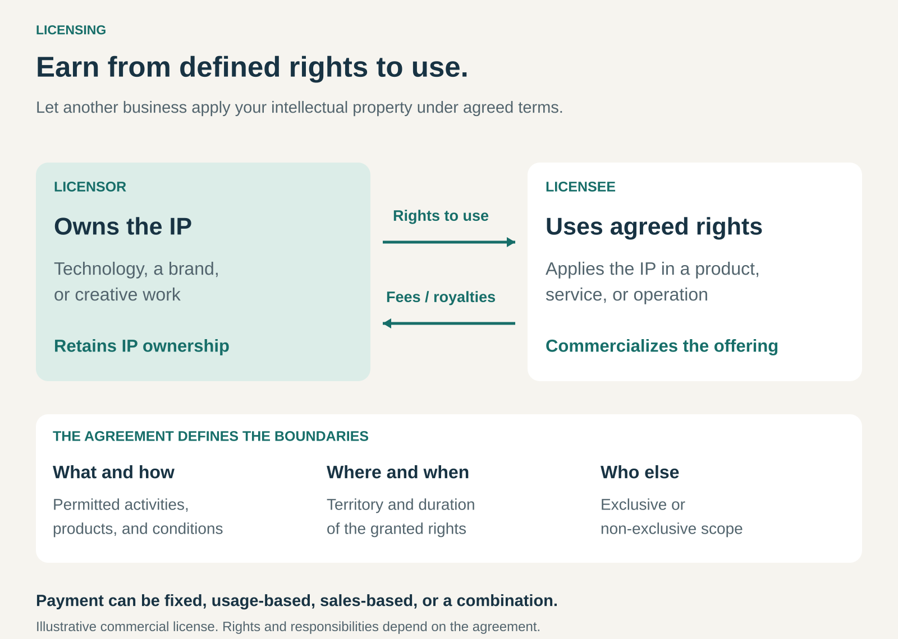

## What it is for

Earning revenue from intellectual property by allowing others to use it under agreed conditions.

A company may develop valuable technology without wanting to manufacture every product that could use it. A character may appeal to customers across toys, clothing, and games. A photograph may be useful to many publishers.

Licensing lets another party apply that asset while its owner retains ownership.

For the owner, it can extend reach without building every production and distribution capability. For the licensee, it provides access to something valuable that would be difficult, expensive, or impossible to develop independently.

## The core idea

**Grant defined rights to use an asset, and charge for those rights.**

The asset might be patented technology, software, a brand, a design, creative content, or confidential know-how.

The **licensor** grants the rights. The **licensee** receives permission to perform specified activities, such as using technology, manufacturing a product, reproducing an image, or incorporating a character into merchandise.

Ownership remains with the rights holder. WIPO distinguishes this arrangement from an assignment, which transfers ownership of the intellectual property. [WIPO: intellectual property commercialization](https://www.wipo.int/en/web/ip-commercialization)

The commercial opportunity comes from separating ownership of an asset from its application. Different businesses can contribute different capabilities: one develops the technology or creative property; another brings manufacturing, distribution, market access, or specialist execution.

## How it works

A licensing arrangement connects three things.

**An asset with practical value.** The licensee needs a reason to pay: better technology, recognizable characters, useful content, trusted branding, or access to protected knowledge.

**A defined scope of permission.** The agreement specifies what the licensee may do, where, and for how long. Permission to use artwork on packaging does not automatically include permission to make toys or sublicense it to others.

**A payment mechanism.** Commercial arrangements can use:

- **Fixed fees:** payment for an agreed scope or period.
- **Per-unit royalties:** payment for each qualifying product manufactured or shipped.
- **Sales-based royalties:** a percentage of a defined sales amount.
- **Usage-based charges:** payment linked to specified use.
- **Combinations:** an initial fee plus ongoing royalties, for example.

A license can be exclusive within a defined scope or available to several licensees. Exclusivity might cover a particular territory, product category, or field of use. Whether the owner also retains rights to operate within that scope depends on the agreement. [WIPO: licensing options and conditions](https://www.wipo.int/en/web/ip-business-moments/earn)

Licensing also involves practical work: providing documentation, approving applications, supporting implementation, checking quality, and verifying royalty reports.

## Why it works

Many intellectual assets can support multiple applications without being consumed by any one of them.

A processor design can appear in many chips. A character can appear across several product categories. A photograph can be licensed for different publications.

This creates opportunities to spread development costs across more uses.

The licensee contributes capabilities the owner may lack. A manufacturer might already have factories, retail relationships, and expertise in a product category. Licensing combines those capabilities with an existing technology or creative property.

The model can therefore expand an asset’s commercial reach without requiring its owner to operate every downstream business.

The economics are not automatically effortless. Development, maintenance, support, approvals, and rights administration can remain substantial. Licensees must also succeed in their own markets for sales-based royalties to grow.

## Famous examples

### Arm: licensing technology that other businesses turn into chips

Arm licenses processor and other intellectual property to businesses designing chips. Customers pay for access to its technology, and Arm receives royalties on substantially all chips shipped using its licensed products. Its reporting describes royalties based on either a percentage of the chip’s selling price or a fixed amount per unit. [Arm’s description of its licensing model](https://investors.arm.com/node/8281/html)

The licensee combines Arm technology with its own engineering and product decisions. Arm can earn from the resulting shipments across multiple customers and markets.

This illustrates two connected revenue opportunities: payment for access to technology and royalties as that technology reaches production.

Licensing remains Arm’s primary business, although the company has also expanded its offering toward its own silicon products. The example concerns its IP licensing model.

### Disney: extending stories and characters into merchandise

Disney licenses intellectual property for use in merchandise. Its annual report describes merchandise licensing revenue based on contractual royalty rates applied to licensees’ product sales, with minimum guaranteed fees in some agreements. [Disney’s annual report](https://investors.thewaltdisneycompany.com/files/doc_financials/2025/ar/2025-Annual-Report.pdf)

LEGO Disney provides a familiar illustration of complementary capabilities. LEGO’s account of the collaboration describes products translating Disney stories and characters into building experiences, including a relationship dating back to its Winnie the Pooh range in 1999. [LEGO’s account of its Disney collaboration](https://www.lego.com/en-us/aboutus/news/2023/january/the-lego-group-to-celebrate-100-years-of-disney)

The creative property supplies recognizable worlds and characters. The manufacturer contributes product design, production, and distribution.

The specific financial terms of the LEGO relationship are not established by these sources.

### Dolby: licensing technology embedded in other companies’ products

Dolby licenses branded technologies and patents used in electronic devices. Its reporting identifies Dolby Atmos and Dolby Vision among its branded technologies and describes royalties linked to products shipped by licensees. [Dolby’s licensing business and royalty reporting](https://www.sec.gov/Archives/edgar/data/1308547/000130854726000010/dlb-20260327.htm)

A device manufacturer can incorporate licensed capabilities into its own offering, while Dolby earns from the permitted use of its technology.

The visible Dolby name also shows how licensing can overlap with ingredient branding. Licensing provides the underlying rights; ingredient branding makes the contribution recognizable to customers.

## The economics

Consider a hypothetical one-year technology license.

The agreement provides:

- A **$20,000 fixed fee**, payable in addition to royalties.
- A **5% royalty** on contractually defined net sales.
- **$1 million** in qualifying licensee sales during the year.

The licensor receives:

**$20,000 + (5% × $1 million) = $70,000.**

If implementation support, administration, and allocated rights-maintenance costs total **$25,000**, the arrangement contributes:

**$70,000 − $25,000 = $45,000.**

That amount is before recovering the original development investment and covering other company costs and taxes.

The royalty base matters. Five percent of retail sales, wholesale receipts, and sales after specified deductions can produce very different payments.

Payment labels matter too. An advance credited against future royalties is not automatically additional revenue on top of those royalties. A minimum guarantee generally establishes a payment floor according to the agreement.

## Useful when

- A business owns valuable intellectual property that others can apply commercially.
- Partners have manufacturing, distribution, or market access the owner lacks.
- An asset has applications across several industries, territories, or product categories.
- Developing the asset is expensive, but additional authorized uses can spread that investment.
- A business wants to enter a market using established technology, content, or branding.
- The permitted use and payment basis can be defined and monitored.

It is less attractive when the value depends heavily on tacit expertise that cannot readily be transferred, or when support and oversight costs overwhelm expected income.

## Common mistakes and limits

**Assuming every idea is a licensable asset.** Commercial value, identifiable rights, and authority to grant those rights need to be established. A promising concept alone may offer little that another business needs permission to use.

**Granting broad exclusivity too cheaply.** Exclusive rights can close off other opportunities. Their value depends on scope, duration, and the licensee’s ability to develop the market.

**Treating royalties as passive income.** Technical updates, approvals, support, reporting checks, and disputes may require ongoing resources.

**Leaving the payment basis unclear.** Sales definitions, deductions, reporting periods, and treatment of returns affect what the licensor actually receives.

**Ignoring partner performance.** A licensee may secure valuable rights and then underinvest. Minimum payments or performance conditions can help align incentives, but they do not guarantee commercial success.

**Overlooking reputation and obsolescence.** Poor licensed products can weaken a brand. Technology can lose relevance, and the rights supporting an arrangement may change or expire.

## Related patterns

- [[open-business-model|Open Business Model:]] Licensing enables knowledge and intellectual property to move between businesses.
- [[ingredient-branding|Ingredient Branding:]] Makes a licensed component, technology, or material visible within another company’s offering.
- [[oem-design-in|OEM Design-In:]] A licensed technology may become embedded in a manufacturer’s product before production begins.
- [[monetize-existing-capabilities|Monetize Existing Capabilities / Make More of It:]] Licensing creates additional revenue from assets a business already possesses.
