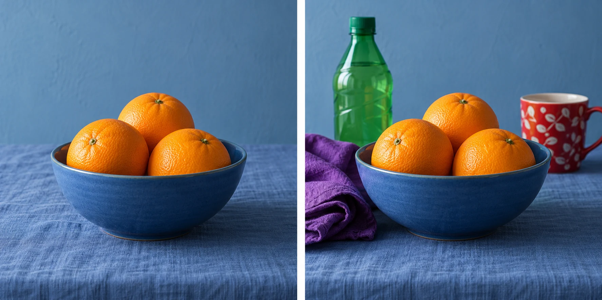

Three oranges in a blue bowl make an immediately readable picture. Add a green bottle, a
purple cloth, and a patterned red cup, and the oranges still exist, but they share attention
with several new color events. The busier version may describe an energetic kitchen. The
restrained version concentrates on a simpler relationship between fruit and surroundings.

Look for a small set of colors that can organize the whole frame. You can choose a location,
change your position, rearrange a still life, or wait until a competing color leaves. A
limited palette does not require monochrome, dullness, or removing every variation. It gives
the photograph a manageable set of color relationships.

## Count the major color events

Think in broad areas rather than exact pigment counts. A blue wall contains many tonal
variations, but can still function as one color family. A small saturated red object may
matter more to the composition than a much larger area of subdued brown. The useful question
is how many separate color events compete for attention and how they relate.

Repetition can create coherence. Similar greens across leaves, a painted chair, and a distant
shutter can connect otherwise separate parts of a scene. A single contrasting color can create
emphasis. These effects depend on brightness, saturation, size, and context as well as hue.
No color has an automatic emotional meaning shared by all viewers.

[[separate-subject-and-background|Separate Subject and Background]] concerns one subject's distinction.
This pattern concerns the color organization of the entire picture. A subject can separate
through brightness inside a nearly monochrome palette, or become part of a richly varied
scene without being strongly isolated.

## Arrange an everyday still life

For the oranges, choose the blue bowl and a blue cloth because their related colors make
a larger continuous setting. The orange fruit provides a different color family. Let natural
shadows and texture remain; flattening every shade of blue would make the materials less convincing.
If a bright green bottle enters the edge, decide whether it belongs before taking the picture.

Moving the bottle is reasonable in a clearly arranged still life. In a documentary photograph
of someone's working kitchen, rearranging objects can change the record. You could instead
choose a different frame or accept the complexity. [[edit-to-guide-attention|Edit to Guide Attention]]
discusses the difference between expressive editing and expectations around documentary accuracy.

A limited palette can make small material differences more noticeable: glossy orange peel
against matte cloth, or ceramic reflections against a painted wall. If your interest is
the abundance of a meal, the extra objects may contribute more than the restricted palette.
Let intention determine whether simplification is useful.

## Find the palette in a street

On a gray rainy day, wet pavement, buildings, and coats may form a restrained background.
A yellow umbrella can become conspicuous without needing a tight crop. Wait until it passes
a plain facade rather than a brightly colored advertisement, and its relationship to the
surroundings becomes simpler.

Alternatively, photograph several differently colored umbrellas to describe the street's variety.
The color story has changed from one accent to a collection. [[find-a-relationship|Find a Relationship]] can help when repeated or contrasting colors connect separate people or objects.
Avoid treating strangers as movable design elements; adjust your own frame and respect their
preferences rather than asking them to perform your palette.

Small camera movements can remove a saturated sign or bring a compatible wall behind a
subject. [[change-your-position|Change Your Position]] provides a geometric tool for a color
problem. A longer lens from the same position may exclude the sign, but it also changes
framing and may remove context you wanted to retain.

## Color under changing light

A portrait beside a green wall may acquire green reflected light in the shadows. A warm
lamp and a cool window can produce different colors across a face. White balance changes
how the camera renders the illumination, but one global adjustment cannot neutralize all
mixed sources independently.

If the mixed colors distract, moving away from the wall or switching off the lamp may
produce a simpler starting point. If the mixture describes the place, retain it. [[photography-foundations|Photography Foundations]] explains white balance and color temperature. Do not confuse changing a color
cast with choosing a limited palette: you can have coherent colors under warm light or
cool light, and competing colors under either.

## Avoid making coherence into sameness

This pattern helps with cluttered-looking images, still lifes, clothing choices for collaborative
portraits, travel scenes, and coherent small sets of photographs. It works particularly well
on a phone because the main tools are selection and framing. Color does not require manual
mode or a particular camera profile to become deliberate.

One mistake is desaturating everything until no color can compete. That can remove the very
relationship that made the image interesting. Another is increasing the remaining accent
until it looks detached from its surroundings. Compare at an ordinary viewing size and look
at materials and skin as well as the apparent punch of the image.

Color coherence is also only one possible organizing principle. Gesture, geometry, light,
and story may matter more. [[use-a-creative-constraint|Use a Creative Constraint]] can use
a small palette to narrow exploration for a while; it need not become a permanent style.
A limited palette is useful when fewer color events make the photograph's relationships
clearer, not simply when the resulting picture contains fewer colors.
