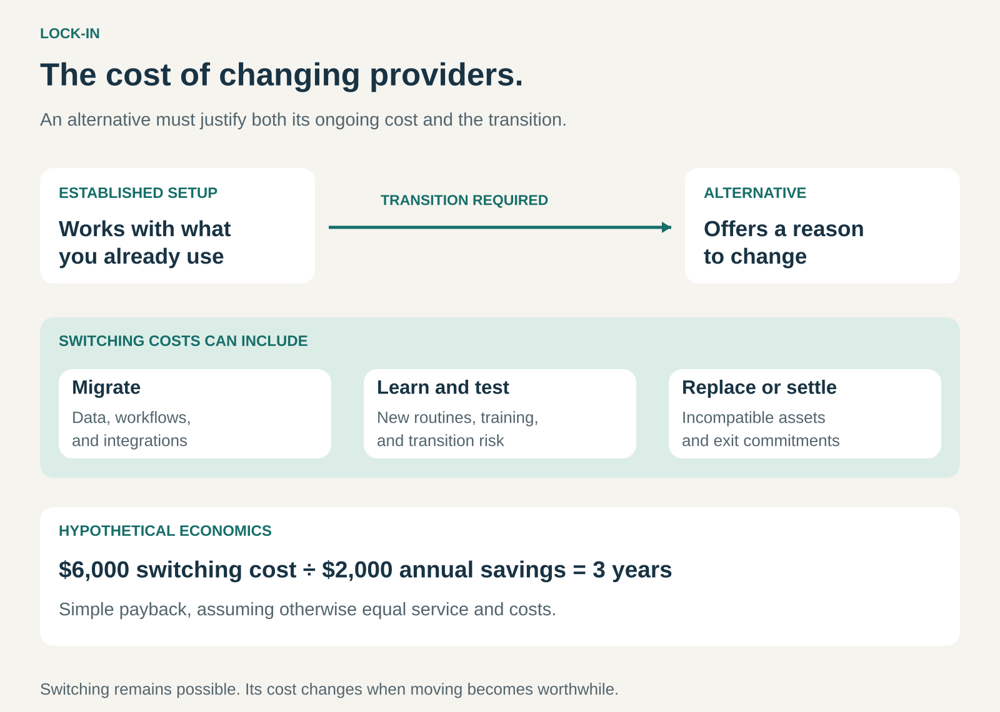

## What it is for

Keeping customers over time by making an established relationship costly or disruptive to replace.

A customer may find a cheaper product and still decide to stay. Their existing system already contains years of data, connects to other tools, supports familiar routines, and works with equipment they own. Changing the product means changing some of that surrounding setup.

Lock-in describes this effect: **switching providers requires giving up something useful or paying a meaningful transition cost.**

It can support recurring revenue and longer customer relationships. It can also create resentment when customers feel that leaving has become unnecessarily difficult.

## The core idea

The customer’s decision includes two comparisons:

- How attractive is the alternative?
- What will it take to get there?

A competitor might offer a better price, but the savings must justify migration, retraining, replacement purchases, disruption, and any remaining commitments.

The Business Model Navigator describes Lock-in through switching costs and dependencies that bind customers to an offering. Those costs can include money, time, and the effort of learning a replacement. [Business Model Navigator: Lock-in](https://ri.businessmodelnavigator.com/pattern?id=27)

Lock-in often grows as a product becomes more deeply integrated into the customer’s life or business. A standalone tool may be easy to replace. The same tool becomes harder to replace after it supports essential workflows, connects to several other systems, and becomes familiar to an entire team.

## How it works

Switching costs can develop in several ways.

**Technical compatibility.** Equipment, accessories, software extensions, or consumables work with a particular system. Moving elsewhere may require replacing useful complementary products.

**Data and workflows.** Customers accumulate records, configurations, automations, templates, and integrations. Exporting the underlying data may be straightforward while recreating the functioning system takes considerable work.

**Learning and coordination.** People become proficient with an interface and develop shared routines around it. A replacement requires training, revised procedures, and time before the team works confidently again.

**Relationships and participation.** A service becomes more useful because relevant customers, suppliers, colleagues, or communities already use it. Moving alone may mean losing convenient access to those relationships.

**Financial commitments and benefits.** An agreement may include remaining payments, termination charges, or benefits that cannot transfer. These affect the immediate cost of leaving, although their influence may diminish when a commitment expires.

Several mechanisms can reinforce one another. An enterprise system might contain important data, support customized workflows, connect to specialist tools, and be familiar to hundreds of employees.

The resulting dependency can arise from genuinely useful integration. It does not require deliberate obstruction.

## Why it works

An existing customer already has a functioning arrangement.

A competing provider must therefore offer enough improvement to cover both the ongoing comparison and the transition. A modestly cheaper service may struggle to win business when adopting it requires weeks of work and introduces operational uncertainty.

For the incumbent, this can reduce churn and make revenue more predictable. Longer relationships can also provide more time to recover acquisition and onboarding costs.

These are possible commercial effects, not guarantees. Customers may leave despite substantial switching costs when reliability, service, or pricing deteriorates enough. Competitors can also weaken lock-in by supplying migration tools, compatibility layers, training, or transition assistance.

## Famous examples

### Apple: compatible products make the phone decision bigger

Apple Watch illustrates how complementary hardware can influence a customer’s choice of smartphone. Apple’s compatibility guidance specifies which iPhones and software versions work with particular Watch models. [Apple Watch and iPhone compatibility](https://support.apple.com/en-us/118490)

For an owner using a Watch with an iPhone, considering a different phone ecosystem can therefore involve more than comparing two handsets. The customer also has to consider how to preserve or replace their existing watch setup.

The switching cost comes from the relationship between products. A useful companion device can make staying with the established system more attractive.

This does not mean every Apple product becomes unusable after a change. The dependency needs to be assessed product by product.

### Microsoft Excel: a workbook can become an operating system for a team

An organization may begin with a few spreadsheets and gradually build reporting processes, macros, and recurring procedures around them.

Moving those workflows to another spreadsheet application can require more than transferring files. Google’s guidance for moving from Excel to Sheets explains that Excel macros can be recreated using Google Apps Script. [Google: moving Excel macros to Sheets](https://support.google.com/docs/answer/9331168?hl=en)

The practical switching cost is the work of adapting automation, validating results, and helping people use the replacement confidently.

A simple spreadsheet may transfer easily. A business process built around years of customized automation can be much harder to move. This illustrates how lock-in can grow through accumulated customer investment.

### HP Instant Ink: supplies depend on an active service

HP Instant Ink illustrates a narrower dependency between a subscription and its supplied cartridges.

HP explains that Instant Ink cartridges stop working after the billing cycle in which cancellation takes effect. Customers can continue using their printer with appropriate standard replacement cartridges. [HP Instant Ink cancellation FAQ](https://perf.store.hp.com/us-en/printers/instant-ink/faq.html)

Leaving therefore involves replacing the subscription supplies, even when those cartridges still contain ink. The printer itself remains usable.

The example shows why it matters to identify exactly what depends on the service: the subscription cartridges, rather than the entire device.

## The economics

Consider a hypothetical business choosing between two otherwise equivalent services.

Its current provider costs **$12,000 per year**. An alternative costs **$10,000 per year**.

Switching would save **$2,000 annually**, but migration, testing, and training would cost **$6,000**.

The simple payback period is:

**$6,000 ÷ $2,000 = three years.**

After one year, the price saving has not recovered the transition cost. Over a longer period, switching could become worthwhile.

This illustration assumes constant prices and equivalent service. It excludes financing, discounting, and any additional differences in reliability or capability. A substantially better alternative could justify moving sooner; transition risk could make moving less attractive.

For the provider, the same switching cost creates a retention advantage. It does not automatically translate into a particular amount of profit.

## Useful when

- Customers benefit from integration with other products, tools, or workflows.
- Adoption requires substantial setup, configuration, or training.
- A product becomes more useful as customers build assets or processes around it.
- Reliable continuity matters enough that changing providers deserves careful evaluation.
- A business needs to understand why customers stay—and why competitors struggle to win them away.

It is less influential when products are interchangeable, customer investment is small, and switching is quick and inexpensive.

## Common mistakes and limits

**Mistaking retention for satisfaction.** Customers may stay because moving is difficult. Retention alone does not establish that they value the relationship or would recommend it.

**Confusing past spending with future switching costs.** Money already spent is a sunk cost. The relevant question is what changing now would require or sacrifice. Replacing still-useful equipment is a future consequence; regretting its original purchase price is different.

**Assuming data export removes every dependency.** A downloadable file may preserve records without preserving working integrations, automation, permissions, or established routines.

**Ignoring the effect on adoption.** Customers can anticipate dependency. A system that appears difficult to leave may be harder to sell, especially when buyers expect long relationships and significant investment.

**Treating friction as the whole strategy.** Making cancellation confusing or withholding usable exports can damage trust. Useful integration provides a stronger foundation when the offering continues to earn its place in the customer’s operation.

**Assuming the advantage lasts indefinitely.** Standards, migration services, and better substitutes can reduce switching costs. Contractual barriers may disappear when an agreement ends.

## Related patterns

- [[extension-ecosystem|Extension Ecosystem:]] Customer-selected extensions and integrations can make a platform more useful while increasing the work required to replace it.
- [[razor-and-blade|Razor and Blade / Bait and Hook:]] Compatibility between a durable product and recurring supplies can create a continuing purchasing relationship.
- [[oem-design-in|OEM Design-In:]] Replacing a component embedded in a finished product may require redesign, testing, and qualification.
- [[customer-loyalty-program|Customer Loyalty Program:]] Accumulated benefits can encourage retention. Lock-in becomes relevant when leaving means losing benefits the customer still values.
