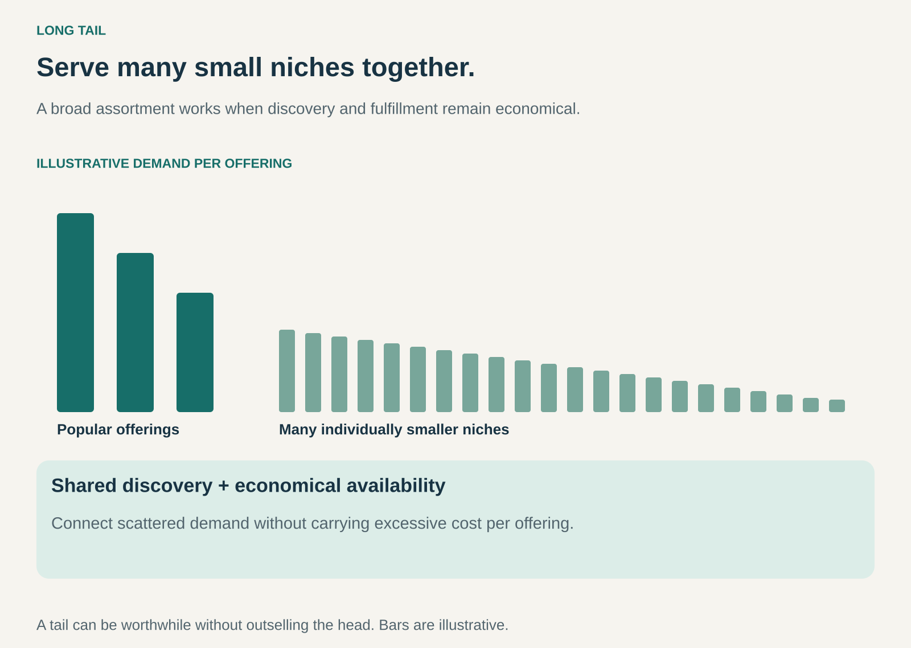

## What it is for

A specialist book may sell only a few copies each month. A local recording may have a small audience scattered across several countries. Neither needs to become a mass-market hit to be valuable to the people looking for it.

Long Tail makes it economical to serve many such niches together. It is useful when individual offerings attract limited demand, but a large, discoverable assortment can create a worthwhile business in aggregate.

The opportunity depends on the cost of making each additional offering available and helping the right customer find it.

## The core idea

**Combine many small sources of demand through a shared distribution and discovery system.**

Imagine a specialist publisher with a catalog of 2,000 technical manuals. A shop with limited shelf space may stock only the fastest sellers. An online catalog with print-on-demand fulfillment can keep less frequently requested titles available without holding a large finished inventory of every title.

The popular offerings form the head of the demand distribution. Numerous lower-demand offerings extend its tail. The pattern concerns serving that tail economically; it does not require the tail to outsell the hits.

## How it works

The business expands its assortment while controlling the cost of each listing, stocked unit, digital file, or supplier relationship. Digital delivery, centralized inventory, supplier fulfillment, and production after an order can each help, depending on the product.

Discovery is equally important. Clear descriptions, useful categories, search, recommendations, and specialist communities connect an unusual need with an appropriate offering. A hidden catalog entry creates little value simply by existing.

The business then earns through purchases, commissions, subscriptions, or another compatible arrangement. Long Tail describes the assortment and demand logic. It can combine with several different revenue models.

## Why it works

Customers with uncommon needs are often spread across locations. A shared distribution system can bring that demand together. The same publishing, payment, search, or delivery infrastructure can serve many products, spreading some costs across the whole assortment.

An additional niche offering becomes attractive when its expected contribution exceeds the additional cost of keeping it available. A digital file may have low reproduction costs, but rights, moderation, support, and discovery still require work. Physical products also carry inventory, handling, and return costs.

Depth can improve the customer's reason to visit: the business becomes a place where unusual requirements are worth searching for. That advantage depends on finding useful results rather than confronting customers with an undifferentiated mass of listings.

## Famous examples

### Amazon — lower-volume books through print on demand

In 2006, Amazon announced a BookSurge program explicitly intended to make lower-volume titles economical to supply. Books could be printed in response to orders, including out-of-print titles and new books with limited demand.

This historical example connects breadth with a specific operating mechanism: production after an order reduces the need to maintain finished inventory for each slow seller. It does not make editing, printing, or delivery costless. [Amazon's print-on-demand announcement](https://press.aboutamazon.com/2006/5/amazon-com-introduces-print-on-demand-program-for-book-publishers-program-lowers-economic-barriers-for-publishers-while-increasing-selection-for-amazon-com-customers)

### Netflix DVD — discovery across a broad catalog

Netflix's 2009 annual report described using recommendations and merchandising to create demand across its library, including older titles. Its DVD service combined a searchable catalog with centralized distribution rather than requiring every local shop to stock the same selection.

This is a historical DVD example. Netflix shipped its final DVDs in September 2023. The example explains assortment and discovery, without assuming that today's streaming rights or catalog economics are identical. [Netflix's 2009 annual report](https://www.sec.gov/Archives/edgar/data/1065280/000119312510036181/d10k.htm), [the DVD service's conclusion](https://about.netflix.com/en/news/thanks-for-watching)

### Bandcamp — specialist audiences connected to artists

Bandcamp combines an online record store with artist pages and music discovery. Fans can purchase recordings and merchandise directly in support of particular artists or labels, including work outside mainstream distribution.

Through this pattern's lens, the useful feature is the shared infrastructure connecting many distinct audiences with many distinct catalogs. Bandcamp's business also uses revenue sharing. Its existence does not imply that every listed artist earns a sustainable living or that all sales come from niche recordings. [About Bandcamp](https://bandcamp.com/about)

## The economics

Consider a fictional digital catalog of 10,000 specialist items. Suppose each produces an average of two purchases annually, with $4 remaining per purchase after creator payments and transaction costs.

That produces 20,000 purchases and $80,000 of contribution before catalog maintenance. If maintaining each listing costs $3 annually, the assortment costs $30,000 to maintain, leaving $50,000 before shared search, technology, marketing, overhead, and tax.

If the average falls to one purchase per item, contribution falls to $40,000 while listing maintenance remains $30,000. The remainder shrinks to $10,000. Assortment size alone therefore says little about profitability. Actual demand, margin, and maintenance determine the result.

These invented averages explain the mechanism. Real sales are unevenly distributed, and some items may never sell.

## Useful when

- Many customers have uncommon needs that are difficult to serve locally.
- Additional offerings can be made available at manageable incremental cost.
- Search, recommendations, or specialist knowledge can connect demand with supply.
- Rights, supplier coordination, quality, and fulfillment remain workable across the assortment.

## Common mistakes and limits

Treating breadth as sufficient is the central mistake. A large assortment without discovery can increase confusion and operating cost. Duplicate listings, weak descriptions, and unreliable suppliers can make the catalog less useful as it grows.

Do not assume that low demand means low competition, or that a larger tail guarantees more profit than a small set of hits. Some markets remain strongly concentrated around popular products. Each additional category may also introduce new expertise and support requirements.

Long Tail can serve very specific demand, but it cannot create demand for every offering. The business needs a reason to retain items whose commercial or strategic value is uncertain.

## Related patterns

[[curation|Curation]] helps customers find relevant items within a broad assortment. [[marketplace|Marketplace]] can distribute the work of supplying that assortment across independent sellers. [[demand-driven-production|Demand-Driven Production / From Push to Pull]] can reduce inventory exposure for slow-moving products. [[broad-assortment-retail|Broad-Assortment Retail / Supermarket]] emphasizes consolidated selection and shopping convenience; Long Tail focuses on the economics of numerous small niches.
