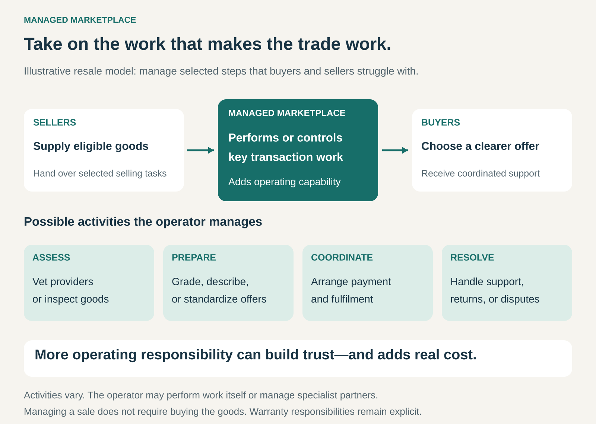

## What it is for

Buyers and sellers can find one another, yet transactions still fail because too much work remains.

A seller struggles to photograph, price, and ship a valuable item. A buyer cannot assess its condition. A service provider has the skills but lacks consistent scheduling, equipment, or customer support.

A Managed Marketplace takes on selected parts of that work. It combines access to independent supply with operating capabilities that make transactions easier and more dependable.

The proposition is: **we help you trade, and we manage important parts of making the transaction work.**

## The core idea

Move beyond providing a venue by performing or actively controlling significant transaction activities.

The operator might inspect goods, select providers, prepare listings, define service packages, coordinate fulfilment, or handle problems after purchase.

“Managed” describes a degree of operational involvement. Every marketplace needs rules and administration; a managed marketplace goes further into work that participants would otherwise have to organize themselves.

It does not have to manage every step. Nor must the operator perform everything through its own employees. Specialist partners can deliver parts of the service under agreed processes.

The central design question is: **which responsibilities should the operator take on because doing so materially improves the exchange?**

## How it works

Consider a resale marketplace for valuable goods.

In a largely self-service arrangement, the seller prepares the description, supplies photographs, determines condition, handles delivery, and responds to questions.

A managed version might receive the item, inspect it, create a standardized description, set or recommend a price, arrange shipping, and coordinate returns.

The seller contributes the goods while handing over selected selling tasks. The buyer receives a more consistent offer and a clearer process for addressing problems.

A service marketplace can apply the same principle differently: vet providers, support training, define service scope, coordinate appointments, and manage customer complaints.

The operator needs both a customer-facing promise and a system capable of delivering it. Checklists, training, specialist judgment, scheduling, performance monitoring, and exception handling become part of the product.

Responsibilities also need clear boundaries. Managing a warranty process is different from providing the warranty. Inspecting an item is different from guaranteeing that no defect can escape detection.

## Why it works

Markets often contain useful supply that buyers struggle to evaluate or purchase confidently.

A capable operator can reduce that uncertainty by applying repeatable standards and supplying expertise that individual participants lack.

Sellers may also value convenience. Someone with a valuable item might accept a smaller payout in exchange for avoiding photography, pricing, shipping, and customer communication.

For buyers, consistent descriptions and coordinated support can make unfamiliar sellers easier to transact with.

The resulting benefit can extend beyond convenience. Better preparation can improve comparability; better scheduling can reduce failed appointments; better inspection can identify problems before delivery.

However, these improvements require real work. The model succeeds when the value created by managing the transaction exceeds the cost of doing so.

## Famous examples

### The RealReal: managing the luxury resale process

The RealReal describes a consignment process that includes authentication, photography, measurements, listing preparation, pricing, shipping, and customer service.

Under its consignment arrangement, owners retain ownership after handing over items, subject to the agreement’s provisions. The company also offers separate outright purchase and trade-in options. [The RealReal selling process](https://www.therealreal.com/sell-trr), [consignment and sales agreement](https://www.therealreal.com/consignor_terms)

The managed element is the substantial operating work between receiving an item and completing its sale.

The ownership arrangement is a separate question. Handling, pricing, and selling a product does not itself require buying it first.

The transferable lesson is that managing the transaction can remove enough work from sellers to become a central reason they participate.

### Back Market: managing standards across independent refurbishers

Back Market connects buyers with professional sellers of refurbished electronics. Its published approach includes seller selection, ongoing performance assessment, standardized condition grades, and mechanisms for choosing offers.

Its US guidance also describes a return period and a limited warranty provided by the seller. [Back Market’s explanation of its operating model](https://help.backmarket.com/en-us/articles/844979-is-back-market-legit)

This demonstrates management through standards and oversight, rather than requiring the marketplace to refurbish every device itself.

The distinction matters: the operator shapes the buying experience, while sellers retain important delivery and warranty responsibilities.

The lesson is that a managed marketplace can coordinate a distributed supply network, provided standards are meaningful, performance is monitored, and responsibilities remain understandable.

### Urban Company: supporting consistent service delivery

Urban Company’s published service-professional programme describes training, operating procedures, access to tools and products, scheduling systems, feedback, retraining, and customer grievance processes.

Service professionals perform the work, while the platform invests in capabilities intended to make that work more consistent and reliably scheduled. [Urban Company’s service-professional programme](https://investorrelations.urbancompany.com/announcements-and-highlights/service-professional-enablement)

The managed component extends beyond introducing a customer to an available professional. It reaches into preparation, delivery methods, and the handling of unsatisfactory experiences.

This illustrates a recurring tradeoff: greater consistency can require more coordination and constraints on how participants work.

The operating model therefore needs to remain attractive to providers as well as customers.

## The economics

A managed marketplace can earn through commissions, service fees, or bundles of transaction services.

Its additional work may justify higher compensation, but a higher fee does not automatically produce a better margin.

Suppose a hypothetical marketplace retains **$25 from a $100 sale**. If assessment, handling, payment, support, and expected problem-resolution costs total **$21**, only **$4** remains before customer acquisition and fixed overhead.

These are illustrative figures, not company rates.

Costs also arise before a successful sale. Rejected goods, unsold items, unsuccessful bookings, and provider training can consume resources without producing transaction income.

Operational density can help. Concentrating activity in suitable locations or categories may improve staff utilization, collection routes, inspection throughput, and scheduling.

Standardization can reduce repeated decisions, while specialist judgment remains necessary for unusual cases.

Useful measures include contribution per completed transaction, handling cost per accepted item, rework, returns, time to fulfil, repeat purchasing, and provider retention.

## Useful when

- Buyers face substantial uncertainty about quality, condition, or delivery.
- Sellers struggle with preparation, logistics, or administration.
- Transactions involve enough value to support meaningful operating work.
- Repeatable processes can improve consistency.
- The operator can influence the causes of failed transactions.
- Customers or providers will pay for reduced effort and uncertainty.
- A focused category or geography can support efficient operations.

## Common mistakes and limits

**Adding services without identifying the obstacle.** More intervention is not automatically valuable. The managed steps should address problems that materially prevent or weaken transactions.

**Promising consistency without operating control.** A uniform presentation cannot compensate for processes the operator cannot monitor or influence.

**Treating inspection as infallible.** Authentication, testing, and provider selection reduce particular risks. They do not establish that mistakes or later failures are impossible.

**Ignoring unsuccessful transactions.** Attractive margins on completed sales can conceal expensive intake, rejected supply, cancellations, and returns.

**Standardizing away the value of the supply.** Independent providers may contribute distinctive expertise or methods. Excessive uniformity can weaken what customers wanted.

**Leaving the customer between organizations.** A coordinated buying experience loses credibility when a problem produces conflicting instructions from the marketplace, seller, and logistics partner.

**Confusing management with ownership.** Buying goods outright introduces inventory and resale exposure. That is an additional commercial choice, rather than a requirement of managing marketplace transactions.

## Related patterns

[[marketplace|Marketplace]] provides the underlying trading environment. Managed Marketplace adds a deliberate layer of operating work around selected transaction stages.

[[consignment|Consignment]] defines an arrangement for ownership and selling goods. It can support a managed resale marketplace, while leaving the operator’s service scope to be specified separately.

[[curation|Curation]] selects and presents suitable offers. Managed Marketplace can extend that selection into preparation, fulfilment, and resolution.

[[solution-provider|Solution Provider]] takes responsibility for a broader customer problem. A managed marketplace can move in that direction while continuing to draw on independent providers or sellers.
