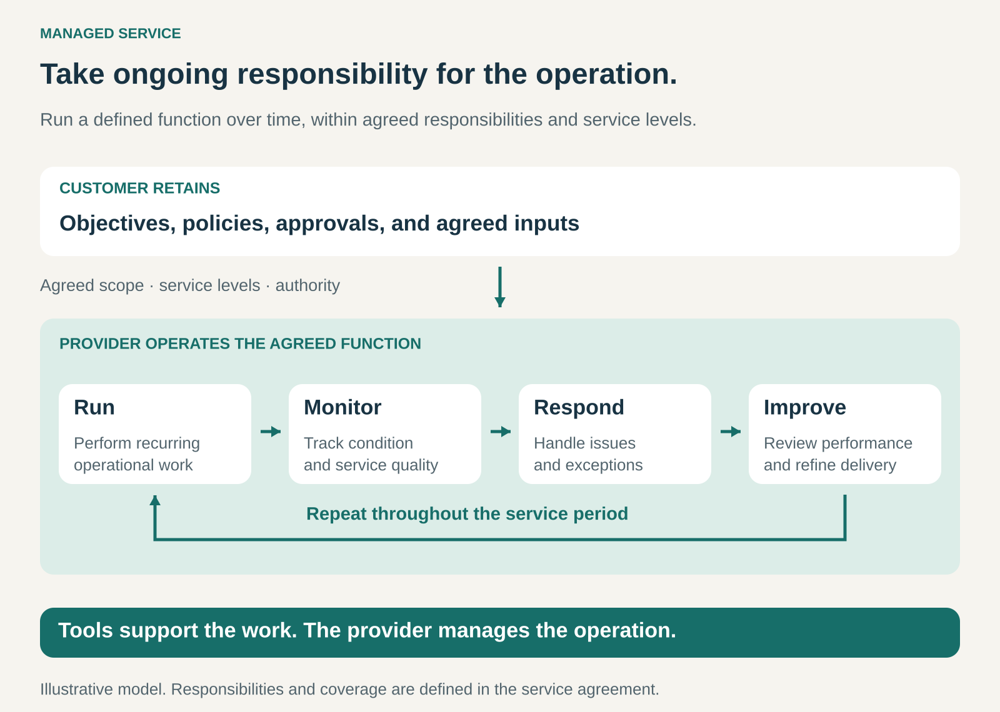

## What it is for

Keep an important business function running without managing every recurring task, maintenance activity, and operational problem internally.

Buying software, equipment, or expert advice still leaves work to do. Someone must operate the system, check its condition, handle exceptions, and make sure routine activities happen on time.

Managed Service is useful when a customer wants a provider to take ongoing responsibility for a defined part of that work.

Examples include managing cloud infrastructure, processing payroll, or maintaining a company’s printing environment. The customer buys continuing operational delivery, supported by agreed responsibilities and service levels.

## The core idea

**Take responsibility for operating a defined function over time, with the people, processes, and tools needed to manage it.**

The provider organizes the work within an agreed scope. That can include scheduled activities, monitoring, maintenance, incident handling, reporting, and improvement.

The customer continues to set business priorities and retains specified decisions, approvals, and responsibilities.

For example, a managed payroll provider may organize payroll processing and resolve processing exceptions. The customer still needs to supply accurate employee information, approve relevant changes, and provide funding.

The defining feature is the provider’s continuing operational role. A monthly invoice alone does not establish a managed service.

## How it works

**1. Establish the service boundary.**

Both parties need to understand what the provider manages.

For infrastructure, that might cover specified servers and operating systems while excluding application development. For payroll, it might cover agreed processing activities while leaving compensation decisions with the customer.

The boundary also identifies supported locations, systems, volumes, and operating hours.

**2. Prepare the operation for ongoing management.**

The provider needs access, documentation, baseline information, and a workable handover.

Existing problems may require remediation before normal service begins. Unreliable equipment, incomplete records, or unsupported software can make the operating commitment difficult to fulfill.

Onboarding is therefore part of the delivery model, with its own work and costs.

**3. Agree service levels and decision authority.**

The agreement describes expected performance, how it is measured, and what happens when problems occur.

Measures might concern processing deadlines, availability, response times, or completion quality. A response commitment and a restoration commitment mean different things: acknowledging a problem within thirty minutes does not promise to fix it within thirty minutes.

The provider also needs clear authority to act. Some interventions can happen automatically; others require customer approval.

**4. Operate, review, and adapt.**

The provider performs recurring work, checks relevant conditions, handles issues, and reports on performance.

Regular reviews examine recurring failures, changing demand, and necessary improvements. When the customer adds systems, locations, employees, or transaction volume, the service scope and price may need adjustment.

The arrangement needs to remain workable as the operation changes.

## Why it works

**Operational work receives continuing attention.** Tasks that are easy to postpone internally can become scheduled responsibilities.

**Specialist capabilities can be shared.** A provider may use common tools, methods, and expert teams across several customers, while maintaining appropriate separation between their environments and information.

**The customer gains a defined operating arrangement.** Responsibilities, escalation routes, and performance measures become more explicit.

**Prevention can benefit both sides.** Where the commercial model rewards reliable delivery, reducing recurring incidents can improve the customer’s experience and the provider’s economics.

**Internal teams can concentrate elsewhere.** They may spend less time coordinating routine operations and more time on business priorities.

These benefits depend on service quality and clear responsibilities. The customer still needs enough oversight to judge performance and make decisions the provider cannot make.

## Famous examples

### Rackspace — ongoing management of supported cloud servers

Rackspace’s documented Managed Operations service level includes monitoring, operating-system and supported application-infrastructure assistance, regular patching, and updates. Its team responds proactively to monitoring alerts, with round-the-clock support available under that service level. [Rackspace Managed Operations](https://docs.rackspace.com/docs/managed-operations)

The example illustrates the difference between providing computing infrastructure and undertaking work to operate it.

The commitment has boundaries: the documentation specifies supported technologies and monitoring coverage. It should not be read as a promise to manage every component of a customer’s technology environment.

### Xerox — managing the printing environment

Xerox describes managed print capabilities that include monitoring device status, handling supplies management, collecting meter information, and supporting incident processes. Its tools also provide information about fleet health, usage, and opportunities for improvement. [Xerox Managed Print Services capabilities](https://www.xerox.com/downloads/usa/en/services/brief/Managed-Print-Services-Capabilities-ENUS.pdf)

Customers receive continuing management of the printing operation, extending beyond the purchase of printers.

The example combines equipment, monitoring, service processes, and operational information within an ongoing arrangement. The particular combination depends on the contracted service.

### ADP — managed payroll administration

ADP Comprehensive Services combines designated professionals, processes, and technology. Its payroll offering covers substantial administration and processing work, including specified reporting and tax-administration activities. Customers can select which functions to outsource. [ADP Comprehensive Services](https://www.adp.com/what-we-offer/products/adp-comprehensive-services.aspx)

This shows how managed services can cover a recurring business process rather than physical equipment or technical infrastructure.

ADP also distinguishes this offering from its co-employment product: under Comprehensive Services, the customer remains the employer of record. Delegating administration does not automatically transfer every employer responsibility.

## The economics

Managed services commonly use recurring charges, sometimes adjusted for users, devices, locations, transactions, or service coverage. Onboarding and major changes may be priced separately.

The provider must fund normal delivery and enough capacity to handle variation.

Consider a hypothetical monthly service:

| Item                                                 |     Amount |
| ---------------------------------------------------- | ---------: |
| Customer service fee                                 |    $10,000 |
| Routine delivery labor                               |    −$6,000 |
| Tools and third-party delivery costs                 |    −$1,500 |
| Budgeted incident and rework costs                   |      −$500 |
| Contribution before sales costs and central overhead | **$2,000** |

If incident costs exceed the budget by $2,500, the contribution becomes a $500 loss before central overhead.

That makes reliable onboarding, prevention, capacity planning, and scope control economically important.

A recurring fee also needs clear inclusions. Software licenses, infrastructure consumption, replacement equipment, or major projects may sit outside it.

For the customer, the comparison includes retained oversight and transition costs alongside the provider’s fee. An ongoing contract does not by itself establish that the service is cheaper than internal operation.

## Useful when

- **The work is ongoing.** Recurring execution and maintenance matter more than a single deliverable.
- **Specialist expertise is needed repeatedly.** Maintaining sufficient internal coverage would be difficult or expensive.
- **The function can be delegated clearly.** Responsibilities, access, authority, and performance expectations can be defined.
- **Continuity matters.** The customer needs dependable coverage beyond the availability of one individual.
- **The customer wants operational delivery.** Access to tools or occasional advice would leave too much work internally.

## Common mistakes and limits

**Leaving responsibilities ambiguous.** Failures often occur where each party assumes the other owns a task, approval, or dependency.

**Buying a service level that measures the wrong thing.** Fast ticket responses can coexist with slow restoration or repeated operational failures.

**Giving responsibility without authority.** A provider cannot manage effectively if every routine action waits for an unavailable approver.

**Treating coverage as unlimited.** New systems, increased volume, unsupported equipment, and major projects can substantially change the workload.

**Underfunding onboarding.** Problems inherited at the start can dominate delivery costs and service quality.

**Losing internal understanding.** Customers still need someone able to assess performance, set priorities, and make informed decisions.

**Neglecting transition and exit arrangements.** Documentation, access, data, and handover procedures affect whether another team can take over successfully.

The pattern is harder to operate when responsibilities change constantly, the customer cannot provide reliable inputs, or essential decisions cannot be delegated or made promptly.

## Related patterns

- [[productized-service|Productized Service:]] defines a repeatable service offering. A managed service can be productized through standard scope, coverage, and operating methods.
- [[retainer|Retainer:]] pays for continuing access or capacity. A managed service adds responsibility for running agreed activities.
- [[subscription|Subscription:]] defines recurring payment. Managed Service defines the provider’s operational role.
- [[product-as-a-service|Product as a Service:]] provides ongoing access to a product’s function. It can incorporate managed operation, although a managed service can also cover customer-owned assets or administrative processes.
