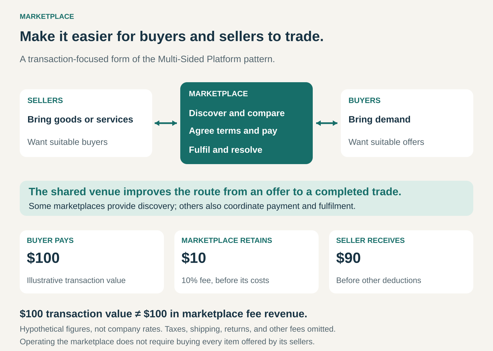

## What it is for

Buyers want suitable offers without searching dozens of separate suppliers. Sellers want access to customers without building an audience for every product or service they provide.

A Marketplace brings those fragmented offers and needs into a shared trading environment.

Its value comes from helping participants discover one another, compare options, agree terms, and complete an exchange with enough confidence to return.

The proposition is: **we make it easier for buyers and sellers to trade.**

## The core idea

Organize transactions between participants rather than supplying every offering yourself.

Sellers contribute goods, services, or access to assets. Buyers contribute demand. The marketplace provides the trading environment and earns money through services associated with participation or exchange.

A Marketplace is a **transaction-focused form of a Multi-Sided Platform**. The broader pattern includes other kinds of interaction; this one focuses on buying, selling, hiring, or renting.

The operator generally does not purchase every item before offering it to customers. However, a business can combine marketplace activity with its own retail operations.

Marketplaces can also differ substantially in their involvement. Some primarily support discovery and negotiation. Others coordinate payments, delivery, verification, returns, and disputes. They can operate online, physically, or across both settings.

## How it works

The marketplace helps participants move through several stages.

First, sellers make their offers understandable. Listings describe what is available, its price or pricing method, relevant conditions, and who is providing it.

Buyers then discover and compare suitable options. Search, categories, availability filters, seller histories, and reviews can reduce the work involved.

Next comes commitment: a purchase, accepted proposal, winning bid, or booking.

Finally, the exchange must be fulfilled. Goods arrive, services are delivered, or access is provided. Payment, acceptance, returns, and disputes may require further coordination.

Different markets need different mechanisms. Buying a replacement component requires accurate specifications and availability. Hiring a designer requires a credible portfolio, a clear scope, and a way to assess the work.

The strongest marketplace design reflects the transaction it is trying to enable.

## Why it works

A shared venue can make a fragmented market easier to navigate.

Buyers gain access to more relevant supply. Sellers reach customers who already have an intention to purchase. Common information and transaction processes reduce the effort of dealing with unfamiliar counterparties.

Trust can also become partly portable. A seller’s transaction history helps the next buyer assess an offer, while shared payment and dispute processes can reduce uncertainty.

These benefits depend on the quality of the market. More listings can improve choice, but they can also create clutter. More buyers can attract sellers, but sellers need realistic opportunities to win business.

The important condition is **liquidity**: how readily a suitable buyer and seller can find one another and complete a trade.

A focused marketplace with reliable activity can therefore be more useful than a broad one with many inactive or unsuitable listings.

## Famous examples

### eBay: several ways to reach an agreed price

eBay supports trading between third-party sellers and buyers using different formats, including auction-style and fixed-price listings. Its user agreement distinguishes the marketplace from the contracts for sale between those participants. [eBay user agreement](https://www.ebay.com/help/policies/member-behaviour-policies/useb-agreement?id=4259), [eBay selling formats](https://pages.ebay.com/ebaymotors/help/sell/contextual/inframe/selling-format.html)

The marketplace accommodates different pricing situations. A seller can specify an asking price or invite bidding where the final price is uncertain.

Its published US selling-fee structure includes listing-related charges and final-value fees, with allowances and exceptions. [eBay selling fees](https://www.ebay.com/help/selling/fees-credits-invoices/x?id=4822)

The transferable lesson is that a marketplace needs a workable way to establish agreement. The right pricing format depends on the goods, participants, and information available.

### Etsy: organizing a market around a distinctive category

Etsy connects buyers with independent sellers under defined creativity standards. Eligible items fall into categories reflecting the seller’s role, including making, designing, handpicking, or sourcing permitted goods. It is broader than a marketplace exclusively for objects handmade by their seller. [Etsy creativity standards](https://www.etsy.com/legal/creativity/)

That scope gives the marketplace a recognizable identity and establishes expectations about what belongs there.

Etsy also illustrates how several revenue mechanisms can coexist. Its fee structure includes listing, transaction, and payment-processing charges, alongside optional services and other applicable fees. [Etsy fee basics](https://help.etsy.com/hc/en-us/articles/360035902374-Etsy-Fee-Basics/)

The lesson is that a marketplace’s boundaries are part of its product. Which offers it permits—and how consistently it applies those rules—affects why buyers and sellers choose it.

### Upwork: structuring transactions for services

Upwork connects clients with freelancers and agencies, supporting both hourly work and fixed-price projects.

For fixed-price work, milestones can define deliverables, dates, and budgets. Clients fund milestones before work begins, and the platform provides a review and payment-release process. Hourly arrangements use a different billing structure. [Upwork hiring process](https://support.upwork.com/hc/en-us/articles/211063398-How-to-start-hiring-on-Upwork), [fixed-price payment process](https://support.upwork.com/hc/en-us/articles/211063718-How-payments-for-milestones-and-fixed-price-contracts-work)

The transaction is more complex than transferring a finished object. Scope, progress, acceptance, and payment all need coordination.

Upwork shows how a marketplace can become more useful by supporting the work surrounding the agreement, rather than ending its contribution when two participants meet.

## The economics

A marketplace can earn through transaction commissions, listing fees, seller subscriptions, promoted placement, payment services, or fulfilment.

These mechanisms create different incentives. Transaction fees depend on successful trade. Listing fees can generate income before a sale, but sellers still need a reasonable prospect of earning a return.

In the graphic’s hypothetical transaction, the buyer pays **$100**. The marketplace retains **$10**, leaving **$90 payable to the seller** before other deductions.

The $10 is fee revenue, not profit. It must help cover acquisition, payment costs, support, fraud losses, technology, and administration. The seller’s $90 must cover its own costs.

Transaction value should therefore remain distinct from marketplace earnings.

Useful operating measures include conversion, time to sale or hire, fulfilment success, repeat purchasing, seller retention, and contribution after transaction-related costs.

A high commission is difficult to sustain if participants receive little continuing value. Conversely, a low fee can still be uneconomic if each transaction requires extensive intervention.

## Useful when

- Supply is distributed across many independent providers.
- Buyers face meaningful difficulty finding or comparing offers.
- Sellers benefit from access to concentrated purchasing demand.
- Offers can be described well enough to support selection.
- Shared processes can improve trust or transaction completion.
- A focused initial category or location can support regular trading.
- Fees can cover the cost of operating the market.

## Common mistakes and limits

**Equating listings with usable supply.** Outdated availability, misleading descriptions, and unresponsive sellers make an apparently large marketplace frustrating.

**Expanding before establishing reliable trade.** Adding categories creates new matching problems. Success in one area does not automatically supply buyers or sellers for another.

**Competing only on traffic.** Visits create little value when buyers cannot find appropriate offers or sellers cannot convert interest into sales.

**Letting paid visibility undermine relevance.** Advertising can generate revenue, but poor search results weaken the reason buyers visit.

**Ignoring seller economics.** Fees, advertising costs, fulfilment obligations, and returns can leave sellers with unattractive margins even while transaction volume grows.

**Assuming participants will always stay.** Buyers and sellers may use competing marketplaces or continue directly after meeting. Useful ongoing services help justify the marketplace’s role.

**Leaving responsibility unclear.** Participants need to understand who supplies the offering, who handles problems, and what support the marketplace actually provides.

## Related patterns

[[multi-sided-platform|Multi-Sided Platform]] is the broader organizing principle. Marketplace applies it specifically to transactions between buyers and sellers.

[[auction|Auction]] is one method of determining price and allocating an offering. A marketplace can support auctions alongside fixed prices or negotiated agreements.

[[curation|Curation]] improves the relevance and quality of available offers. It can create a distinctive marketplace without requiring the operator to supply the goods itself.

[[consignment|Consignment]] establishes an ownership and selling arrangement for goods. A marketplace can offer consignment services, but operating a marketplace does not itself require taking custody of sellers’ inventory.
