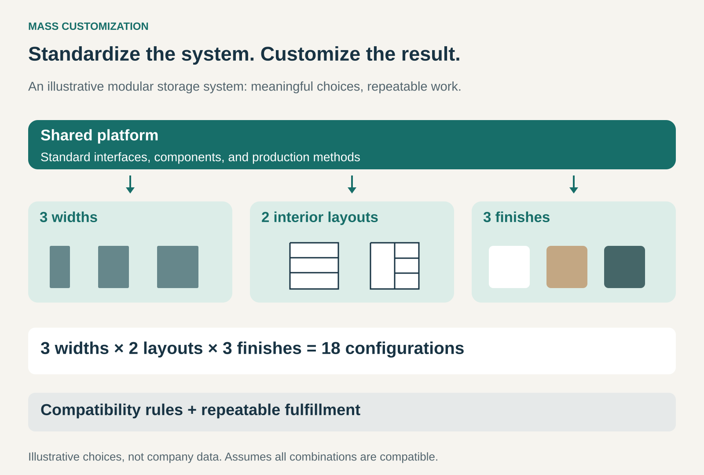

## What it is for

Use this pattern when customers want meaningful differences in an offering, but designing and producing every order from scratch would be too expensive or slow.

Two customers need storage for different spaces. One wants drawers for folded clothes; another needs hanging space and shelves. A single standard wardrobe may suit neither particularly well.

A business can meet those differences through a shared system of frames, fittings, finishes, and configuration rules.

Mass Customization creates customer-specific results through repeatable methods. It aims to preserve much of the efficiency of standardized production while allowing variation that customers value.

## The core idea

Standardize the underlying system and define where it can vary.

The business creates common components, interfaces, processes, or design rules. Customers—or staff working from their requirements—select compatible combinations.

Variation might concern appearance, dimensions, functionality, fit, or the mix of services provided.

The essential work happens before individual orders arrive: designing a system that can produce different results reliably.

Bespoke work can involve solving a new design problem for each customer. Mass Customization moves much of that problem-solving into a reusable architecture, so each order becomes a manageable configuration.

The customer receives something adapted to their needs without every element becoming unique.

## The graphic

A relatively small set of choices can generate many combinations.

The multiplication describes possible configurations, not operational simplicity. Every combination still needs to be valid, available, and practical to deliver.

## How it works

**A common platform carries the shared work.** Components and processes used across many orders spread development effort and support repeatable production.

**Defined options provide meaningful variation.** Customers choose along dimensions where their preferences or requirements actually differ.

**Rules keep combinations workable.** A configurator, trained salesperson, or engineering system checks compatibility, dependencies, dimensions, and availability.

**Fulfillment translates choices into instructions.** The selected configuration becomes an accurate parts list, production specification, assembly plan, or service arrangement.

Final assembly may happen in a factory, store, or customer’s home. The business can also customize an existing product through finishing or printing.

The pattern depends on controlled variation, rather than one particular manufacturing location or ordering interface.

## Famous example: Nike By You

Nike By You lets customers adapt selected shoe models using curated colors, materials, and other design options. Its digital builder updates a visual representation as choices change, and some styles support a personal message. [Nike: What Is Nike By You?](https://www.nike.com/gb/help/a/what-is-nike-by-you)

The customer works within a defined shoe platform and a permitted set of variations.

This illustrates customization for appearance and personal expression. Nike provides the design boundaries; the customer decides how to use them.

Those boundaries also explain the limits. Selecting colors and materials does not make the shoe individually engineered for the customer’s foot. Many characteristics remain determined by the underlying model.

The commercial opportunity comes from offering personal relevance through a production system capable of handling the approved variations.

## Famous example: Dell’s classic build-to-order model

Dell’s classic model allowed customers to specify computer configurations that the company assembled through a repeatable manufacturing process.

Its historical reporting describes build-to-order production involving assembly, functional testing, and quality control, designed to produce customized systems while managing inventory exposure. [Dell: Manufacturing and Build-to-Order](https://www.sec.gov/Archives/edgar/data/826083/000095013400003430/0000950134-00-003430-d1.html)

The customization concerns capability. A customer might need a different combination of memory, storage, and processing performance within the available platform.

The underlying logic is modular: shared components support different finished systems.

The difficult work includes translating the order accurately, maintaining component availability, and testing the selected configuration. More combinations create more dependencies to manage.

This is a historical example of the model, rather than a description of every Dell product sold today.

## Famous example: IKEA PAX

IKEA’s PAX system combines wardrobe frames and doors with KOMPLEMENT interior organizers. Customers can use a planner to develop a configuration suited to their space and storage needs. [IKEA: PAX Wardrobe System](https://www.ikea.com/us/en/cat/pax-system-19086/)

The buying guide explains how customers can combine components or modify suggested solutions by adding and removing interior organizers. [IKEA: PAX and KOMPLEMENT Guide](https://www.ikea.com/us/en/files/pdf/2c/79/2c7917e9/pax_new_july_11_2024a-digital.pdf)

This demonstrates customization through standardized modules that can be assembled into different results.

The business does not need to manufacture a completely unique wardrobe for every household. Much of the variety appears in the combination of available parts.

The tradeoff is dimensional and structural constraint. Customers configure within the system’s available sizes and compatibility rules. Rooms and requirements outside those boundaries may still need bespoke work.

## The business model

Customers may pay for a closer match to their needs, personal expression, or the ability to avoid unwanted features.

The business can charge a customization premium, price individual components, or use customization as part of its standard proposition.

Customization can also strengthen differentiation. A customer compares how well the configured result serves them, alongside price and general product quality.

The configuration experience becomes part of the offering. Customers need understandable choices, useful defaults, reliable previews, and a clear total price.

A large option menu provides little benefit if customers cannot tell which combination will work.

## The economics

Mass Customization aims to reuse expensive work while varying selected parts of the result.

Common components can support larger purchasing volumes and serve several possible configurations. Delaying final assembly or finishing can reduce the need to stock every finished variant.

However, variety creates costs elsewhere: component inventory, changeovers, configuration software, testing, order checking, documentation, and support.

A customized product may also be harder to resell after a return.

The useful comparison is the additional customer value and revenue against the full cost of accommodating variation. A popular option may justify its complexity; a rarely chosen option can consume disproportionate effort.

Mass Customization does not guarantee the same cost or delivery time as a single standard product. Its advantage comes from making relevant variation repeatable and economically manageable.

## Useful when

This pattern is especially useful when customers differ along identifiable dimensions and those differences can be served through a stable system.

It fits modular products, configurable equipment, selected personal designs, and services assembled from repeatable elements.

It is strongest when customers can express their requirements—or receive help doing so—and the business can verify the resulting configuration before committing to fulfillment.

It fits less well when every order requires extensive new engineering, preferences are difficult to translate into specifications, or the added variation offers little customer value.

## Common mistakes and limits

**Maximizing the number of options.** More combinations can increase complexity without improving the match. Choices need a purpose.

**Confusing variety with customization.** A large catalog offers selection. Mass Customization uses a repeatable system to configure or adapt an offering for particular requirements.

**Allowing invalid combinations.** Compatibility checking belongs in the process before production or ordering creates costly mistakes.

**Making customers act as engineers.** Technical freedom needs guidance, examples, defaults, or recommendations.

**Ignoring the order-to-delivery connection.** An attractive configurator creates problems if its promises do not match production capabilities and available components.

**Assuming every customer wants to configure.** Ready-made combinations can provide a useful starting point, with customization available where it matters.

## Related patterns

[[demand-driven-production|Demand-Driven Production / From Push to Pull]] determines when production is authorized. Mass Customization determines how the offering varies for the customer.

**Postponement** delays final differentiation until requirements are clearer. It can make customization easier to support economically.

[[core-plus-add-ons|Core plus Add-Ons]] lets customers extend a common offering. Mass Customization can also change the configuration of the core itself.

[[solution-provider|Solution Provider]] integrates capabilities around a customer’s problem. A modular customization system can help deliver that solution repeatedly.
